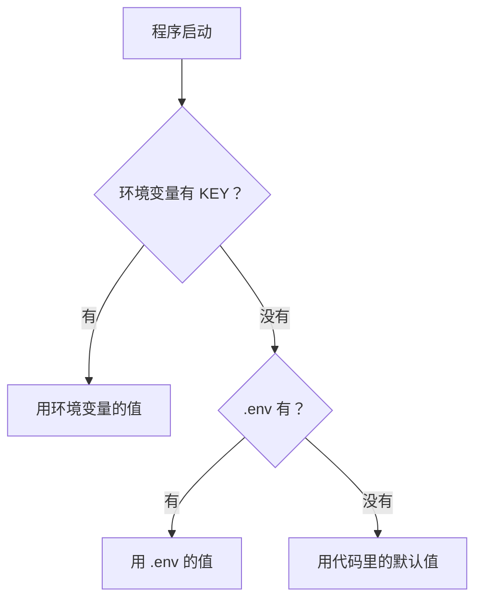

# PY-052 环境变量与配置文件

## 1. 知识概览

| 项 | 内容 |
|---|---|
| 知识 ID | `PY-052` |
| 所属模块 | M-PY-06 Python 进阶与工程实践 |
| 学习难度 | L2 初级 |
| **预计学习时间** | 40 分钟 |
| 前置知识 | [[PY-048 数据持久化方案]] |
| 学习目标 | 会用 `os.environ` 读环境变量、会读 JSON/`.env` 配置、知道密钥不能写进代码 |

## 2. 通俗原理讲解

配置分两类：

- **会变的、跟机器相关的**：数据库地址、端口、密钥 → 放**环境变量**。
- **相对固定的、结构化的**：功能开关、阈值、界面设置 → 放**配置文件**。

**为什么不能把密钥写进代码**：

- 代码会进 Git，一提交就等于公开。
- 换环境要改代码，容易漏。

**原则**：代码里只写"从环境变量读"，具体值由运行环境注入。

## 3. 技术原理

| 方式 | 读取 | 适用 |
|---|---|---|
| 环境变量 | `os.environ.get("KEY", 默认)` | 密钥、机器相关配置 |
| `.env` 文件 | 自己解析或装 `python-dotenv` | 本地开发方便 |
| JSON | `json.load` | 结构化配置 |
| TOML | `tomllib.load` | 现代项目配置 |

**优先级建议**：环境变量 > `.env` > 配置文件默认值。这样部署时不用改文件。

**注意**：`os.environ["KEY"]` 键不存在会抛 `KeyError`；用 `.get()` 更安全。

## 4. 图解辅助



## 5. 完整代码示例

```powershell
python config_demo.py
```

```python
import json
import os
from pathlib import Path

os.environ["DEMO_MODE"] = "dev"
print(os.environ.get("DEMO_MODE", "未设置"))
print(os.environ.get("NOT_EXISTS", "默认值"))

cfg = Path("config.json")
cfg.write_text(json.dumps({"mode": "prod", "debug": False}, ensure_ascii=False), encoding="utf-8")
data = json.loads(cfg.read_text(encoding="utf-8"))
print(data["mode"], data["debug"])
cfg.unlink()

env = Path(".env")
env.write_text("APP_PORT=8080\nAPP_HOST=127.0.0.1\n# 注释行\n", encoding="utf-8")

pairs = {}
for line in env.read_text(encoding="utf-8").splitlines():
    line = line.strip()
    if not line or line.startswith("#") or "=" not in line:
        continue
    k, v = line.split("=", 1)
    pairs[k.strip()] = v.strip()

print(pairs)
env.unlink()
```

**预期输出**

```
dev
默认值
prod False
{'APP_PORT': '8080', 'APP_HOST': '127.0.0.1'}
```

**说明**

- `os.environ.get(key, default)` 不会因缺键报错。
- 配置文件的布尔值读回来是真正的 `False`，不是字符串。
- 解析 `.env` 要跳过空行、注释行、不含 `=` 的行。

## 6. 实践练习

**基础**

1. 设置一个环境变量并读回，再读取一个不存在的键并给默认值。
2. 写一个 JSON 配置文件（含 host/port/debug），读回并打印。
3. 判断：把数据库密码写进代码有什么风险？

**进阶**

1. 写 `get_config()`：优先读环境变量，其次读 JSON，最后用默认值。
2. 手写一个 `.env` 解析器，支持 `#` 注释与首尾空格。

**综合实践**

写一个"应用启动配置"模块：从 `.env` 与 `config.json` 合并配置（环境变量优先），打印最终生效的 host/port/debug，并校验 port 在 1–65535。

## 7. 参考答案

**基础 1 · 思路**：`environ` 读写。

```python
import os
os.environ["MY_KEY"] = "abc"
print(os.environ.get("MY_KEY"))
print(os.environ.get("MISSING", "无"))
```

运行结果：

```
abc
无
```

**基础 2 · 思路**：`json` 读写。

```python
import json
from pathlib import Path
p = Path("c.json")
p.write_text(json.dumps({"host": "127.0.0.1", "port": 8000, "debug": True}), encoding="utf-8")
print(json.loads(p.read_text(encoding="utf-8")))
p.unlink()
```

运行结果：`{'host': '127.0.0.1', 'port': 8000, 'debug': True}`

**基础 3 · 思路**：进 Git 就泄露。

答案：版本库一旦推送，密码等于公开；改密码要改代码并重新部署。

**进阶 1 · 思路**：三级回退。

```python
import json, os
from pathlib import Path

DEFAULTS = {"host": "127.0.0.1", "port": 8000}

def get_config(path="config.json"):
    cfg = dict(DEFAULTS)
    p = Path(path)
    if p.exists():
        cfg.update(json.loads(p.read_text(encoding="utf-8")))
    if os.environ.get("APP_PORT"):
        cfg["port"] = int(os.environ["APP_PORT"])
    return cfg

print(get_config("不存在.json"))
```

运行结果：`{'host': '127.0.0.1', 'port': 8000}`

**进阶 2 · 思路**：逐行解析 + 过滤。

```python
def parse_env(text):
    out = {}
    for line in text.splitlines():
        line = line.strip()
        if not line or line.startswith("#") or "=" not in line:
            continue
        k, v = line.split("=", 1)
        out[k.strip()] = v.strip().strip("'\"")
    return out

print(parse_env("A=1\n# c\n B = 2 \n"))
```

运行结果：`{'A': '1', 'B': '2'}`

**综合实践 · 思路**：合并 + 校验。

```python
import json
from pathlib import Path

def load(env_file=".env", json_file="config.json"):
    cfg = {"host": "127.0.0.1", "port": 8000, "debug": False}

    jp = Path(json_file)
    if jp.exists():
        cfg.update(json.loads(jp.read_text(encoding="utf-8")))

    ep = Path(env_file)
    if ep.exists():
        for line in ep.read_text(encoding="utf-8").splitlines():
            line = line.strip()
            if not line or line.startswith("#") or "=" not in line:
                continue
            k, v = [x.strip() for x in line.split("=", 1)]
            if k == "APP_PORT":
                cfg["port"] = int(v)
            elif k == "APP_HOST":
                cfg["host"] = v
            elif k == "APP_DEBUG":
                cfg["debug"] = v.lower() in ("1", "true", "yes")

    if not (1 <= cfg["port"] <= 65535):
        raise ValueError("端口不合法")
    return cfg

Path(".env").write_text("APP_PORT=9000\nAPP_HOST=0.0.0.0\nAPP_DEBUG=true\n", encoding="utf-8")
print(load())
Path(".env").unlink()
```

运行结果：`{'host': '0.0.0.0', 'port': 9000, 'debug': True}`

## 8. 常见错误

| 错误写法 | 现象 | 原因 | 正确写法 |
|---|---|---|---|
| 密钥硬编码进源码 | 泄露到 Git | 没做分离 | 读环境变量 |
| 用 `os.environ["KEY"]` 不判空 | `KeyError` | 键不存在 | `.get(k, 默认)` |
| `.env` 里写引号 | 读到的值带引号 | 未去引号 | `strip("'\"")` |
| 把 `.env` 提交 | 配置泄露 | 未加 gitignore | 加入 `.gitignore` |
| 直接 `int(os.environ[...])` | 值为空时报错 | 未校验 | 先判空再转换 |

## 9. 知识关联

- **前置**：[[PY-048 数据持久化方案]]
- **后继**：[[PY-055 Git 基础]]、[[PY-056 代码风格与类型检查]]
- **相关数学**：无
- **所属模块**：`M-PY-06 Python 进阶与工程实践`

## 10. 学习记录

| 日期 | 状态 | 掌握程度 | 遇到的问题 | 个人总结 | 待复习 |
|---|---|---|---|---|---|
| — | planned | — | — | — | — |

---

## 🔗 Notion 同步信息

> 以下内容由 Notion「AI Knowledge System · 知识点」数据库按知识 ID 合并而来（导出于 2026-11-09）。

| 属性 | 值 |
|---|---|
| 学科 | Python基础 |
| 学习状态 | 未开始 |
| 难度 | L2 应用 |
| 知识类型 | Technique |
| 学习目标 | 会用环境变量与配置文件，知道密钥不能写进代码。 |

- **所属模块**：[M-PY-06 Python 进阶与工程实践](../%E8%AF%BE%E7%A8%8B%E6%A8%A1%E5%9D%97/M-PY-06%20Python%20%E8%BF%9B%E9%98%B6%E4%B8%8E%E5%B7%A5%E7%A8%8B%E5%AE%9E%E8%B7%B5.md)
- **前置知识**：[PY-048 数据持久化方案](../05%20%E5%BC%82%E5%B8%B8%E4%B8%8E%E6%96%87%E4%BB%B6/PY-048%20%E6%95%B0%E6%8D%AE%E6%8C%81%E4%B9%85%E5%8C%96%E6%96%B9%E6%A1%88.md)
