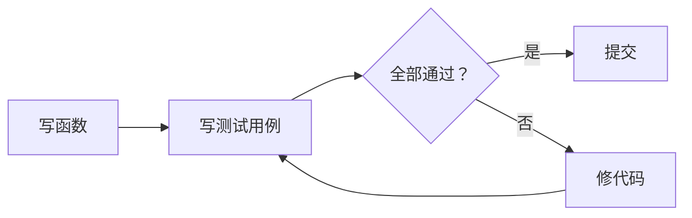

# PY-053 单元测试与 pytest

## 1. 知识概览

| 项 | 内容 |
|---|---|
| 知识 ID | `PY-053` |
| 所属模块 | M-PY-06 Python 进阶与工程实践 |
| 学习难度 | L3 中级 |
| **预计学习时间** | 55 分钟 |
| 前置知识 | [[PY-009 函数]] |
| 学习目标 | 会用 `unittest` 与 `pytest` 写测试、知道"测试是改代码的安全网" |

## 2. 通俗原理讲解

单元测试像**给函数做体检**：每写完一个函数，就用几条固定输入验证输出对不对。

好处：

- 改代码后跑一遍，几秒就知道有没有弄坏别处。
- 别人接手时，测试就是"这个函数该怎么用"的活文档。
- 出 bug 时先写一条能复现的测试，修完它变绿，以后不会再退回去。

## 3. 技术原理

**两种主流工具**

| 工具 | 来源 | 特点 |
|---|---|---|
| `unittest` | 标准库 | 类式写法，无需安装 |
| `pytest` | 第三方（本机已装 9.1.1） | 函数式 + `assert`，更简洁 |

**pytest 的三条便利**

1. 测试函数只需以 `test_` 开头，`assert` 直接写。
2. 断言失败会打印详细对比。
3. 支持参数化、fixture、插件生态。

**运行方式**

```powershell
pytest                      # 自动发现 test_*.py
pytest -v                   # 详细
pytest tests/test_x.py::test_a   # 只跑一个
```

**测试金字塔**：单元测试多、集成测试少、端到端最少。先把单元测试写起来。

## 4. 图解辅助



## 5. 完整代码示例

**标准库写法（可直接运行）**

```powershell
python test_demo.py
```

```python
import io
import unittest


def add(a, b):
    return a + b


class TestAdd(unittest.TestCase):
    def test_positive(self):
        self.assertEqual(add(2, 3), 5)

    def test_zero(self):
        self.assertEqual(add(0, 0), 0)

    def test_negative(self):
        self.assertEqual(add(-1, 1), 0)


suite = unittest.defaultTestLoader.loadTestsFromTestCase(TestAdd)
buf = io.StringIO()
result = unittest.TextTestRunner(stream=buf, verbosity=0).run(suite)
print("用例数:", result.testsRun)
print("全部通过:", result.wasSuccessful())
```

**预期输出**

```
用例数: 3
全部通过: True
```

**pytest 写法（保存为 `test_mul.py` 后用 `pytest` 运行）**

```python
def mul(a, b):
    return a * b


def test_mul():
    assert mul(2, 3) == 6


def test_mul_zero():
    assert mul(0, 5) == 0
```

```powershell
pytest test_mul.py -v
```

> 这段代码直接 `python test_mul.py` 不会跑测试（只定义函数）；必须用 `pytest` 执行。

## 6. 实践练习

**基础**

1. 写 `sub(a, b)` 与三条 `unittest` 用例，验证结果。
2. 用 pytest 写两条用例测试一个"判断偶数"的函数。
3. 判断：测试文件命名有什么要求（pytest 默认规则）？

**进阶**

1. 写一个会失败的用例，观察 pytest 的报错信息，再修好它。
2. 用 `pytest.mark.parametrize` 给同一个函数写多组输入（写出代码即可）。

**综合实践**

给"学生成绩等级"函数（≥90 A，≥80 B，≥60 C，其余 D）写 5 条测试用例，覆盖四个边界与一个中间值，并全部跑通。

## 7. 参考答案

**基础 1 · 思路**：`assertEqual`。

```python
import io, unittest

def sub(a, b):
    return a - b

class T(unittest.TestCase):
    def test_1(self): self.assertEqual(sub(5, 3), 2)
    def test_2(self): self.assertEqual(sub(0, 0), 0)
    def test_3(self): self.assertEqual(sub(-1, 1), -2)

buf = io.StringIO()
r = unittest.TextTestRunner(stream=buf, verbosity=0).run(
    unittest.defaultTestLoader.loadTestsFromTestCase(T))
print(r.wasSuccessful())
```

运行结果：`True`

**基础 2 · 思路**：函数式 + assert。

```python
def is_even(n):
    return n % 2 == 0

def test_even_true():
    assert is_even(4)

def test_even_false():
    assert not is_even(7)
```

运行结果：无输出（定义测试，需用 pytest 执行）

**基础 3 · 思路**：默认发现规则。

答案：文件名 `test_*.py` 或 `*_test.py`；函数名以 `test_` 开头。

**进阶 1 · 思路**：故意断言错值。

```python
def add(a, b):
    return a + b

def test_wrong():
    assert add(2, 2) == 5
```

运行结果：`pytest` 下会显示 `assert 4 == 5` 并失败——这是**故意**的，用来看报错格式。

**进阶 2 · 思路**：`parametrize` 装饰器。

```python
import pytest

@pytest.mark.parametrize("a,b,expected", [(1, 1, 2), (2, 3, 5), (-1, 1, 0)])
def test_add(a, b, expected):
    assert a + b == expected
```

运行结果：3 组参数分别执行。

**综合实践 · 思路**：边界 + 中间值。

```python
import io, unittest

def grade(score):
    if score >= 90:
        return "A"
    if score >= 80:
        return "B"
    if score >= 60:
        return "C"
    return "D"

class TestGrade(unittest.TestCase):
    def test_90(self): self.assertEqual(grade(90), "A")
    def test_89(self): self.assertEqual(grade(89), "B")
    def test_80(self): self.assertEqual(grade(80), "B")
    def test_60(self): self.assertEqual(grade(60), "C")
    def test_59(self): self.assertEqual(grade(59), "D")

buf = io.StringIO()
r = unittest.TextTestRunner(stream=buf, verbosity=0).run(
    unittest.defaultTestLoader.loadTestsFromTestCase(TestGrade))
print("用例数:", r.testsRun, "全部通过:", r.wasSuccessful())
```

运行结果：`用例数: 5 全部通过: True`

## 8. 常见错误

| 错误写法 | 现象 | 原因 | 正确写法 |
|---|---|---|---|
| 测试文件名不以 `test_` 开头 | pytest 找不到 | 默认发现规则 | 改名 |
| 测试函数没有 `test_` 前缀 | 不被收集 | 同上 | 加前缀 |
| 断言用 `assert x == True` | 风格差 | 冗余 | `assert x` |
| 测试之间相互依赖 | 单独跑就失败 | 共享状态 | 每个用例独立 |
| 只测正常路径 | 边界 bug 漏网 | 覆盖不足 | 补 0/负数/空值 |

## 9. 知识关联

- **前置**：[[PY-009 函数]]
- **后继**：[[PY-054 调试]]、[[PY-056 代码风格与类型检查]]
- **相关数学**：无
- **所属模块**：`M-PY-06 Python 进阶与工程实践`

## 10. 学习记录

| 日期 | 状态 | 掌握程度 | 遇到的问题 | 个人总结 | 待复习 |
|---|---|---|---|---|---|
| — | planned | — | — | — | — |

---

## 🔗 Notion 同步信息

> 以下内容由 Notion「AI Knowledge System · 知识点」数据库按知识 ID 合并而来（导出于 2026-11-09）。

| 属性 | 值 |
|---|---|
| 学科 | Python基础 |
| 学习状态 | 未开始 |
| 难度 | L3 推导 |
| 知识类型 | Technique |
| 学习目标 | 会用 unittest 与 pytest 写测试，建立改代码的安全网。 |

- **所属模块**：[M-PY-06 Python 进阶与工程实践](../%E8%AF%BE%E7%A8%8B%E6%A8%A1%E5%9D%97/M-PY-06%20Python%20%E8%BF%9B%E9%98%B6%E4%B8%8E%E5%B7%A5%E7%A8%8B%E5%AE%9E%E8%B7%B5.md)
- **前置知识**：[PY-009 函数](../02%20%E5%87%BD%E6%95%B0%E4%B8%8E%E4%BD%9C%E7%94%A8%E5%9F%9F/PY-009%20%E5%87%BD%E6%95%B0.md)
