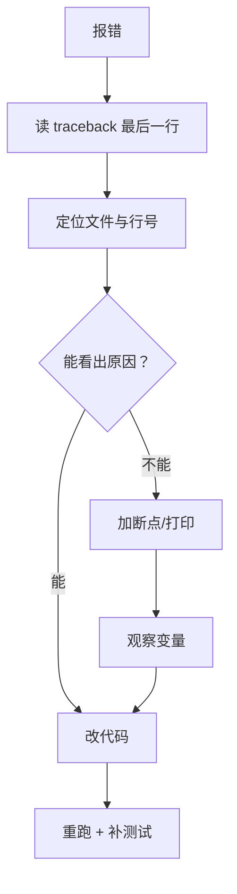

# PY-054 调试

## 1. 知识概览

| 项 | 内容 |
|---|---|
| 知识 ID | `PY-054` |
| 所属模块 | M-PY-06 Python 进阶与工程实践 |
| 学习难度 | L2 初级 |
| **预计学习时间** | 45 分钟 |
| 前置知识 | [[PY-044 异常处理]] |
| 学习目标 | 会读 traceback、会用 `assert` 与 `pdb`、知道 VS Code 断点调试怎么用 |

## 2. 通俗原理讲解

调试像**查水管漏水**：

- 先看水从哪冒出来（traceback 最后一行 = 出错位置）；
- 再顺着管子往上找（调用栈 = 谁调用了它）；
- 不确定就在某段塞个"探头"（`pdb` 断点 / 打印）看看。

**新手误区**：一报错就到处加 `print`。更快的办法是先读 traceback——它已经告诉你文件和行号了。

## 3. 技术原理

**traceback 的三段**

```text
Traceback (most recent call last):
  File "demo.py", line 8, in <module>
    divide(1, 0)
  File "demo.py", line 3, in divide
    return a / b
ZeroDivisionError: division by zero     ← 最后一行最关键
```

1. `Traceback`：调用链，**从外到内**。
2. 中间：每层的文件、行号、函数名。
3. 最后一行：异常类型 + 消息。

**三种调试手段**

| 手段 | 命令 | 适用 |
|---|---|---|
| 打印 | `print()` / `logging` | 简单值检查 |
| 断言 | `assert 条件, "消息"` | 检查"这里必须成立" |
| 断点 | `breakpoint()` / `python -m pdb x.py` | 复杂逻辑、要看变量 |

**VS Code 断点**：行号左侧点红点 → F5 启动 → 用 F10（单步跳过）、F11（单步进入）、F5（继续）查看变量面板。

**注意**：`assert` 在 `python -O` 优化模式下会被移除，**不要用它做业务校验**。

## 4. 图解辅助



## 5. 完整代码示例

```powershell
python debug_demo.py
```

```python
import traceback


def divide(a, b):
    assert b != 0, "除数不能为 0"
    return a / b


print(divide(6, 3))

try:
    divide(1, 0)
except AssertionError as e:
    print("断言失败:", e)

try:
    1 / 0
except ZeroDivisionError:
    tb = traceback.format_exc()
    print("回溯里包含异常类型:", "ZeroDivisionError" in tb)
    print("最后一行:", tb.strip().splitlines()[-1])
```

**预期输出**

```
2.0
断言失败: 除数不能为 0
回溯里包含异常类型: True
最后一行: ZeroDivisionError: division by zero
```

**说明**

- `assert` 在条件不成立时抛 `AssertionError`，消息就是"断言失败"后面的文字。
- `traceback.format_exc()` 拿到完整回溯字符串，便于记录到日志。
- 取最后一行就能快速看到"是什么错"。

## 6. 实践练习

**基础**

1. 写一个会除零的函数，运行并读 traceback，指出出错行号。
2. 用 `assert` 检查一个参数必须为正数。
3. 判断：`assert` 能不能替代 `if` 做业务校验？

**进阶**

1. 用 `breakpoint()` 在一个循环里停下，查看循环变量的值（说明操作步骤即可）。
2. 用 `traceback.format_exc()` 把异常写进日志文件。

**综合实践**

给一段有 bug 的代码（如"求列表平均值"在空列表时报错）加断言与异常处理，使其在空列表时返回 `0`，并写一条测试验证。

## 7. 参考答案

**基础 1 · 思路**：运行看输出。

```python
import traceback


def div(a, b):
    return a / b


try:
    print(div(1, 0))
except ZeroDivisionError:
    tb = traceback.format_exc()
    print("回溯里能定位到出错行:", "return a / b" in tb)
    print("最后一行:", tb.strip().splitlines()[-1])
```

运行结果：

```
回溯里能定位到出错行: True
最后一行: ZeroDivisionError: division by zero
```

> 出错行是 `return a / b`，调用行也会出现在回溯里。读 traceback 时**从最后一行往上**读最快。

**基础 2 · 思路**：断言消息写清楚。

```python
def sqrt_like(x):
    assert x >= 0, "x 必须为正数"
    return x ** 0.5

print(sqrt_like(9))
try:
    sqrt_like(-1)
except AssertionError as e:
    print("拒绝:", e)
```

运行结果：

```
3.0
拒绝: x 必须为正数
```

**基础 3 · 思路**：优化模式会移除断言。

答案：不能。`python -O` 会跳过 assert，业务校验必须用显式判断并抛异常。

**进阶 1 · 思路**：插入 `breakpoint()` 后运行。

```text
在循环体内加 breakpoint()
运行 python debug_demo.py
进入 pdb 后：
  p i          # 打印变量 i
  n            # 下一步
  c            # 继续
```

**进阶 2 · 思路**：写文件。

```python
import traceback
from pathlib import Path

try:
    1 / 0
except ZeroDivisionError:
    Path("error.log").write_text(traceback.format_exc(), encoding="utf-8")

print("包含 ZeroDivisionError:", "ZeroDivisionError" in Path("error.log").read_text(encoding="utf-8"))
Path("error.log").unlink()
```

运行结果：`包含 ZeroDivisionError: True`

**综合实践 · 思路**：先判空再算。

```python
def average(nums):
    assert isinstance(nums, list), "必须是列表"
    if not nums:
        return 0
    return sum(nums) / len(nums)

print(average([1, 2, 3]))
print(average([]))
```

运行结果：

```
2.0
0
```

## 8. 常见错误

| 错误写法 | 现象 | 原因 | 正确写法 |
|---|---|---|---|
| 只看第一行 traceback | 找不到真正出错点 | 应从最后一行看 | 读最后一行 + 对应行号 |
| 用 `assert` 做业务校验 | 生产环境失效 | `-O` 会移除 | 显式 `if` + `raise` |
| `except: print("错了")` | 丢失堆栈 | 未记录细节 | `logging.exception` |
| 到处 print 后忘记删 | 输出混乱 | 临时手段 | 用 logging 分级 |
| 改了代码不重跑 | 以为修好了 | 没验证 | 每次改完跑测试 |

## 9. 知识关联

- **前置**：[[PY-044 异常处理]]
- **后继**：[[PY-053 单元测试与 pytest]]（用测试固化修复）
- **相关数学**：无
- **所属模块**：`M-PY-06 Python 进阶与工程实践`

## 10. 学习记录

| 日期 | 状态 | 掌握程度 | 遇到的问题 | 个人总结 | 待复习 |
|---|---|---|---|---|---|
| — | planned | — | — | — | — |

---

## 🔗 Notion 同步信息

> 以下内容由 Notion「AI Knowledge System · 知识点」数据库按知识 ID 合并而来（导出于 2026-11-09）。

| 属性 | 值 |
|---|---|
| 学科 | Python基础 |
| 学习状态 | 未开始 |
| 难度 | L2 应用 |
| 知识类型 | Technique |
| 学习目标 | 会读 traceback、用 assert 与断点，能定位问题。 |

- **所属模块**：[M-PY-06 Python 进阶与工程实践](../%E8%AF%BE%E7%A8%8B%E6%A8%A1%E5%9D%97/M-PY-06%20Python%20%E8%BF%9B%E9%98%B6%E4%B8%8E%E5%B7%A5%E7%A8%8B%E5%AE%9E%E8%B7%B5.md)
- **前置知识**：[PY-044 异常处理](../05%20%E5%BC%82%E5%B8%B8%E4%B8%8E%E6%96%87%E4%BB%B6/PY-044%20%E5%BC%82%E5%B8%B8%E5%A4%84%E7%90%86.md)
