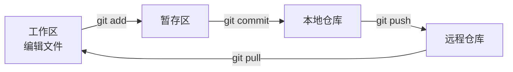

# PY-055 Git 基础

## 1. 知识概览

| 项 | 内容 |
|---|---|
| 知识 ID | `PY-055` |
| 所属模块 | M-PY-06 Python 进阶与工程实践 |
| 学习难度 | L2 初级 |
| **预计学习时间** | 50 分钟 |
| 前置知识 | [[PY-050 pip 与虚拟环境]] |
| 学习目标 | 会做"初始化 → 提交 → 看历史"的日常操作、会写 `.gitignore`、知道什么时候该提交 |

## 2. 通俗原理讲解

Git 像**游戏存档**：

- 每次 `commit` = 一个存档点，附带一句说明。
- 改坏了可以回到任意存档（`git checkout`）。
- 多台机器/多人协作时，`push`/`pull` 就是"上传/下载存档"。

**为什么重要**：它是"敢改代码"的底气。没有版本控制，重构等于赌博。

## 3. 技术原理

**三个区域**

```
工作区（你改的文件） → 暂存区（git add） → 仓库（git commit）
```

| 命令 | 作用 |
|---|---|
| `git init` | 在当前目录建仓库 |
| `git status` | 看哪些文件变了 |
| `git add .` | 全部加入暂存区 |
| `git commit -m "说明"` | 生成一个存档 |
| `git log --oneline` | 看历史 |
| `git diff` | 看未暂存的改动 |
| `git checkout -- 文件` | 丢弃工作区改动（**危险**） |

**`.gitignore` 必须包含**

```text
.venv/
__pycache__/
*.pyc
.env
*.db
```

**提交信息写法**：`动词 + 对象`，例如 `修复成绩排序的空列表报错`、`新增 CSV 导出`。

## 4. 图解辅助



## 5. 完整代码示例

Python 部分演示"生成并检查 `.gitignore`"：

```powershell
python gitignore_demo.py
```

```python
from pathlib import Path

ignored = [".venv/", "__pycache__/", "*.pyc", ".env", "*.db"]

p = Path(".gitignore_demo")
p.write_text("\n".join(ignored) + "\n", encoding="utf-8")

lines = [x for x in p.read_text(encoding="utf-8").splitlines() if x]
print("条数:", len(lines))
print("包含 .venv:", ".venv/" in lines)

p.unlink()
```

**预期输出**

```
条数: 5
包含 .venv: True
```

**日常命令（PowerShell）**

```powershell
git init
git status
git add .
git commit -m "初始化项目结构"
git log --oneline
```

## 6. 实践练习

**基础**

1. 在空目录执行 `git init`，创建一个文件并提交，查看 `git log`。
2. 写一个 `.gitignore`，忽略 `__pycache__/` 与 `.venv/`。
3. 判断：`git add` 与 `git commit` 各做什么？

**进阶**

1. 修改文件后用 `git diff` 看差异，再提交。
2. 解释为什么 `.env` 与 `*.db` 不该进仓库。

**综合实践**

为一个 Python 小项目完成首次提交：建 `.gitignore` → `git init` → `git add .` → `git commit`；再用 `git log --oneline` 确认，并说明提交信息该怎么写。

## 7. 参考答案

**基础 1 · 思路**：三步走。

```powershell
mkdir demo_git
cd demo_git
git init
"hello" > readme.txt
git add .
git commit -m "首次提交"
git log --oneline
```

运行结果：显示一条提交记录（哈希 + 说明）。

**基础 2 · 思路**：逐行写规则。

```text
__pycache__/
.venv/
```

**基础 3 · 思路**：暂存 vs 存档。

答案：`git add` 把改动放进暂存区（准备提交）；`git commit` 把暂存区内容固化成一次历史记录。

**进阶 1 · 思路**：改完先看再提交。

```powershell
"new line" >> readme.txt
git diff
git add readme.txt
git commit -m "补充说明"
```

运行结果：`git diff` 显示新增的一行。

**进阶 2 · 思路**：敏感信息与二进制。

答案：`.env` 含密钥，进仓库等于泄露；`*.db` 是二进制且经常变化，提交会让仓库迅速膨胀，也不利于合并。

**综合实践 · 思路**：先忽略、再提交。

```powershell
git init
@"
.venv/
__pycache__/
*.pyc
.env
"@ | Out-File -Encoding utf8 .gitignore
git add .
git commit -m "初始化：项目结构与忽略规则"
git log --oneline
```

提交信息建议：**动词开头 + 说明做了什么**，不用 "update"、"fix bug" 这种无信息量的词。

## 8. 常见错误

| 错误写法 | 现象 | 原因 | 正确写法 |
|---|---|---|---|
| 把 `.venv` 提交 | 仓库巨大 | 未忽略 | 写进 `.gitignore` |
| 提交 `.env` | 密钥泄露 | 未忽略 | 加入 `.gitignore` |
| 一次提交几百个文件 | 无法回溯 | 粒度太粗 | 按功能拆分提交 |
| 提交信息写 "update" | 历史无意义 | 信息量为零 | 写清做了什么 |
| 直接在主干乱改 | 无法回退 | 无分支习惯 | 小改动也先 `git status` 确认 |

## 9. 知识关联

- **前置**：[[PY-050 pip 与虚拟环境]]
- **后继**：[[PY-056 代码风格与类型检查]]
- **相关数学**：无
- **所属模块**：`M-PY-06 Python 进阶与工程实践`

## 10. 学习记录

| 日期 | 状态 | 掌握程度 | 遇到的问题 | 个人总结 | 待复习 |
|---|---|---|---|---|---|
| — | planned | — | — | — | — |

---

## 🔗 Notion 同步信息

> 以下内容由 Notion「AI Knowledge System · 知识点」数据库按知识 ID 合并而来（导出于 2026-11-09）。

| 属性 | 值 |
|---|---|
| 学科 | Python基础 |
| 学习状态 | 未开始 |
| 难度 | L2 应用 |
| 知识类型 | Technique |
| 学习目标 | 会做 Git 日常操作、写 .gitignore，养成提交习惯。 |

- **所属模块**：[M-PY-06 Python 进阶与工程实践](../%E8%AF%BE%E7%A8%8B%E6%A8%A1%E5%9D%97/M-PY-06%20Python%20%E8%BF%9B%E9%98%B6%E4%B8%8E%E5%B7%A5%E7%A8%8B%E5%AE%9E%E8%B7%B5.md)
- **前置知识**：[PY-050 pip 与虚拟环境](PY-050%20pip%20%E4%B8%8E%E8%99%9A%E6%8B%9F%E7%8E%AF%E5%A2%83.md)
