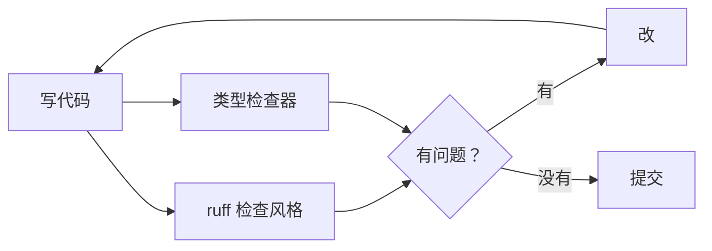

# PY-056 代码风格与类型检查

## 1. 知识概览

| 项 | 内容 |
|---|---|
| 知识 ID | `PY-056` |
| 所属模块 | M-PY-06 Python 进阶与工程实践 |
| 学习难度 | L2 初级 |
| **预计学习时间** | 45 分钟 |
| 前置知识 | [[PY-030 类型注解]] |
| 学习目标 | 会用 `ruff` 检查风格、理解类型注解 + 静态检查的价值、知道 PEP 8 的核心几条 |

## 2. 通俗原理讲解

代码风格像**排版规范**：

- 一个人写，怎么排都行；
- 多人协作/半年后回看，乱排版会让人读得慢、改得慌。

**类型检查**像**出门前的安检**：不改变程序运行，只是提前告诉你"这里可能会炸"。

两个工具分工：

- `ruff`：查风格与常见错误（本机已装 0.17.2）。
- `mypy` / `pyright`：查类型不一致（本机未装 mypy，可用 VS Code 的 Pylance）。

## 3. 技术原理

**PEP 8 核心几条**

| 项 | 规范 |
|---|---|
| 缩进 | 4 个空格 |
| 行宽 | ≤ 79（团队可放宽到 100） |
| 命名 | 变量/函数 `snake_case`，类 `PascalCase`，常量 `UPPER_CASE` |
| 空行 | 顶层函数间 2 行，类内方法间 1 行 |
| 导入 | 标准库 / 第三方 / 本地，分三组 |

**ruff 常用命令**

```powershell
ruff check .            # 检查
ruff check . --fix      # 自动修可修的
ruff format .           # 格式化（类似 black）
```

**类型检查能抓什么**

```python
def add(a: int, b: int) -> int:
    return a + b


print(add(1, 2))
print(add("1", "2"))
```

上面第二次调用**照样能跑**（返回 `"12"`），因为注解不参与运行时检查——但静态类型检查器会在这里报警。

## 4. 图解辅助



## 5. 完整代码示例

```powershell
python style_demo.py
ruff check style_demo.py
```

```python
from typing import Optional


def find_index(nums: list[int], target: int) -> Optional[int]:
    for i, value in enumerate(nums):
        if value == target:
            return i
    return None


def average(nums: list[float]) -> float:
    if not nums:
        return 0.0
    return sum(nums) / len(nums)


print(find_index([10, 20, 30], 20))
print(find_index([10, 20, 30], 99))
print(average([1.0, 2.0, 3.0]))
print(average([]))
```

**预期输出**

```
1
None
2.0
0.0
```

**说明**

- 返回 `Optional[int]` 明确表达"可能没有"，比返回 `-1` 更不容易被误用。
- `average([])` 返回 `0.0`，避免除零。
- 对这段代码跑 `ruff check` 应无告警（命名、缩进、行宽都符合规范）。

## 6. 实践练习

**基础**

1. 写一个函数并加类型注解，然后用 `ruff check` 检查。
2. 故意写一行超过 100 字符的代码，看 ruff 是否提示。
3. 判断：类型注解会在运行时检查吗？

**进阶**

1. 把变量名改成 `Data`、函数名改成 `GetData`，观察 ruff 的命名告警。
2. 解释 `Optional[int]` 与 `int` 的区别，各举一个适用场景。

**综合实践**

给一段"风格很乱"的代码（单字母变量、行长超限、命名不规范）做规范化：改命名、拆行、补注解，再用 `ruff check` 验证通过。

## 7. 参考答案

**基础 1 · 思路**：注解 + 检查。

```python
def area(width: float, height: float) -> float:
    return width * height

print(area(2.0, 3.0))
```

运行结果：`6.0`；`ruff check` 无输出即通过。

**基础 2 · 思路**：超长行触发 E501。

```python
# 这一行故意写得很长很长很长很长很长很长很长很长很长很长很长很长很长很长很长很长很长很长很长很长很长很长
```

`ruff check` 会提示 `E501 Line too long`。

**基础 3 · 思路**：注解只是元数据。

答案：**不会**。需要 mypy/pyright 这类静态工具检查。

**进阶 1 · 思路**：命名规则。

```python
Data = 1          # N816: mixedCase variable in global scope
def GetData():    # N802: function name should be lowercase
    return 1
```

`ruff` 会给出命名相关的告警（取决于启用的规则集）。

**进阶 2 · 思路**：可能为空 vs 一定有值。

答案：`Optional[int]` 表示"可能是 int 也可能是 None"，适用于"查不到"；`int` 表示"一定有值"，适用于计算结果。

**综合实践 · 思路**：逐步规范化。

```python
def calculate_total_price(unit_price: float, quantity: int) -> float:
    return unit_price * quantity


print(calculate_total_price(2.5, 4))
```

运行结果：`10.0`

## 8. 常见错误

| 错误写法 | 现象 | 原因 | 正确写法 |
|---|---|---|---|
| 变量用单字母 | 可读性差 | 命名随意 | `index`、`total` 等 |
| 函数名大写开头 | 与类混淆 | 违反 PEP 8 | `snake_case` |
| 行宽超限 | ruff 告警 | 未折行 | 括号内换行 |
| 注解写 `Any` | 等于没写 | 放弃检查 | 写具体类型 |
| 装了 ruff 不跑 | 问题累积 | 无自动化 | 提交前跑一次 |

## 9. 知识关联

- **前置**：[[PY-030 类型注解]]
- **后继**：[[PY-053 单元测试与 pytest]]（一起构成质量门禁）
- **相关数学**：无
- **所属模块**：`M-PY-06 Python 进阶与工程实践`

## 10. 学习记录

| 日期 | 状态 | 掌握程度 | 遇到的问题 | 个人总结 | 待复习 |
|---|---|---|---|---|---|
| — | planned | — | — | — | — |

---

## 🔗 Notion 同步信息

> 以下内容由 Notion「AI Knowledge System · 知识点」数据库按知识 ID 合并而来（导出于 2026-11-09）。

| 属性 | 值 |
|---|---|
| 学科 | Python基础 |
| 学习状态 | 未开始 |
| 难度 | L2 应用 |
| 知识类型 | Technique |
| 学习目标 | 会用 ruff 检查风格，理解类型注解 + 静态检查的价值。 |

- **所属模块**：[M-PY-06 Python 进阶与工程实践](../%E8%AF%BE%E7%A8%8B%E6%A8%A1%E5%9D%97/M-PY-06%20Python%20%E8%BF%9B%E9%98%B6%E4%B8%8E%E5%B7%A5%E7%A8%8B%E5%AE%9E%E8%B7%B5.md)
- **前置知识**：[PY-030 类型注解](../02%20%E5%87%BD%E6%95%B0%E4%B8%8E%E4%BD%9C%E7%94%A8%E5%9F%9F/PY-030%20%E7%B1%BB%E5%9E%8B%E6%B3%A8%E8%A7%A3.md)
