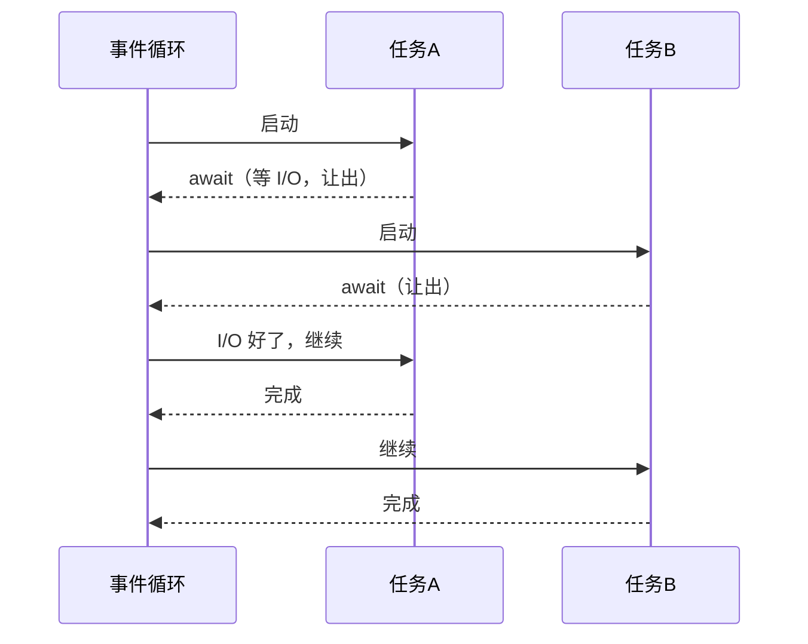

# PY-057 异步编程基础

## 1. 知识概览

| 项 | 内容 |
|---|---|
| 知识 ID | `PY-057` |
| 所属模块 | M-PY-06 Python 进阶与工程实践 |
| 学习难度 | L3 中级 |
| **预计学习时间** | 50 分钟 |
| 前置知识 | [[PY-028 生成器]] |
| 学习目标 | 理解"等待时切走"的模型、会用 `async/await` 与 `gather`、知道它不适合 CPU 密集型 |

## 2. 通俗原理讲解

异步像**一个人同时看几口锅**：

- 水没开时（等待 I/O），他不站着发呆，而是去切菜。
- 谁的锅开了（数据到了），再回来处理。

关键是**一个人**（单线程）在多个任务间切换，靠的是"等待时主动让出"。

**和并发的区别**：多线程/多进程是"多个人"，异步是"一个人多任务"。异步适合**等网络、等磁盘**，不适合**算数学**。

## 3. 技术原理

| 概念 | 说明 |
|---|---|
| `async def` | 定义协程函数，调用它**不会立即执行**，返回协程对象 |
| `await` | 等待一个可等待对象，期间让出控制权 |
| `asyncio.run(main())` | 启动事件循环（程序入口用一次） |
| `asyncio.gather(...)` | 并发运行多个协程，按顺序收集结果 |
| `asyncio.sleep(t)` | 异步等待（**不能用 `time.sleep`**，它会卡住整个循环） |

**三条铁律**

1. 协程里**不要**调用阻塞函数（`time.sleep`、`requests.get`），要用对应的异步库（`aiohttp`、`asyncio.to_thread`）。
2. `await` 只能出现在 `async def` 里。
3. 忘了 `await`，拿到的是协程对象，不会执行。

## 4. 图解辅助



## 5. 完整代码示例

```powershell
python async_demo.py
```

```python
import asyncio


async def fetch(name, delay):
    await asyncio.sleep(delay)
    return f"{name} 完成"


async def main():
    print("开始")
    results = await asyncio.gather(fetch("A", 0.01), fetch("B", 0.01))
    print(results)

    single = await fetch("C", 0)
    print(single)


asyncio.run(main())
```

**预期输出**

```
开始
['A 完成', 'B 完成']
C 完成
```

**说明**

- `fetch` 是协程函数，`await` 让它"等待时让出"。
- `gather` 让 A、B 并发等待，结果顺序与传入顺序一致。
- `asyncio.run` 只调用一次，它是整个程序的入口。

## 6. 实践练习

**基础**

1. 写一个协程 `hello(name)`，`await asyncio.sleep(0)` 后返回问候语。
2. 用 `gather` 并发跑三个协程并打印结果列表。
3. 判断：为什么不能在协程里用 `time.sleep`？

**进阶**

1. 用 `asyncio.to_thread` 包装一个阻塞函数（如读文件），避免卡住循环。
2. 解释 `await` 与"阻塞等待"的区别。

**综合实践**

写一个"并发下载模拟器"：三个任务各 `await` 随机时长（固定为 0.01/0.02/0.03），用 `gather` 并发执行，最后打印完成顺序与总结果数。

## 7. 参考答案

**基础 1 · 思路**：最小的协程。

```python
import asyncio

async def hello(name):
    await asyncio.sleep(0)
    return f"你好，{name}"

print(asyncio.run(hello("小明")))
```

运行结果：`你好，小明`

**基础 2 · 思路**：三个协程一起跑。

```python
import asyncio

async def task(n):
    await asyncio.sleep(0.01)
    return n * 2

async def main():
    print(await asyncio.gather(task(1), task(2), task(3)))

asyncio.run(main())
```

运行结果：`[2, 4, 6]`

**基础 3 · 思路**：阻塞调用。

答案：`time.sleep` 会阻塞整个线程，事件循环无法切换，其它协程全被卡住。

**进阶 1 · 思路**：`to_thread` 把阻塞调用丢到线程池。

```python
import asyncio
from pathlib import Path

async def read_file():
    return await asyncio.to_thread(Path("nofile.txt").exists)

print(asyncio.run(read_file()))
```

运行结果：`False`

**进阶 2 · 思路**：让出 vs 占住。

答案：`await` 会把控制权交还事件循环，期间其它任务可以运行；阻塞等待会占住线程，谁也跑不了。

**综合实践 · 思路**：不同延迟 + gather。

```python
import asyncio

async def download(name, delay):
    await asyncio.sleep(delay)
    return f"{name}({delay}s)"

async def main():
    results = await asyncio.gather(
        download("A", 0.01),
        download("B", 0.02),
        download("C", 0.03),
    )
    print(results)
    print("完成数:", len(results))

asyncio.run(main())
```

运行结果：

```
['A(0.01s)', 'B(0.02s)', 'C(0.03s)']
完成数: 3
```

> 结果顺序始终等于传入顺序，哪怕完成时间不同——这是 `gather` 的保证。

## 8. 常见错误

| 错误写法 | 现象 | 原因 | 正确写法 |
|---|---|---|---|
| 协程里用 `time.sleep` | 全部变慢 | 阻塞事件循环 | `asyncio.sleep` |
| 忘了 `await` | 协程没执行 | 只创建了对象 | 加 `await` |
| 在普通函数里 `await` | `SyntaxError` | 只能在协程内 | 改成 `async def` |
| 多次 `asyncio.run` | 事件循环已关闭 | 入口只跑一次 | 在内部拆协程 |
| 用异步做大量计算 | 反而更慢 | 无 I/O 可让出 | 用多进程 |

## 9. 知识关联

- **前置**：[[PY-028 生成器]]
- **后继**：[[PY-058 多线程与多进程]]（对比三种并发模型）
- **相关数学**：无
- **所属模块**：`M-PY-06 Python 进阶与工程实践`

## 10. 学习记录

| 日期 | 状态 | 掌握程度 | 遇到的问题 | 个人总结 | 待复习 |
|---|---|---|---|---|---|
| — | planned | — | — | — | — |

---

## 🔗 Notion 同步信息

> 以下内容由 Notion「AI Knowledge System · 知识点」数据库按知识 ID 合并而来（导出于 2026-11-09）。

| 属性 | 值 |
|---|---|
| 学科 | Python基础 |
| 学习状态 | 未开始 |
| 难度 | L3 推导 |
| 知识类型 | Concept |
| 学习目标 | 理解异步模型，会用 async/await 与 gather。 |

- **所属模块**：[M-PY-06 Python 进阶与工程实践](../%E8%AF%BE%E7%A8%8B%E6%A8%A1%E5%9D%97/M-PY-06%20Python%20%E8%BF%9B%E9%98%B6%E4%B8%8E%E5%B7%A5%E7%A8%8B%E5%AE%9E%E8%B7%B5.md)
- **前置知识**：[PY-028 生成器](../02%20%E5%87%BD%E6%95%B0%E4%B8%8E%E4%BD%9C%E7%94%A8%E5%9F%9F/PY-028%20%E7%94%9F%E6%88%90%E5%99%A8.md)
- **后继知识**：[PY-058 多线程与多进程](PY-058%20%E5%A4%9A%E7%BA%BF%E7%A8%8B%E4%B8%8E%E5%A4%9A%E8%BF%9B%E7%A8%8B.md)
