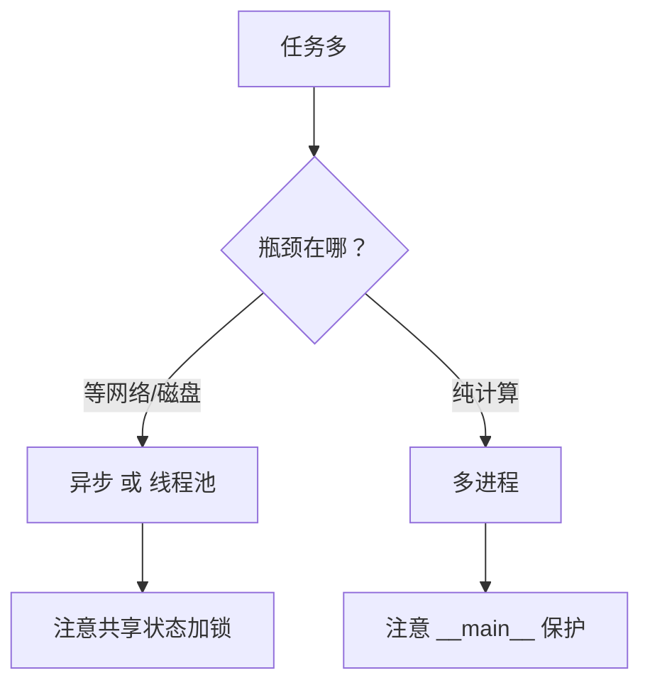

# PY-058 多线程与多进程

## 1. 知识概览

| 项 | 内容 |
|---|---|
| 知识 ID | `PY-058` |
| 所属模块 | M-PY-06 Python 进阶与工程实践 |
| 学习难度 | L3 中级 |
| **预计学习时间** | 55 分钟 |
| 前置知识 | [[PY-057 异步编程基础]] |
| 学习目标 | 分清 I/O 密集与 CPU 密集、会用 `ThreadPoolExecutor`、知道 GIL 的影响 |

## 2. 通俗原理讲解

三种"同时做事"的方式，像三种干活安排：

- **异步**：一个人，等的时候去干别的（适合等网络）。
- **多线程**：几个人，但共用一套工具（GIL 限制：同一时刻只有一人能用 Python 解释器算数）。
- **多进程**：几个人，各有一套工具（真并行，但启动与通信成本高）。

**选择口诀**：

- 等 I/O 多（网络/磁盘）→ 异步或线程池。
- 算得多（大量数学）→ 多进程。
- 不确定 → 先测量，别猜。

## 3. 技术原理

| 模型 | 并行度 | 开销 | 适用 |
|---|---|---|---|
| 单线程 | 1 | 最低 | 简单脚本 |
| 多线程 | 受限（GIL） | 低 | I/O 密集 |
| 多进程 | 真并行 | 高（启动+序列化） | CPU 密集 |
| 异步 | 单线程并发 | 最低 | 高并发 I/O |

**GIL**：CPython 的全局解释器锁，保证同一时刻只有一个线程执行 Python 字节码。所以**多线程不会让纯计算变快**，但 I/O 等待时会释放 GIL，因此对 I/O 仍有效。

**线程安全**：多个线程改同一个变量必须加锁（`threading.Lock`），否则计数会丢。

**Windows 注意**：`multiprocessing` 用 `spawn` 启动子进程，**必须**把入口放在 `if __name__ == "__main__":` 里，否则子进程会重新导入脚本导致无限递归。

## 4. 图解辅助



## 5. 完整代码示例

```powershell
python concurrency_demo.py
```

```python
import threading
from concurrent.futures import ThreadPoolExecutor

counter = {"value": 0}
lock = threading.Lock()


def worker(n):
    for _ in range(n):
        with lock:
            counter["value"] += 1


threads = [threading.Thread(target=worker, args=(1000,)) for _ in range(4)]
for t in threads:
    t.start()
for t in threads:
    t.join()

print("计数:", counter["value"])


def square(x):
    return x * x


with ThreadPoolExecutor(max_workers=4) as ex:
    print(list(ex.map(square, range(5))))
```

**预期输出**

```
计数: 4000
[0, 1, 4, 9, 16]
```

**说明**

- 4 个线程各加 1000 次，`with lock` 保证不丢计数；去掉锁通常会小于 4000。
- `ThreadPoolExecutor.map` 按输入顺序返回结果，写起来比手动 `Thread` 简洁。

**多进程示例（不能内联执行，必须放脚本里）**

```text
# cpu_demo.py
import multiprocessing

def square(x):
    return x * x

if __name__ == "__main__":
    with multiprocessing.Pool(4) as pool:
        print(pool.map(square, range(5)))
```

> 为什么本笔记不直接运行这段：Windows 用 `spawn` 启动子进程，子进程会重新导入脚本；若入口没有 `__main__` 保护，就会无限创建进程。所以它必须以"独立文件"的形式运行。

## 6. 实践练习

**基础**

1. 用 `ThreadPoolExecutor` 并发计算 1–10 的平方。
2. 用 `threading.Lock` 保护一个共享计数，验证结果正确。
3. 判断：多线程能让纯 Python 的循环求和变快吗？

**进阶**

1. 去掉锁，多跑几次，观察计数是否小于预期，解释原因。
2. 说明什么情况下应该选多进程而不是多线程。

**综合实践**

写一个"目录扫描器"：用线程池并发统计一个目录下所有 `.md` 文件的总大小，与单线程版本比较耗时（打印"并发更快"的布尔值即可，不要写死时间）。

## 7. 参考答案

**基础 1 · 思路**：`map` + 线程池。

```python
from concurrent.futures import ThreadPoolExecutor

with ThreadPoolExecutor(max_workers=4) as ex:
    print(list(ex.map(lambda x: x * x, range(1, 11))))
```

运行结果：`[1, 4, 9, 16, 25, 36, 49, 64, 81, 100]`

**基础 2 · 思路**：加锁累加。

```python
import threading

c = {"v": 0}
lock = threading.Lock()

def w():
    for _ in range(500):
        with lock:
            c["v"] += 1

ts = [threading.Thread(target=w) for _ in range(3)]
[t.start() for t in ts]
[t.join() for t in ts]
print(c["v"])
```

运行结果：`1500`

**基础 3 · 思路**：GIL 限制。

答案：**不能**（纯计算时线程轮流持锁，没有真并行）。

**进阶 1 · 思路**：竞态条件。

答案：`counter["value"] += 1` 不是原子操作（读-改-写三步），线程切换会导致丢失更新，结果通常小于 4000。

**进阶 2 · 思路**：CPU 密集。

答案：计算量大、几乎不等待 I/O 时选多进程（每个进程独立 GIL，可真正并行）。

**综合实践 · 思路**：两种实现对比，只输出布尔。

```python
from concurrent.futures import ThreadPoolExecutor
from pathlib import Path

root = Path(r"<VAULT_ROOT>")
files = list(root.rglob("*.md"))

def size(p):
    return p.stat().st_size

serial = sum(size(p) for p in files)

with ThreadPoolExecutor(max_workers=8) as ex:
    parallel = sum(ex.map(size, files))

print("两种方式结果一致:", serial == parallel)
print("统计到文件数 > 0:", len(files) > 0)
```

运行结果：

```
两种方式结果一致: True
统计到文件数 > 0: True
```

> 刻意**不打印文件总数与耗时**：总数会随笔记增加而变，耗时受机器状态影响。写死数字等于伪造。

## 8. 常见错误

| 错误写法 | 现象 | 原因 | 正确写法 |
|---|---|---|---|
| 共享计数不加锁 | 结果偏小 | 竞态条件 | `with lock` |
| 用多线程跑计算 | 没变快 | GIL | 用多进程 |
| Windows 下多进程没 `__main__` 保护 | 无限创建进程 | `spawn` 重新导入 | 加 `if __name__ == "__main__":` |
| 线程里改 GUI | 崩溃/卡死 | 非线程安全 | 交回主线程更新 |
| 线程数开太多 | 切换开销大 | 资源浪费 | 控制并发数（如 4–16） |

## 9. 知识关联

- **前置**：[[PY-057 异步编程基础]]
- **后继**：`PY-065 向量化与性能`（用 NumPy 避免 Python 层循环，待建）
- **相关数学**：无
- **所属模块**：`M-PY-06 Python 进阶与工程实践`

## 10. 学习记录

| 日期 | 状态 | 掌握程度 | 遇到的问题 | 个人总结 | 待复习 |
|---|---|---|---|---|---|
| — | planned | — | — | — | — |

---

## 🔗 Notion 同步信息

> 以下内容由 Notion「AI Knowledge System · 知识点」数据库按知识 ID 合并而来（导出于 2026-11-09）。

| 属性 | 值 |
|---|---|
| 学科 | Python基础 |
| 学习状态 | 未开始 |
| 难度 | L3 推导 |
| 知识类型 | Concept |
| 学习目标 | 分清 I/O 密集与 CPU 密集，会用线程池，知道 GIL 影响。 |

- **所属模块**：[M-PY-06 Python 进阶与工程实践](../%E8%AF%BE%E7%A8%8B%E6%A8%A1%E5%9D%97/M-PY-06%20Python%20%E8%BF%9B%E9%98%B6%E4%B8%8E%E5%B7%A5%E7%A8%8B%E5%AE%9E%E8%B7%B5.md)
- **前置知识**：[PY-057 异步编程基础](PY-057%20%E5%BC%82%E6%AD%A5%E7%BC%96%E7%A8%8B%E5%9F%BA%E7%A1%80.md)
