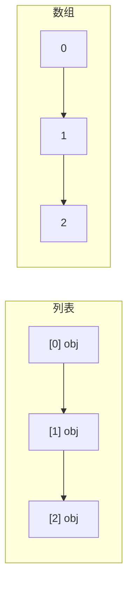

# PY-059 NumPy 与列表的区别

## 1. 知识概览

| 项 | 内容 |
|---|---|
| 知识 ID | `PY-059` |
| 所属模块 | M-PY-07 NumPy 科学计算 |
| 学习难度 | L2 初级 |
| **预计学习时间** | 45 分钟 |
| 前置知识 | [[PY-007 列表与元组]] |
| 学习目标 | 说清 NumPy 数组与 Python 列表的三点本质差异，知道什么时候必须换数组 |

## 2. 通俗原理讲解

Python 列表像**一排独立的小盒子**：每个盒子里装一个对象（带类型信息、引用计数），位置分散。

NumPy 数组像**一块连续的钢板**：所有元素同类型、紧挨着摆放。

这带来三个直接后果：

1. **省内存**：数组没有"每个元素一个对象"的开销。
2. **算得快**：连续内存 + 同类型 → CPU 可以一条指令处理多个数（向量化）。
3. **要统一类型**：数组里只能放同一种类型，混着放会被"提升"成更宽的类型。

## 3. 技术原理

| 维度 | list | ndarray |
|---|---|---|
| 元素类型 | 任意、可混合 | 统一 dtype |
| 内存 | 分散 + 对象开销 | 连续 + 紧凑 |
| `+` 运算 | 拼接 | **逐元素相加** |
| 大小（5 个整数） | 约 120 字节（含对象） | 40 字节（int64 × 5） |
| 适用 | 通用容器 | 数值计算 |

**最容易踩的差异**：

```text
[1, 2] + [3, 4]                      # [1, 2, 3, 4]   拼接
np.array([1,2]) + np.array([3,4])    # [4, 6]         逐元素
```

**结论**：**只要开始做数值计算，就换数组**；列表留给"装各种东西"的场景。

## 4. 图解辅助



列表的每个格子指向独立对象；数组的格子是连续的原始值。

## 5. 完整代码示例

```powershell
python numpy_vs_list.py
```

```python
import sys

import numpy as np

lst = list(range(5))
arr = np.arange(5)

print("列表:", lst)
print("数组:", arr)
print("列表元素类型:", type(lst[0]).__name__)
print("数组元素类型:", arr.dtype)

print("列表相加:", lst + lst)
print("数组相加:", arr + arr)

print("数组更省内存:", arr.nbytes < sys.getsizeof(lst))
```

**预期输出**

```
列表: [0, 1, 2, 3, 4]
数组: [0 1 2 3 4]
列表元素类型: int
数组元素类型: int64
列表相加: [0, 1, 2, 3, 4, 0, 1, 2, 3, 4]
数组相加: [0 2 4 6 8]
数组更省内存: True
```

**说明**

- `print(arr)` 显示 `[0 1 2 3 4]`（元素间空格），而 `repr(arr)` 会显示 `array([0, 1, 2, 3, 4])`。
- 列表相加是拼接，数组相加是逐元素——**同一个 `+`，语义不同**。
- `nbytes` 是数组真实数据字节数，`getsizeof(list)` 只算列表本身（不含元素对象），即便如此数组仍更省。

## 6. 实践练习

**基础**

1. 用列表与数组分别存 1–4，各自乘以 2，打印结果。
2. 打印一个数组的 `dtype` 与 `nbytes`。
3. 判断：`[1, "a"]` 能放进 NumPy 数组吗？会变成什么？

**进阶**

1. 把一维数组与一维列表相加，观察 NumPy 如何处理（提示：列表会被转换）。
2. 说明"为什么数组要求统一类型"能带来性能优势。

**综合实践**

写一个"对比实验"：同一个 1–5 的序列，分别用列表推导式与 NumPy 计算平方和，输出两个结果并验证相等。

## 7. 参考答案

**基础 1 · 思路**：列表用推导式，数组直接乘。

```python
import numpy as np

print([x * 2 for x in [1, 2, 3, 4]])
print((np.arange(1, 5) * 2).tolist())
```

运行结果：

```
[2, 4, 6, 8]
[2, 4, 6, 8]
```

**基础 2 · 思路**：属性直接取。

```python
import numpy as np
a = np.arange(5)
print(a.dtype, a.nbytes)
```

运行结果：`int64 40`

**基础 3 · 思路**：类型提升为字符串。

```python
import numpy as np
a = np.array([1, "a"])
print(a.dtype, a.tolist())
```

运行结果：`<U21 ['1', 'a']`

**进阶 1 · 思路**：NumPy 会把列表转成数组再运算。

```python
import numpy as np
print((np.array([1, 2, 3]) + [10, 20, 30]).tolist())
```

运行结果：`[11, 22, 33]`

**进阶 2 · 思路**：连续内存 + 定长。

答案：同类型意味着每个元素定长，可以按固定步长寻址、连续加载进 CPU 缓存，也便于 SIMD 一次算多个；混合类型只能退化成"取对象再判断类型"，慢得多。

**综合实践 · 思路**：两种写法对照。

```python
import numpy as np

n = 5
s1 = sum(x * x for x in range(1, n + 1))
s2 = int((np.arange(1, n + 1) ** 2).sum())
print(s1, s2, s1 == s2)
```

运行结果：`55 55 True`

## 8. 常见错误

| 错误写法 | 现象 | 原因 | 正确写法 |
|---|---|---|---|
| 以为 `arr + 1` 是拼接 | 得到逐元素结果 | 数组语义不同 | 拼接用 `np.concatenate` |
| 在数组里混放字符串与数字 | 全变成字符串 | 类型提升 | 分开存或改用列表 |
| 用列表推导处理大数组 | 慢很多 | 没向量化 | 直接用数组运算 |
| 用 `arr == 某个数组` 判整体相等 | 得到布尔数组 | 逐元素比较 | `np.array_equal(a, b)` |
| 忘了 `import numpy as np` | `NameError` | 未导入 | 顶部导入 |

## 9. 知识关联

- **前置**：[[PY-007 列表与元组]]
- **后继**：[[PY-060 ndarray 与 dtype]]、[[PY-063 数组运算]]
- **相关数学**：数组即向量/张量，见 [[MATH-201 向量与空间基础]]
- **所属模块**：`M-PY-07 NumPy 科学计算`

## 10. 学习记录

| 日期 | 状态 | 掌握程度 | 遇到的问题 | 个人总结 | 待复习 |
|---|---|---|---|---|---|
| — | planned | — | — | — | — |

---

## 🔗 Notion 同步信息

> 以下内容由 Notion「AI Knowledge System · 知识点」数据库按知识 ID 合并而来（导出于 2026-11-09）。

| 属性 | 值 |
|---|---|
| 学科 | Python基础 |
| 学习状态 | 未开始 |
| 难度 | L2 应用 |
| 知识类型 | Concept |
| 学习目标 | 说清 NumPy 数组与列表的三点本质差异，知道何时必须换数组。 |

- **所属模块**：[M-PY-07 NumPy 科学计算](../%E8%AF%BE%E7%A8%8B%E6%A8%A1%E5%9D%97/M-PY-07%20NumPy%20%E7%A7%91%E5%AD%A6%E8%AE%A1%E7%AE%97.md)
- **前置知识**：[PY-007 列表与元组](../03%20%E6%95%B0%E6%8D%AE%E7%BB%93%E6%9E%84/PY-007%20%E5%88%97%E8%A1%A8%E4%B8%8E%E5%85%83%E7%BB%84.md)
- **后继知识**：[PY-060 ndarray 与 dtype](PY-060%20ndarray%20%E4%B8%8E%20dtype.md)
