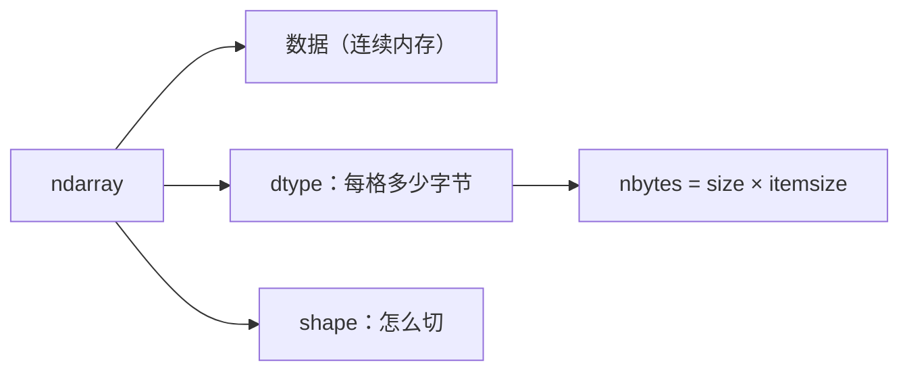

# PY-060 ndarray 与 dtype

## 1. 知识概览

| 项 | 内容 |
|---|---|
| 知识 ID | `PY-060` |
| 所属模块 | M-PY-07 NumPy 科学计算 |
| 学习难度 | L2 初级 |
| **预计学习时间** | 45 分钟 |
| 前置知识 | [[PY-059 NumPy 与列表的区别]] |
| 学习目标 | 掌握 `dtype`、`shape`、`ndim`、`size`、`itemsize`，会做类型转换与内存估算 |

## 2. 通俗原理讲解

`ndarray` 是 NumPy 的核心对象，它由三样东西描述：

- **数据**：连续内存里的一串值；
- **dtype**：每个值占多少字节、怎么解释（整数？浮点？）；
- **shape**：怎么切分（几行几列）。

类比：一块钢板（数据）+ 钢板厚度（dtype）+ 切割方式（shape）。

**为什么关心 dtype**：它直接决定内存与精度。`int8` 只占 1 字节，`float64` 占 8 字节——同样 100 万个数，差 8 倍内存。

## 3. 技术原理

| 属性 | 含义 | 示例 |
|---|---|---|
| `dtype` | 元素类型 | `int64`、`float64` |
| `shape` | 各维长度（元组） | `(2, 3)` |
| `ndim` | 维度数 | `2` |
| `size` | 元素总数 | `6` |
| `itemsize` | 单元素字节数 | `8` |
| `nbytes` | 总字节数 = `size × itemsize` | `48` |

**常见 dtype**

| dtype | 字节 | 范围/用途 |
|---|---|---|
| `int8/16/32/64` | 1/2/4/8 | 整数，越大范围越广 |
| `float32` | 4 | 单精度，深度学习常用 |
| `float64` | 8 | 双精度，NumPy 默认浮点 |
| `bool` | 1 | 布尔 |
| `str_` / `<U..` | 变长 | 字符串（少用） |

**类型提升规则**：`int` 与 `float` 混合 → `float64`；与字符串混合 → 全部变字符串。

## 4. 图解辅助



## 5. 完整代码示例

```powershell
python dtype_demo.py
```

```python
import numpy as np

a = np.array([1, 2, 3])
print(a, a.dtype, a.shape, a.ndim, a.size)

b = np.array([1.5, 2.5])
print(b, b.dtype)

c = a.astype(float)
print(c, c.dtype)

d = np.array([1, 2, 3], dtype=np.int8)
print(d.dtype, d.itemsize, d.nbytes)

print(np.array([1, 2], dtype=np.float32).dtype)
```

**预期输出**

```
[1 2 3] int64 (3,) 1 3
[1.5 2.5] float64
[1. 2. 3.] float64
int8 1 3
float32
```

**说明**

- 整数默认 `int64`（64 位系统），浮点默认 `float64`。
- `astype(float)` 生成**新数组**，原数组不变。
- `d.itemsize == 1` 说明每个元素 1 字节，3 个元素共 `nbytes == 3`。
- `float32` 常用于省内存/加速（深度学习训练默认）。

## 6. 实践练习

**基础**

1. 创建 `np.array([10, 20, 30])`，打印 dtype/shape/size。
2. 用 `astype(np.float32)` 转换并打印新 dtype。
3. 计算一个 `(4, 5)` 的 `int32` 数组占多少字节。

**进阶**

1. 让 `np.array([1, 2.5])` 打印 dtype，解释为什么是这个类型。
2. 比较 `int8` 与 `int64` 数组在 100 万个元素时的内存差异（用 `nbytes`）。

**综合实践**

写一个"内存估算器"：输入 `shape` 与 `dtype`，输出该数组的 `nbytes`（用 `np.empty(shape, dtype).nbytes` 或手算），并对 `(1000, 1000)` 的 `float64` 与 `float32` 各算一次。

## 7. 参考答案

**基础 1 · 思路**：属性直接取。

```python
import numpy as np
a = np.array([10, 20, 30])
print(a.dtype, a.shape, a.size)
```

运行结果：`int64 (3,) 3`

**基础 2 · 思路**：`astype`。

```python
import numpy as np
print(np.array([1, 2, 3]).astype(np.float32).dtype)
```

运行结果：`float32`

**基础 3 · 思路**：`size × itemsize`。

```python
import numpy as np
a = np.zeros((4, 5), dtype=np.int32)
print(a.nbytes)
```

运行结果：`80`

**进阶 1 · 思路**：混合类型提升。

```python
import numpy as np
print(np.array([1, 2.5]).dtype)
```

运行结果：`float64`

这里整数被提升为浮点，避免丢小数。

**进阶 2 · 思路**：`nbytes` 对比。

```python
import numpy as np
print(np.zeros(1_000_000, dtype=np.int8).nbytes)
print(np.zeros(1_000_000, dtype=np.int64).nbytes)
```

运行结果：

```
1000000
8000000
```

**综合实践 · 思路**：按 shape 建空数组读 nbytes。

```python
import numpy as np

def bytes_of(shape, dtype):
    return np.empty(shape, dtype=dtype).nbytes

print(bytes_of((1000, 1000), np.float64))
print(bytes_of((1000, 1000), np.float32))
print("float64 是 float32 的两倍:", bytes_of((1000, 1000), np.float64) == 2 * bytes_of((1000, 1000), np.float32))
```

运行结果：

```
8000000
4000000
float64 是 float32 的两倍: True
```

## 8. 常见错误

| 错误写法 | 现象 | 原因 | 正确写法 |
|---|---|---|---|
| 以为 `int` 默认是 `int32` | 内存估错 | 平台默认 64 位 | 显式 `dtype=np.int32` |
| 用 `astype` 后以为原数组变了 | 原数组不变 | 返回新数组 | 接收返回值 |
| 大数组用 `float64` 存整数 | 内存浪费一倍 | 精度过剩 | 用 `int32/int64` |
| 数组里放字符串 | dtype 变成 `<U..` | 类型提升 | 数值与文本分开存 |
| 忽略 `shape` 的逗号 | `(3)` 不是元组 | 单元素元组要逗号 | `(3,)` |

## 9. 知识关联

- **前置**：[[PY-059 NumPy 与列表的区别]]
- **后继**：[[PY-061 数组创建与 shape]]
- **相关数学**：向量与矩阵的维度概念见 [[MATH-201 向量与空间基础]]
- **所属模块**：`M-PY-07 NumPy 科学计算`

## 10. 学习记录

| 日期 | 状态 | 掌握程度 | 遇到的问题 | 个人总结 | 待复习 |
|---|---|---|---|---|---|
| — | planned | — | — | — | — |

---

## 🔗 Notion 同步信息

> 以下内容由 Notion「AI Knowledge System · 知识点」数据库按知识 ID 合并而来（导出于 2026-11-09）。

| 属性 | 值 |
|---|---|
| 学科 | Python基础 |
| 学习状态 | 未开始 |
| 难度 | L2 应用 |
| 知识类型 | Concept |
| 学习目标 | 掌握 dtype/shape/ndim/size，会类型转换与内存估算。 |

- **所属模块**：[M-PY-07 NumPy 科学计算](../%E8%AF%BE%E7%A8%8B%E6%A8%A1%E5%9D%97/M-PY-07%20NumPy%20%E7%A7%91%E5%AD%A6%E8%AE%A1%E7%AE%97.md)
- **前置知识**：[PY-059 NumPy 与列表的区别](PY-059%20NumPy%20%E4%B8%8E%E5%88%97%E8%A1%A8%E7%9A%84%E5%8C%BA%E5%88%AB.md)
- **后继知识**：[PY-061 数组创建与 shape](PY-061%20%E6%95%B0%E7%BB%84%E5%88%9B%E5%BB%BA%E4%B8%8E%20shape.md)
- **关联数学**：[MATH-201 向量与空间基础](../../06_%E6%95%B0%E5%AD%A6%E5%9F%BA%E7%A1%80/02%20%E7%BA%BF%E6%80%A7%E4%BB%A3%E6%95%B0/MATH-201%20%E5%90%91%E9%87%8F%E4%B8%8E%E7%A9%BA%E9%97%B4%E5%9F%BA%E7%A1%80.md)
