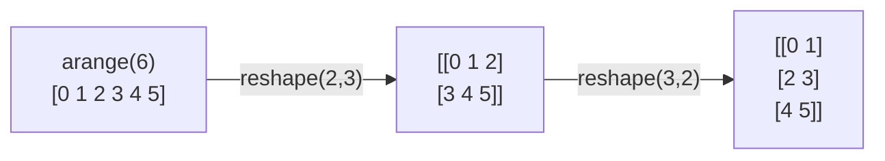

# PY-061 数组创建与 shape

## 1. 知识概览

| 项 | 内容 |
|---|---|
| 知识 ID | `PY-061` |
| 所属模块 | M-PY-07 NumPy 科学计算 |
| 学习难度 | L2 初级 |
| **预计学习时间** | 40 分钟 |
| 前置知识 | [[PY-060 ndarray 与 dtype]] |
| 学习目标 | 掌握 6 种常用创建方式与 `reshape`，能看懂 `(2, 3)` 与 `(2,)` 的区别 |

## 2. 通俗原理讲解

创建数组像**准备一张表格**：

- 要空白表 → `zeros`
- 要全 1 表 → `ones`
- 要等差数列 → `arange` / `linspace`
- 要固定填充 → `full`
- 要单位矩阵 → `eye`

`shape` 就是表格的"几行几列"。改形状用 `reshape`，**元素总数必须不变**。

## 3. 技术原理

| 函数 | 作用 | 示例 |
|---|---|---|
| `np.array(list)` | 从列表转 | `np.array([1,2])` |
| `np.zeros(shape)` | 全 0 | `np.zeros((2,3))` |
| `np.ones(shape)` | 全 1 | `np.ones(2)` |
| `np.full(shape, v)` | 填充 v | `np.full((2,2), 7)` |
| `np.arange(start, stop, step)` | 左闭右开 | `np.arange(6)` |
| `np.linspace(a, b, n)` | n 个等距点（含端点） | `np.linspace(0,1,5)` |
| `np.eye(n)` | 单位矩阵 | `np.eye(2)` |

**reshape 规则**

- `a.reshape(2, 3)`：元素总数必须等于 6。
- `-1` 表示"自动算这一维"：`a.reshape(2, -1)`。
- `reshape` 通常返回**视图**（共享内存），不是复制。

## 4. 图解辅助



同一个一维数据，换个切法就是不同形状。

## 5. 完整代码示例

```powershell
python create_demo.py
```

```python
import numpy as np

print(np.zeros((2, 2), dtype=int).tolist())
print(np.ones(3).tolist())
print(np.arange(6).tolist())
print(np.linspace(0, 1, 5).tolist())
print(np.full((2, 2), 7).tolist())
print(np.eye(2, dtype=int).tolist())

a = np.arange(6)
print(a.shape, a.reshape(2, 3).shape, a.reshape(2, 3).tolist())
print(np.arange(6).reshape(2, -1).shape)
```

**预期输出**

```
[[0, 0], [0, 0]]
[1.0, 1.0, 1.0]
[0, 1, 2, 3, 4, 5]
[0.0, 0.25, 0.5, 0.75, 1.0]
[[7, 7], [7, 7]]
[[1, 0], [0, 1]]
(6,) (2, 3) [[0, 1, 2], [3, 4, 5]]
(2, 3)
```

**说明**

- 用 `.tolist()` 输出，避免 NumPy 的多行格式干扰阅读。
- `ones` 默认 `float64`，所以是 `1.0`；`zeros(dtype=int)` 才是整数。
- `(6,)` 是一维（一个逗号），`(2, 3)` 是二维——**逗号数量 = 维度**。
- `reshape(2, -1)` 中 `-1` 自动推成 3。

## 6. 实践练习

**基础**

1. 创建 `(3, 4)` 的全 0 数组并打印 shape。
2. 用 `arange(1, 10, 2)` 看结果。
3. 用 `linspace(0, 1, 11)` 生成 11 个点。

**进阶**

1. 把 `arange(12)` 改成 `(3, 4)`、`(4, 3)`、`(2, 6)`，观察元素如何填充（行优先）。
2. 解释 `reshape` 与 `resize` 的区别。

**综合实践**

写一个"生成棋盘"函数：用 `zeros((8,8), int)`，把奇数行列设为 1，输出 8×8 的 0/1 矩阵。

## 7. 参考答案

**基础 1 · 思路**：`zeros`。

```python
import numpy as np
a = np.zeros((3, 4), dtype=int)
print(a.shape, a.tolist())
```

运行结果：`(3, 4) [[0, 0, 0, 0], [0, 0, 0, 0], [0, 0, 0, 0]]`

**基础 2 · 思路**：步长 2。

```python
import numpy as np
print(np.arange(1, 10, 2).tolist())
```

运行结果：`[1, 3, 5, 7, 9]`

**基础 3 · 思路**：11 个点含端点。

```python
import numpy as np
print(np.linspace(0, 1, 11).round(1).tolist())
```

运行结果：`[0.0, 0.1, 0.2, 0.3, 0.4, 0.5, 0.6, 0.7, 0.8, 0.9, 1.0]`

**进阶 1 · 思路**：行优先填充。

```python
import numpy as np
print(np.arange(12).reshape(3, 4).tolist())
print(np.arange(12).reshape(2, 6).tolist())
```

运行结果：

```
[[0, 1, 2, 3], [4, 5, 6, 7], [8, 9, 10, 11]]
[[0, 1, 2, 3, 4, 5], [6, 7, 8, 9, 10, 11]]
```

先行后列，从左上到右下顺序填。

**进阶 2 · 思路**：视图 vs 原地改。

答案：`reshape` 尽量返回**视图**（共享内存、元素数必须不变）；`resize` 会直接改数组本身，元素数可变（不够时补 0）。

**综合实践 · 思路**：利用行列下标奇偶性。

```python
import numpy as np

board = np.zeros((8, 8), dtype=int)
board[1::2, ::2] = 1
board[::2, 1::2] = 1
print(board.tolist()[0])
print("1 的个数:", int(board.sum()))
```

运行结果：

```
[0, 1, 0, 1, 0, 1, 0, 1]
1 的个数: 32
```

## 8. 常见错误

| 错误写法 | 现象 | 原因 | 正确写法 |
|---|---|---|---|
| `np.zeros(3, 4)` | `TypeError` | shape 要传元组 | `np.zeros((3, 4))` |
| `reshape(2, 3)` 但只有 5 个元素 | `ValueError` | 总数不匹配 | 先确认 `size` |
| 以为 `arange(1, 10)` 含 10 | 少一个 | 左闭右开 | 用 `arange(1, 11)` |
| 以为 `ones` 是整数 | 得到 `1.0` | 默认 float64 | 传 `dtype=int` |
| 用 `(3)` 表示一维 | 其实是整数 3 | 缺逗号 | `(3,)` |

## 9. 知识关联

- **前置**：[[PY-060 ndarray 与 dtype]]
- **后继**：[[PY-062 索引与切片]]
- **相关数学**：矩阵形状（行×列）见 [[MATH-216 矩阵乘法]]
- **所属模块**：`M-PY-07 NumPy 科学计算`

## 10. 学习记录

| 日期 | 状态 | 掌握程度 | 遇到的问题 | 个人总结 | 待复习 |
|---|---|---|---|---|---|
| — | planned | — | — | — | — |

---

## 🔗 Notion 同步信息

> 以下内容由 Notion「AI Knowledge System · 知识点」数据库按知识 ID 合并而来（导出于 2026-11-09）。

| 属性 | 值 |
|---|---|
| 学科 | Python基础 |
| 学习状态 | 未开始 |
| 难度 | L2 应用 |
| 知识类型 | Technique |
| 学习目标 | 掌握常用创建方式与 reshape，看懂形状元组。 |

- **所属模块**：[M-PY-07 NumPy 科学计算](../%E8%AF%BE%E7%A8%8B%E6%A8%A1%E5%9D%97/M-PY-07%20NumPy%20%E7%A7%91%E5%AD%A6%E8%AE%A1%E7%AE%97.md)
- **前置知识**：[PY-060 ndarray 与 dtype](PY-060%20ndarray%20%E4%B8%8E%20dtype.md)
- **后继知识**：[PY-062 索引与切片](PY-062%20%E7%B4%A2%E5%BC%95%E4%B8%8E%E5%88%87%E7%89%87.md)
