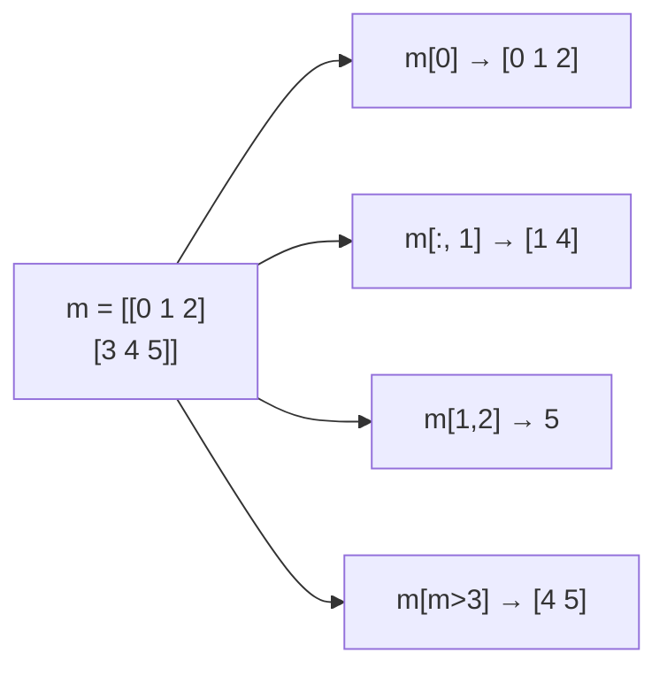

# PY-062 索引与切片

## 1. 知识概览

| 项 | 内容 |
|---|---|
| 知识 ID | `PY-062` |
| 所属模块 | M-PY-07 NumPy 科学计算 |
| 学习难度 | L2 初级 |
| **预计学习时间** | 45 分钟 |
| 前置知识 | [[PY-061 数组创建与 shape]] |
| 学习目标 | 会做一维/二维索引与切片、会用布尔索引与 `where`、知道切片返回视图 |

## 2. 通俗原理讲解

索引像**查坐标**：

- 一维：`a[2]` 第 3 个元素。
- 二维：`m[行, 列]`，逗号前是行、后是列。
- 切片：`a[起:止:步]`，**左闭右开**，跟列表一致。

布尔索引像**用筛子筛**：`m[m > 3]` 把所有大于 3 的元素捞出来，形状会被压平。

## 3. 技术原理

| 写法 | 含义 |
|---|---|
| `a[2]` | 第 3 个元素 |
| `a[-1]` | 最后一个 |
| `a[2:5]` | 下标 2、3、4 |
| `a[::2]` | 每隔一个取 |
| `a[::-1]` | 反转 |
| `m[0]` | 第 0 行（整行） |
| `m[:, 1]` | 第 1 列（整列） |
| `m[1, 2]` | 第 1 行第 2 列 |
| `m[m > 3]` | 布尔索引，返回一维数组 |
| `np.where(cond)` | 返回满足条件的下标 |

**关键区别**：**切片返回视图（共享内存）**，布尔索引返回**副本**。改视图会影响原数组，这是最常见的"改了一处坏了一片"。

## 4. 图解辅助



## 5. 完整代码示例

```powershell
python indexing_demo.py
```

```python
import numpy as np

a = np.arange(10)
print(a[2:8:2].tolist())
print(a[::-1][:3].tolist())

m = np.arange(6).reshape(2, 3)
print(m[0].tolist(), m[:, 1].tolist())
print(m[1, 2])
print(m[m > 3].tolist())
print(np.where(a % 2 == 0)[0].tolist())
```

**预期输出**

```
[2, 4, 6]
[9, 8, 7]
[0, 1, 2] [1, 4]
5
[4, 5]
[0, 2, 4, 6, 8]
```

**说明**

- `a[2:8:2]` 取下标 2、4、6。
- `m[0]` 得到整行 `[0, 1, 2]`；`m[:, 1]` 得到整列 `[1, 4]`。
- `m[m > 3]` 把满足条件的元素压平成一维。
- `np.where` 返回的是**下标元组**，取 `[0]` 才是下标数组。

## 6. 实践练习

**基础**

1. 建 `np.arange(10)`，取前 3 个、后 3 个。
2. 建 `(3, 3)` 矩阵，取对角线元素（提示：`np.eye` 或布尔）。
3. 用布尔索引取出所有大于 5 的数。

**进阶**

1. 验证切片是视图：改 `a[0:2]` 的值，看原数组是否变化。
2. 用 `np.where` 找出数组中所有负数并输出下标。

**综合实践**

写一个"成绩筛选器"：给定 `(n, 3)` 的（语文、数学、英语）成绩矩阵，输出①数学成绩大于 90 的所有行②每行总分大于 250 的行号③所有不及格（<60）的位置。

## 7. 参考答案

**基础 1 · 思路**：切片。

```python
import numpy as np
a = np.arange(10)
print(a[:3].tolist(), a[-3:].tolist())
```

运行结果：`[0, 1, 2] [7, 8, 9]`

**基础 2 · 思路**：对角线用 `np.diag` 或 `[i, i]`。

```python
import numpy as np
m = np.arange(9).reshape(3, 3)
print(np.diag(m).tolist())
print([int(m[i, i]) for i in range(3)])
```

运行结果：

```
[0, 4, 8]
[0, 4, 8]
```

**基础 3 · 思路**：布尔索引。

```python
import numpy as np
a = np.arange(10)
print(a[a > 5].tolist())
```

运行结果：`[6, 7, 8, 9]`

**进阶 1 · 思路**：切片是视图。

```python
import numpy as np
a = np.arange(5)
sub = a[0:2]
sub[0] = 99
print(a.tolist())
```

运行结果：`[99, 1, 2, 3, 4]`——原数组被改了。

**进阶 2 · 思路**：`where` 返回下标。

```python
import numpy as np
a = np.array([3, -1, 4, -2])
print(np.where(a < 0)[0].tolist())
```

运行结果：`[1, 3]`

**综合实践 · 思路**：三个条件分别处理。

```python
import numpy as np

scores = np.array([
    [88, 92, 79],
    [76, 95, 81],
    [90, 88, 86],
])

print("数学 > 90 的行:")
print(scores[scores[:, 1] > 90].tolist())

print("总分 > 250 的行号:", np.where(scores.sum(axis=1) > 250)[0].tolist())
print("不及格位置:", np.argwhere(scores < 60).tolist())
```

运行结果：

```
数学 > 90 的行:
[[76, 95, 81]]
总分 > 250 的行号: [1]
不及格位置: []
```

## 8. 常见错误

| 错误写法 | 现象 | 原因 | 正确写法 |
|---|---|---|---|
| 改切片后原数组也变了 | 意料之外 | 切片是视图 | 需要独立数据用 `.copy()` |
| `m[:, 1]` 写成 `m[1]` | 拿到整行 | 行列混淆 | 逗号前是行 |
| 以为 `a[2:5]` 含下标 5 | 少一个 | 左闭右开 | 要含 5 写 `[2:6]` |
| 布尔索引后还想保持二维 | 被压平 | 布尔索引返回一维 | 用 `np.where` + 索引或 `m[m>3].reshape` |
| 用 `where` 返回值直接当元素 | 拿到下标 | 返回下标 | 取 `a[cond]` 才是元素 |

## 9. 知识关联

- **前置**：[[PY-061 数组创建与 shape]]
- **后继**：[[PY-063 数组运算]]、[[PY-068 随机数、视图与副本]]
- **相关数学**：矩阵元素 $a_{ij}$ 的记号见 [[MATH-216 矩阵乘法]]
- **所属模块**：`M-PY-07 NumPy 科学计算`

## 10. 学习记录

| 日期 | 状态 | 掌握程度 | 遇到的问题 | 个人总结 | 待复习 |
|---|---|---|---|---|---|
| — | planned | — | — | — | — |

---

## 🔗 Notion 同步信息

> 以下内容由 Notion「AI Knowledge System · 知识点」数据库按知识 ID 合并而来（导出于 2026-11-09）。

| 属性 | 值 |
|---|---|
| 学科 | Python基础 |
| 学习状态 | 未开始 |
| 难度 | L2 应用 |
| 知识类型 | Technique |
| 学习目标 | 会做一维/二维索引切片、布尔索引与 where。 |

- **所属模块**：[M-PY-07 NumPy 科学计算](../%E8%AF%BE%E7%A8%8B%E6%A8%A1%E5%9D%97/M-PY-07%20NumPy%20%E7%A7%91%E5%AD%A6%E8%AE%A1%E7%AE%97.md)
- **前置知识**：[PY-061 数组创建与 shape](PY-061%20%E6%95%B0%E7%BB%84%E5%88%9B%E5%BB%BA%E4%B8%8E%20shape.md)
- **后继知识**：[PY-063 数组运算](PY-063%20%E6%95%B0%E7%BB%84%E8%BF%90%E7%AE%97.md)
