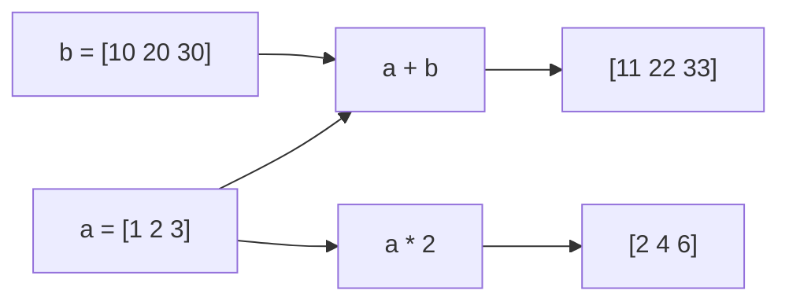

# PY-063 数组运算

## 1. 知识概览

| 项 | 内容 |
|---|---|
| 知识 ID | `PY-063` |
| 所属模块 | M-PY-07 NumPy 科学计算 |
| 学习难度 | L2 初级 |
| **预计学习时间** | 40 分钟 |
| 前置知识 | [[PY-062 索引与切片]] |
| 学习目标 | 掌握逐元素运算、比较运算、通用函数，理解"数组运算默认逐元素" |

## 2. 通俗原理讲解

NumPy 的运算符默认是**逐个元素对着算**：

```
[1, 2, 3] + [10, 20, 30]  →  [11, 22, 33]
```

不是拼接，也不是矩阵乘法。这跟数学里的"向量加法"一致。

**矩阵乘法要单独用 `@`**（见 [[PY-066 矩阵运算]]）。

## 3. 技术原理

| 运算 | 写法 | 说明 |
|---|---|---|
| 加减乘除 | `a + b`、`a - b`、`a * b`、`a / b` | 逐元素 |
| 标量运算 | `a * 2`、`a + 1` | 广播到每个元素 |
| 幂 | `a ** 2` | 逐元素平方 |
| 比较 | `a > 1` | 返回布尔数组 |
| 逐元素取大 | `np.maximum(a, b)` | 每对取较大 |
| 数学函数 | `np.sqrt`、`np.exp`、`np.log` | 通用函数（ufunc） |

**注意**：`/` 结果是浮点；`//` 是整除；除以 0 会得到 `inf` 或警告（不是异常）。

## 4. 图解辅助



## 5. 完整代码示例

```powershell
python array_ops.py
```

```python
import numpy as np

a = np.array([1, 2, 3])
b = np.array([10, 20, 30])

print((a + b).tolist())
print((b - a).tolist())
print((a * 2).tolist())
print((b / a).tolist())
print(np.sqrt(a).round(3).tolist())
print((a ** 2).tolist())
print((a > 1).tolist())
print(np.maximum(a, 2).tolist())
```

**预期输出**

```
[11, 22, 33]
[9, 18, 27]
[2, 4, 6]
[10.0, 10.0, 10.0]
[1.0, 1.414, 1.732]
[1, 4, 9]
[False, True, True]
[2, 2, 3]
```

**说明**

- `b / a` 得到浮点数组，`10.0` 不是 `10`。
- `np.sqrt` 是通用函数，直接作用到每个元素。
- `a > 1` 得到**布尔数组**，可直接当索引用。
- `np.maximum(a, 2)` 把每个元素与 2 取较大值。

## 6. 实践练习

**基础**

1. 两个数组相加、相乘，打印结果。
2. 给数组每个元素加 100。
3. 用比较运算得到一个布尔数组，并统计 `True` 的个数。

**进阶**

1. 计算 `[1,2,3]` 与 `[4,5,6]` 的逐元素除法，观察结果类型。
2. 解释 `a * b` 与 `a @ b` 的区别（后者见矩阵运算）。

**综合实践**

写一个"分数调整器"：给定成绩数组，规则为"加 5 分但不超过 100"，用向量化方式实现并输出调整前后对比。

## 7. 参考答案

**基础 1 · 思路**：直接运算符。

```python
import numpy as np
a, b = np.array([1, 2, 3]), np.array([4, 5, 6])
print((a + b).tolist(), (a * b).tolist())
```

运行结果：`[5, 7, 9] [4, 10, 18]`

**基础 2 · 思路**：标量广播。

```python
import numpy as np
print((np.array([1, 2, 3]) + 100).tolist())
```

运行结果：`[101, 102, 103]`

**基础 3 · 思路**：布尔数组求和。

```python
import numpy as np
a = np.array([1, 5, 2, 8])
mask = a > 2
print(mask.tolist(), int(mask.sum()))
```

运行结果：`[False, True, False, True] 2`

**进阶 1 · 思路**：真除法。

```python
import numpy as np
r = np.array([1, 2, 3]) / np.array([4, 5, 6])
print(r.round(4).tolist(), r.dtype)
```

运行结果：`[0.25, 0.4, 0.5] float64`

**进阶 2 · 思路**：逐元素 vs 矩阵乘法。

答案：`a * b` 是逐元素相乘（Hadamard 积），要求形状可广播；`a @ b` 是线性代数意义的矩阵乘法，要求"左列数 = 右行数"。

**综合实践 · 思路**：用 `np.minimum` 封顶。

```python
import numpy as np

scores = np.array([58, 92, 77, 99])
adjusted = np.minimum(scores + 5, 100)
print("调整前:", scores.tolist())
print("调整后:", adjusted.tolist())
```

运行结果：

```
调整前: [58, 92, 77, 99]
调整后: [63, 97, 82, 100]
```

## 8. 常见错误

| 错误写法 | 现象 | 原因 | 正确写法 |
|---|---|---|---|
| 以为 `*` 是矩阵乘法 | 结果不对 | `*` 是逐元素 | 矩阵乘用 `@` |
| 两个数组长度不同直接算 | `ValueError` | 形状不兼容 | 用广播（见下一节） |
| 用 `/` 得到整数 | 实际是浮点 | 真除法 | 要整除用 `//` |
| 忽略除零警告 | 出现 `inf`/`nan` | 未检查 | 先判 0 或用 `np.errstate` |
| 用 `and` 组合条件 | 报错 | 数组不支持 `and` | 用 `&`、`|`、`~`（带括号） |

## 9. 知识关联

- **前置**：[[PY-062 索引与切片]]
- **后继**：[[PY-064 广播机制]]、[[PY-066 矩阵运算]]
- **相关数学**：向量加法/数乘见 [[MATH-201 向量与空间基础]]
- **所属模块**：`M-PY-07 NumPy 科学计算`

## 10. 学习记录

| 日期 | 状态 | 掌握程度 | 遇到的问题 | 个人总结 | 待复习 |
|---|---|---|---|---|---|
| — | planned | — | — | — | — |

---

## 🔗 Notion 同步信息

> 以下内容由 Notion「AI Knowledge System · 知识点」数据库按知识 ID 合并而来（导出于 2026-11-09）。

| 属性 | 值 |
|---|---|
| 学科 | Python基础 |
| 学习状态 | 未开始 |
| 难度 | L2 应用 |
| 知识类型 | Technique |
| 学习目标 | 掌握逐元素运算、比较与通用函数。 |

- **所属模块**：[M-PY-07 NumPy 科学计算](../%E8%AF%BE%E7%A8%8B%E6%A8%A1%E5%9D%97/M-PY-07%20NumPy%20%E7%A7%91%E5%AD%A6%E8%AE%A1%E7%AE%97.md)
- **前置知识**：[PY-062 索引与切片](PY-062%20%E7%B4%A2%E5%BC%95%E4%B8%8E%E5%88%87%E7%89%87.md)
- **后继知识**：[PY-064 广播机制](PY-064%20%E5%B9%BF%E6%92%AD%E6%9C%BA%E5%88%B6.md) · [PY-065 向量化与性能](PY-065%20%E5%90%91%E9%87%8F%E5%8C%96%E4%B8%8E%E6%80%A7%E8%83%BD.md) · [PY-067 聚合与统计](PY-067%20%E8%81%9A%E5%90%88%E4%B8%8E%E7%BB%9F%E8%AE%A1.md) · [PY-068 随机数、视图与副本](PY-068%20%E9%9A%8F%E6%9C%BA%E6%95%B0%E3%80%81%E8%A7%86%E5%9B%BE%E4%B8%8E%E5%89%AF%E6%9C%AC.md)
- **关联数学**：[MATH-216 矩阵乘法](../../06_%E6%95%B0%E5%AD%A6%E5%9F%BA%E7%A1%80/02%20%E7%BA%BF%E6%80%A7%E4%BB%A3%E6%95%B0/MATH-216%20%E7%9F%A9%E9%98%B5%E4%B9%98%E6%B3%95.md)
- **被项目引用**：[PROJ-006 NumPy 数组计算工具](../../07_%E5%AE%9E%E6%88%98%E9%A1%B9%E7%9B%AE/02%20%E6%95%B0%E6%8D%AE%E5%88%86%E6%9E%90%E9%A1%B9%E7%9B%AE/PROJ-006%20NumPy%20%E6%95%B0%E7%BB%84%E8%AE%A1%E7%AE%97%E5%B7%A5%E5%85%B7.md)
