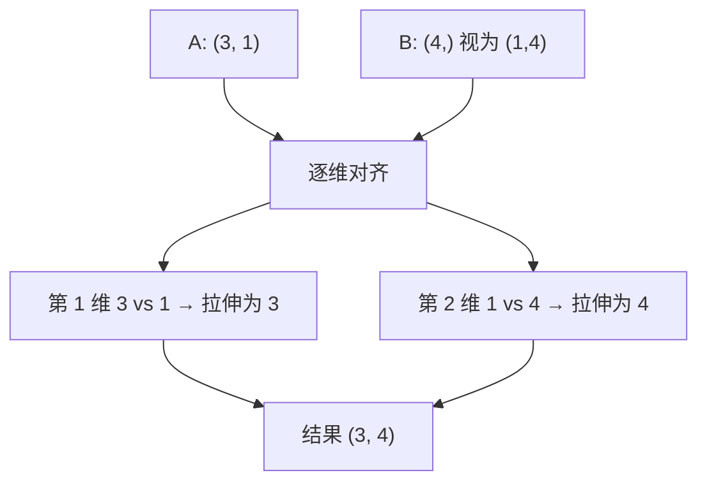

# PY-064 广播机制

## 1. 知识概览

| 项 | 内容 |
|---|---|
| 知识 ID | `PY-064` |
| 所属模块 | M-PY-07 NumPy 科学计算 |
| 学习难度 | L3 中级 |
| **预计学习时间** | 45 分钟 |
| 前置知识 | [[PY-063 数组运算]] |
| 学习目标 | 能判断两个形状能否广播、会看广播后的形状、知道它省内存的原因 |

## 2. 通俗原理讲解

广播像**盖章**：

- 你有一个 4 格的表格，一个只有 1 格的章。
- 章会自动"盖到每一格"（复制到所有位置），但**不会真的复制出 4 份数据**——只在计算时按需取值。

所以 `(3, 1)` 与 `(1, 4)` 相加，会得到 `(3, 4)`：行方向复制 4 次、列方向复制 3 次。

## 3. 技术原理

**广播三条规则**

1. 从**最后一维**开始，逐维比较。
2. 两维相等 → 兼容。
3. 其中一维是 1 → 该维被"拉伸"到另一维的长度。
4. 都不满足 → `ValueError`。

**示例**

| 形状 A | 形状 B | 结果 |
|---|---|---|
| `(3, 1)` | `(4,)` | `(3, 4)` ✅ |
| `(2, 3)` | `(3,)` | `(2, 3)` ✅ |
| `(2, 3)` | `(2,)` | ❌ 最后维 3 vs 2 |
| `(3,)` | `(4,)` | ❌ 3 vs 4 |

**代价**：广播本身不复制数据（省内存），但结果数组仍是完整大小。若中间结果巨大，仍会吃内存。

## 4. 图解辅助



## 5. 完整代码示例

```powershell
python broadcasting.py
```

```python
import numpy as np

a = np.arange(3).reshape(3, 1)
b = np.arange(4)
c = a + b
print(c.tolist())
print(c.shape)

print((np.array([[1], [2]]) * np.array([10, 20])).tolist())

try:
    np.arange(3) + np.arange(4)
except ValueError:
    print("形状不兼容触发 ValueError: True")
```

**预期输出**

```
[[0, 1, 2, 3], [1, 2, 3, 4], [2, 3, 4, 5]]
(3, 4)
[[10, 20], [20, 40]]
形状不兼容触发 ValueError: True
```

**说明**

- `(3,1) + (4,)` → `(3,4)`：行是 0/1/2，列是 0/1/2/3，逐格相加。
- `[[1],[2]] * [10,20]` → `[[10,20],[20,40]]`，列被拉伸。
- `(3,) + (4,)` 报错，因为最后一维 3≠4 且都不是 1。

## 6. 实践练习

**基础**

1. `(2, 3)` 与 `(3,)` 相加，打印结果形状。
2. `(5, 1)` 与 `(1, 3)` 相加，打印结果。
3. 判断 `(2, 3)` 与 `(2,)` 能否相加，为什么。

**进阶**

1. 用广播把一维数组"加到每一行"上，实现"每行减去行均值"。
2. 解释广播为什么"不复制数据却仍可能耗内存"。

**综合实践**

写一个"标准化"函数：给定 `(n, m)` 矩阵，用广播减去每列均值、除以每列标准差，输出处理后的矩阵形状与前两行。

## 7. 参考答案

**基础 1 · 思路**：末维对齐。

```python
import numpy as np
r = np.arange(6).reshape(2, 3) + np.arange(3)
print(r.shape, r.tolist())
```

运行结果：

```
(2, 3) [[0, 2, 4], [3, 5, 7]]
```

**基础 2 · 思路**：双维拉伸。

```python
import numpy as np
r = np.zeros((5, 1)) + np.zeros((1, 3))
print(r.shape)
```

运行结果：`(5, 3)`

**基础 3 · 思路**：末维不匹配。

答案：不能。末维 3 vs 2，且都不是 1，违反广播规则。

**进阶 1 · 思路**：求出均值后保持 `(n,1)`。

```python
import numpy as np

m = np.arange(6).reshape(2, 3).astype(float)
row_mean = m.mean(axis=1, keepdims=True)
print((m - row_mean).tolist())
```

运行结果：

```
[[-1.0, 0.0, 1.0], [-1.0, 0.0, 1.0]]
```

**进阶 2 · 思路**：输入不复制，结果要落地。

答案：广播只在**计算时**按需取值，不会把 `(1,4)` 真的扩成 `(3,4)`；但**结果数组**（`(3,4)`）是实实在在分配的，所以结果越大越占内存。

**综合实践 · 思路**：`axis=0` 求列统计并用 `keepdims` 保持二维。

```python
import numpy as np

def standardize(m):
    m = np.asarray(m, dtype=float)
    mean = m.mean(axis=0, keepdims=True)
    std = m.std(axis=0, keepdims=True)
    return (m - mean) / std

x = np.array([[1.0, 2.0], [3.0, 4.0], [5.0, 6.0]])
z = standardize(x)
print(z.shape)
print(z.round(4).tolist())
```

运行结果：

```
(3, 2)
[[-1.2247, -1.2247], [0.0, 0.0], [1.2247, 1.2247]]
```

## 8. 常见错误

| 错误写法 | 现象 | 原因 | 正确写法 |
|---|---|---|---|
| 忘记 `keepdims` | 形状掉一维导致广播方向错 | 聚合后变成 `(n,)` | `keepdims=True` |
| `(2,3)` 与 `(2,)` 相加 | `ValueError` | 末维不匹配 | 改成 `(2,1)` 或转置 |
| 以为广播会复制输入 | 内存估算错 | 理解偏差 | 只有结果占内存 |
| 用广播做超大结果 | 内存爆 | 结果尺寸 = 各维最大 | 分批计算 |
| 混淆 `axis=0/1` | 减错方向 | 轴含义不清 | 0=跨行（列统计），1=跨列（行统计） |

## 9. 知识关联

- **前置**：[[PY-063 数组运算]]
- **后继**：[[PY-065 向量化与性能]]、[[PY-066 矩阵运算]]
- **相关数学**：向量与矩阵的维数匹配见 [[MATH-216 矩阵乘法]]
- **所属模块**：`M-PY-07 NumPy 科学计算`

## 10. 学习记录

| 日期 | 状态 | 掌握程度 | 遇到的问题 | 个人总结 | 待复习 |
|---|---|---|---|---|---|
| — | planned | — | — | — | — |

---

## 🔗 Notion 同步信息

> 以下内容由 Notion「AI Knowledge System · 知识点」数据库按知识 ID 合并而来（导出于 2026-11-09）。

| 属性 | 值 |
|---|---|
| 学科 | Python基础 |
| 学习状态 | 未开始 |
| 难度 | L3 推导 |
| 知识类型 | Concept |
| 学习目标 | 能判断形状能否广播，会看广播后的形状。 |

- **所属模块**：[M-PY-07 NumPy 科学计算](../%E8%AF%BE%E7%A8%8B%E6%A8%A1%E5%9D%97/M-PY-07%20NumPy%20%E7%A7%91%E5%AD%A6%E8%AE%A1%E7%AE%97.md)
- **前置知识**：[PY-063 数组运算](PY-063%20%E6%95%B0%E7%BB%84%E8%BF%90%E7%AE%97.md)
- **后继知识**：[PY-066 矩阵运算](PY-066%20%E7%9F%A9%E9%98%B5%E8%BF%90%E7%AE%97.md)
- **关联数学**：[MATH-216 矩阵乘法](../../06_%E6%95%B0%E5%AD%A6%E5%9F%BA%E7%A1%80/02%20%E7%BA%BF%E6%80%A7%E4%BB%A3%E6%95%B0/MATH-216%20%E7%9F%A9%E9%98%B5%E4%B9%98%E6%B3%95.md)
