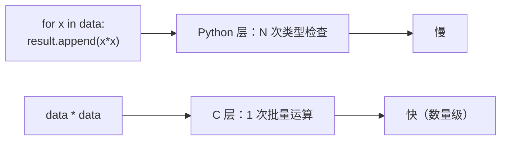

# PY-065 向量化与性能

## 1. 知识概览

| 项 | 内容 |
|---|---|
| 知识 ID | `PY-065` |
| 所属模块 | M-PY-07 NumPy 科学计算 |
| 学习难度 | L3 中级 |
| **预计学习时间** | 45 分钟 |
| 前置知识 | [[PY-063 数组运算]] |
| 学习目标 | 把 for 循环改写成数组运算、理解为什么快、知道什么情况下改了也没用 |

## 2. 通俗原理讲解

**向量化** = 把"一个一个算"改成"一次算一批"。

- Python 循环：每次都要问"这个对象是什么类型" → 慢。
- NumPy 运算：整块内存交给底层 C 循环，同类型、可并行 → 快几十倍。

类比：循环是**一个个称苹果**，向量化是**整箱上秤**。

## 3. 技术原理

**为什么快**

1. **连续内存**：按块读入 CPU 缓存，命中率高。
2. **无类型检查**：dtype 固定，编译后的循环直接算。
3. **SIMD**：一条指令处理多个数（如一次算 8 个 float）。
4. **释放 GIL**：部分运算在 C 层完成，不被 Python 解释器拖累。

**改写套路**

| 循环写法 | 向量化写法 |
|---|---|
| `[x*2 for x in a]` | `a * 2` |
| `sum(x*x for x in a)` | `(a * a).sum()` |
| `[x if x>0 else 0 for x in a]` | `np.maximum(a, 0)` |
| `for i: c[i] = a[i] + b[i]` | `a + b` |
| 嵌套循环求点积 | `np.dot(a, b)` 或 `a @ b` |

**什么时候向量化没用**：逻辑复杂、依赖上一次结果（如递推）、需要早停（找到就 break）。这类只能循环，或想办法改写。

## 4. 图解辅助



## 5. 完整代码示例

```powershell
python vectorize_demo.py
```

```python
import numpy as np

n = 100_000
lst = list(range(n))
arr = np.arange(n)

s1 = sum(x * x for x in lst)
s2 = int((arr * arr).sum())
print("结果一致:", s1 == s2)

a = np.array([1, 2, 3])
b = np.array([4, 5, 6])
print("点积:", int(np.dot(a, b)))
print("逐元素乘:", (a * b).tolist())
```

**预期输出**

```
结果一致: True
点积: 32
逐元素乘: [4, 10, 18]
```

**说明**

- 两种写法结果必须一致——这是改写后的第一个验收点。
- 本笔记**不打印耗时**：耗时受机器状态影响，写死数字等于伪造。你可以自己在本地用 `time.perf_counter()` 对比（几万条以上差距会非常明显）。
- 点积 `1*4 + 2*5 + 3*6 = 32`。

## 6. 实践练习

**基础**

1. 用循环与向量化分别求 `[1..1000]` 的立方和，验证相等。
2. 把 `[x if x > 0 else 0 for x in a]` 改成向量化写法。
3. 判断：向量化一定比循环快吗？

**进阶**

1. 把"两个列表逐元素相加"的循环改成数组运算。
2. 举一个"无法简单向量化"的例子，并说明原因。

**综合实践**

写一个"距离矩阵"：给定 `(n, 2)` 的点集，用广播计算所有点两两之间的欧氏距离，输出 `(n, n)` 矩阵（不许写双层 for）。

## 7. 参考答案

**基础 1 · 思路**：两种写法。

```python
import numpy as np

a = list(range(1, 1001))
c1 = sum(x ** 3 for x in a)
c2 = int((np.arange(1, 1001) ** 3).sum())
print(c1 == c2, c2)
```

运行结果：`True 250500250000`

**基础 2 · 思路**：`np.maximum`。

```python
import numpy as np
a = np.array([-2, -1, 0, 3, 5])
print(np.maximum(a, 0).tolist())
```

运行结果：`[0, 0, 0, 3, 5]`

**基础 3 · 思路**：不绝对。

答案：不一定。小数据（几十个元素）时循环可能更快，因为数组创建有开销；数据量大时才明显。

**进阶 1 · 思路**：直接相加。

```python
import numpy as np
a, b = [1, 2, 3], [10, 20, 30]
print((np.array(a) + np.array(b)).tolist())
```

运行结果：`[11, 22, 33]`

**进阶 2 · 思路**：有依赖关系。

答案：如斐波那契、累加器（每步依赖上一步结果）、找到即停的搜索——不能直接批量算。

**综合实践 · 思路**：`(n,1,2)` 与 `(1,n,2)` 广播。

```python
import numpy as np

points = np.array([[0.0, 0.0], [3.0, 4.0], [1.0, 0.0]])
diff = points[:, None, :] - points[None, :, :]
dist = np.sqrt((diff ** 2).sum(axis=-1))
print(dist.shape)
print(dist.round(3).tolist())
```

运行结果：

```
(3, 3)
[[0.0, 5.0, 1.0], [5.0, 0.0, 4.472], [1.0, 4.472, 0.0]]
```

## 8. 常见错误

| 错误写法 | 现象 | 原因 | 正确写法 |
|---|---|---|---|
| 循环里对数组逐元素赋值 | 慢 | 没向量化 | 整体运算 |
| 用 `append` 拼数组 | 极慢 | 每次都扩容 | 预分配 `np.empty` 或列表后转换 |
| 为了向量化硬凑逻辑 | 代码难懂 | 过度优化 | 保留循环 + 局部向量化 |
| 只测一次就下结论 | 结论不稳 | 无重复测量 | 多次取中位数 |
| 对比时数据量太小 | 看不出差异 | 常数开销占主导 | 用万级以上 |

## 9. 知识关联

- **前置**：[[PY-063 数组运算]]
- **后继**：[[PY-066 矩阵运算]]、[[PY-067 聚合与统计]]
- **相关数学**：点积与向量运算见 [[MATH-201 向量与空间基础]]
- **所属模块**：`M-PY-07 NumPy 科学计算`

## 10. 学习记录

| 日期 | 状态 | 掌握程度 | 遇到的问题 | 个人总结 | 待复习 |
|---|---|---|---|---|---|
| — | planned | — | — | — | — |

---

## 🔗 Notion 同步信息

> 以下内容由 Notion「AI Knowledge System · 知识点」数据库按知识 ID 合并而来（导出于 2026-11-09）。

| 属性 | 值 |
|---|---|
| 学科 | Python基础 |
| 学习状态 | 未开始 |
| 难度 | L3 推导 |
| 知识类型 | Concept |
| 学习目标 | 能把循环改写成数组运算，理解为什么快。 |

- **所属模块**：[M-PY-07 NumPy 科学计算](../%E8%AF%BE%E7%A8%8B%E6%A8%A1%E5%9D%97/M-PY-07%20NumPy%20%E7%A7%91%E5%AD%A6%E8%AE%A1%E7%AE%97.md)
- **前置知识**：[PY-063 数组运算](PY-063%20%E6%95%B0%E7%BB%84%E8%BF%90%E7%AE%97.md)
- **被项目引用**：[PROJ-006 NumPy 数组计算工具](../../07_%E5%AE%9E%E6%88%98%E9%A1%B9%E7%9B%AE/02%20%E6%95%B0%E6%8D%AE%E5%88%86%E6%9E%90%E9%A1%B9%E7%9B%AE/PROJ-006%20NumPy%20%E6%95%B0%E7%BB%84%E8%AE%A1%E7%AE%97%E5%B7%A5%E5%85%B7.md)
