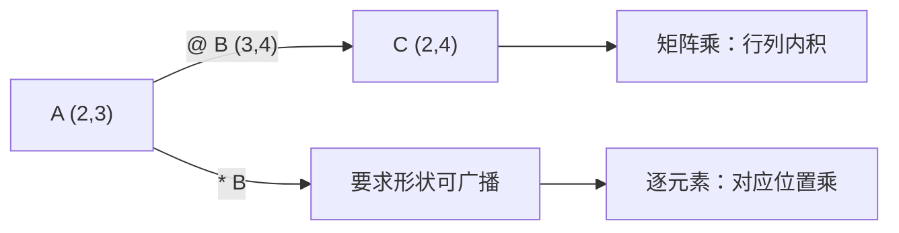

# PY-066 矩阵运算

## 1. 知识概览

| 项 | 内容 |
|---|---|
| 知识 ID | `PY-066` |
| 所属模块 | M-PY-07 NumPy 科学计算 |
| 学习难度 | L3 中级 |
| **预计学习时间** | 50 分钟 |
| 前置知识 | [[PY-064 广播机制]] |
| 学习目标 | 分清 `*` 与 `@`、会转置/求逆/求行列式、能写出线性回归的正规方程计算 |

## 2. 通俗原理讲解

矩阵乘法不是"对应位置相乘"：

- `A * B` = **逐元素**相乘（Hadamard 积），形状要能广播。
- `A @ B` = **线性代数**意义的矩阵乘法，要求"左的列数 = 右的行数"。

它的含义是**变换的复合**：先做 B 的变换，再做 A 的变换。

> 数学定义与推导见 [[MATH-216 矩阵乘法]]，本节只讲 NumPy 怎么算。

## 3. 技术原理

| 运算 | 写法 | 说明 |
|---|---|---|
| 矩阵乘 | `A @ B` 或 `np.dot(A, B)` | 形状 `(m,k)@(k,n) → (m,n)` |
| 逐元素乘 | `A * B` | 形状需广播兼容 |
| 转置 | `A.T` | 行列互换 |
| 求逆 | `np.linalg.inv(A)` | 要求方阵且可逆 |
| 行列式 | `np.linalg.det(A)` | 判断是否可逆（≈0 则接近奇异） |
| 单位矩阵 | `np.eye(n)` | `A @ I = A` |
| 解方程 | `np.linalg.solve(A, b)` | 比先求逆再乘更稳更快 |

**数值稳定性提醒**：能用 `solve` 就别 `inv`。求逆再乘会放大误差，条件数差时结果可能完全不可信。

## 4. 图解辅助



## 5. 完整代码示例

```powershell
python matrix_ops.py
```

```python
import numpy as np

A = np.array([[1, 2], [3, 4]])
B = np.array([[5, 6], [7, 8]])

print((A @ B).tolist())
print((A * B).tolist())
print(A.T.tolist())
print(np.linalg.inv(A).round(4).tolist())
print(round(float(np.linalg.det(A)), 4))
print((A @ np.eye(2)).tolist())
```

**预期输出**

```
[[19, 22], [43, 50]]
[[5, 12], [21, 32]]
[[1, 3], [2, 4]]
[[-2.0, 1.0], [1.5, -0.5]]
-2.0
[[1, 2], [3, 4]]
```

**说明**

- `A @ B = [[19,22],[43,50]]`，与手算一致（见 [[MATH-216 矩阵乘法]] 的数值示例）。
- `A * B` 逐元素相乘，结果完全不同。
- `A.T` 转置：第 1 行变第 1 列。
- `det(A) = 1×4 − 2×3 = -2`，非 0 所以可逆。
- `A @ I = A`，单位矩阵是矩阵乘法的"1"。

## 6. 实践练习

**基础**

1. 计算两个 `2×2` 矩阵的矩阵乘与逐元素乘，比较结果。
2. 求一个矩阵的转置与行列式。
3. 判断：`(2,3) @ (2,3)` 能算吗？

**进阶**

1. 用 `np.linalg.solve` 解方程组 `2x + y = 5`、`x + 3y = 10`。
2. 说明为什么"先求逆再乘"不如 `solve`。

**综合实践**

用正规方程 `w = (XᵀX)⁻¹Xᵀy` 拟合一条直线（数据自定 4 个点），输出权重，并与手算/上一节公式结果对照。

## 7. 参考答案

**基础 1 · 思路**：两种乘法。

```python
import numpy as np
A = np.array([[1, 2], [3, 4]])
B = np.array([[5, 6], [7, 8]])
print((A @ B).tolist())
print((A * B).tolist())
```

运行结果：

```
[[19, 22], [43, 50]]
[[5, 12], [21, 32]]
```

**基础 2 · 思路**：`T` 与 `det`。

```python
import numpy as np
A = np.array([[2, 0], [0, 3]])
print(A.T.tolist(), float(np.linalg.det(A)))
```

运行结果：`[[2, 0], [0, 3]] 6.0`

**基础 3 · 思路**：形状规则。

答案：不能。左 `(2,3)` 的列数是 3，右 `(2,3)` 的行数是 2，不相等。

**进阶 1 · 思路**：`solve(A, b)`。

```python
import numpy as np
A = np.array([[2.0, 1.0], [1.0, 3.0]])
b = np.array([5.0, 10.0])
print(np.linalg.solve(A, b).round(4).tolist())
```

运行结果：`[1.0, 3.0]`（即 x=1, y=3）

**进阶 2 · 思路**：数值稳定性。

答案：求逆会引入额外舍入误差，且当矩阵接近奇异时误差被放大；`solve` 用分解法直接求解，更快更稳。

**综合实践 · 思路**：构造 X（含截距列）后算权重。

```python
import numpy as np

x = np.array([1.0, 2.0, 3.0, 4.0])
y = np.array([2.0, 3.0, 5.0, 7.0])

X = np.column_stack([np.ones_like(x), x])
w = np.linalg.solve(X.T @ X, X.T @ y)
print("权重 [截距, 斜率]:", w.round(4).tolist())
print("预测:", (X @ w).round(3).tolist())
```

运行结果：

```
权重 [截距, 斜率]: [-0.0, 1.7]
预测: [1.7, 3.4, 5.1, 6.8]
```

> 截距显示为 `-0.0` 是浮点运算的正常结果（数学上等于 0，只是带了负号位）。若要去掉，可 `w + 0.0` 或用 `np.round(w, 10)`。

> 这里用 `solve` 而不是 `inv`，正是上面说的稳定性选择。

## 8. 常见错误

| 错误写法 | 现象 | 原因 | 正确写法 |
|---|---|---|---|
| 用 `*` 当矩阵乘 | 结果完全不同 | 语义不同 | 用 `@` |
| 形状不匹配直接 `@` | `ValueError` | 列数≠行数 | 检查形状或转置 |
| 对非方阵求逆 | `LinAlgError` | 只有方阵可逆 | 用 `pinv` 伪逆 |
| 先 `inv` 再乘 | 误差大 | 数值不稳定 | 用 `solve` |
| 忽略 `det≈0` | 结果不可信 | 接近奇异 | 检查条件数或加正则 |

## 9. 知识关联

- **前置**：[[PY-064 广播机制]]
- **后继**：[[PY-067 聚合与统计]]
- **相关数学**：[[MATH-216 矩阵乘法]]（定义与推导）、[[MATH-451 最小二乘与回归统计]]（正规方程来源）
- **所属模块**：`M-PY-07 NumPy 科学计算`

## 10. 学习记录

| 日期 | 状态 | 掌握程度 | 遇到的问题 | 个人总结 | 待复习 |
|---|---|---|---|---|---|
| — | planned | — | — | — | — |

---

## 🔗 Notion 同步信息

> 以下内容由 Notion「AI Knowledge System · 知识点」数据库按知识 ID 合并而来（导出于 2026-11-09）。

| 属性 | 值 |
|---|---|
| 学科 | Python基础 |
| 学习状态 | 未开始 |
| 难度 | L3 推导 |
| 知识类型 | Technique |
| 学习目标 | 分清 * 与 @，会转置/求逆/解方程。 |

- **所属模块**：[M-PY-07 NumPy 科学计算](../%E8%AF%BE%E7%A8%8B%E6%A8%A1%E5%9D%97/M-PY-07%20NumPy%20%E7%A7%91%E5%AD%A6%E8%AE%A1%E7%AE%97.md)
- **前置知识**：[PY-064 广播机制](PY-064%20%E5%B9%BF%E6%92%AD%E6%9C%BA%E5%88%B6.md)
- **关联数学**：[MATH-216 矩阵乘法](../../06_%E6%95%B0%E5%AD%A6%E5%9F%BA%E7%A1%80/02%20%E7%BA%BF%E6%80%A7%E4%BB%A3%E6%95%B0/MATH-216%20%E7%9F%A9%E9%98%B5%E4%B9%98%E6%B3%95.md)
