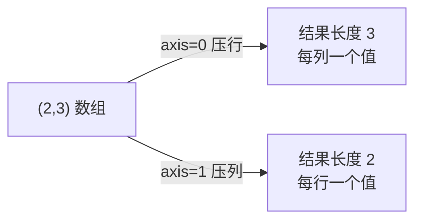

# PY-067 聚合与统计

## 1. 知识概览

| 项 | 内容 |
|---|---|
| 知识 ID | `PY-067` |
| 所属模块 | M-PY-07 NumPy 科学计算 |
| 学习难度 | L2 初级 |
| **预计学习时间** | 40 分钟 |
| 前置知识 | [[PY-063 数组运算]] |
| 学习目标 | 掌握 `sum/mean/std/max/min/median/percentile/cumsum` 与 `axis` 的含义 |

## 2. 通俗原理讲解

聚合就是**把一堆数压成一个数**：

- 求和、平均、最大、最小、标准差、中位数。

`axis` 是最容易搞混的地方。记一句话：

> **`axis=0` 是"跨行"（把每列的数压起来），`axis=1` 是"跨列"（把每行的数压起来）。**

或者更直白：**`axis=k` 表示"第 k 维被压掉"**。所以 `(2,3)` 数组 `axis=0` 压掉行维，得到长度 3。

## 3. 技术原理

| 函数 | 作用 |
|---|---|
| `a.sum()` / `a.mean()` | 总和 / 平均 |
| `a.std()` / `a.var()` | 标准差 / 方差 |
| `a.max()` / `a.min()` | 最大 / 最小 |
| `a.argmax()` / `a.argmin()` | 最值的下标 |
| `np.median(a)` | 中位数 |
| `np.percentile(a, q)` | 分位数 |
| `a.cumsum()` | 累加（前缀和） |
| `a.mean(axis=0)` | 按列求平均 |

**重要细节**

- 聚合默认**忽略 `nan`**？**不**。`np.mean` 遇到 `nan` 会返回 `nan`，要用 `np.nanmean`。
- `keepdims=True` 保留被压掉的维度为 1，方便后续广播。
- `argmax` 返回的是**扁平索引**（对多维需 `np.unravel_index` 换算）。

## 4. 图解辅助



## 5. 完整代码示例

```powershell
python aggregate_demo.py
```

```python
import numpy as np

a = np.arange(6).reshape(2, 3)

print(int(a.sum()), a.sum(axis=0).tolist(), a.sum(axis=1).tolist())
print(round(float(a.mean()), 3), int(a.max()), int(a.min()))
print(round(float(a.std()), 4))
print(float(np.median(a)))
print(a.cumsum().tolist())
print(float(np.percentile(a, 50)))
```

**预期输出**

```
15 [3, 5, 7] [3, 12]
2.5 5 0
1.7078
2.5
[0, 1, 3, 6, 10, 15]
2.5
```

**说明**

- 总和 15；按列求和 `[0+3, 1+4, 2+5] = [3,5,7]`；按行求和 `[0+1+2, 3+4+5] = [3,12]`。
- 标准差约 1.7078（数据是 0–5 均匀分布）。
- 中位数与 50 分位数都是 2.5。
- 累加输出前缀和。

## 6. 实践练习

**基础**

1. 求 `[1,2,3,4]` 的和、平均、最大、最小。
2. 对 `(3,3)` 矩阵分别按行、按列求和。
3. 判断：`axis=0` 是压行还是压列？

**进阶**

1. 用 `argmax` 找出最大值位置，并说明多维时怎么换算。
2. 比较 `np.mean` 与 `np.nanmean` 在含 `nan` 数据上的差异。

**综合实践**

写一个"成绩分析"：给定 `(3, 4)` 的成绩矩阵（3 个学生 × 4 门课），输出每个学生的平均分、每门课的最高分、全班总分、以及总分最高的学生索引。

## 7. 参考答案

**基础 1 · 思路**：内置聚合。

```python
import numpy as np
a = np.array([1, 2, 3, 4])
print(int(a.sum()), float(a.mean()), int(a.max()), int(a.min()))
```

运行结果：`10 2.5 4 1`

**基础 2 · 思路**：两个轴各算一次。

```python
import numpy as np
m = np.arange(9).reshape(3, 3)
print(m.sum(axis=0).tolist(), m.sum(axis=1).tolist())
```

运行结果：`[9, 12, 15] [3, 12, 21]`

**基础 3 · 思路**：axis 表示被压掉的维度。

答案：`axis=0` 压掉行维 → 每列得到一个值（跨行聚合）。

**进阶 1 · 思路**：`argmax` + `unravel_index`。

```python
import numpy as np
m = np.array([[1, 9], [5, 3]])
idx = int(m.argmax())
print(idx, np.unravel_index(idx, m.shape))
```

运行结果：`1 (0, 1)`

**进阶 2 · 思路**：nan 传播。

```python
import numpy as np
a = np.array([1.0, np.nan, 3.0])
print(float(np.mean(a)) if not np.isnan(np.mean(a)) else "nan")
print(round(float(np.nanmean(a)), 3))
```

运行结果：

```
nan
2.0
```

**综合实践 · 思路**：行均值、列最大值、总和、argmax。

```python
import numpy as np

scores = np.array([
    [88, 92, 79, 85],
    [76, 95, 81, 90],
    [90, 88, 86, 70],
])

print("每人平均:", scores.mean(axis=1).round(2).tolist())
print("每门最高:", scores.max(axis=0).tolist())
print("全班总分:", int(scores.sum()))
print("总分最高的人:", int(scores.sum(axis=1).argmax()))
```

运行结果：

```
每人平均: [86.0, 85.5, 83.5]
每门最高: [90, 95, 86, 90]
全班总分: 1030
总分最高的人: 0
```

## 8. 常见错误

| 错误写法 | 现象 | 原因 | 正确写法 |
|---|---|---|---|
| 混淆 `axis=0/1` | 结果方向反了 | 轴含义不清 | 记住"axis=被压掉的维" |
| 含 `nan` 直接用 `mean` | 返回 `nan` | nan 会传播 | `np.nanmean` |
| `argmax` 当多维坐标用 | 拿到扁平索引 | 返回的是展平下标 | `np.unravel_index` |
| 以为聚合结果还是二维 | 形状不对 | 默认压掉该维 | `keepdims=True` |
| 用 Python 内置 `sum` 处理数组 | 慢且可能类型错 | 走了 Python 循环 | 用 `a.sum()` |

## 9. 知识关联

- **前置**：[[PY-063 数组运算]]
- **后继**：[[PY-068 随机数、视图与副本]]
- **相关数学**：均值/方差/分位数的统计含义见 [[MATH-451 最小二乘与回归统计]]
- **所属模块**：`M-PY-07 NumPy 科学计算`

## 10. 学习记录

| 日期 | 状态 | 掌握程度 | 遇到的问题 | 个人总结 | 待复习 |
|---|---|---|---|---|---|
| — | planned | — | — | — | — |

---

## 🔗 Notion 同步信息

> 以下内容由 Notion「AI Knowledge System · 知识点」数据库按知识 ID 合并而来（导出于 2026-11-09）。

| 属性 | 值 |
|---|---|
| 学科 | Python基础 |
| 学习状态 | 未开始 |
| 难度 | L2 应用 |
| 知识类型 | Technique |
| 学习目标 | 掌握常用聚合与 axis 含义。 |

- **所属模块**：[M-PY-07 NumPy 科学计算](../%E8%AF%BE%E7%A8%8B%E6%A8%A1%E5%9D%97/M-PY-07%20NumPy%20%E7%A7%91%E5%AD%A6%E8%AE%A1%E7%AE%97.md)
- **前置知识**：[PY-063 数组运算](PY-063%20%E6%95%B0%E7%BB%84%E8%BF%90%E7%AE%97.md)
- **关联数学**：[MATH-306 期望、方差与协方差](../../06_%E6%95%B0%E5%AD%A6%E5%9F%BA%E7%A1%80/03%20%E6%A6%82%E7%8E%87%E8%AE%BA/MATH-306%20%E6%9C%9F%E6%9C%9B%E3%80%81%E6%96%B9%E5%B7%AE%E4%B8%8E%E5%8D%8F%E6%96%B9%E5%B7%AE.md)
