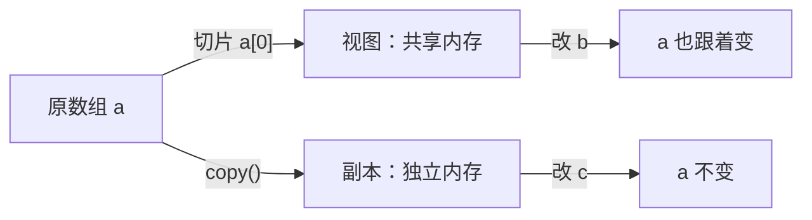

# PY-068 随机数、视图与副本

## 1. 知识概览

| 项 | 内容 |
|---|---|
| 知识 ID | `PY-068` |
| 所属模块 | M-PY-07 NumPy 科学计算 |
| 学习难度 | L3 中级 |
| **预计学习时间** | 45 分钟 |
| 前置知识 | [[PY-063 数组运算]] |
| 学习目标 | 会用 `default_rng` 生成可复现随机数、分清视图与副本、知道什么时候必须 `copy()` |

## 2. 通俗原理讲解

**随机数**：真正的随机不可复现，科研与调试需要"可复现的随机"——给定种子，序列固定。

**视图 vs 副本**：像"同一份文件的快捷方式 vs 复制一份"。

- 视图：共享内存，改一个另一个也变。
- 副本：独立内存，互不影响。

NumPy 里**切片是视图**，**花式索引/布尔索引是副本**，`copy()` 显式复制。

## 3. 技术原理

**随机数（推荐新接口）**

```text
rng = np.random.default_rng(seed)     # 种子固定 → 序列可复现
rng.integers(low, high, size)         # 左闭右开整数
rng.random(n)                         # [0,1) 浮点
rng.normal(loc, scale, size)          # 正态
rng.choice(arr, size, replace=False)  # 抽样
```

> 旧接口 `np.random.seed()` + `np.random.rand()` 仍可用，但新项目建议 `default_rng`。

**视图/副本判定**

| 操作 | 结果 | 是否共享 |
|---|---|---|
| `a[1:3]` | 视图 | ✅ |
| `a.reshape(...)` | 通常视图 | ✅ |
| `a.T` | 视图 | ✅ |
| `a[[0, 2]]`（花式索引） | 副本 | ❌ |
| `a[a > 3]`（布尔索引） | 副本 | ❌ |
| `a.copy()` | 副本 | ❌ |

用 `np.shares_memory(a, b)` 可以实测，不要靠猜。

## 4. 图解辅助



## 5. 完整代码示例

```powershell
python random_view_demo.py
```

```python
import numpy as np

rng = np.random.default_rng(42)
print(rng.integers(1, 7, size=3).tolist())
print(rng.random(3).round(4).tolist())

a = np.arange(6).reshape(2, 3)
view = a[0]
view[0] = 99
print("视图影响原数组:", int(a[0][0]))

copy = a.copy()
copy[0][0] = -1
print("副本不影响原数组:", int(a[0][0]), int(copy[0][0]))
print("是否共享内存:", bool(np.shares_memory(a, a[0])))
```

**预期输出**

```
[1, 5, 4]
[0.637, 0.2698, 0.041]
视图影响原数组: 99
副本不影响原数组: 99 -1
是否共享内存: True
```

**说明**

- 种子 42 固定，所以这两个随机序列**每次运行都一样**——这正是可复现的意思。
- `view = a[0]` 是切片 → 视图，改它等于改原数组。
- `a.copy()` 是副本，改它原数组不变。
- `shares_memory` 直接给出判定，比记忆规则可靠。

## 6. 实践练习

**基础**

1. 用种子 0 生成 5 个 `[0,1)` 随机数并保留 3 位小数。
2. 生成 10 个 1–6 的随机整数（模拟掷骰子）。
3. 判断：`a[1:3]` 是视图还是副本？

**进阶**

1. 用同一个种子生成两次随机数，验证序列完全一致。
2. 验证"布尔索引返回副本"：改 `a[a > 2]` 的结果，看原数组是否变化。

**综合实践**

写一个"可复现的模拟器"：给定种子与次数，用 `rng.integers(1, 7)` 模拟掷骰子 n 次，统计每个点数出现的次数，输出频次字典（顺序固定）。

## 7. 参考答案

**基础 1 · 思路**：`random` + `round`。

```python
import numpy as np
print(np.random.default_rng(0).random(5).round(3).tolist())
```

运行结果：`[0.637, 0.27, 0.041, 0.017, 0.813]`

**基础 2 · 思路**：`integers`。

```python
import numpy as np
print(np.random.default_rng(1).integers(1, 7, size=10).tolist())
```

运行结果：`[3, 4, 5, 6, 1, 1, 5, 6, 2, 2]`

**基础 3 · 思路**：切片即视图。

答案：**视图**，改它会影响原数组。

**进阶 1 · 思路**：同种子两次。

```python
import numpy as np
a = np.random.default_rng(7).random(3)
b = np.random.default_rng(7).random(3)
print(np.array_equal(a, b))
```

运行结果：`True`

**进阶 2 · 思路**：布尔索引是副本。

```python
import numpy as np
x = np.array([1, 2, 3, 4])
sel = x[x > 2]
sel[0] = 999
print(x.tolist(), sel.tolist())
```

运行结果：`[1, 2, 3, 4] [999, 4]`——原数组没变。

**综合实践 · 思路**：计数用 `np.bincount` 或字典。

```python
import numpy as np

def simulate(seed, n):
    rng = np.random.default_rng(seed)
    rolls = rng.integers(1, 7, size=n)
    counts = np.bincount(rolls, minlength=7)[1:]
    return {i + 1: int(c) for i, c in enumerate(counts)}

print(simulate(42, 10))
print("总数:", sum(simulate(42, 10).values()))
```

运行结果：

```
{1: 3, 2: 1, 3: 2, 4: 1, 5: 2, 6: 1}
总数: 10
```

## 8. 常见错误

| 错误写法 | 现象 | 原因 | 正确写法 |
|---|---|---|---|
| 不设种子 | 每次结果不同 | 默认随机 | `default_rng(seed)` |
| 以为切片是副本 | 改子数组污染原数据 | 切片共享内存 | 需要隔离用 `.copy()` |
| 以为布尔索引是视图 | 改了没生效 | 布尔索引返回副本 | 需要写回用 `a[mask] = ...` |
| 用 `np.random.seed` 混用新接口 | 序列不符合预期 | 两套生成器独立 | 统一用 `default_rng` |
| 依赖 `randint` 的老写法 | 弃用警告 | 接口更新 | `rng.integers` |

## 9. 知识关联

- **前置**：[[PY-063 数组运算]]
- **后继**：`PY-069 Series 与 DataFrame`（Pandas 基于 NumPy 数组）
- **相关数学**：随机变量与分布见 [[MATH-451 最小二乘与回归统计]]
- **所属模块**：`M-PY-07 NumPy 科学计算`

## 10. 学习记录

| 日期 | 状态 | 掌握程度 | 遇到的问题 | 个人总结 | 待复习 |
|---|---|---|---|---|---|
| — | planned | — | — | — | — |

---

## 🔗 Notion 同步信息

> 以下内容由 Notion「AI Knowledge System · 知识点」数据库按知识 ID 合并而来（导出于 2026-11-09）。

| 属性 | 值 |
|---|---|
| 学科 | Python基础 |
| 学习状态 | 未开始 |
| 难度 | L3 推导 |
| 知识类型 | Technique |
| 学习目标 | 会用 default_rng 生成可复现随机数，分清视图与副本。 |

- **所属模块**：[M-PY-07 NumPy 科学计算](../%E8%AF%BE%E7%A8%8B%E6%A8%A1%E5%9D%97/M-PY-07%20NumPy%20%E7%A7%91%E5%AD%A6%E8%AE%A1%E7%AE%97.md)
- **前置知识**：[PY-063 数组运算](PY-063%20%E6%95%B0%E7%BB%84%E8%BF%90%E7%AE%97.md)
- **后继知识**：[PY-069 Series 与 DataFrame](../09%20Pandas%E4%B8%8E%E5%8F%AF%E8%A7%86%E5%8C%96/PY-069%20Series%20%E4%B8%8E%20DataFrame.md)
- **关联数学**：[MATH-305 常见连续分布与正态分布](../../06_%E6%95%B0%E5%AD%A6%E5%9F%BA%E7%A1%80/03%20%E6%A6%82%E7%8E%87%E8%AE%BA/MATH-305%20%E5%B8%B8%E8%A7%81%E8%BF%9E%E7%BB%AD%E5%88%86%E5%B8%83%E4%B8%8E%E6%AD%A3%E6%80%81%E5%88%86%E5%B8%83.md)
