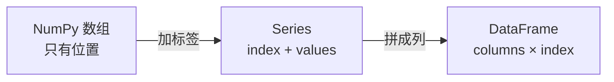

# PY-069 Series 与 DataFrame

## 1. 知识概览

| 项 | 内容 |
|---|---|
| 知识 ID | `PY-069` |
| 所属模块 | M-PY-08 Pandas 与数据可视化 |
| 学习难度 | L2 初级 |
| **预计学习时间** | 45 分钟 |
| 前置知识 | [[PY-068 随机数、视图与副本]] |
| 学习目标 | 分清 Series 与 DataFrame、会建表、会取列/取行、理解"带标签的数组" |

## 2. 通俗原理讲解

- **Series** = 带标签的一列数据（一维）。
- **DataFrame** = 带行标签的多列数据（二维表格），可以看成"若干 Series 拼成的表"。

区别就像：

- Series 是**一列成绩单**（有名字、有分数）。
- DataFrame 是**整张成绩表**（姓名、语文、数学三列）。

**为什么用 Pandas 而不是纯 NumPy**：NumPy 只有位置下标，Pandas 有**列名**和**行标签**，能按名字取数据、自动对齐、处理缺失值。

## 3. 技术原理

| 对象 | 构造 | 要点 |
|---|---|---|
| Series | `pd.Series([1,2], index=["a","b"], name="x")` | 有 index 与 name |
| DataFrame | `pd.DataFrame({"a": [...], "b": [...]})` | 有 columns 与 index |

**常用属性**

| 属性 | 含义 |
|---|---|
| `df.shape` | (行数, 列数) |
| `df.columns` | 列名 |
| `df.index` | 行标签 |
| `df.dtypes` | 每列类型 |
| `df.head(n)` | 前 n 行 |
| `df.to_dict(orient="records")` | 转成字典列表（便于打印） |

**取数方式**

- `df["col"]` → 取一列（Series）
- `df[["a","b"]]` → 取多列（DataFrame）
- `df.loc[i]` → 按标签取行
- `df.iloc[i]` → 按位置取行

## 4. 图解辅助



## 5. 完整代码示例

```powershell
python series_df.py
```

```python
import pandas as pd

s = pd.Series([85, 92, 78], index=["小明", "小红", "小刚"], name="score")
print(s.tolist(), s.index.tolist())
print(s.dtype, s.name)

df = pd.DataFrame({"name": ["小明", "小红"], "score": [85, 92]})
print(df.shape, df.columns.tolist())
print(df.to_dict(orient="records"))
```

**预期输出**

```
[85, 92, 78] ['小明', '小红', '小刚']
int64 score
(2, 2) ['name', 'score']
[{'name': '小明', 'score': 85}, {'name': '小红', 'score': 92}]
```

**说明**

- Series 的 `index` 是自定义标签，`name` 是这一列的名字。
- `shape` 是 `(行, 列)`；`columns` 是列名列表。
- 用 `to_dict(orient="records")` 打印最直观（每行一个字典）。

## 6. 实践练习

**基础**

1. 建一个 Series 存三门课的成绩，索引为课程名。
2. 建一个 DataFrame 含 name 与 score 两列，打印 `shape` 与 `columns`。
3. 从 DataFrame 取 `name` 列，打印其类型。

**进阶**

1. 给 DataFrame 自定义行索引（如学号），并用 `loc` 取一行。
2. 用 `iloc` 取第一行，比较与 `loc` 的差别。

**综合实践**

建一个 3 行 3 列的成绩表（姓名 + 语文 + 数学），输出：行列数、列名、每列类型、前两行记录。

## 7. 参考答案

**基础 1 · 思路**：Series + index。

```python
import pandas as pd
s = pd.Series([90, 85, 88], index=["语文", "数学", "英语"])
print(s.to_dict())
```

运行结果：`{'语文': 90, '数学': 85, '英语': 88}`

**基础 2 · 思路**：字典建表。

```python
import pandas as pd
df = pd.DataFrame({"name": ["小明", "小红"], "score": [85, 92]})
print(df.shape, df.columns.tolist())
```

运行结果：`(2, 2) ['name', 'score']`

**基础 3 · 思路**：取列得到 Series。

```python
print(type(df["name"]).__name__, df["name"].tolist())
```

运行结果：`Series ['小明', '小红']`

**进阶 1 · 思路**：`index=` 后 `loc`。

```python
import pandas as pd
df = pd.DataFrame({"name": ["小明", "小红"], "score": [85, 92]}, index=["S01", "S02"])
print(df.loc["S02"].to_dict())
```

运行结果：`{'name': '小红', 'score': 92}`

**进阶 2 · 思路**：位置 vs 标签。

```python
print(df.iloc[0].to_dict())
```

运行结果：`{'name': '小明', 'score': 85}`

当索引是默认的 0,1,2… 时二者相同；自定义索引后就不同了。

**综合实践 · 思路**：属性一次取全。

```python
import pandas as pd

df = pd.DataFrame({
    "姓名": ["小明", "小红", "小刚"],
    "语文": [88, 92, 79],
    "数学": [95, 90, 85],
})

print(df.shape)
print(df.columns.tolist())
print(df.dtypes.astype(str).to_dict())
print(df.head(2).to_dict(orient="records"))
```

运行结果：

```
(3, 3)
['姓名', '语文', '数学']
{'姓名': 'str', '语文': 'int64', '数学': 'int64'}
[{'姓名': '小明', '语文': 88, '数学': 95}, {'姓名': '小红', '语文': 92, '数学': 90}]
```

## 8. 常见错误

| 错误写法 | 现象 | 原因 | 正确写法 |
|---|---|---|---|
| `df["a", "b"]` | `KeyError` | 多列要传列表 | `df[["a","b"]]` |
| 以为 `df["a"]` 是 DataFrame | 少了列维度 | 返回 Series | 要表用 `df[["a"]]` |
| 混用 `loc` 与 `iloc` | 取错行 | 标签 vs 位置 | 按索引类型选 |
| 列名含空格不去处理 | 取列麻烦 | 命名随意 | 统一命名 |
| 用 `df.shape[0]` 与 `len(df)` 混谈 | 概念混淆 | 一个取行数 | 两者等价，统一一种 |

## 9. 知识关联

- **前置**：[[PY-068 随机数、视图与副本]]
- **后继**：[[PY-070 数据读取与写出]]、[[PY-071 筛选与排序]]
- **相关数学**：无
- **所属模块**：`M-PY-08 Pandas 与数据可视化`

## 10. 学习记录

| 日期 | 状态 | 掌握程度 | 遇到的问题 | 个人总结 | 待复习 |
|---|---|---|---|---|---|
| — | planned | — | — | — | — |

---

## 🔗 Notion 同步信息

> 以下内容由 Notion「AI Knowledge System · 知识点」数据库按知识 ID 合并而来（导出于 2026-11-09）。

| 属性 | 值 |
|---|---|
| 学科 | Python基础 |
| 学习状态 | 未开始 |
| 难度 | L2 应用 |
| 知识类型 | Concept |
| 学习目标 | 分清 Series 与 DataFrame，会建表、取列取行。 |

- **所属模块**：[M-PY-08 Pandas 与数据可视化](../%E8%AF%BE%E7%A8%8B%E6%A8%A1%E5%9D%97/M-PY-08%20Pandas%20%E4%B8%8E%E6%95%B0%E6%8D%AE%E5%8F%AF%E8%A7%86%E5%8C%96.md)
- **前置知识**：[PY-068 随机数、视图与副本](../08%20NumPy/PY-068%20%E9%9A%8F%E6%9C%BA%E6%95%B0%E3%80%81%E8%A7%86%E5%9B%BE%E4%B8%8E%E5%89%AF%E6%9C%AC.md)
- **后继知识**：[PY-070 数据读取与写出](PY-070%20%E6%95%B0%E6%8D%AE%E8%AF%BB%E5%8F%96%E4%B8%8E%E5%86%99%E5%87%BA.md)
