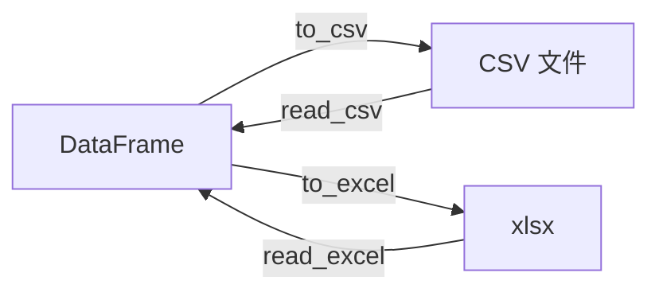

# PY-070 数据读取与写出

## 1. 知识概览

| 项 | 内容 |
|---|---|
| 知识 ID | `PY-070` |
| 所属模块 | M-PY-08 Pandas 与数据可视化 |
| 学习难度 | L2 初级 |
| **预计学习时间** | 40 分钟 |
| 前置知识 | [[PY-069 Series 与 DataFrame]] |
| 学习目标 | 会读写 CSV/Excel/JSON、会处理编码与索引、知道常见参数 |

## 2. 通俗原理讲解

Pandas 的读写像**插拔数据线**：

- `read_csv` / `to_csv`：表格 ↔ 文本
- `read_excel` / `to_excel`：表格 ↔ Excel
- `read_json` / `to_json`：结构 ↔ JSON

**一个坑**：CSV 没有类型，读回来全是 `object/str` 或靠 Pandas 猜；猜错就得手动 `astype`。

## 3. 技术原理

| 操作 | 写法 |
|---|---|
| 读 CSV | `pd.read_csv(path, encoding="utf-8")` |
| 写 CSV | `df.to_csv(path, index=False, encoding="utf-8-sig")` |
| 读 Excel | `pd.read_excel(path, sheet_name="Sheet1")` |
| 写 Excel | `df.to_excel(path, index=False)` |
| 读 JSON | `pd.read_json(path)` |
| 写 JSON | `df.to_json(path, orient="records", force_ascii=False)` |

**关键参数**

| 参数 | 作用 |
|---|---|
| `index=False` | 不把行号写进文件（几乎总是要加） |
| `encoding="utf-8-sig"` | 让 Excel 直接打开中文不乱码 |
| `header=0` | 第 0 行作为列名 |
| `usecols=[...]` | 只读需要的列 |
| `dtype={...}` | 指定列类型，避免猜错 |
| `parse_dates=[...]` | 直接解析日期列 |

**读回类型**：数值列一般是 `int64/float64`；文本列在 pandas 3 里是 `str`；空值会变 `NaN`（浮点）或 `pd.NA`。

## 4. 图解辅助



## 5. 完整代码示例

```powershell
python io_demo.py
```

```python
from pathlib import Path

import pandas as pd

df = pd.DataFrame({"name": ["小明", "小红"], "score": [85, 92]})

p = Path("demo_scores.csv")
df.to_csv(p, index=False, encoding="utf-8-sig")

back = pd.read_csv(p)
print(back.shape, back.columns.tolist())
print(back["score"].tolist())
print(back.dtypes.astype(str).to_dict())

p.unlink()
print("已清理:", not p.exists())
```

**预期输出**

```
(2, 2) ['name', 'score']
[85, 92]
{'name': 'str', 'score': 'int64'}
已清理: True
```

**说明**

- `index=False` 避免把行号也写进 CSV。
- `encoding="utf-8-sig"` 让 Excel 双击打开时中文正常（带 BOM，Excel 才认得出 UTF-8）。
- 读回来 `score` 自动识别成 `int64`，`name` 是 `str`（pandas 3 的字符串类型）。
- 演示文件用完即删。

## 6. 实践练习

**基础**

1. 建 DataFrame 写出 CSV，再读回并打印形状。
2. 写出时不加 `index=False`，对比读回结果多了什么。
3. 读取时用 `usecols` 只取一列。

**进阶**

1. 用 `dtype={"score": "float64"}` 强制类型，观察读回类型。
2. 把带中文的 DataFrame 写成 `utf-8`（无 BOM）与 `utf-8-sig`，说明差异。

**综合实践**

写一个"数据往返"程序：造 5 行数据 → 写 CSV → 读回 → 校验行数与某列总和一致 → 删除文件。

## 7. 参考答案

**基础 1 · 思路**：写读配对。

```python
from pathlib import Path
import pandas as pd

df = pd.DataFrame({"a": [1, 2], "b": [3, 4]})
p = Path("t1.csv")
df.to_csv(p, index=False)
print(pd.read_csv(p).shape)
p.unlink()
```

运行结果：`(2, 2)`

**基础 2 · 思路**：不写 `index=False` 会多一列行号。

```python
p = Path("t2.csv")
df.to_csv(p)
print(pd.read_csv(p).columns.tolist())
p.unlink()
```

运行结果：`['Unnamed: 0', 'a', 'b']`

**基础 3 · 思路**：`usecols`。

```python
p = Path("t3.csv")
df.to_csv(p, index=False)
print(pd.read_csv(p, usecols=["a"]).columns.tolist())
p.unlink()
```

运行结果：`['a']`

**进阶 1 · 思路**：显式 dtype。

```python
p = Path("t4.csv")
df.to_csv(p, index=False)
back = pd.read_csv(p, dtype={"a": "float64"})
print(back.dtypes.astype(str).to_dict())
p.unlink()
```

运行结果：`{'a': 'float64', 'b': 'int64'}`

**进阶 2 · 思路**：BOM 的作用。

答案：`utf-8` 无 BOM，Excel 可能按 GBK 解读导致中文乱码；`utf-8-sig` 带 BOM，Excel 能正确识别为 UTF-8。程序自己读时两者都能读，只是首列名可能带 `\ufeff`。

**综合实践 · 思路**：往返校验。

```python
from pathlib import Path
import pandas as pd

df = pd.DataFrame({"name": list("ABCDE"), "score": [10, 20, 30, 40, 50]})
p = Path("roundtrip.csv")
df.to_csv(p, index=False, encoding="utf-8-sig")

back = pd.read_csv(p)
print("行数一致:", len(back) == len(df))
print("总和一致:", int(back["score"].sum()) == int(df["score"].sum()))
p.unlink()
```

运行结果：

```
行数一致: True
总和一致: True
```

## 8. 常见错误

| 错误写法 | 现象 | 原因 | 正确写法 |
|---|---|---|---|
| `to_csv` 不加 `index=False` | 多一列 `Unnamed: 0` | 行号被写出 | 加 `index=False` |
| 中文 CSV 用 `utf-8` | Excel 打开乱码 | 无 BOM | `utf-8-sig` |
| 不指定 `dtype` | 数字被读成字符串 | 含空值/异常值 | 显式指定 |
| 路径用相对路径 | 换个目录就找不到 | 依赖 cwd | 用 `Path` 明确路径 |
| 读 Excel 缺 `openpyxl` | `ImportError` | 缺引擎 | `pip install openpyxl` |

## 9. 知识关联

- **前置**：[[PY-069 Series 与 DataFrame]]
- **后继**：[[PY-071 筛选与排序]]
- **相关数学**：无
- **所属模块**：`M-PY-08 Pandas 与数据可视化`

## 10. 学习记录

| 日期 | 状态 | 掌握程度 | 遇到的问题 | 个人总结 | 待复习 |
|---|---|---|---|---|---|
| — | planned | — | — | — | — |

---

## 🔗 Notion 同步信息

> 以下内容由 Notion「AI Knowledge System · 知识点」数据库按知识 ID 合并而来（导出于 2026-11-09）。

| 属性 | 值 |
|---|---|
| 学科 | Python基础 |
| 学习状态 | 未开始 |
| 难度 | L2 应用 |
| 知识类型 | Technique |
| 学习目标 | 会读写 CSV/Excel/JSON，会处理编码与索引。 |

- **所属模块**：[M-PY-08 Pandas 与数据可视化](../%E8%AF%BE%E7%A8%8B%E6%A8%A1%E5%9D%97/M-PY-08%20Pandas%20%E4%B8%8E%E6%95%B0%E6%8D%AE%E5%8F%AF%E8%A7%86%E5%8C%96.md)
- **前置知识**：[PY-069 Series 与 DataFrame](PY-069%20Series%20%E4%B8%8E%20DataFrame.md)
- **后继知识**：[PY-071 筛选与排序](PY-071%20%E7%AD%9B%E9%80%89%E4%B8%8E%E6%8E%92%E5%BA%8F.md)
