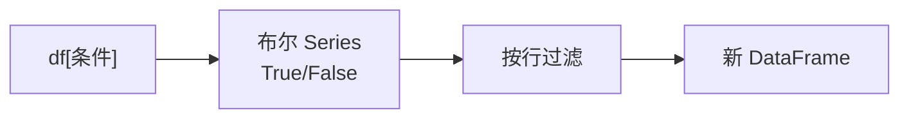

# PY-071 筛选与排序

## 1. 知识概览

| 项 | 内容 |
|---|---|
| 知识 ID | `PY-071` |
| 所属模块 | M-PY-08 Pandas 与数据可视化 |
| 学习难度 | L2 初级 |
| **预计学习时间** | 40 分钟 |
| 前置知识 | [[PY-070 数据读取与写出]] |
| 学习目标 | 会用布尔筛选、`query`、多重条件、`sort_values` 与 `nlargest` |

## 2. 通俗原理讲解

筛选像**用筛子过一遍**：

- 先写一个条件（`score > 80`），得到一列 `True/False`。
- 用它去"过滤"整张表：`True` 的行留下。

排序像**把牌按大小摊开**：`sort_values("score")` 从小到大，`ascending=False` 反过来。

## 3. 技术原理

| 需求 | 写法 |
|---|---|
| 单条件 | `df[df["score"] > 80]` |
| 多条件（且） | `df[(df["score"] > 80) & (df["name"] != "小明")]` |
| 多条件（或） | `df[(df["a"] > 1) \| (df["b"] < 0)]` |
| 取反 | `df[~(df["score"] > 80)]` |
| `isin` | `df[df["name"].isin(["小明","小红"])]` |
| 字符串筛选 | `df[df["name"].str.startswith("小")]` |
| 排序 | `df.sort_values("score", ascending=False)` |
| 多列排序 | `df.sort_values(["dept","score"])` |
| 最大 n 个 | `df.nlargest(2, "score")` |

**三个必须记住**

1. 多条件必须用 `&` `|` `~`（**不是** `and/or/not`），且每个条件要括号。
2. `sort_values` 默认**返回新表**，`inplace=True` 才改原表（不推荐）。
3. `df.loc[df["score"].idxmax()]` 取最大值那一行。

## 4. 图解辅助



## 5. 完整代码示例

```powershell
python filter_sort.py
```

```python
import pandas as pd

df = pd.DataFrame({"name": ["小明", "小红", "小刚"], "score": [85, 92, 78]})

print(df[df["score"] > 80]["name"].tolist())
print(df.sort_values("score", ascending=False)["name"].tolist())
print(df.loc[df["score"].idxmax(), "name"])
print(df.query("score >= 85")["name"].tolist())
```

**预期输出**

```
['小明', '小红']
['小红', '小明', '小刚']
小红
['小明', '小红']
```

**说明**

- `df[条件]` 返回新表，再用 `["name"]` 取列。
- `sort_values(ascending=False)` 降序；原 `df` 不变。
- `idxmax()` 给出最大值所在**行标签**，配合 `loc` 取整行或某列。
- `query("score >= 85")` 用字符串表达式，可读性更好。

## 6. 实践练习

**基础**

1. 筛出分数大于等于 90 的行。
2. 按分数升序排序，打印姓名列表。
3. 用 `query` 筛出分数在 80–90 之间的行。

**进阶**

1. 用多条件筛出"分数 > 80 且姓名不是小红"的行。
2. 用 `nlargest` 取分数最高的 2 行。

**综合实践**

给定含 dept/score 的表，输出：每个部门分最高的人（提示：先排序再去重，或 `idxmax` + 分组）。

## 7. 参考答案

**基础 1 · 思路**：布尔筛选。

```python
import pandas as pd
df = pd.DataFrame({"name": ["小明", "小红"], "score": [85, 92]})
print(df[df["score"] >= 90].to_dict(orient="records"))
```

运行结果：`[{'name': '小红', 'score': 92}]`

**基础 2 · 思路**：排序。

```python
print(df.sort_values("score")["name"].tolist())
```

运行结果：`['小明', '小红']`

**基础 3 · 思路**：`query` 区间。

```python
import pandas as pd
df = pd.DataFrame({"score": [70, 85, 92, 78]})
print(df.query("80 <= score <= 90")["score"].tolist())
```

运行结果：`[85]`（若数据中只有 85 落在此区间）

**进阶 1 · 思路**：括号 + `&`。

```python
import pandas as pd
df = pd.DataFrame({"name": ["小明", "小红", "小刚"], "score": [85, 92, 78]})
print(df[(df["score"] > 80) & (df["name"] != "小红")]["name"].tolist())
```

运行结果：`['小明']`

**进阶 2 · 思路**：`nlargest`。

```python
print(df.nlargest(2, "score")["name"].tolist())
```

运行结果：`['小红', '小明']`

**综合实践 · 思路**：排序后按部门去重。

```python
import pandas as pd

df = pd.DataFrame({
    "dept": ["A", "A", "B"],
    "name": ["小明", "小红", "小刚"],
    "score": [85, 92, 78],
})

top = df.sort_values("score", ascending=False).drop_duplicates("dept")
print(top[["dept", "name", "score"]].to_dict(orient="records"))
```

运行结果：`[{'dept': 'A', 'name': '小红', 'score': 92}, {'dept': 'B', 'name': '小刚', 'score': 78}]`

## 8. 常见错误

| 错误写法 | 现象 | 原因 | 正确写法 |
|---|---|---|---|
| `df[df.a > 1 and df.b < 2]` | `ValueError` | `and` 不支持 Series | 用 `&` 并加括号 |
| 忘记括号 | 运算优先级错 | `&` 优先级高于比较 | `(cond1) & (cond2)` |
| 误以为 `sort_values` 改了原表 | 原表没变 | 返回新表 | 接收返回值 |
| 用 `df["score"][0]` 取值 | 未来可能警告 | 链式索引 | `df.loc[0, "score"]` |
| 用 `==` 判断 `NaN` | 永远 False | NaN 不等于任何值 | `isna()` |

## 9. 知识关联

- **前置**：[[PY-070 数据读取与写出]]
- **后继**：[[PY-072 缺失值处理]]、[[PY-073 分组聚合]]
- **相关数学**：无
- **所属模块**：`M-PY-08 Pandas 与数据可视化`

## 10. 学习记录

| 日期 | 状态 | 掌握程度 | 遇到的问题 | 个人总结 | 待复习 |
|---|---|---|---|---|---|
| — | planned | — | — | — | — |

---

## 🔗 Notion 同步信息

> 以下内容由 Notion「AI Knowledge System · 知识点」数据库按知识 ID 合并而来（导出于 2026-11-09）。

| 属性 | 值 |
|---|---|
| 学科 | Python基础 |
| 学习状态 | 未开始 |
| 难度 | L2 应用 |
| 知识类型 | Technique |
| 学习目标 | 会用布尔筛选、query、多条件与排序。 |

- **所属模块**：[M-PY-08 Pandas 与数据可视化](../%E8%AF%BE%E7%A8%8B%E6%A8%A1%E5%9D%97/M-PY-08%20Pandas%20%E4%B8%8E%E6%95%B0%E6%8D%AE%E5%8F%AF%E8%A7%86%E5%8C%96.md)
- **前置知识**：[PY-070 数据读取与写出](PY-070%20%E6%95%B0%E6%8D%AE%E8%AF%BB%E5%8F%96%E4%B8%8E%E5%86%99%E5%87%BA.md)
- **后继知识**：[PY-072 缺失值处理](PY-072%20%E7%BC%BA%E5%A4%B1%E5%80%BC%E5%A4%84%E7%90%86.md)
