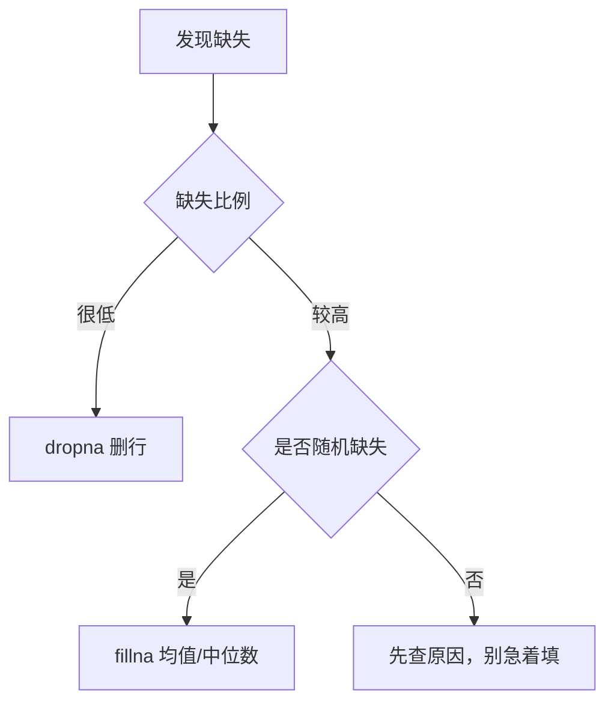

# PY-072 缺失值处理

## 1. 知识概览

| 项 | 内容 |
|---|---|
| 知识 ID | `PY-072` |
| 所属模块 | M-PY-08 Pandas 与数据可视化 |
| 学习难度 | L2 初级 |
| **预计学习时间** | 40 分钟 |
| 前置知识 | [[PY-071 筛选与排序]] |
| 学习目标 | 会检测缺失值、会删除或填充、知道不同填充策略的后果 |

## 2. 通俗原理讲解

缺失值就是**表格里的空格**。真实数据里到处都是：没填、没采集、记录丢失。

处理只有两条路：

- **删**：把有空值的行/列去掉（简单，但可能删掉大量数据）。
- **填**：用某个值补上（保留数据，但可能引入偏差）。

**没有"最好的方法"**，只有"适合这个数据的方法"。填 0 和填均值，结论可能完全不同。

## 3. 技术原理

| 操作 | 写法 | 说明 |
|---|---|---|
| 检测 | `df.isna()` / `df.isna().sum()` | 布尔表 / 每列缺失数 |
| 任一为空 | `df.isna().any(axis=1)` | 该行是否有缺失 |
| 删除行 | `df.dropna()` | 有缺失就删整行 |
| 删除列 | `df.dropna(axis=1)` | 整列有缺失就删 |
| 填充固定值 | `df.fillna(0)` | 简单但可能失真 |
| 填充统计量 | `df.fillna(df.mean(numeric_only=True))` | 保留分布 |
| 前向填充 | `df.ffill()` | 时间序列常用 |
| 插值 | `df.interpolate()` | 按趋势补 |

**关键判断**

- 缺失比例 < 5%：删行通常可接受。
- 缺失比例高且非随机：**填值会引入偏差**，应分析"为什么缺"。
- 时间序列：优先 `ffill` 或插值，别填 0。

## 4. 图解辅助



## 5. 完整代码示例

```powershell
python missing_demo.py
```

```python
import numpy as np
import pandas as pd

df = pd.DataFrame({"a": [1.0, np.nan, 3.0], "b": ["x", None, "z"]})

print(df.isna().sum().to_dict())
print(df["a"].fillna(0).tolist())
print(df.dropna().shape)
print(df["a"].mean(), df["a"].fillna(df["a"].mean()).round(4).tolist())
```

**预期输出**

```
{'a': 1, 'b': 1}
[1.0, 0.0, 3.0]
(1, 2)
2.0 [1.0, 2.0, 3.0]
```

**说明**

- `isna().sum()` 给出每列缺失个数。
- `fillna(0)` 把 NaN 换成 0；`fillna(mean)` 用均值补，分布更接近原数据。
- `dropna()` 删掉**任何**含缺失的行，所以只剩 1 行。
- 均值 2.0 是 `(1+3)/2`，NaN 被自动忽略——这点很重要：Pandas 的聚合默认跳过 NaN。

## 6. 实践练习

**基础**

1. 造一个含 NaN 的 Series，统计缺失个数。
2. 用 0 填充，再用均值填充，比较结果。
3. 删除含缺失的行，输出剩余行数。

**进阶**

1. 只删除"所有列都缺失"的行（`how="all"`）。
2. 对时间序列用 `ffill` 填充，说明为什么比填 0 合理。

**综合实践**

写一个"数据清洗报告"：给定含缺失的表，输出每列缺失数与缺失比例，按比例排序，并对数值列用中位数填充、文本列用 `"未知"` 填充，最后输出清洗后行数。

## 7. 参考答案

**基础 1 · 思路**：`isna().sum()`。

```python
import numpy as np, pandas as pd
s = pd.Series([1.0, np.nan, 3.0])
print(int(s.isna().sum()))
```

运行结果：`1`

**基础 2 · 思路**：两种填充对比。

```python
print(s.fillna(0).tolist())
print(s.fillna(s.mean()).tolist())
```

运行结果：

```
[1.0, 0.0, 3.0]
[1.0, 2.0, 3.0]
```

**基础 3 · 思路**：`dropna`。

```python
df = pd.DataFrame({"a": [1.0, np.nan], "b": [2.0, 3.0]})
print(df.dropna().shape)
```

运行结果：`(1, 2)`

**进阶 1 · 思路**：`how="all"`。

```python
df = pd.DataFrame({"a": [1.0, np.nan], "b": [2.0, np.nan]})
print(df.dropna(how="all").shape)
```

运行结果：`(1, 2)`——只有整行全空才删。

**进阶 2 · 思路**：时效性。

答案：时间序列相邻点相关性强，用"上一个值"比"0"更接近真实；填 0 会造出虚假的骤降，破坏趋势与统计量。

**综合实践 · 思路**：分列处理 + 比例排序。

```python
import numpy as np
import pandas as pd

df = pd.DataFrame({
    "name": ["A", "B", "C", "D"],
    "score": [90.0, np.nan, 80.0, np.nan],
    "city": ["北京", None, "上海", None],
})

missing = df.isna().mean().sort_values(ascending=False)
print(missing.round(2).to_dict())

df["score"] = df["score"].fillna(df["score"].median())
df["city"] = df["city"].fillna("未知")
print("清洗后缺失:", int(df.isna().sum().sum()))
print(df["score"].tolist())
```

运行结果：

```
{'city': 0.5, 'score': 0.5}
清洗后缺失: 0
[90.0, 85.0, 80.0, 85.0]
```

## 8. 常见错误

| 错误写法 | 现象 | 原因 | 正确写法 |
|---|---|---|---|
| 用 `df == np.nan` 判断 | 永远 False | NaN 不等于自身 | `isna()` |
| 直接 `fillna(0)` 不做分析 | 结论失真 | 0 可能无意义 | 先看分布与缺失原因 |
| `dropna()` 后数据只剩几行 | 丢太多 | 默认删任何缺失 | 用 `how`/`thresh` 控制 |
| 对文本列求均值填充 | 报错 | 非数值 | 文本用众数或固定值 |
| 忘记聚合会跳过 NaN | 分母算错 | `mean` 默认 `skipna=True` | 需要时 `skipna=False` |

> **与 [[ML-011 缺失值处理]] 的分工（阶段 10 判定）**：本篇讲 **pandas 工具层**（`isna/dropna/fillna` 的用法与坑）；机器学习层的"缺失机制与插补策略选择"由 ML-011 负责。两篇不重复，互为引用。

## 9. 知识关联

- **前置**：[[PY-071 筛选与排序]]
- **后继**：[[PY-073 分组聚合]]、[[PY-078 数据分析综合实践]]
- **相关数学**：均值/中位数的统计含义见 [[MATH-451 最小二乘与回归统计]]
- **所属模块**：`M-PY-08 Pandas 与数据可视化`

## 10. 学习记录

| 日期 | 状态 | 掌握程度 | 遇到的问题 | 个人总结 | 待复习 |
|---|---|---|---|---|---|
| — | planned | — | — | — | — |

---

## 🔗 Notion 同步信息

> 以下内容由 Notion「AI Knowledge System · 知识点」数据库按知识 ID 合并而来（导出于 2026-11-09）。

| 属性 | 值 |
|---|---|
| 学科 | Python基础 |
| 学习状态 | 未开始 |
| 难度 | L2 应用 |
| 知识类型 | Technique |
| 学习目标 | 会检测、删除、填充缺失值，知道不同策略的后果。 |

- **所属模块**：[M-PY-08 Pandas 与数据可视化](../%E8%AF%BE%E7%A8%8B%E6%A8%A1%E5%9D%97/M-PY-08%20Pandas%20%E4%B8%8E%E6%95%B0%E6%8D%AE%E5%8F%AF%E8%A7%86%E5%8C%96.md)
- **前置知识**：[PY-071 筛选与排序](PY-071%20%E7%AD%9B%E9%80%89%E4%B8%8E%E6%8E%92%E5%BA%8F.md)
- **后继知识**：[PY-073 分组聚合](PY-073%20%E5%88%86%E7%BB%84%E8%81%9A%E5%90%88.md)
- **被项目引用**：[PROJ-007 Pandas 数据分析项目](../../07_%E5%AE%9E%E6%88%98%E9%A1%B9%E7%9B%AE/02%20%E6%95%B0%E6%8D%AE%E5%88%86%E6%9E%90%E9%A1%B9%E7%9B%AE/PROJ-007%20Pandas%20%E6%95%B0%E6%8D%AE%E5%88%86%E6%9E%90%E9%A1%B9%E7%9B%AE.md)
