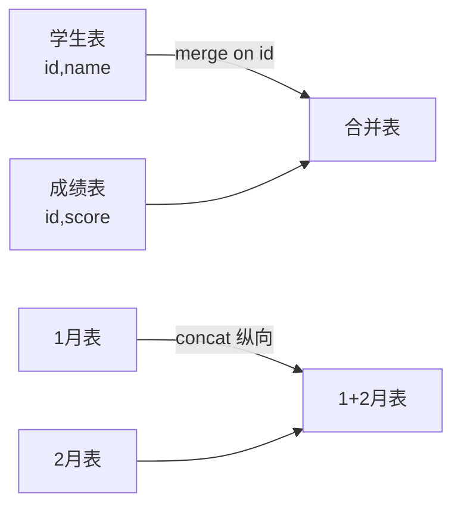

# PY-074 merge 与 concat

## 1. 知识概览

| 项 | 内容 |
|---|---|
| 知识 ID | `PY-074` |
| 所属模块 | M-PY-08 Pandas 与数据可视化 |
| 学习难度 | L3 中级 |
| **预计学习时间** | 45 分钟 |
| 前置知识 | [[PY-073 分组聚合]] |
| 学习目标 | 分清"横向按列拼"与"纵向按行接"、会用四种 join、知道 merge 后行数为何会变 |

## 2. 通俗原理讲解

两种"拼表"方式：

- **merge（横向）**：按**共同的键**把两张表并到一起。像把"学生表"和"成绩表"按学号对上。
- **concat（纵向）**：把两张结构相同的表**上下摞起来**。像把 1 月账单和 2 月账单接成一张。

merge 像 `JOIN`（SQL），concat 像 `UNION ALL`（但保留重复）。

## 3. 技术原理

| 方式 | 写法 | 结果 |
|---|---|---|
| 内连接 | `merge(b, on="k", how="inner")` | 只保留两边都有的键 |
| 左连接 | `how="left"` | 保留左表全部，右表缺失填 NaN |
| 右连接 | `how="right"` | 保留右表全部 |
| 外连接 | `how="outer"` | 两边全部，缺失互补 NaN |
| 纵向拼接 | `pd.concat([df1, df2], ignore_index=True)` | 行数相加 |
| 横向拼接 | `pd.concat([df1, df2], axis=1)` | 按索引对齐 |

**merge 后行数会变**的三种原因：

1. 右表键有重复（一对多）→ 行数膨胀。
2. 内连接丢弃了匹配不上的行。
3. 多键组合不唯一。

**务必检查**：`merge` 前后行数、是否产生 `_x/_y` 后缀列（说明有同名列冲突）。

## 4. 图解辅助



## 5. 完整代码示例

```powershell
python merge_concat.py
```

```python
import pandas as pd

a = pd.DataFrame({"name": ["小明", "小红"], "score": [85, 92]})
b = pd.DataFrame({"name": ["小明"], "city": ["北京"]})

print(a.merge(b, on="name", how="left").to_dict(orient="records"))
print(pd.concat([a, a], ignore_index=True).shape)
print(len(a.merge(b, on="name", how="inner")))
```

**预期输出**

```
[{'name': '小明', 'score': 85, 'city': '北京'}, {'name': '小红', 'score': 92, 'city': nan}]
(4, 2)
1
```

**说明**

- 左连接保留左表两行；`小红` 在右表没有匹配，`city` 为 `NaN`。
- `concat` 纵向拼接，行数翻倍；`ignore_index=True` 让索引重新从 0 编号。
- 内连接只保留两边都有的键，所以只剩 1 行。

## 6. 实践练习

**基础**

1. 两张表按 `id` 做左连接，观察缺失。
2. 用 `concat` 把两批数据接起来，输出总行数。
3. 判断：`merge` 与 `concat` 各改变的是行还是列？

**进阶**

1. 造一张"右表有重复键"的数据，做左连接，解释行数为何膨胀。
2. 说明 `how="outer"` 与 `how="left"` 在缺失处理上的区别。

**综合实践**

给"订单表"与"客户表"，做左连接补上客户等级，再按等级汇总订单金额；输出每级订单数与总金额。

## 7. 参考答案

**基础 1 · 思路**：`how="left"`。

```python
import pandas as pd
a = pd.DataFrame({"id": [1, 2], "v": [10, 20]})
b = pd.DataFrame({"id": [2], "w": [200]})
print(a.merge(b, on="id", how="left").to_dict(orient="records"))
```

运行结果：`[{'id': 1, 'v': 10, 'w': nan}, {'id': 2, 'v': 20, 'w': 200}]`

**基础 2 · 思路**：`concat`。

```python
print(len(pd.concat([a, a], ignore_index=True)))
```

运行结果：`4`

**基础 3 · 思路**：横纵方向。

答案：`merge` 按列扩（横向），行数由键匹配决定；`concat(axis=0)` 按行接（纵向），列不变行数相加。

**进阶 1 · 思路**：一对多。

```python
import pandas as pd
left = pd.DataFrame({"id": [1], "a": ["x"]})
right = pd.DataFrame({"id": [1, 1], "b": ["p", "q"]})
m = left.merge(right, on="id", how="left")
print(m.shape, m.to_dict(orient="records"))
```

运行结果：

```
(2, 3) [{'id': 1, 'a': 'x', 'b': 'p'}, {'id': 1, 'a': 'x', 'b': 'q'}]
```

右表 id=1 出现两次，左表这行被复制成两行。

**进阶 2 · 思路**：保留范围不同。

答案：`left` 只保留左表全部键；`outer` 保留两边全部键，任一侧缺失都填 NaN。

**综合实践 · 思路**：先左连、再分组。

```python
import pandas as pd

orders = pd.DataFrame({
    "order_id": [1, 2, 3, 4],
    "customer_id": [10, 11, 10, 12],
    "amount": [100, 200, 150, 50],
})
customers = pd.DataFrame({
    "customer_id": [10, 11],
    "level": ["金", "银"],
})

m = orders.merge(customers, on="customer_id", how="left")
print(m[["order_id", "level", "amount"]].to_dict(orient="records"))

agg = m.groupby("level").agg(订单数=("order_id", "count"), 总金额=("amount", "sum"))
print(agg.to_dict())
```

运行结果：

```
[{'order_id': 1, 'level': '金', 'amount': 100}, {'order_id': 2, 'level': '银', 'amount': 200}, {'order_id': 3, 'level': '金', 'amount': 150}, {'order_id': 4, 'level': nan, 'amount': 50}]
{'订单数': {'金': 2, '银': 1}, '总金额': {'金': 250, '银': 200}}
```

> 注意 `customer_id=12` 没有匹配客户，`level` 为 NaN，`groupby` **默认丢弃** NaN 组，所以"订单数"合计只有 3——这是常见的数据丢失点。

## 8. 常见错误

| 错误写法 | 现象 | 原因 | 正确写法 |
|---|---|---|---|
| 不检查 merge 后行数 | 数据悄悄变多/变少 | 一对多/未匹配 | 前后对比 `len()` |
| 同名列冲突 | 出现 `_x` `_y` | 两表都有该列 | 用 `suffixes=` 或先改名 |
| 用 `concat` 拼不同列的表 | 出现大量 NaN | 列不一致 | 先对齐列 |
| 忘 `ignore_index=True` | 索引重复 | 保留原索引 | 加上 |
| 用 merge 做纵向拼接 | 结果怪 | 方向搞错 | 纵向用 concat |

## 9. 知识关联

- **前置**：[[PY-073 分组聚合]]
- **后继**：[[PY-075 数据转换与时间序列]]、[[PY-078 数据分析综合实践]]
- **相关数学**：无
- **所属模块**：`M-PY-08 Pandas 与数据可视化`

## 10. 学习记录

| 日期 | 状态 | 掌握程度 | 遇到的问题 | 个人总结 | 待复习 |
|---|---|---|---|---|---|
| — | planned | — | — | — | — |

---

## 🔗 Notion 同步信息

> 以下内容由 Notion「AI Knowledge System · 知识点」数据库按知识 ID 合并而来（导出于 2026-11-09）。

| 属性 | 值 |
|---|---|
| 学科 | Python基础 |
| 学习状态 | 未开始 |
| 难度 | L3 推导 |
| 知识类型 | Technique |
| 学习目标 | 分清 merge 与 concat，会用四种 join。 |

- **所属模块**：[M-PY-08 Pandas 与数据可视化](../%E8%AF%BE%E7%A8%8B%E6%A8%A1%E5%9D%97/M-PY-08%20Pandas%20%E4%B8%8E%E6%95%B0%E6%8D%AE%E5%8F%AF%E8%A7%86%E5%8C%96.md)
- **前置知识**：[PY-073 分组聚合](PY-073%20%E5%88%86%E7%BB%84%E8%81%9A%E5%90%88.md)
- **后继知识**：[PY-075 数据转换与时间序列](PY-075%20%E6%95%B0%E6%8D%AE%E8%BD%AC%E6%8D%A2%E4%B8%8E%E6%97%B6%E9%97%B4%E5%BA%8F%E5%88%97.md)
- **被项目引用**：[PROJ-007 Pandas 数据分析项目](../../07_%E5%AE%9E%E6%88%98%E9%A1%B9%E7%9B%AE/02%20%E6%95%B0%E6%8D%AE%E5%88%86%E6%9E%90%E9%A1%B9%E7%9B%AE/PROJ-007%20Pandas%20%E6%95%B0%E6%8D%AE%E5%88%86%E6%9E%90%E9%A1%B9%E7%9B%AE.md)
