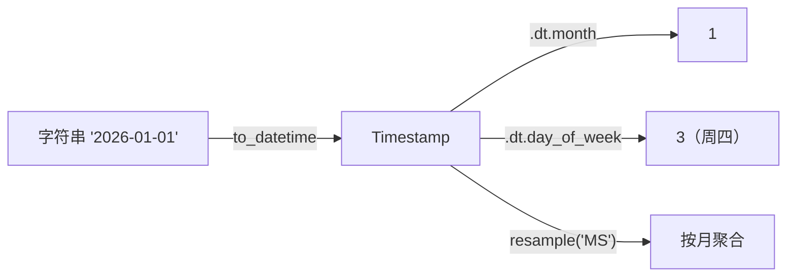

# PY-075 数据转换与时间序列

## 1. 知识概览

| 项 | 内容 |
|---|---|
| 知识 ID | `PY-075` |
| 所属模块 | M-PY-08 Pandas 与数据可视化 |
| 学习难度 | L3 中级 |
| **预计学习时间** | 45 分钟 |
| 前置知识 | [[PY-074 merge 与 concat]] |
| 学习目标 | 会 `apply`/`map`/`astype` 转换、会把字符串转日期、会按时间重采样 |

## 2. 通俗原理讲解

**数据转换**像"换单位"：把"元"换成"万元"，把字符串"2026-01-01"换成日期类型。

**时间序列**是 Pandas 的强项：一旦列变成日期类型，就能按天/周/月聚合、算时间差、算星期几。

关键动作只有两个：

1. `pd.to_datetime(...)` 把字符串变日期。
2. `.dt` 访问器取年/月/日/星期。

## 3. 技术原理

| 操作 | 写法 |
|---|---|
| 类型转换 | `df["x"].astype(float)` |
| 逐元素映射 | `df["x"].map({...})` 或 `.map(func)` |
| 按行/列应用 | `df.apply(func, axis=1)` |
| 字符串转日期 | `pd.to_datetime(df["d"])` |
| 取年月日 | `df["d"].dt.year` / `.month` / `.day` |
| 取星期 | `df["d"].dt.day_of_week`（周一=0） |
| 时间差 | `s.diff().dt.days` |
| 格式化 | `df["d"].dt.strftime("%Y-%m")` |
| 重采样 | `df.set_index("d").resample("MS")["v"].sum()` |
| 按月分组 | `df.groupby(df["d"].dt.to_period("M"))` |

**注意**

- `dayofweek` 在 Pandas 3 已弃用，用 `day_of_week`。
- `resample` 需要**日期索引**，所以先 `set_index`。
- `MS` 表示"月初"，`M` 表示"月末"。

## 4. 图解辅助



## 5. 完整代码示例

```powershell
python transform_time.py
```

```python
import pandas as pd

idx = pd.to_datetime(["2026-01-01", "2026-02-01"])
print(idx.month.tolist())
print(idx.day_of_week.tolist())

s = pd.Series(idx)
print(s.diff().dt.days.tolist())
print(idx.strftime("%Y-%m").tolist())
```

**预期输出**

```
[1, 2]
[3, 6]
[NaN, 31.0]
['2026-01', '2026-02']
```

**说明**

- `2026-01-01` 是周四（`day_of_week=3`），`2026-02-01` 是周日（`6`）。
- `diff()` 求相邻日期差，第一行没有前值所以是 `NaN`。
- `strftime` 把日期格式化成字符串，常用于做分组标签。

## 6. 实践练习

**基础**

1. 把 `["2026-03-01", "2026-03-15"]` 转成日期并取月份。
2. 用 `astype(float)` 把整数列转成浮点。
3. 用 `map` 把 `{"A": "高", "B": "低"}` 映射到一列。

**进阶**

1. 计算两个日期之间相差多少天。
2. 用 `resample("MS")` 按月汇总一组日数据。

**综合实践**

给一张"每日销售额"表（日期 + 金额，跨 3 个月），输出：每月总销售额、每个月的天数、销售额最高的月份。

## 7. 参考答案

**基础 1 · 思路**：`to_datetime` + `.month`。

```python
import pandas as pd
idx = pd.to_datetime(["2026-03-01", "2026-03-15"])
print(idx.month.tolist())
```

运行结果：`[3, 3]`

**基础 2 · 思路**：`astype`。

```python
import pandas as pd
s = pd.Series([1, 2, 3])
print(s.astype(float).tolist())
```

运行结果：`[1.0, 2.0, 3.0]`

**基础 3 · 思路**：`map` 字典。

```python
import pandas as pd
s = pd.Series(["A", "B", "A"])
print(s.map({"A": "高", "B": "低"}).tolist())
```

运行结果：`['高', '低', '高']`

**进阶 1 · 思路**：Timedelta。

```python
import pandas as pd
d1, d2 = pd.to_datetime("2026-01-01"), pd.to_datetime("2026-01-31")
print((d2 - d1).days)
```

运行结果：`30`

**进阶 2 · 思路**：`resample("MS")`。

```python
import pandas as pd
df = pd.DataFrame({
    "d": pd.to_datetime(["2026-01-05", "2026-01-20", "2026-02-03"]),
    "v": [100, 50, 80],
})
print(df.set_index("d").resample("MS")["v"].sum().to_dict())
```

运行结果：`{Timestamp('2026-01-01 00:00:00'): 150, Timestamp('2026-02-01 00:00:00'): 80}`

**综合实践 · 思路**：按 Period 分组并排序。

```python
import pandas as pd

df = pd.DataFrame({
    "d": pd.to_datetime(["2026-01-05", "2026-01-20", "2026-02-03", "2026-03-10"]),
    "amount": [100, 50, 80, 120],
})

df["month"] = df["d"].dt.to_period("M").astype(str)
monthly = df.groupby("month")["amount"].sum()
print("每月总额:", monthly.to_dict())
print("每月天数:", df.groupby("month")["d"].nunique().to_dict())
print("最高月份:", monthly.idxmax())
```

运行结果：

```
每月总额: {'2026-01': 150, '2026-02': 80, '2026-03': 120}
每月天数: {'2026-01': 2, '2026-02': 1, '2026-03': 1}
最高月份: 2026-01
```

> 这里的"每月天数"统计的是**有记录的日期数**，不是日历天数——如果你要日历天数，得用 `period.days_in_month`。

## 8. 常见错误

| 错误写法 | 现象 | 原因 | 正确写法 |
|---|---|---|---|
| 直接把字符串当日期比较 | 结果错 | 字符串按字典序比 | 先 `to_datetime` |
| 用 `dayofweek` | 弃用警告 | Pandas 3 改名 | `day_of_week` |
| 对非日期索引 `resample` | 报错 | 需要 DatetimeIndex | `set_index` 后 |
| `diff()` 第一行是 NaN 当 bug | 误判 | 没有前值 | 正常现象 |
| 用 `M` 想要月初 | 结果错位 | `M` 是月末 | 用 `MS` |

## 9. 知识关联

- **前置**：[[PY-074 merge 与 concat]]
- **后继**：[[PY-076 Matplotlib 基础]]、[[PY-078 数据分析综合实践]]
- **相关数学**：无
- **所属模块**：`M-PY-08 Pandas 与数据可视化`

## 10. 学习记录

| 日期 | 状态 | 掌握程度 | 遇到的问题 | 个人总结 | 待复习 |
|---|---|---|---|---|---|
| — | planned | — | — | — | — |

---

## 🔗 Notion 同步信息

> 以下内容由 Notion「AI Knowledge System · 知识点」数据库按知识 ID 合并而来（导出于 2026-11-09）。

| 属性 | 值 |
|---|---|
| 学科 | Python基础 |
| 学习状态 | 未开始 |
| 难度 | L3 推导 |
| 知识类型 | Technique |
| 学习目标 | 会做类型转换、日期解析与按时间重采样。 |

- **所属模块**：[M-PY-08 Pandas 与数据可视化](../%E8%AF%BE%E7%A8%8B%E6%A8%A1%E5%9D%97/M-PY-08%20Pandas%20%E4%B8%8E%E6%95%B0%E6%8D%AE%E5%8F%AF%E8%A7%86%E5%8C%96.md)
- **前置知识**：[PY-074 merge 与 concat](PY-074%20merge%20%E4%B8%8E%20concat.md)
- **后继知识**：[PY-076 Matplotlib 基础](PY-076%20Matplotlib%20%E5%9F%BA%E7%A1%80.md) · [PY-078 数据分析综合实践](PY-078%20%E6%95%B0%E6%8D%AE%E5%88%86%E6%9E%90%E7%BB%BC%E5%90%88%E5%AE%9E%E8%B7%B5.md)
