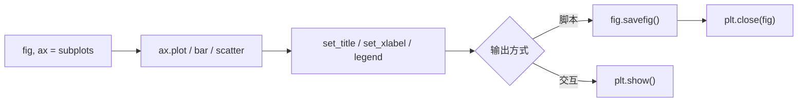

# PY-076 Matplotlib 基础

## 1. 知识概览

| 项 | 内容 |
|---|---|
| 知识 ID | `PY-076` |
| 所属模块 | M-PY-08 Pandas 与数据可视化 |
| 学习难度 | L2 初级 |
| **预计学习时间** | 45 分钟 |
| 前置知识 | [[PY-075 数据转换与时间序列]] |
| 学习目标 | 会用 `figure`/`axes` 画折线、柱状、散点，会保存图片，知道 `show` 与 `savefig` 的区别 |

## 2. 通俗原理讲解

Matplotlib 像**一张画板 + 一支笔**：

- `figure`：整张画板（可以放多幅子图）。
- `axes`：其中一块画布（有坐标轴）。
- `plot` / `bar` / `scatter`：往画布上画东西。

**两条铁律**：

1. 画完要 `savefig()` 或 `show()`，否则什么也看不到。
2. 脚本里批量出图要 `close()`，否则图越开越多会吃内存。

## 3. 技术原理

| 操作 | 写法 |
|---|---|
| 建画板 | `fig, ax = plt.subplots(figsize=(6,4))` |
| 折线 | `ax.plot(x, y, marker="o")` |
| 柱状 | `ax.bar(cats, vals)` |
| 散点 | `ax.scatter(x, y)` |
| 标题/轴标签 | `ax.set_title` / `ax.set_xlabel` / `ax.set_ylabel` |
| 图例 | `ax.legend()`（需给 `label=`） |
| 保存 | `fig.savefig("a.png", dpi=120)` |
| 关闭 | `plt.close(fig)` |
| 非交互后端 | `matplotlib.use("Agg")` |

**`show()` vs `savefig()`**

- `show()`：弹窗显示（需要 GUI 后端，脚本里可能阻塞）。
- `savefig()`：写文件（可在无界面环境运行，**推荐脚本使用**）。

**中文乱码**：Matplotlib 默认字体不含中文，需设置 `plt.rcParams["font.sans-serif"] = ["Microsoft YaHei"]` 并 `axes.unicode_minus=False`。为稳妥，本笔记图表标签用英文。

## 4. 图解辅助



## 5. 完整代码示例

```powershell
python plot_basic.py
```

```python
from pathlib import Path

import matplotlib

matplotlib.use("Agg")
import matplotlib.pyplot as plt
import pandas as pd

df = pd.DataFrame({"x": [1, 2, 3], "y": [2, 4, 6]})

fig, ax = plt.subplots(figsize=(4, 3))
ax.plot(df["x"], df["y"], marker="o", label="y = 2x")
ax.set_title("Line Chart")
ax.set_xlabel("x")
ax.set_ylabel("y")
ax.legend()

out = Path("plot_basic.png")
fig.savefig(out, dpi=80)
plt.close(fig)

print("生成成功:", out.exists(), out.stat().st_size > 0)
out.unlink()
```

**预期输出**

```
生成成功: True True
```

**说明**

- 先 `matplotlib.use("Agg")` 再导入 `pyplot`，保证无界面环境也能出图。
- `marker="o"` 在每个数据点画圆圈，方便看出数据位置。
- `savefig` 后 `close`，避免图对象堆积。
- 输出判断用"文件存在且大小 > 0"，比只看返回值可靠。

## 6. 实践练习

**基础**

1. 画一条 `y = x` 的折线并保存为 PNG。
2. 画三根柱子的柱状图，设置标题。
3. 判断：脚本里只用 `show()` 不 `savefig()` 会怎样？

**进阶**

1. 在同一张图上画两条折线并加图例。
2. 用 `figsize` 调整尺寸，比较输出文件大小变化（只说趋势，不写死字节）。

**综合实践**

用 Pandas 造 6 个月的销售数据，画折线图（x=月份，y=销售额），加标题与轴标签，保存后确认文件存在，再关闭图形。

## 7. 参考答案

**基础 1 · 思路**：最小折线。

```python
from pathlib import Path
import matplotlib
matplotlib.use("Agg")
import matplotlib.pyplot as plt

fig, ax = plt.subplots()
ax.plot([1, 2, 3], [1, 2, 3])
p = Path("t1.png")
fig.savefig(p)
plt.close(fig)
print(p.exists())
p.unlink()
```

运行结果：`True`

**基础 2 · 思路**：柱状图。

```python
fig, ax = plt.subplots()
ax.bar(["A", "B", "C"], [3, 5, 2])
ax.set_title("Bars")
p = Path("t2.png")
fig.savefig(p)
plt.close(fig)
print(p.exists())
p.unlink()
```

运行结果：`True`

**基础 3 · 思路**：后端决定行为。

答案：在无 GUI/未配置后端时，`show()` 可能什么都不做或阻塞；脚本应该用 `savefig()`。

**进阶 1 · 思路**：两次 plot + legend。

```python
fig, ax = plt.subplots()
ax.plot([1, 2, 3], [1, 2, 3], label="a")
ax.plot([1, 2, 3], [3, 2, 1], label="b")
ax.legend()
print(len(ax.lines))
plt.close(fig)
```

运行结果：`2`

**进阶 2 · 思路**：尺寸影响像素数。

答案：`figsize` 越大，默认 dpi 下像素越多，PNG 文件通常越大（有上限，取决于内容复杂度）。

**综合实践 · 思路**：Pandas 造数据 + 折线。

```python
from pathlib import Path
import matplotlib
matplotlib.use("Agg")
import matplotlib.pyplot as plt
import pandas as pd

df = pd.DataFrame({
    "month": ["2026-01", "2026-02", "2026-03", "2026-04", "2026-05", "2026-06"],
    "sales": [120, 150, 130, 180, 170, 210],
})

fig, ax = plt.subplots(figsize=(6, 3))
ax.plot(df["month"], df["sales"], marker="o")
ax.set_title("Monthly Sales")
ax.set_xlabel("Month")
ax.set_ylabel("Sales")
ax.tick_params(axis="x", rotation=30)

p = Path("monthly_sales.png")
fig.savefig(p, dpi=100)
plt.close(fig)
print("图已生成:", p.exists())
p.unlink()
```

运行结果：`图已生成: True`

## 8. 常见错误

| 错误写法 | 现象 | 原因 | 正确写法 |
|---|---|---|---|
| 只 `plot` 不保存/显示 | 什么都没有 | 没触发渲染 | `savefig` 或 `show` |
| 在 `Agg` 下调 `show()` | 无反应 | 后端无界面 | 用 `savefig` |
| 循环里不 `close` | 内存涨、警告 | 图对象堆积 | 每次 `plt.close(fig)` |
| 中文标签变方块 | 显示豆腐块 | 字体不含中文 | 设 `font.sans-serif` 或用英文 |
| `savefig` 后再画 | 图已关 | `close` 之后不能用 | 先画完再关 |

## 9. 知识关联

- **前置**：[[PY-075 数据转换与时间序列]]
- **后继**：[[PY-077 图表设计与可读性]]、[[PY-078 数据分析综合实践]]
- **相关数学**：坐标与函数图像见 [[MATH-121 导数]]
- **所属模块**：`M-PY-08 Pandas 与数据可视化`

## 10. 学习记录

| 日期 | 状态 | 掌握程度 | 遇到的问题 | 个人总结 | 待复习 |
|---|---|---|---|---|---|
| — | planned | — | — | — | — |

---

## 🔗 Notion 同步信息

> 以下内容由 Notion「AI Knowledge System · 知识点」数据库按知识 ID 合并而来（导出于 2026-11-09）。

| 属性 | 值 |
|---|---|
| 学科 | Python基础 |
| 学习状态 | 未开始 |
| 难度 | L2 应用 |
| 知识类型 | Technique |
| 学习目标 | 会用 figure/axes 画图并保存，知道 show 与 savefig 区别。 |

- **所属模块**：[M-PY-08 Pandas 与数据可视化](../%E8%AF%BE%E7%A8%8B%E6%A8%A1%E5%9D%97/M-PY-08%20Pandas%20%E4%B8%8E%E6%95%B0%E6%8D%AE%E5%8F%AF%E8%A7%86%E5%8C%96.md)
- **前置知识**：[PY-075 数据转换与时间序列](PY-075%20%E6%95%B0%E6%8D%AE%E8%BD%AC%E6%8D%A2%E4%B8%8E%E6%97%B6%E9%97%B4%E5%BA%8F%E5%88%97.md)
- **后继知识**：[PY-077 图表设计与可读性](PY-077%20%E5%9B%BE%E8%A1%A8%E8%AE%BE%E8%AE%A1%E4%B8%8E%E5%8F%AF%E8%AF%BB%E6%80%A7.md)
- **被项目引用**：[PROJ-008 数据可视化项目](../../07_%E5%AE%9E%E6%88%98%E9%A1%B9%E7%9B%AE/02%20%E6%95%B0%E6%8D%AE%E5%88%86%E6%9E%90%E9%A1%B9%E7%9B%AE/PROJ-008%20%E6%95%B0%E6%8D%AE%E5%8F%AF%E8%A7%86%E5%8C%96%E9%A1%B9%E7%9B%AE.md)
