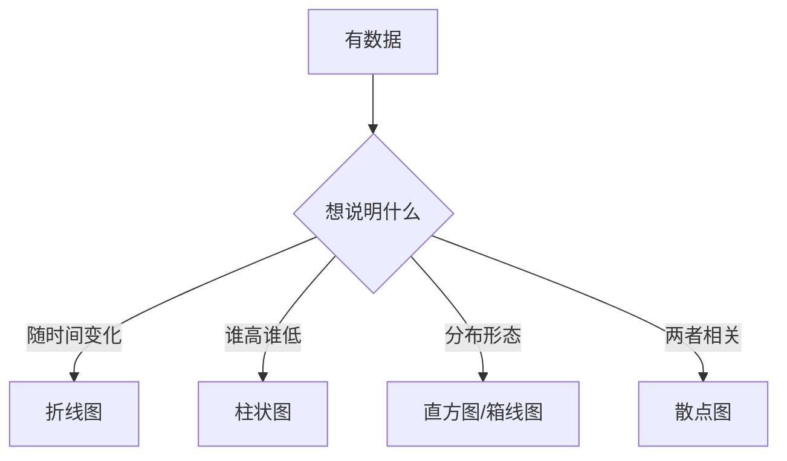

# PY-077 图表设计与可读性

## 1. 知识概览

| 项 | 内容 |
|---|---|
| 知识 ID | `PY-077` |
| 所属模块 | M-PY-08 Pandas 与数据可视化 |
| 学习难度 | L2 初级 |
| **预计学习时间** | 40 分钟 |
| 前置知识 | [[PY-076 Matplotlib 基础]] |
| 学习目标 | 会挑图型、会排版子图、知道哪些设计让图"能读"哪些让它"白画" |

## 2. 通俗原理讲解

画图的目的**不是好看，是让人一眼看懂结论**。

三个常见错误：

1. **图型选错**：类别数据用折线图（没有"趋势"却硬连）。
2. **信息过载**：一图放 8 条线、10 个颜色，谁也看不出重点。
3. **缺上下文**：没有标题、没有单位、没有基准线。

好图的标准：**不看正文也能读懂它想说什么**。

## 3. 技术原理

| 数据关系 | 推荐图型 |
|---|---|
| 趋势（时间序列） | 折线图 |
| 类别对比 | 柱状图 |
| 分布 | 直方图 / 箱线图 |
| 两变量关系 | 散点图 |
| 占比 | 堆叠柱 / 饼图（项少时） |

**排版要点**

| 要素 | 作用 |
|---|---|
| `figsize` | 控制整体比例（宽屏 8×3，方形 5×5） |
| `subplots(1, 2)` | 并排子图，对比用 |
| `tight_layout()` | 自动避免标签重叠 |
| `grid(alpha=0.3)` | 淡网格帮助读数 |
| `tick_params(rotation=30)` | 长标签倾斜 |
| `axhline` | 基准线（如目标值） |
| 统一配色 | 同一含义用同一颜色 |

**中文显示**：`plt.rcParams["font.sans-serif"] = ["Microsoft YaHei"]`、`plt.rcParams["axes.unicode_minus"] = False`。本笔记为保证可复现，图内标签用英文。

## 4. 图解辅助



## 5. 完整代码示例

```powershell
python chart_design.py
```

```python
from pathlib import Path

import matplotlib

matplotlib.use("Agg")
import matplotlib.pyplot as plt

fig, axes = plt.subplots(1, 2, figsize=(8, 3))

axes[0].plot([1, 2, 3], [3, 1, 2], marker="o")
axes[0].set_title("Line")
axes[0].set_xlabel("x")
axes[0].set_ylabel("y")
axes[0].grid(True, alpha=0.3)

axes[1].bar(["A", "B", "C"], [3, 1, 2], color="#4C78A8")
axes[1].set_title("Bar")
axes[1].set_ylabel("value")

fig.tight_layout()
p = Path("chart_design.png")
fig.savefig(p, dpi=90)
plt.close(fig)

print("子图数:", len(axes))
print("文件生成:", p.exists())
p.unlink()
```

**预期输出**

```
子图数: 2
文件生成: True
```

**说明**

- `subplots(1, 2)` 返回 `axes` 数组，用 `axes[0]`、`axes[1]` 分别操作。
- 左边折线配淡网格，右边柱状用统一的主色（`#4C78A8`）。
- `tight_layout()` 防止标题/标签被裁切。
- 保存后关闭，避免内存泄漏。

## 6. 实践练习

**基础**

1. 画一个 2×1 的上下子图，分别放折线与柱状。
2. 给图加标题、轴标签、网格。
3. 判断：类别数据适合用折线图吗？

**进阶**

1. 用 `axhline` 加一条"目标线"（如 100）。
2. 长标签倾斜 45°，观察是否更易读。

**综合实践**

给一组"各科平均分"数据，画两个子图：左柱状对比各科，右横向条形（`barh`）按分数排序；统一标题与配色，保存并确认文件存在。

## 7. 参考答案

**基础 1 · 思路**：`subplots(2, 1)`。

```python
from pathlib import Path
import matplotlib
matplotlib.use("Agg")
import matplotlib.pyplot as plt

fig, axes = plt.subplots(2, 1, figsize=(4, 4))
axes[0].plot([1, 2, 3], [1, 2, 3])
axes[1].bar(["A", "B"], [2, 1])
p = Path("t.png"); fig.savefig(p); plt.close(fig)
print(p.exists()); p.unlink()
```

运行结果：`True`

**基础 2 · 思路**：三个 set + grid。

```python
fig, ax = plt.subplots()
ax.plot([1, 2], [1, 2])
ax.set_title("T"); ax.set_xlabel("X"); ax.set_ylabel("Y"); ax.grid(True, alpha=0.3)
plt.close(fig)
print("ok")
```

运行结果：`ok`

**基础 3 · 思路**：类别无趋势。

答案：不适合。类别之间没有"连续变化"，折线会暗示不存在的趋势；应用柱状图。

**进阶 1 · 思路**：`axhline`。

```python
fig, ax = plt.subplots()
ax.bar(["A", "B"], [80, 120])
ax.axhline(100, color="red", linestyle="--", linewidth=1)
plt.close(fig)
print("ok")
```

运行结果：`ok`

**进阶 2 · 思路**：`tick_params`。

```python
fig, ax = plt.subplots()
ax.bar(["2026-01", "2026-02"], [10, 20])
ax.tick_params(axis="x", rotation=45)
plt.close(fig)
print("ok")
```

运行结果：`ok`

**综合实践 · 思路**：两个子图 + 排序。

```python
from pathlib import Path
import matplotlib
matplotlib.use("Agg")
import matplotlib.pyplot as plt
import pandas as pd

df = pd.DataFrame({"subject": ["Math", "English", "Python"], "avg": [88, 79, 92]})
df = df.sort_values("avg", ascending=False)

fig, axes = plt.subplots(1, 2, figsize=(9, 3))
axes[0].bar(df["subject"], df["avg"], color="#4C78A8")
axes[0].set_title("Average by Subject")
axes[0].set_ylabel("Score")

axes[1].barh(df["subject"], df["avg"], color="#F2A93B")
axes[1].set_title("Ranked (sorted)")
axes[1].set_xlabel("Score")

fig.tight_layout()
p = Path("subjects.png")
fig.savefig(p, dpi=90)
plt.close(fig)
print("生成:", p.exists())
p.unlink()
```

运行结果：`生成: True`

## 8. 常见错误

| 错误写法 | 现象 | 原因 | 正确写法 |
|---|---|---|---|
| 类别数据用折线 | 暗示假趋势 | 图型不符 | 用柱状 |
| 一图十余条线 | 无法辨认 | 信息过载 | 拆子图或只留重点 |
| 忘 `tight_layout` | 标签被裁 | 布局重叠 | `fig.tight_layout()` |
| 中文标签变方块 | 缺字体 | 未设字体 | 设 `font.sans-serif` 或用英文 |
| 无标题/无单位 | 读者猜 | 缺上下文 | 标题 + 轴标签 + 单位 |

## 9. 知识关联

- **前置**：[[PY-076 Matplotlib 基础]]
- **后继**：[[PY-078 数据分析综合实践]]
- **相关数学**：无
- **所属模块**：`M-PY-08 Pandas 与数据可视化`

## 10. 学习记录

| 日期 | 状态 | 掌握程度 | 遇到的问题 | 个人总结 | 待复习 |
|---|---|---|---|---|---|
| — | planned | — | — | — | — |

---

## 🔗 Notion 同步信息

> 以下内容由 Notion「AI Knowledge System · 知识点」数据库按知识 ID 合并而来（导出于 2026-11-09）。

| 属性 | 值 |
|---|---|
| 学科 | Python基础 |
| 学习状态 | 未开始 |
| 难度 | L2 应用 |
| 知识类型 | Technique |
| 学习目标 | 会挑图型、排版子图，让图表可读。 |

- **所属模块**：[M-PY-08 Pandas 与数据可视化](../%E8%AF%BE%E7%A8%8B%E6%A8%A1%E5%9D%97/M-PY-08%20Pandas%20%E4%B8%8E%E6%95%B0%E6%8D%AE%E5%8F%AF%E8%A7%86%E5%8C%96.md)
- **前置知识**：[PY-076 Matplotlib 基础](PY-076%20Matplotlib%20%E5%9F%BA%E7%A1%80.md)
- **被项目引用**：[PROJ-008 数据可视化项目](../../07_%E5%AE%9E%E6%88%98%E9%A1%B9%E7%9B%AE/02%20%E6%95%B0%E6%8D%AE%E5%88%86%E6%9E%90%E9%A1%B9%E7%9B%AE/PROJ-008%20%E6%95%B0%E6%8D%AE%E5%8F%AF%E8%A7%86%E5%8C%96%E9%A1%B9%E7%9B%AE.md)
