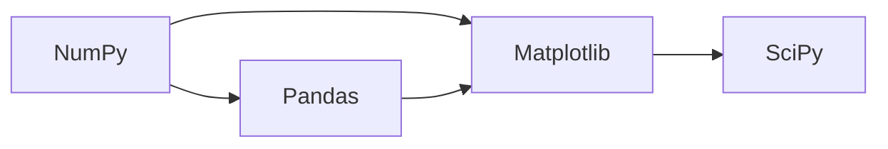

# 🔢 科学计算 · 模块索引

> 主色：#2F6FEB
> 上位导航：[[00_知识首页/00 总索引\|总索引]] · 顺序见 [[00_知识首页/01 学习路线总览\|学习路线]]
> 定位：**把 Python 变成能算数的工具**。这一层不学模型，只学"数据怎么表示、怎么算得快"。

---

## 一、四个模块

| # | 模块 | 目录 | 能力目标 |
|---|---|---|---|
| 1 | NumPy | `01 NumPy/` | 用 ndarray 与向量化替代循环；理解 broadcasting、axis、视图与副本 |
| 2 | Pandas | `02 Pandas/` | 用 DataFrame 做筛选/分组/合并/透视；处理缺失值与时间序列 |
| 3 | Matplotlib | `03 Matplotlib/` | 画清一张能读的图：坐标轴、图例、子图、标注 |
| 4 | SciPy | `04 SciPy/` | 调用 `optimize` `stats` `integrate` `sparse` 解决现成问题 |

## 二、学习顺序

> **NumPy 必须最先**。Pandas 的底层是 NumPy，Matplotlib 的输入是数组，SciPy 的参数是数组。

## 三、三个必须先建立的直觉

1. **向量化不是语法糖**，是数量级的差别（循环 vs 连续内存 + SIMD）。
2. **`axis` 是"被压掉的轴"**，不是"操作的方向"——这是最常见的困惑来源。
3. **视图 vs 副本**：切片返回视图，改它会影响原数组；`copy()` 才是独立数据。

## 四、知识点登记（当前 0 条）

| 知识 ID | 名称 | 难度 | 状态 | 笔记 |
|---|---|---|---|---|
| — | — | — | — | 尚未建立 |

领号入口：[[08_知识索引/08 ID注册表\|ID 注册表]]

## 五、关联数学

| 数学分支 | 入口 | 关联点 |
|---|---|---|
| 线性代数 | [[06_数学基础/02 线性代数/00 分支索引\|线性代数]] | ndarray 的本质是张量；矩阵乘法、转置、广播对应线代运算 |
| 数理统计 | [[06_数学基础/04 数理统计/00 分支索引\|数理统计]] | Pandas 的 describe/groupby 背后是均值、方差、分位数 |
| 数值计算 | [[06_数学基础/06 数值计算/00 分支索引\|数值计算]] | 浮点精度、条件数、稳定性 |

**重点锚点**：矩阵乘法 = `MATH-216`，是 NumPy 与后续所有模型的核心运算。

## 六、出口标准

- [ ] 能把一段三重 for 循环改写成 NumPy 向量化，并实测提速
- [ ] 能独立完成"读 CSV → 清洗 → 分组统计 → 出图"全流程
- [ ] 能解释 `a[0]` 与 `a[0:1]` 的维度差异与视图行为

## 七、下一步

- 往下走：[[03_机器学习/00 模块索引\|机器学习]]
- 查全库：[[08_知识索引/00 全知识点索引\|全知识点索引]]
