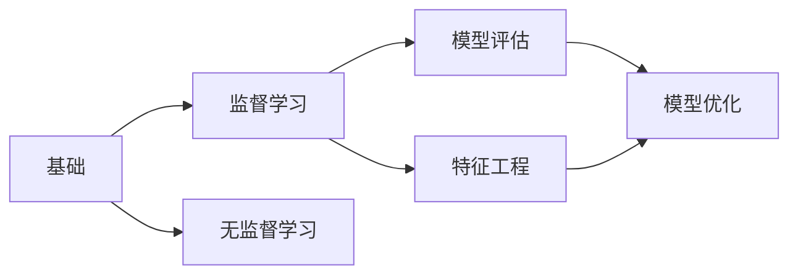

# 🤖 机器学习 · 模块索引

> 主色：#2F6FEB
> 上位导航：[[00_知识首页/00 总索引\|总索引]] · 顺序见 [[00_知识首页/01 学习路线总览\|学习路线]]
> 定位：**从"数据"到"预测"的方法论层**。这一层的核心不是调包，是知道每个模型在假设什么。

---

## 一、八个课程模块

| # | 课程模块 | 模块 ID | 目录 | 篇数 |
|---|---|---|---|---|
| 1 | 机器学习基础 | `M-ML-01` | `01 机器学习基础/` | 8 |
| 2 | 数据处理与特征工程 | `M-ML-02` | `05 特征工程/` | 8 |
| 3 | 监督学习——回归 | `M-ML-03` | `02 监督学习/` | 7 |
| 4 | 监督学习——分类 | `M-ML-04` | `02 监督学习/` | 9 |
| 5 | 无监督学习 | `M-ML-05` | `03 无监督学习/` | 7 |
| 6 | 模型评估与优化 | `M-ML-06` | `04 模型评估/` | 10 |
| 7 | 集成学习与高级算法 | `M-ML-07` | `06 模型优化/` | 8 |
| 8 | 机器学习工程实践 | `M-ML-08` | `07 工程实践/` | 7 |
| | | | | **64** |

> **目录按主题、模块按课程**：`02 监督学习/` 同时承载回归与分类两个模块，靠 frontmatter `module` 区分。

## 二、学习顺序

> **评估必须紧跟监督学习**。先学模型再学评估，会养成"只看准确率"的坏习惯，后患无穷。

## 三、四个最容易犯的错

1. **数据泄漏**：在划分训练集之前就做了标准化/填充 → 指标虚高。
2. **只看准确率**：类别不平衡时准确率毫无意义。
3. **拿测试集调参**：测试集只能用一次。
4. **把相关性当因果**：特征重要性 ≠ 因果效应。

## 四、知识点登记

当前已完成 **64 / 64**（13 批全部完成，8 个模块全部收官）：

| 知识 ID | 名称 | 模块 | 难度 | 状态 | 笔记 |
|---|---|---|---|---|---|
| `ML-001` | 什么是机器学习 | M-ML-01 | L1 | planned | [[ML-001 什么是机器学习]] |
| `ML-002` | 机器学习三大范式 | M-ML-01 | L1 | planned | [[ML-002 机器学习三大范式]] |
| `ML-003` | 机器学习工作流程 | M-ML-01 | L1 | planned | [[ML-003 机器学习工作流程]] |
| `ML-004` | 训练集、验证集与测试集 | M-ML-01 | L2 | planned | [[ML-004 训练集、验证集与测试集]] |
| `ML-005` | 特征、标签、样本与数据集 | M-ML-01 | L1 | planned | [[ML-005 特征、标签、样本与数据集]] |
| `ML-006` | 模型、参数与超参数 | M-ML-01 | L1 | planned | [[ML-006 模型、参数与超参数]] |
| `ML-007` | 经验风险与泛化能力 | M-ML-01 | L2 | planned | [[ML-007 经验风险与泛化能力]] |
| `ML-008` | Scikit-learn 入门与开发环境 | M-ML-01 | L2 | planned | [[ML-008 Scikit-learn 入门与开发环境]] |
| `ML-009` | 结构化数据读取 | M-ML-02 | L1 | planned | [[ML-009 结构化数据读取]] |
| `ML-010` | 数据清洗 | M-ML-02 | L2 | planned | [[ML-010 数据清洗]] |
| `ML-011` | 缺失值处理 | M-ML-02 | L2 | planned | [[ML-011 缺失值处理]] |
| `ML-012` | 异常值识别与处理 | M-ML-02 | L2 | planned | [[ML-012 异常值识别与处理]] |
| `ML-013` | 类别特征编码 | M-ML-02 | L2 | planned | [[ML-013 类别特征编码]] |
| `ML-014` | 数值特征标准化与归一化 | M-ML-02 | L2 | planned | [[ML-014 数值特征标准化与归一化]] |
| `ML-015` | 特征选择与特征构造 | M-ML-02 | L3 | planned | [[ML-015 特征选择与特征构造]] |
| `ML-016` | 预处理 Pipeline 与 ColumnTransformer | M-ML-02 | L3 | planned | [[ML-016 预处理 Pipeline 与 ColumnTransformer]] |
| `ML-017` | 回归任务基本概念 | M-ML-03 | L1 | planned | [[ML-017 回归任务基本概念]] |
| `ML-018` | 线性回归（手写实现） | M-ML-03 | L2 | planned | [[ML-018 线性回归（手写实现）]] |
| `ML-019` | 多元线性回归与正规方程 | M-ML-03 | L3 | planned | [[ML-019 多元线性回归与正规方程]] |
| `ML-020` | 多项式回归 | M-ML-03 | L2 | planned | [[ML-020 多项式回归]] |
| `ML-021` | 岭回归 | M-ML-03 | L2 | planned | [[ML-021 岭回归]] |
| `ML-022` | Lasso 与 Elastic Net | M-ML-03 | L3 | planned | [[ML-022 Lasso 与 Elastic Net]] |
| `ML-023` | 回归评价指标与残差诊断 | M-ML-03 | L2 | planned | [[ML-023 回归评价指标与残差诊断]] |
| `ML-024` | 分类任务基本概念 | M-ML-04 | L1 | planned | [[ML-024 分类任务基本概念]] |
| `ML-025` | 逻辑回归 | M-ML-04 | L2 | planned | [[ML-025 逻辑回归]] |
| `ML-026` | K 近邻 | M-ML-04 | L1 | planned | [[ML-026 K 近邻]] |
| `ML-027` | 朴素贝叶斯 | M-ML-04 | L2 | planned | [[ML-027 朴素贝叶斯]] |
| `ML-028` | 决策树 | M-ML-04 | L3 | planned | [[ML-028 决策树]] |
| `ML-029` | 支持向量机 | M-ML-04 | L3 | planned | [[ML-029 支持向量机]] |
| `ML-030` | 决策边界与分类阈值 | M-ML-04 | L2 | planned | [[ML-030 决策边界与分类阈值]] |
| `ML-031` | 多分类策略 | M-ML-04 | L2 | planned | [[ML-031 多分类策略]] |
| `ML-032` | 类别不平衡处理 | M-ML-04 | L3 | planned | [[ML-032 类别不平衡处理]] |
| `ML-033` | 无监督学习基本概念 | M-ML-05 | L1 | planned | [[ML-033 无监督学习基本概念]] |
| `ML-034` | K-Means 聚类 | M-ML-05 | L2 | planned | [[ML-034 K-Means 聚类]] |
| `ML-035` | 层次聚类 | M-ML-05 | L2 | planned | [[ML-035 层次聚类]] |
| `ML-036` | DBSCAN | L2 | planned | [[ML-036 DBSCAN]] |
| `ML-037` | 距离度量与聚类评价 | L2 | planned | [[ML-037 距离度量与聚类评价]] |
| `ML-038` | PCA 降维 | L2 | planned | [[ML-038 PCA 降维]] |
| `ML-039` | 异常检测 | L3 | planned | [[ML-039 异常检测]] |
| `ML-040` | Hold-out 验证 | M-ML-06 | L1 | planned | [[ML-040 Hold-out 验证]] |
| `ML-041` | K 折交叉验证 | L2 | planned | [[ML-041 K 折交叉验证]] |
| `ML-042` | 分层 K 折与留一法 | L2 | planned | [[ML-042 分层 K 折与留一法]] |
| `ML-043` | 混淆矩阵与分类指标 | L2 | planned | [[ML-043 混淆矩阵与分类指标]] |
| `ML-044` | ROC 曲线与 AUC | L3 | planned | [[ML-044 ROC 曲线与 AUC]] |
| `ML-045` | PR 曲线与阈值选择 | L3 | planned | [[ML-045 PR 曲线与阈值选择]] |

领号入口：[[08_知识索引/08 ID注册表\|ID 注册表]]

## 五、关联数学（本学科依赖最重）

| 数学分支 | 入口 | 用在哪 |
|---|---|---|
| 线性代数 | [[06_数学基础/02 线性代数/00 分支索引\|线性代数]] | 特征矩阵、矩阵乘法（`MATH-216`）、特征值分解、PCA |
| 概率论 | [[06_数学基础/03 概率论/00 分支索引\|概率论]] | 似然、条件概率、分布假设、贝叶斯 |
| 数理统计 | [[06_数学基础/04 数理统计/00 分支索引\|数理统计]] | 估计、假设检验、最小二乘与回归（`MATH-451`） |
| 最优化方法 | [[06_数学基础/07 最优化方法/00 分支索引\|最优化方法]] | 损失函数最小化、梯度下降（`MATH-721`）、凸性 |
| 高等数学 | [[06_数学基础/01 高等数学/00 分支索引\|高等数学]] | 导数（`MATH-121`）、偏导、链式法则 |

> **不要等数学学完再学 ML**。正确顺序：先跑通模型建立直觉 → 遇到看不懂的公式再回数学库补对应知识点 → 回头重读。数学是随用随取的字典，不是入场券。

## 六、出口标准

- [ ] 能只用 NumPy 手写线性回归（含梯度下降），不用 sklearn
- [ ] 能解释偏差与方差，并从学习曲线判断模型处在哪一侧
- [ ] 能在类别不平衡数据上选对评估指标并说明理由
- [ ] 能指出一个模型的假设，并说出假设被违反时会发生什么

## 七、下一步

- 往下走：[[04_深度学习/00 模块索引\|深度学习]]
- 交叉索引：[[08_知识索引/06 知识关联索引\|知识关联索引]] · [[08_知识索引/03 机器学习知识索引\|机器学习知识索引]]
