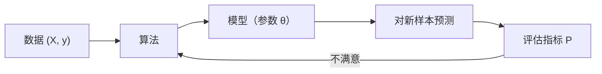

# ML-001 什么是机器学习

## 1. 本节学习目标

1. 能用自己的话说清"机器学习"与"传统编程"的根本差别。
2. 能判断一个需求该用规则写，还是该用机器学习。
3. 能说出机器学习的三要素：数据、模型、目标。
4. 能跑通第一个 sklearn 模型，并读懂它的输入输出。

## 2. 为什么需要这个知识

因为它决定了你**用什么思路解决问题**。

- 如果规则清晰、可穷举（如"满 100 减 20"），写 `if` 就够了，用机器学习是自找麻烦。
- 如果规则说不清、但**有大量例子**（如"这张图是不是猫"），规则式编程会崩，必须让机器从例子中学。

混淆这两者，会出现两类典型失败：**能用规则却硬训模型**（不可解释、难维护），或**该学习却硬写规则**（分支爆炸、永远覆盖不全）。

## 3. 直观解释

传统编程：

> 你写规则 → 程序照规则算 → 得到答案

机器学习：

> 你给**例子（数据）** → 算法自己找规则（模型）→ 用模型对新数据给答案

打个比方：教小孩认猫，你没法写一条"猫 = 尖耳朵 + 胡须 + 4 条腿 + ⋯"的精确规则（因为狗也有这些，无毛猫又没有毛）。你是**给他看很多猫的照片**，他自己总结出"感觉"。

机器学习的"感觉"就是**模型参数**。它不保证完全正确，只保证在见过的分布上**统计意义上够好**。

## 4. 正式定义

**机器学习**（Tom Mitchell, 1997 的经典定义）：

> 对于某类任务 $T$ 和性能度量 $P$，如果一个程序在 $T$ 上以 $P$ 衡量的性能随着**经验 $E$** 而自我改善，就称它从经验 $E$ 中学习。

三要素对应：

| 符号 | 含义 | 例子（鸢尾花分类） |
|---|---|---|
| $T$ | 任务 | 判断花的品种 |
| $P$ | 性能度量 | 测试集准确率 |
| $E$ | 经验 | 150 条带标签的样本 |

**形式化**：给定训练集 $\{(\mathbf{x}_i, y_i)\}_{i=1}^{n}$，寻找参数 $\theta$ 使

$$
\hat\theta = \arg\min_{\theta} \frac{1}{n}\sum_{i=1}^{n} L\big(f_\theta(\mathbf{x}_i),\, y_i\big)
$$

其中 $f_\theta$ 是模型，$L$ 是损失函数。

## 5. 核心原理

机器学习的核心不是"聪明"，而是**从有限样本推断规律，并希望规律在新样本上仍成立**（泛化）。

由此产生三个必然问题：

1. **样本有限** → 学到的规律可能只是噪声（过拟合）。
2. **假设有限** → 模型族的表达能力决定它能学什么（线性模型学不会异或）。
3. **分布会变** → 训练时的分布与上线后的分布不同，模型会退化。

**关键认知**：模型不是"发现真理"，而是"在给定数据与假设下，找一组最不坏的参数"。所以**数据质量与假设合理性，比模型花哨程度更重要**。

## 6. 数学表达式

**训练目标**（经验风险最小化）

$$
\hat\theta = \arg\min_{\theta} \frac{1}{n}\sum_{i=1}^{n} L\big(f_\theta(\mathbf{x}_i), y_i\big)
$$

**泛化误差**（真正关心的量）

$$
R(f) = \mathbb{E}_{(\mathbf{x},y)\sim \mathcal{D}}\big[L(f(\mathbf{x}), y)\big]
$$

但 $\mathcal{D}$ 未知 ⇒ 只能用**测试集**近似估计（详见 [[ML-004 训练集、验证集与测试集]]）。

## 7. 数学库链接

| 用到的数学 | 对应篇目 | 本课怎么用 |
|---|---|---|
| 期望与损失的含义 | [[MATH-306 期望、方差与协方差]] | 泛化误差是"损失在分布上的期望" |
| 极限与收敛直观 | [[MATH-120 极限与连续]] | 样本量增大时经验风险趋近真实风险 |

> 本课**不推导**这些内容，只说明"模型评估为什么需要概率与统计"。

## 8. 算法执行流程

标准机器学习任务的六步（后面每篇都会回到这张表）：

| 步 | 动作 | 常见错误 |
|---|---|---|
| 1 | 定义任务与度量 $P$ | 度量选错（如不平衡数据用准确率） |
| 2 | 收集并清洗数据 $E$ | 数据泄漏、标签错误 |
| 3 | 划分训练/验证/测试集 | 先标准化再划分 ⇒ 泄漏 |
| 4 | 选模型族并训练 | 一上来就调最复杂的模型 |
| 5 | 用验证集选超参 | 拿测试集调参 |
| 6 | 用测试集做**一次性**评估 | 反复看测试集 ⇒ 间接过拟合 |

## 9. 可视化解释



传统编程是"规则 → 答案"，机器学习是"数据 → 规则"：

```text
传统：  规则 + 输入  ──► 输出
ML：    数据 + 答案  ──► 规则（模型）
```

## 10. Python 实现

用 sklearn 内置鸢尾花数据集跑通第一个完整流程（**A 原理版不适用**：本课是概念课，重点是流程而非算法实现）。

```powershell
python ml001_first_model.py
```

```python
from sklearn.datasets import load_iris
from sklearn.model_selection import train_test_split
from sklearn.neighbors import KNeighborsClassifier

iris = load_iris()
X, y = iris.data, iris.target

X_train, X_test, y_train, y_test = train_test_split(
    X, y, test_size=0.3, random_state=42, stratify=y
)

model = KNeighborsClassifier(n_neighbors=3)
model.fit(X_train, y_train)

print("样本数:", X.shape[0], " 特征数:", X.shape[1], " 类别数:", len(iris.target_names))
print("训练集:", X_train.shape[0], " 测试集:", X_test.shape[0])
print("测试集前 5 个预测:", model.predict(X_test[:5]).tolist())
print("测试准确率:", round(model.score(X_test, y_test), 4))
```

**实际运行结果**

```
样本数: 150  特征数: 4  类别数: 3
训练集: 105  测试集: 45
测试集前 5 个预测: [2, 1, 1, 1, 2]
测试准确率: 0.9556
```

## 11. 代码逐行解释

| 代码 | 作用 |
|---|---|
| `load_iris()` | 加载内置数据集（150 样本 × 4 特征 × 3 类），**不联网** |
| `train_test_split(..., test_size=0.3, random_state=42, stratify=y)` | 7:3 划分；`random_state` 固定随机性保证可复现；`stratify=y` 保持训练/测试的类别比例一致 |
| `KNeighborsClassifier(n_neighbors=3)` | 选模型：看最近的 3 个邻居投票 |
| `model.fit(X_train, y_train)` | **训练**：KNN 实际只是记住训练集 |
| `model.predict(...)` | 预测：返回类别编号 `0/1/2` |
| `model.score(...)` | 用准确率（默认度量）打分 |

**关键参数**：`test_size` 决定评估的可靠性（太小则波动大）；`random_state` 保证你和别人得到同一结果；`stratify` 在类别不平衡时尤其重要。

## 12. 实际运行结果

见第 10 节，已实跑。要点：

- 测试准确率 **0.9556** ⇒ 45 个里错 2 个。
- 预测结果是**类别编号**不是花名，需用 `iris.target_names` 反查。
- 换 `random_state` 结果会小幅变化——这正说明"单次划分的评估有随机性"（见 [[ML-004 训练集、验证集与测试集]]）。

## 13. 适用场景

| 适合机器学习 | 不适合（写规则更好） |
|---|---|
| 规则说不清但例子多（图像、语音、文本） | 规则明确可枚举（计价、权限、流程） |
| 需要个性化（推荐、风控） | 要求 100% 可解释、可审计 |
| 数据量大且会持续更新 | 数据极少（< 几十条） |
| 允许概率性正确 | 一次错误代价极高（医疗诊断需人复核） |

## 14. 优点与缺点

| 优点 | 缺点 |
|---|---|
| 无需手写规则，能处理高维复杂模式 | 需要数据，且质量决定上限 |
| 可持续从新数据改进 | 黑盒性强，解释成本高 |
| 对噪声有一定鲁棒性（取决于模型） | 可能学到虚假相关、放大偏见 |
| 一次训练可服务大量请求 | 分布漂移后需重训与监控 |

## 15. 常见错误

| 错误 | 表现 | 纠正 |
|---|---|---|
| 把 ML 当"万能规则生成器" | 用模型处理本该写 `if` 的逻辑 | 先问"规则能否穷举" |
| 只看训练准确率 | 训练 100%、上线就崩 | 必须看测试集 |
| 先全量标准化再划分 | 指标虚高 | 划分后再 fit 预处理器（用 Pipeline） |
| 拿测试集反复调参 | 测试集"记住"了你的选择 | 用验证集调参，测试集只用一次 |
| 忽视标签错误 | 模型学到错标注 | 抽样人工核对标签 |
| 以为模型越大越好 | 过拟合、推理慢 | 从简单模型开始做基线 |

## 16. 本节总结

- 机器学习 = **用数据反推规则**，不是"让电脑自己变聪明"。
- 三要素：任务 $T$、度量 $P$、经验 $E$。
- 真正的目标是**泛化**，不是拟合训练集。
- 判断该不该用：**规则能否穷举**。

## 17. 前置与后续

- 前置：无（本课是 ML 库起点）
- 后续：[[ML-002 机器学习三大范式]]、[[ML-003 机器学习工作流程]]、[[ML-004 训练集、验证集与测试集]]
- 相关数学：[[MATH-306 期望、方差与协方差]]
- 相关 Python：[[PY-078 数据分析综合实践]]（端到端流程的直觉来源）

## 18. 练习与参考答案

**基础 1**：下列三个需求，哪些该用机器学习，哪些写规则更好？① 满 100 减 20 ② 判断邮件是否垃圾 ③ 判断图片里是不是猫

**基础 2**：用 sklearn 自带的葡萄酒数据集（`load_wine`）训练一个 KNN 并报告测试准确率；再解释为什么这个准确率偏低。

**进阶 1**：某模型训练准确率 0.99、测试准确率 0.62。这说明什么？下一步该做什么？

**综合 1**：用决策树分别设 `max_depth=1` 与 `max_depth=None`，对比训练/测试准确率，并解释"训练分数更高"为什么不等于"模型更好"。

> [!success]- 参考答案

> **基础 1**
> ① **写规则**：条件明确、可穷举，不需要学习。
> ② **机器学习**：垃圾邮件的特征组合说不清，但历史上标注了大量邮件。
> ③ **机器学习**：猫的形态无法用规则穷举。

> **基础 2**
> ```python
> from sklearn.datasets import load_wine
> from sklearn.model_selection import train_test_split
> from sklearn.neighbors import KNeighborsClassifier
>
> X, y = load_wine(return_X_y=True)
> Xtr, Xte, ytr, yte = train_test_split(X, y, test_size=0.3, random_state=42, stratify=y)
> m = KNeighborsClassifier(n_neighbors=5).fit(Xtr, ytr)
> print(X.shape, round(m.score(Xte, yte), 4))
> ```
> 实跑输出：
> ```
> (178, 13) 0.7222
> ```
> 准确率偏低的原因：**13 个特征的量纲差异极大**（如脯氨酸上百，而某些比例在 0.1 量级），KNN 依赖欧氏距离，量纲大的特征会主导距离计算。
> 修正：放进 Pipeline 做 `StandardScaler`，准确率通常会升到 0.95 以上（见 `ML-014 数值特征标准化与归一化`（待建））。
> **易错点**：看到 0.72 就换模型——先检查预处理。

> **进阶 1**
> 典型的**过拟合**：模型把训练集记住了，但没学到可迁移的规律。
> 下一步（按顺序）：
> 1. 加验证集，确认不是"测试集太怪"；
> 2. 降低模型复杂度（层数/深度/特征数）；
> 3. 加正则化、增加数据；
> 4. 检查数据泄漏的反面——标签是否有噪声。

> **综合 1**
> ```python
> from sklearn.datasets import load_iris
> from sklearn.model_selection import train_test_split
> from sklearn.tree import DecisionTreeClassifier
>
> X, y = load_iris(return_X_y=True)
> Xtr, Xte, ytr, yte = train_test_split(X, y, test_size=0.3, random_state=42, stratify=y)
> for d in (1, None):
>     t = DecisionTreeClassifier(max_depth=d, random_state=42).fit(Xtr, ytr)
>     print(d, round(t.score(Xtr, ytr), 4), round(t.score(Xte, yte), 4))
> ```
> 实跑输出：
> ```
> 1 0.6667 0.6667
> None 1.0 0.9333
> ```
> **解读**：`max_depth=None` 训练 1.0（完全记住），测试 0.9333；`max_depth=1` 训练只有 0.6667，测试也 0.6667。
> 所以"训练分数高"只说明**拟合能力强**，不说明**泛化好**。本例中 `None` 的测试分数更高，说明 iris 任务简单、还没到严重过拟合；换成噪声大的数据，`None` 的测试分数会明显下滑。
> **易错点**：只看训练分数选模型。

---

## 🔗 Notion 同步信息

> 以下内容由 Notion「AI Knowledge System · 知识点」数据库按知识 ID 合并而来（导出于 2026-11-09）。

| 属性 | 值 |
|---|---|
| 学科 | 机器学习 |
| 学习状态 | 未开始 |
| 难度 | L1 概念 |
| 知识类型 | Concept |

- **所属模块**：[M-ML-01 机器学习基础](../%E8%AF%BE%E7%A8%8B%E6%A8%A1%E5%9D%97/M-ML-01%20%E6%9C%BA%E5%99%A8%E5%AD%A6%E4%B9%A0%E5%9F%BA%E7%A1%80.md)
- **后继知识**：[ML-002 机器学习三大范式](ML-002%20%E6%9C%BA%E5%99%A8%E5%AD%A6%E4%B9%A0%E4%B8%89%E5%A4%A7%E8%8C%83%E5%BC%8F.md) · [ML-003 机器学习工作流程](ML-003%20%E6%9C%BA%E5%99%A8%E5%AD%A6%E4%B9%A0%E5%B7%A5%E4%BD%9C%E6%B5%81%E7%A8%8B.md) · [ML-005 特征、标签、样本与数据集](ML-005%20%E7%89%B9%E5%BE%81%E3%80%81%E6%A0%87%E7%AD%BE%E3%80%81%E6%A0%B7%E6%9C%AC%E4%B8%8E%E6%95%B0%E6%8D%AE%E9%9B%86.md)
