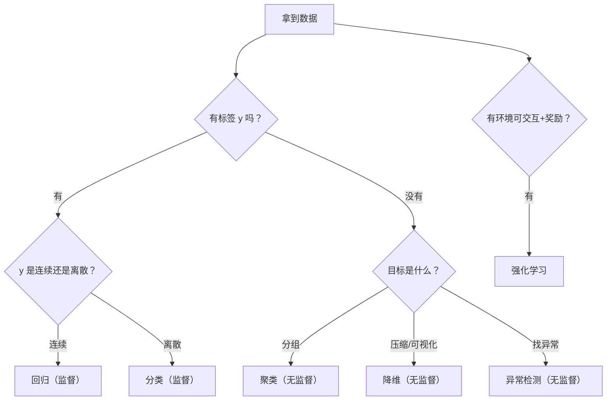

# ML-002 机器学习三大范式

## 1. 本节学习目标

1. 能区分**监督学习、无监督学习、强化学习**的定义与信号来源。
2. 能根据"有没有标签"判断一个任务属于哪类。
3. 能看懂半监督与自监督为什么介于两者之间。
4. 能跑通"同一份数据、监督 vs 无监督"的对照实验。

## 2. 为什么需要这个知识

因为**范式决定你能问什么问题**。

- 有标签 ⇒ 可以问"这条数据属于哪一类/值是多少"。
- 没标签 ⇒ 只能问"它们怎么分组/结构是什么"。
- 只有反馈 ⇒ 只能问"下一步动作怎么选"。

选错范式是新手最常见的方向性错误：拿没有标签的数据硬做分类（只能人工标一部分，或用聚类再贴标签），或用无监督方法去回答需要标签的问题。

## 3. 直观解释

| 范式 | 类比 | 你给的信号 |
|---|---|---|
| 监督学习 | 老师批改作业 | **标准答案**（标签） |
| 无监督学习 | 自己整理衣柜 | 只有衣物（无答案），靠"相似性"分组 |
| 强化学习 | 打游戏靠分数练 | 只有**延迟的奖励**，没有每步答案 |

一句话总结：**有答案 → 监督；没答案找结构 → 无监督；只有奖惩 → 强化**。

## 4. 正式定义

**监督学习**：给定 $\{(\mathbf{x}_i, y_i)\}$，学习映射 $f:\mathcal{X}\to\mathcal{Y}$。

- 分类：$y$ 离散（品种、是否流失）。
- 回归：$y$ 连续（房价、销量）。

**无监督学习**：给定 $\{\mathbf{x}_i\}$，学习数据的结构。

- 聚类：把样本分组。
- 降维：把高维压到低维。
- 密度估计/异常检测：学分布形状。

**强化学习**：智能体与环境交互，学习策略 $\pi(a\mid s)$ 最大化累积回报

$$
\max_\pi\ \mathbb{E}\Big[\sum_{t=0}^{T}\gamma^t r_t\Big]
$$

**两个中间地带**

| 名称 | 定义 | 典型用途 |
|---|---|---|
| 半监督 | 少量标签 + 大量无标签 | 标注成本高的场景（医学影像） |
| 自监督 | 从数据本身构造标签（如遮词预测） | 预训练大模型 |

## 5. 核心原理

三种范式对"信息从哪来"的回答不同：

- 监督：信息在**标签**里。
- 无监督：信息在**数据分布的形状**里。
- 强化：信息在**奖励信号**里（且延迟、稀疏）。

**代价对照**：

| 范式 | 数据成本 | 评价难度 | 典型失败 |
|---|---|---|---|
| 监督 | 高（要标注） | 低（有标准答案） | 标签噪声、过拟合 |
| 无监督 | 低（无需标注） | 高（没有唯一正确答案） | 聚类结果无业务含义 |
| 强化 | 极高（要交互/仿真） | 高（方差大、难复现） | 奖励设计错误、样本效率低 |

## 6. 数学表达式

**监督（分类）**：最大化条件似然

$$
\hat\theta = \arg\max_\theta \prod_{i=1}^{n} P(y_i \mid \mathbf{x}_i; \theta)
$$

**无监督（聚类，K-Means 目标）**：最小化簇内平方和

$$
\min_{\{C_k\},\{\boldsymbol\mu_k\}} \sum_{k=1}^{K}\sum_{\mathbf{x}\in C_k}\|\mathbf{x}-\boldsymbol\mu_k\|^2
$$

**强化（期望回报）**：

$$
J(\pi) = \mathbb{E}_{\pi}\Big[\sum_{t}\gamma^{t}r_t\Big]
$$

## 7. 数学库链接

| 用到的数学 | 对应篇目 | 用在哪 |
|---|---|---|
| 条件概率与贝叶斯 | [[MATH-301 概率基础与条件概率]] | 监督学习在估 $P(y\mid x)$ |
| 距离/范数 | [[MATH-201 向量与空间基础]] | 聚类与 KNN 的距离度量 |
| 期望与方差 | [[MATH-306 期望、方差与协方差]] | 强化学习的回报期望、评估波动 |

## 8. 算法执行流程



## 9. 可视化解释

```text
监督：  x ──► [模型] ──► ŷ      与 y 比较 → 算损失 → 更新
无监督：x ──► [模型] ──► 分组/结构   没有 y 可比 → 用内部准则
强化：  s ──► [策略] ──► a ──► 环境 ──► r, s'   延迟反馈
```

## 10. Python 实现

同一份鸢尾花数据，分别用监督与无监督视角处理，对比"有标签"与"无标签"能得到什么。

```powershell
python ml002_paradigms.py
```

```python
import numpy as np
from sklearn.cluster import KMeans
from sklearn.datasets import load_iris
from sklearn.linear_model import LogisticRegression
from sklearn.metrics import accuracy_score, adjusted_rand_score
from sklearn.model_selection import train_test_split

iris = load_iris()
X, y = iris.data, iris.target

# 监督：用标签训练分类器
X_train, X_test, y_train, y_test = train_test_split(
    X, y, test_size=0.3, random_state=42, stratify=y
)
clf = LogisticRegression(max_iter=1000).fit(X_train, y_train)
print("监督学习（有标签）测试准确率:",
      round(accuracy_score(y_test, clf.predict(X_test)), 4))

# 无监督：不看标签，直接聚成 3 组
km = KMeans(n_clusters=3, n_init=10, random_state=42).fit(X)
print("无监督学习（无标签）聚类 ARI:", round(adjusted_rand_score(y, km.labels_), 4))
print("各簇样本数:", np.bincount(km.labels_).tolist())
```

**实际运行结果**

```
监督学习（有标签）测试准确率: 0.9333
无监督学习（无标签）聚类 ARI: 0.7302
各簇样本数: [62, 50, 38]
```

## 11. 代码逐行解释

| 代码 | 作用 |
|---|---|
| `train_test_split(..., stratify=y)` | 监督学习必须留出测试集 |
| `LogisticRegression(max_iter=1000)` | 线性分类器；`max_iter` 调大避免不收敛警告 |
| `accuracy_score` | 有标签才能算的指标 |
| `KMeans(n_clusters=3)` | **必须人工指定簇数**——无监督不知道有几类 |
| `adjusted_rand_score(y, km.labels_)` | 用真标签**事后**评价聚类（ARI 校正了随机一致性） |
| `np.bincount(km.labels_)` | 各簇大小；`[62, 50, 38]` 说明簇不平衡 |

**关键观察**：ARI 0.7302 表示聚类结果与真实品种**高度一致但不完美**——无监督能发现"结构"，但不知道"结构叫什么"，也常把相近的两类混在一起（versicolor 与 virginica 本就重叠）。

## 12. 实际运行结果

见第 10 节。要点：

- 监督：**93.33%** 准确率（有明确对错）。
- 无监督：**ARI 0.7302**（只能与真标签做事后对照，不能用于训练）。
- 簇大小 62/50/38 不均衡，而真实是 50/50/50 ⇒ 聚类把两类混了。

## 13. 适用场景

| 范式 | 典型场景 |
|---|---|
| 监督-分类 | 垃圾邮件、疾病诊断、流失预测 |
| 监督-回归 | 房价、销量、评分预测 |
| 无监督-聚类 | 用户分群、图像分割、文档主题 |
| 无监督-降维 | 可视化、去噪、特征压缩（PCA） |
| 无监督-异常检测 | 欺诈、故障、入侵检测 |
| 强化 | 游戏、机器人控制、推荐策略、RLHF |

## 14. 优点与缺点

| 范式 | 优点 | 缺点 |
|---|---|---|
| 监督 | 目标明确、易评估、效果通常最好 | 标注贵；只能学标签覆盖的情形 |
| 无监督 | 无需标注、能发现未知结构 | 结果难评估、需人解读、簇数要猜 |
| 强化 | 能学序列决策、可超越人类策略 | 样本效率低、奖励设计难、难复现 |
| 半监督/自监督 | 用少量标签撬动大量数据 | 实现复杂、可能有确认偏差 |

## 15. 常见错误

| 错误 | 表现 | 纠正 |
|---|---|---|
| 无标签硬做分类 | 用聚类结果当"预测标签"上线 | 聚类只产出"组"，需人工命名后可作特征 |
| 用 ARI/准确率评价无监督 | 没有真标签时算不出来 | 改用轮廓系数等内部指标 |
| 把强化当监督 | 以为每步都有标准答案 | 强化只有延迟奖励 |
| 认为无监督"不需要数据质量" | 脏数据聚出无意义簇 | 同样要清洗、标准化 |
| 混淆回归与分类 | 用回归预测类别、用准确率评回归 | 看 $y$ 是连续还是离散 |

## 16. 本节总结

- **有标签 → 监督；没标签找结构 → 无监督；只有奖惩 → 强化**。
- 无监督的"评价"是它最大的软肋：没有标准答案，只能靠内部指标 + 人工解读。
- 半监督/自监督是两者的折中，本质是"想办法造出标签"。

## 17. 前置与后续

- 前置：[[ML-001 什么是机器学习]]
- 后续：[[ML-003 机器学习工作流程]]、`ML-017 回归任务基本概念`（待建）、`ML-024 分类任务基本概念`（待建）、`ML-033 无监督学习基本概念`（待建）
- 相关数学：[[MATH-301 概率基础与条件概率]]、[[MATH-201 向量与空间基础]]

## 18. 练习与参考答案

**基础 1**：判断下列任务属于哪种范式：① 预测房价 ② 把用户按行为分成 5 群 ③ 下围棋 ④ 判断评论情感 ⑤ 把 100 维特征压到 2 维做可视化

**基础 2**：用 `make_blobs` 生成 4 个簇，用 K-Means 聚类并输出各簇样本数。

**进阶 1**：为什么无监督学习不能直接用"准确率"评价？

**综合 1**：你有 1 万条用户评论，只有 200 条标注了情感。说明你会怎么设计流程（提示：半监督思路）。

> [!success]- 参考答案

> **基础 1**
> | 任务 | 范式 |
> |---|---|
> | ① 预测房价 | 监督-回归 |
> | ② 用户分群 | 无监督-聚类 |
> | ③ 下围棋 | 强化学习 |
> | ④ 情感分类 | 监督-分类 |
> | ⑤ 100 维 → 2 维 | 无监督-降维 |

> **基础 2**
> ```python
> import numpy as np
> from sklearn.cluster import KMeans
> from sklearn.datasets import make_blobs
>
> X, y = make_blobs(n_samples=300, centers=4, cluster_std=0.8, random_state=42)
> km = KMeans(n_clusters=4, n_init=10, random_state=42).fit(X)
> print("各簇大小:", np.bincount(km.labels_).tolist())
> print("惯性:", round(float(km.inertia_), 2))
> ```
> 实跑输出：
> ```
> 各簇大小: [75, 75, 75, 75]
> 惯性: 362.47
> ```
> 生成时每簇恰好 75 条，K-Means 完美还原了簇大小。
> **易错点**：以为簇编号与 `y` 的真值编号对得上——聚类标签是任意顺序，需要事后对齐。

> **进阶 1**
> 因为"准确率"需要标准答案 $y$。无监督任务没有 $y$，而且簇编号可以任意置换（把簇 0 叫簇 1 结果一样）。
> 可用的替代：轮廓系数、Calinski-Harabasz、Davies-Bouldin 等**内部指标**；有真标签时才用 ARI/NMI 做事后对照。

> **综合 1**
> 分三步：
> 1. **先用 200 条标注训练一个基线分类器**（监督），看效果；
> 2. **对 9800 条无标签数据做自训练**：用基线预测高置信度样本，伪标签加入训练集，迭代；
> 3. **或先做无监督**（聚类/主题模型）把评论分组，再对每组抽样人工标注，把"标注预算"花在最有信息量的样本上。
>
> 核心思路：**在标注贵时，用结构（无监督）或伪标签（半监督）去"放大"少量标签**。
> **风险**：伪标签会放大初始模型的偏差（确认偏差），需保留独立验证集。

---

## 🔗 Notion 同步信息

> 以下内容由 Notion「AI Knowledge System · 知识点」数据库按知识 ID 合并而来（导出于 2026-11-09）。

| 属性 | 值 |
|---|---|
| 学科 | 机器学习 |
| 学习状态 | 未开始 |
| 难度 | L1 概念 |
| 知识类型 | Concept |

- **所属模块**：[M-ML-01 机器学习基础](../%E8%AF%BE%E7%A8%8B%E6%A8%A1%E5%9D%97/M-ML-01%20%E6%9C%BA%E5%99%A8%E5%AD%A6%E4%B9%A0%E5%9F%BA%E7%A1%80.md)
- **前置知识**：[ML-001 什么是机器学习](ML-001%20%E4%BB%80%E4%B9%88%E6%98%AF%E6%9C%BA%E5%99%A8%E5%AD%A6%E4%B9%A0.md)
