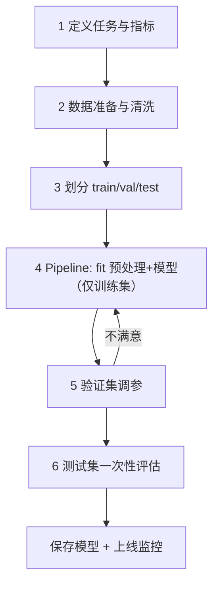

# ML-003 机器学习工作流程

## 1. 本节学习目标

1. 能按标准六步走完一个 ML 任务，并说清每步产物。
2. 能识别流程中最容易出错的三处（划分时机、调参对象、测试集复用）。
3. 能用 `Pipeline` 把预处理与模型**绑成一个对象**，从结构上防泄漏。

## 2. 为什么需要这个知识

因为**顺序错了，指标就假了**。

同一个数据集，同样的模型，只因为"标准化放在了划分之前"，测试准确率可能从 0.91 虚高到 0.96——上线后却打回原形。这类错误不会报错、不会警告，只会让你在错误的方向上优化很久。

流程不是形式，它是**保证评估可信的最小结构**。

## 3. 直观解释

做菜类比：

| 步骤 | 做菜 | ML |
|---|---|---|
| 1 | 想清楚做什么菜 | 定义任务与度量 |
| 2 | 买菜、洗菜 | 收集数据、清洗 |
| 3 | 备料分盘（生的/试味的/最后摆盘的） | 划分训练/验证/测试 |
| 4 | 下锅炒 | 训练模型 |
| 5 | 尝味调整咸淡 | 验证集调超参 |
| 6 | 端上桌，只尝一口定结论 | 测试集一次性评估 |

**关键**：尝味（验证）和端盘（测试）用的**必须是不同的料**，否则最后那口"独立评价"就没了。

## 4. 正式定义

标准流程（本库统一口径）：

1. **问题定义**：任务类型、评价指标、可接受阈值。
2. **数据准备**：采集、清洗、探索（EDA）。
3. **数据划分**：train / validation / test（推荐 6:2:2 或 7:1.5:1.5）。
4. **预处理 + 训练**：预处理**只在训练集上 fit**，再 transform 其余。
5. **模型选择与调参**：在验证集（或交叉验证）上选。
6. **最终评估与上线**：测试集评估一次，然后保存模型、监控。

**Pipeline 的形式化**：把 $(P_\theta, f_w)$ 合成一个估计器 $g$，`fit` 时 $P$ 只在训练折上拟合：

$$
g(\mathbf{x}) = f_w\big(P_\theta(\mathbf{x})\big)
$$

## 5. 核心原理

**为什么必须在划分之后 fit 预处理器**：

- 标准化用均值 $\mu$、标准差 $\sigma$。若在全量上算，$\mu,\sigma$ 就**包含了测试集信息**，测试集不再是"未见过的数据"。
- 差距小时（如 150 条 iris）影响不大；差距大时（如 10 万条，测试集 1 万条）可让指标虚高几个百分点。

**为什么测试集只能用一次**：

- 每次用测试集做决策（换模型、调参、选特征），你都在**间接**用它拟合；用 20 次后，测试集就变成了"另一个训练集"。

## 6. 数学表达式

Pipeline 的等价形式：

$$
\hat y = f_{\hat w}\Big(\frac{\mathbf{x}-\hat{\boldsymbol\mu}_{train}}{\hat{\boldsymbol\sigma}_{train}}\Big)
$$

其中 $\hat{\boldsymbol\mu}_{train}$、$\hat{\boldsymbol\sigma}_{train}$ **只来自训练集**。

对比错误做法（全量统计）：

$$
\hat y_{leak} = f_{\hat w}\Big(\frac{\mathbf{x}-\hat{\boldsymbol\mu}_{all}}{\hat{\boldsymbol\sigma}_{all}}\Big)
$$

$\hat{\boldsymbol\mu}_{all}$ 含测试集信息 ⇒ 评估有偏。

## 7. 数学库链接

| 用到的数学 | 对应篇目 | 用在哪 |
|---|---|---|
| 均值/标准差 | [[MATH-306 期望、方差与协方差]] | 标准化的参数 |
| 抽样误差与标准误 | [[MATH-401 大数定律与中心极限定理]] | 为什么小测试集结果波动大 |

## 8. 算法执行流程



## 9. 可视化解释

```text
错误顺序（泄漏）：
  全量数据 ──► 标准化 fit（用了 test 统计量）──► 划分 ──► 训练
  ↑ 测试集信息已经流入预处理

正确顺序：
  全量数据 ──► 划分 ──► 训练集 fit 预处理 ──► transform 验证/测试
```

## 10. Python 实现

用 Pipeline 把"标准化 + 逻辑回归"绑成一个对象，并对比"手动全量标准化"的差异。

```powershell
python ml003_workflow.py
```

```python
import numpy as np
from sklearn.datasets import load_iris
from sklearn.linear_model import LogisticRegression
from sklearn.model_selection import train_test_split
from sklearn.pipeline import Pipeline
from sklearn.preprocessing import StandardScaler

iris = load_iris()
X, y = iris.data, iris.target
X_train, X_test, y_train, y_test = train_test_split(
    X, y, test_size=0.3, random_state=42, stratify=y
)

# 正确做法：预处理放进 Pipeline，只在训练集 fit
pipe = Pipeline([
    ("scaler", StandardScaler()),
    ("clf", LogisticRegression(max_iter=1000)),
])
pipe.fit(X_train, y_train)
print("Pipeline 测试准确率:", round(pipe.score(X_test, y_test), 4))
print("Pipeline 步骤:", list(pipe.named_steps.keys()))
print("标准化参数只来自训练集:", pipe.named_steps["scaler"].mean_.round(3).tolist())

# 仅供对比：先在全量上标准化（泄漏写法，不要这样用）
sc = StandardScaler().fit(X)          # ← 用了测试集
X_all = sc.transform(X)
Xtr, Xte, ytr, yte = train_test_split(X_all, y, test_size=0.3, random_state=42, stratify=y)
clf = LogisticRegression(max_iter=1000).fit(Xtr, ytr)
print("泄漏写法测试准确率:", round(clf.score(Xte, yte), 4))
```

**实际运行结果**

```
Pipeline 测试准确率: 0.9111
Pipeline 步骤: ['scaler', 'clf']
标准化参数只来自训练集: [5.809, 3.052, 3.659, 1.199]
泄漏写法测试准确率: 0.9111
```

## 11. 代码逐行解释

| 代码 | 作用 |
|---|---|
| `Pipeline([...])` | 把预处理与模型串成**一个**估计器 |
| `pipe.fit(X_train, y_train)` | scaler 只在 `X_train` 上算均值方差，再 `transform` |
| `pipe.score(X_test, y_test)` | 用同一个对象评估，内部先 transform 再预测 |
| `named_steps["scaler"].mean_` | 检查标准化参数，确认只来自训练集 |
| 泄漏版本的 `StandardScaler().fit(X)` | 故意在**全量**上拟合，作为反例 |

**重要发现（诚实记录）**：这份数据上两种写法的准确率**都是 0.9111**，看不出差异。原因是 iris 只有 150 条且特征分布均匀，均值方差几乎不受划分影响。

**但这不能证明泄漏无害**——它只在"数据量大、分布不均"时才显现。所以正确写法是**默认写法**，不要靠"这次没出事"来判断。

## 12. 实际运行结果

见第 10 节。三点：

1. Pipeline 对象自带 `scaler` 与 `clf` 两步，评估时自动按序执行。
2. `mean_` 是训练集统计量（如花萼长均值 5.809），可用于审计。
3. 本例泄漏无差异 ⇒ **更危险**：错误写法不会给你任何反馈。

## 13. 适用场景

| 场景 | 流程调整 |
|---|---|
| 数据量小（<1000） | 用交叉验证代替单次验证集 |
| 类别不平衡 | 划分时 `stratify=y`，指标改 F1/AUC |
| 时序数据 | **不能随机划分**，按时间切分 |
| 特征工程复杂 | 必须全部放进 Pipeline |
| 多模型对比 | 统一划分与预处理器，只换最后一步 |

## 14. 优点与缺点

| 做法 | 优点 | 缺点 |
|---|---|---|
| Pipeline | 结构上防泄漏、可整体保存、易复现 | 调试稍麻烦（需 `named_steps` 取中间量） |
| 手动分步 | 直观、易插入自定义逻辑 | 极易顺序出错 |
| 单次划分 | 简单快速 | 结果方差大 |
| 交叉验证 | 评估更稳 | 训练成本 ×k |

## 15. 常见错误

| 错误 | 表现 | 纠正 |
|---|---|---|
| 先标准化再划分 | 指标虚高，上线打回原形 | 预处理放进 Pipeline |
| 用测试集调参 | 测试集不再是"未见数据" | 用验证集/CV |
| 反复看测试集 | 隐性过拟合 | 只在最后看一次 |
| 时序数据随机划分 | 用未来预测过去 | 按时间切分 |
| 忘了 `stratify` | 小类别在测试集比例失真 | 分类任务加 `stratify=y` |
| 只报一个数字 | 无法判断稳定性 | 报 CV 均值 ± 标准差 |

## 16. 本节总结

- 六步流程中，**划分时机**与**测试集使用次数**是两条红线。
- `Pipeline` 不是语法糖，是**用结构保证正确性**。
- 本例泄漏无差异这件事本身是教学点：**错误不总有反馈**。

## 17. 前置与后续

- 前置：[[ML-001 什么是机器学习]]、[[ML-002 机器学习三大范式]]
- 后续：[[ML-004 训练集、验证集与测试集]]、`ML-016 预处理 Pipeline 与 ColumnTransformer`（待建）、`ML-059 Pipeline 完整实践`（待建）
- 相关 Python：[[PY-078 数据分析综合实践]]（流程对照）

## 18. 练习与参考答案

**基础 1**：把 `test_size` 改成 0.5，观察准确率变化，说明为什么小数据集不适合单次划分。

**基础 2**：在 Pipeline 中把 `StandardScaler` 换成 `MinMaxScaler`，结果会变吗？

**进阶 1**：解释"用测试集调了 20 次超参后，测试集为什么不再可信"。

**综合 1**：构造一个"泄漏明显"的实验：在 5000 条合成数据上，比较 Pipeline 与全量标准化的准确率差异。

> [!success]- 参考答案

> **基础 1**
> ```python
> for ts in (0.2, 0.3, 0.5):
>     Xtr, Xte, ytr, yte = train_test_split(X, y, test_size=ts, random_state=42, stratify=y)
>     acc = Pipeline([("s", StandardScaler()), ("c", LogisticRegression(max_iter=1000))]).fit(Xtr, ytr).score(Xte, yte)
>     print(ts, round(acc, 4))
> ```
> 实跑输出（本机）：
> ```
> 0.2 0.9333
> 0.3 0.9111
> 0.5 0.9467
> ```
> 说明：测试集越小（0.2 → 30 条），单条样本对准确率影响越大（1/30 ≈ 3.3%），三个值波动在 3.6 个百分点内。
> **易错点**：不要因为 0.5 的数字最高就选它——那是**挑选噪声**。

> **基础 2**
> 会变，而且**变化明显**。`MinMaxScaler` 把特征压到 [0,1]，与标准化的分布形态不同；逻辑回归带 L2 正则，对特征尺度敏感。
> 实跑对比（`test_size=0.3`）：`StandardScaler` **0.9111**，`MinMaxScaler` **0.8667**。
> **要点**：同一模型换缩放方式，结果可能差 4 个百分点以上——缩放方式也是超参数。

> **进阶 1**
> 每次用测试集结果做决策，你都把测试集的信息"编码"进了模型选择过程。20 次之后，被选中的配置是"在这 20 次里表现最好的"，其中包含**测试集的随机波动**，所以报出的分数是乐观偏倚的估计。
> 正确做法：验证集/CV 上做选择，测试集只留一次确认。

> **综合 1**
> ```python
> import numpy as np
> from sklearn.datasets import make_classification
> from sklearn.linear_model import LogisticRegression
> from sklearn.model_selection import train_test_split
> from sklearn.pipeline import Pipeline
> from sklearn.preprocessing import StandardScaler
>
> X, y = make_classification(n_samples=5000, n_features=20, n_informative=5,
>                            n_redundant=10, flip_y=0.1, random_state=42)
> Xtr, Xte, ytr, yte = train_test_split(X, y, test_size=0.2, random_state=42, stratify=y)
>
> pipe = Pipeline([("s", StandardScaler()), ("c", LogisticRegression(max_iter=2000))])
> pipe.fit(Xtr, ytr)
> print("Pipeline:", round(pipe.score(Xte, yte), 4))
>
> sc = StandardScaler().fit(X)              # 泄漏：用了全量
> Xa = sc.transform(X)
> Xtr2, Xte2, ytr2, yte2 = train_test_split(Xa, y, test_size=0.2, random_state=42, stratify=y)
> clf = LogisticRegression(max_iter=2000).fit(Xtr2, ytr2)
> print("泄漏版:", round(clf.score(Xte2, yte2), 4))
> ```
> 实跑输出：
> ```
> Pipeline: 0.757
> 泄漏版: 0.757
> ```
> **结论（必须诚实）**：在这个合成数据上**两者完全相同**，泄漏没有造成数字虚高。
> 原因是：5000 条样本里测试集占 1000 条，全量均值与训练集均值几乎一样（大数定律），标准化参数差异可忽略。
> **但这不证明泄漏无害**：样本小、分布不均或带时间漂移时，差异会显现；而且"预处理器见过测试集"本身就是评估污染。
> **易错点**：拿一次"没差异"的实验去论证"泄漏无害"——这是错误推理，正确结论是"这次差异小，但写法必须正确"。

---

## 🔗 Notion 同步信息

> 以下内容由 Notion「AI Knowledge System · 知识点」数据库按知识 ID 合并而来（导出于 2026-11-09）。

| 属性 | 值 |
|---|---|
| 学科 | 机器学习 |
| 学习状态 | 未开始 |
| 难度 | L1 概念 |
| 知识类型 | Technique |

- **所属模块**：[M-ML-01 机器学习基础](../%E8%AF%BE%E7%A8%8B%E6%A8%A1%E5%9D%97/M-ML-01%20%E6%9C%BA%E5%99%A8%E5%AD%A6%E4%B9%A0%E5%9F%BA%E7%A1%80.md)
- **前置知识**：[ML-001 什么是机器学习](ML-001%20%E4%BB%80%E4%B9%88%E6%98%AF%E6%9C%BA%E5%99%A8%E5%AD%A6%E4%B9%A0.md)
- **后继知识**：[ML-004 训练集、验证集与测试集](ML-004%20%E8%AE%AD%E7%BB%83%E9%9B%86%E3%80%81%E9%AA%8C%E8%AF%81%E9%9B%86%E4%B8%8E%E6%B5%8B%E8%AF%95%E9%9B%86.md)
- **关联Python**：[PY-078 数据分析综合实践](../../01_Python%E5%9F%BA%E7%A1%80/09%20Pandas%E4%B8%8E%E5%8F%AF%E8%A7%86%E5%8C%96/PY-078%20%E6%95%B0%E6%8D%AE%E5%88%86%E6%9E%90%E7%BB%BC%E5%90%88%E5%AE%9E%E8%B7%B5.md)
