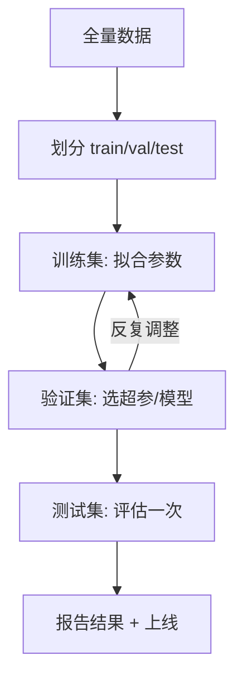

# ML-004 训练集、验证集与测试集

## 1. 本节学习目标

1. 说清三个集合各自回答什么问题、谁能被反复使用。
2. 能按任务类型选择划分比例与是否分层。
3. 能用"训练/验证准确率差距"判断过拟合。
4. 知道时序数据、分组数据为什么不能随机划分。

## 2. 为什么需要这个知识

因为**模型的好坏只能由"没见过的数据"来回答**。

同一份数据既用来训练又用来评估，就像考试前把答案给学生——分数必然虚高。三个集合的分工，就是给"评估"留一块干净的地。

## 3. 直观解释

| 集合 | 类比 | 用途 | 能用几次 |
|---|---|---|---|
| 训练集 | 平时练习题 | 学参数 | 反复 |
| 验证集 | 模拟考 | 选模型/调超参 | 多次（但受控） |
| 测试集 | 高考 | 最终评估 | **一次** |

**关键区别**：验证集允许你"看了结果再改"；测试集不允许——你看得越多，它越像训练集。

## 4. 正式定义

设数据集 $\mathcal{D} = \{(\mathbf{x}_i,y_i)\}_{i=1}^{n}$，划分为互不相交的三部分：

$$
\mathcal{D} = \mathcal{D}_{train} \cup \mathcal{D}_{val} \cup \mathcal{D}_{test}
$$

| 集合 | 典型比例 | 作用 |
|---|---|---|
| $\mathcal{D}_{train}$ | 60–80% | 拟合参数 $\theta$ |
| $\mathcal{D}_{val}$ | 10–20% | 选超参、选模型族 |
| $\mathcal{D}_{test}$ | 10–20% | 估计泛化误差 |

**评估的关系**

$$
\underbrace{\text{训练误差}}_{\text{乐观}} \le \underbrace{\text{验证误差}}_{\text{用于选择}} \approx \underbrace{\text{测试误差}}_{\text{泛化估计}}
$$

## 5. 核心原理

**为什么验证误差通常低于测试误差**：因为模型/超参是"按验证集挑出来的"，验证集已被间接使用；测试集从未参与任何决策，所以它的估计更接近真实泛化。

**差距从哪来**：

- 训练 << 验证：过拟合（模型记住了训练集）。
- 训练 ≈ 验证但都很差：欠拟合（模型太简单）。
- 验证 << 测试：验证集太小或分布与测试不同。

**小数据的困境**：验证集越小，估计方差越大（标准误 $\propto 1/\sqrt{n_{val}}$）。这时应改用交叉验证（见 `ML-041 K 折交叉验证`（待建））。

## 6. 数学表达式

**泛化误差的估计**

$$
\hat R_{test} = \frac{1}{n_{test}}\sum_{i\in \mathcal{D}_{test}} L\big(f(\mathbf{x}_i), y_i)
$$

**估计的标准误**（分类准确率，$p$ 为真实准确率）

$$
\operatorname{SE}(\hat p) = \sqrt{\frac{p(1-p)}{n_{test}}}
$$

**例**：$n_{test}=30$、$p=0.93$ ⇒ $\operatorname{SE}\approx0.047$，95% 区间约 ±9 个百分点——**30 条测试集根本分不出 0.90 和 0.95**。

## 7. 数学库链接

| 用到的数学 | 对应篇目 | 用在哪 |
|---|---|---|
| 中心极限定理与标准误 | [[MATH-401 大数定律与中心极限定理]] | 测试集要多大的定量依据 |
| 方差与抽样波动 | [[MATH-306 期望、方差与协方差]] | 为什么小测试集结果不稳 |

## 8. 算法执行流程



## 9. 可视化解释

```text
数据 100%
├──────────── 训练 60–80% ────────────┤├─ 验证 ─┤├─ 测试 ─┤
       学参数（反复用）               选模型    只看一次
```

过拟合的典型信号：

```text
准确率
1.0 ┤        ● 训练
    │      ╱
0.9 ┤    ╱   ● 验证（差距拉大）
    │  ╱
0.7 ┤●
    └──┬────┬────┬────► 模型复杂度
```

## 10. Python 实现

用不同深度的决策树，展示"训练/验证/测试"三列准确率如何揭示过拟合。

```powershell
python ml004_split.py
```

```python
from sklearn.datasets import load_iris
from sklearn.model_selection import train_test_split
from sklearn.tree import DecisionTreeClassifier

X, y = load_iris(return_X_y=True)

# 先切出 60% 训练，剩余 40% 再平分给验证与测试
X_train, X_tmp, y_train, y_tmp = train_test_split(
    X, y, test_size=0.4, random_state=42, stratify=y
)
X_val, X_test, y_val, y_test = train_test_split(
    X_tmp, y_tmp, test_size=0.5, random_state=42, stratify=y_tmp
)
print("训练/验证/测试:", X_train.shape[0], X_val.shape[0], X_test.shape[0])

for depth in (1, 2, None):
    tree = DecisionTreeClassifier(max_depth=depth, random_state=42).fit(X_train, y_train)
    print(f"max_depth={depth}:",
          round(tree.score(X_train, y_train), 4),
          round(tree.score(X_val, y_val), 4),
          round(tree.score(X_test, y_test), 4))
```

**实际运行结果**

```
训练/验证/测试: 90 30 30
max_depth=1: 0.6667 0.6667 0.6667
max_depth=2: 0.9667 0.9 0.9333
max_depth=None: 1.0 0.9667 0.9333
```

## 11. 代码逐行解释

| 代码 | 作用 |
|---|---|
| 第一次 `train_test_split(test_size=0.4)` | 留出 40% 作为"验证+测试"池 |
| 第二次 `test_size=0.5` | 把池子对半分成验证与测试（各 20%） |
| `stratify=y` / `stratify=y_tmp` | 两次都分层，保证三类比例一致 |
| `max_depth=1` | 只能切一刀 ⇒ 欠拟合（三列都 0.667） |
| `max_depth=None` | 完全生长 ⇒ 训练 1.0，验证降到 0.9667 ⇒ **过拟合信号** |

**三列一起看才有意义**：只看训练准确率，`max_depth=None` 是"最好"的（1.0），但它其实最差。

## 12. 实际运行结果

见第 10 节。解读：

| 模型 | 训练 | 验证 | 测试 | 诊断 |
|---|---|---|---|---|
| depth=1 | 0.6667 | 0.6667 | 0.6667 | **欠拟合**（三者同低） |
| depth=2 | 0.9667 | 0.9 | 0.9333 | 合适 |
| depth=None | 1.0 | 0.9667 | 0.9333 | **过拟合**（训练远高于验证） |

注意测试准确率与验证准确率不完全一致（0.9667 vs 0.9333），这是 30 条样本的正常波动。

## 13. 适用场景

| 数据情形 | 划分方式 |
|---|---|
| 一般数据集 | 6:2:2 或 8:1:1 |
| 小数据（<1000） | 交叉验证替代验证集 |
| 类别不平衡 | 必须分层 `stratify` |
| 时序数据 | **按时间切**（过去训练、未来测试），绝不随机 |
| 分组数据（同一用户多条） | 按组划分，避免同组跨集 |
| 超参空间大 | 验证集 + CV，测试集仍只一次 |

## 14. 优点与缺点

| 方案 | 优点 | 缺点 |
|---|---|---|
| 单次划分 | 简单、快 | 结果方差大，依赖运气 |
| 训练/验证/测试 | 职责清晰 | 数据被"浪费"两份 |
| 交叉验证 | 每份数据都参与训练与验证 | 训练成本 ×k，仍需独立测试集 |
| 分层划分 | 保持类别比例 | 需标签；回归无类别可分 |

## 15. 常见错误

| 错误 | 表现 | 纠正 |
|---|---|---|
| 用测试集调参 | 测试分数虚高 | 验证集调，测试只用一次 |
| 小数据只切一次就下结论 | 结果换个种子就翻盘 | 用 CV 并报均值±标准差 |
| 时序数据随机划分 | 用未来信息预测过去 | 按时间切分 |
| 同一用户跨训练/测试 | 泄漏（模型"见过"该用户） | 按用户分组划分 |
| 不做分层 | 小类在测试集里太少 | `stratify=y` |
| 测试集太小 | ±9 个百分点误差 | 至少几百条，或用 CV |

## 16. 本节总结

- 三个集合分工：**训练学参数、验证选模型、测试给结论**。
- 测试集只能用一次；用多了它就变成训练集。
- **训练与验证的差距**是过拟合最直接的信号。
- 小数据别硬切，改交叉验证。

## 17. 前置与后续

- 前置：[[ML-003 机器学习工作流程]]
- 后续：`ML-040 Hold-out 验证`（待建）、`ML-041 K 折交叉验证`（待建）、`ML-046 过拟合与欠拟合`（待建）、`ML-049 数据泄漏与评估陷阱`（待建）
- 相关数学：[[MATH-401 大数定律与中心极限定理]]

## 18. 练习与参考答案

**基础 1**：把比例改成 8:1:1，验证集只剩 15 条，会发生什么？

**基础 2**：为什么 `stratify=y` 在类别不平衡时几乎是必须的？

**进阶 1**：验证准确率 0.90、测试 0.72，可能的原因有哪些？

**综合 1**：用同一个 `max_depth` 扫描，报告验证集准确率的均值与标准差（重复 10 个随机种子），说明单次划分为什么不可靠。

> [!success]- 参考答案

> **基础 1**
> 验证集 15 条，1 条样本 = 6.7 个百分点，验证准确率会剧烈跳动，选出的超参极不稳定。
> 结论：验证集少于 ~100 条时，应改用交叉验证。

> **基础 2**
> 不平衡时随机划分可能让测试集里几乎没有少数类。例如 1000 条里 50 条正类，随机取 20% ⇒ 平均 10 条正类，波动极大，指标失真。
> `stratify=y` 保证各集合的正负比例与原数据一致。

> **进阶 1**
> 常见原因：
> 1. 验证集太小，0.90 本身是噪声；
> 2. 验证集与测试集分布不同（如测试集含更难的样本）；
> 3. 用验证集反复调参后，验证分数被"选高"了；
> 4. 测试集里有标签错误或异常值。

> **综合 1**
> ```python
> import numpy as np
> from sklearn.datasets import load_iris
> from sklearn.model_selection import train_test_split
> from sklearn.tree import DecisionTreeClassifier
>
> X, y = load_iris(return_X_y=True)
> scores = []
> for seed in range(10):
>     Xtr, Xtmp, ytr, ytmp = train_test_split(X, y, test_size=0.4, random_state=seed, stratify=y)
>     Xv, Xte, yv, yte = train_test_split(Xtmp, ytmp, test_size=0.5, random_state=seed, stratify=ytmp)
>     m = DecisionTreeClassifier(max_depth=2, random_state=42).fit(Xtr, ytr)
>     scores.append(m.score(Xv, yv))
> print("10 次验证准确率:", [round(s, 3) for s in scores])
> print("均值 %.3f 标准差 %.3f" % (np.mean(scores), np.std(scores)))
> ```
> 实跑输出：
> ```
> 10 次验证准确率: [0.933, 0.967, 0.967, 0.967, 0.967, 0.933, 0.933, 0.9, 0.933, 0.9]
> 均值 0.940 标准差 0.025
> ```
> **结论**：同一模型、同一数据，仅换划分种子，验证准确率就在 **0.900–0.967** 之间波动（标准差 0.025，约 2.5 个百分点）。**单次划分的 0.933 并不比 0.900 更"真"**。
> **易错点**：把 10 次里最好的种子当成"调参成果"——那同样是挑噪声。正确做法是报告"均值 ± 标准差"。

---

## 🔗 Notion 同步信息

> 以下内容由 Notion「AI Knowledge System · 知识点」数据库按知识 ID 合并而来（导出于 2026-11-09）。

| 属性 | 值 |
|---|---|
| 学科 | 机器学习 |
| 学习状态 | 未开始 |
| 难度 | L2 应用 |
| 知识类型 | Concept |

- **所属模块**：[M-ML-01 机器学习基础](../%E8%AF%BE%E7%A8%8B%E6%A8%A1%E5%9D%97/M-ML-01%20%E6%9C%BA%E5%99%A8%E5%AD%A6%E4%B9%A0%E5%9F%BA%E7%A1%80.md)
- **前置知识**：[ML-003 机器学习工作流程](ML-003%20%E6%9C%BA%E5%99%A8%E5%AD%A6%E4%B9%A0%E5%B7%A5%E4%BD%9C%E6%B5%81%E7%A8%8B.md)
- **关联数学**：[MATH-401 大数定律与中心极限定理](../../06_%E6%95%B0%E5%AD%A6%E5%9F%BA%E7%A1%80/04%20%E6%95%B0%E7%90%86%E7%BB%9F%E8%AE%A1/MATH-401%20%E5%A4%A7%E6%95%B0%E5%AE%9A%E5%BE%8B%E4%B8%8E%E4%B8%AD%E5%BF%83%E6%9E%81%E9%99%90%E5%AE%9A%E7%90%86.md)
