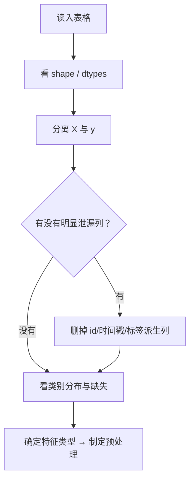

# ML-005 特征、标签、样本与数据集

## 1. 本节学习目标

1. 能准确说出样本、特征、标签、数据集的对应关系。
2. 能把一张表格正确翻译成矩阵 $X$ 与向量 $y$，并说清形状含义。
3. 能识别"目标泄漏"（某个特征其实是标签的替身）。
4. 会对数据集做基本体检：形状、类型、类别分布、缺失。

## 2. 为什么需要这个知识

因为几乎所有 ML 报错与翻车，都能追溯到**数据表示错了**：

- 把标签当成特征喂进去 ⇒ 准确率虚高到 0.99，上线全废（目标泄漏）。
- 把类别编码成 1/2/3 直接喂线性模型 ⇒ 模型以为"3 > 2 > 1"。
- 忘了把 `id`、时间戳去掉 ⇒ 模型学的是"样本编号"。

这些错误在代码层面完全合法，不会报错。**只有先把数据表示想清楚，后面的模型才有意义**。

## 3. 直观解释

一张表就是一份数据集：

| 花萼长 | 花萼宽 | 花瓣长 | 花瓣宽 | 品种 |
|---|---|---|---|---|
| 5.1 | 3.5 | 1.4 | 0.2 | setosa |
| 4.9 | 3.0 | 1.4 | 0.2 | setosa |

- **一行** = 一个样本（sample）
- **前四列** = 特征（features）$\mathbf{x}$
- **最后一列** = 标签（label）$y$
- **整张表** = 数据集（dataset）

机器学习做的，就是从"四列数"推出"品种"，并希望新品种的花也能分对。

## 4. 正式定义

**数据集**：$\mathcal{D}=\{(\mathbf{x}_i,y_i)\}_{i=1}^{n}$

| 符号 | 名称 | 形状 | 类型 |
|---|---|---|---|
| $n$ | 样本数 | 标量 | int |
| $d$ | 特征数 | 标量 | int |
| $\mathbf{x}_i$ | 第 $i$ 个样本 | $(d,)$ | 向量 |
| $X$ | 特征矩阵 | $(n,d)$ | 二维数组 |
| $y$ | 标签向量 | $(n,)$ | 一维数组 |

**特征类型**

| 类型 | 例子 | 处理方式 |
|---|---|---|
| 数值型（连续） | 身高、价格 | 标准化/归一化 |
| 数值型（离散） | 次数、件数 | 可直接用，或分箱 |
| 类别型（无序） | 颜色、城市 | One-Hot / 目标编码 |
| 类别型（有序） | 学历、评级 | 有序整数编码 |
| 文本/图像 | 评论、图片 | 需专门表示（阶段 08+） |

**目标泄漏**：某特征 $x_j$ 与标签 $y$ 高度相关到"它就是 $y$ 的另一种写法"。

## 5. 核心原理

**为什么 $X$ 必须是二维、$y$ 必须是一维**：sklearn 的所有估计器都按 `(n_samples, n_features)` 约定接收数据。传一维数组会被当成"单特征"或直接报错。

**为什么特征矩阵要"干净"**：

- 含 `id`/时间戳 ⇒ 模型可能记住样本顺序。
- 含标签派生列 ⇒ 泄漏。
- 含全空列 ⇒ 无信息。

**数据体检四件事**（每篇数据相关笔记都会回到这四件）：

1. `shape`：多少样本、多少特征。
2. `dtype`：数值还是对象（object 往往意味着有脏值或字符串）。
3. 类别分布：是否不平衡。
4. 缺失：每列缺多少。

## 6. 数学表达式

特征矩阵与标签：

$$
X = \begin{bmatrix}
x_{11} & x_{12} & \cdots & x_{1d}\\
\vdots & & & \vdots\\
x_{n1} & x_{n2} & \cdots & x_{nd}
\end{bmatrix}_{n\times d},
\qquad
y = \begin{bmatrix}y_1\\ \vdots\\ y_n\end{bmatrix}_{n\times 1}
$$

**单样本预测**（行向量与权重内积）：

$$
\hat y_i = \mathbf{x}_i^\top\mathbf{w} + b
$$

**目标泄漏的量化信号**：若某特征 $x_j$ 与 $y$ 的相关系数 $|\rho|\approx1$，几乎可以断定泄漏。

## 7. 数学库链接

| 用到的数学 | 对应篇目 | 用在哪 |
|---|---|---|
| 矩阵与形状 | [[MATH-217 矩阵运算与维度]] | $X$ 是 $(n,d)$，乘法维度要对齐 |
| 向量内积 | [[MATH-201 向量与空间基础]] | $\mathbf{x}_i^\top\mathbf{w}$ 的含义 |
| 方差与相关 | [[MATH-306 期望、方差与协方差]] | 判断特征是否泄漏/冗余 |

## 8. 算法执行流程

拿到一份数据的标准动作：



## 9. 可视化解释

```text
          特征矩阵 X (n × d)                标签 y (n)
        ┌─────────────────────────┐
样本 1  │ 5.1  3.5  1.4  0.2      │  ──► setosa
样本 2  │ 4.9  3.0  1.4  0.2      │  ──► setosa
  ⋮     │  ⋮                       │
样本 n  │ 6.7  3.0  5.2  2.3      │  ──► virginica
        └─────────────────────────┘
             d = 4 个特征
```

## 10. Python 实现

对鸢尾花数据集做"数据体检"，并演示手动构造 $X$/$y$ 的方式。

```powershell
python ml005_dataset.py
```

```python
import numpy as np
from sklearn.datasets import load_iris

iris = load_iris()
X, y = iris.data, iris.target

print("X 形状:", X.shape, " y 形状:", y.shape)
print("X 类型:", X.dtype, " y 类型:", y.dtype)
print("特征名:", iris.feature_names)
print("类别分布:", np.bincount(y).tolist())
print("前 2 个样本:", X[:2].round(2).tolist())
print("标签映射:", {i: str(name) for i, name in enumerate(iris.target_names)})
print("前 3 个样本的类别名:", [str(n) for n in iris.target_names[y[:3]]])
```

**实际运行结果**

```
X 形状: (150, 4)  y 形状: (150,)
X 类型: float64  y 类型: int64
特征名: ['sepal length (cm)', 'sepal width (cm)', 'petal length (cm)', 'petal width (cm)']
类别分布: [50, 50, 50]
前 2 个样本: [[5.1, 3.5, 1.4, 0.2], [4.9, 3.0, 1.4, 0.2]]
标签映射: {0: 'setosa', 1: 'versicolor', 2: 'virginica'}
前 3 个样本的类别名: ['setosa', 'setosa', 'setosa']
```

## 11. 代码逐行解释

| 代码 | 作用 |
|---|---|
| `X.shape` → `(150, 4)` | 150 个样本、4 个特征 ⇒ $n=150$、$d=4$ |
| `y.shape` → `(150,)` | 一维，长度等于样本数 |
| `X.dtype` → `float64` | 数值型，可直接算 |
| `np.bincount(y)` → `[50,50,50]` | 三类各 50 条，**平衡数据** |
| `iris.feature_names` | 列名，写报告时要用 |
| `{i: str(name) ...}` | 把 0/1/2 映射成花名（`str()` 是为了去掉 `np.str_` 包装） |

**注意 `str(name)`**：直接打印 `iris.target_names` 会显示成 `np.str_('setosa')`，写进文档不美观也不便复制。

## 12. 实际运行结果

见第 10 节。体检结论：

| 项 | 值 | 含义 |
|---|---|---|
| $n$ | 150 | 小数据集，适合教学 |
| $d$ | 4 | 低维，可可视化 |
| 类别分布 | 50/50/50 | 平衡 ⇒ 准确率可用 |
| 缺失 | 无 | 内置数据已清洗 |
| 类型 | float64 / int64 | 全数值，无需编码 |

## 13. 适用场景

| 数据形态 | 首要处理 |
|---|---|
| 纯数值、无缺失 | 标准化即可 |
| 含类别列 | 编码（One-Hot / 有序整数） |
| 含缺失 | 填充或删（见 ML-011） |
| 含 id/时间戳 | 删掉或转为"时间特征" |
| 文本列 | 需向量化（阶段 08 后） |
| 极度不平衡 | 重采样或换指标（见 ML-032） |

## 14. 优点与缺点

| 做法 | 优点 | 缺点 |
|---|---|---|
| 把数据整理成 $X$/$y$ 矩阵 | 统一接口、可向量化计算 | 丢失表结构信息 |
| 用 DataFrame 保留列名 | 可读性好、便于 EDA | 进模型前仍要转数组 |
| 保留原始 id | 便于回溯 | **绝不能当特征** |
| 把类别转成 1/2/3 | 简单 | 引入虚假序关系 |

## 15. 常见错误

| 错误 | 表现 | 纠正 |
|---|---|---|
| 把 id 当特征 | 模型学到"编号规律" | 训练前删掉 |
| 标签列留在 $X$ 里 | 准确率接近 1.0 | 分离 $X$/$y$ 时检查列名 |
| 无序类别用整数编码 | 模型认为 2>1>0 | 用 One-Hot |
| 忘记 reshape 一维特征 | sklearn 报形状错误 | 用 `X[:, None]` 或 `reshape(-1,1)` |
| 不检查 dtype | object 列直接报错 | 先 `dtypes` 体检 |
| 用全量统计做特征 | 泄漏 | 只用训练集统计 |

## 16. 本节总结

- 一行一样本、一列一特征、最后一列是标签。
- $X$ 必须 `(n, d)` 二维、$y$ 一维；形状是 sklearn 的硬约束。
- **目标泄漏与 id 特征**是最隐蔽的两类错误，代码不会报错。
- 拿数据先做四件体检：形状、类型、分布、缺失。

## 17. 前置与后续

- 前置：[[ML-001 什么是机器学习]]
- 后续：`ML-009 结构化数据读取`（待建）、`ML-010 数据清洗`（待建）、`ML-013 类别特征编码`（待建）、`ML-049 数据泄漏与评估陷阱`（待建）
- 相关 Python：[[PY-066 矩阵运算]]、[[PY-067 聚合与统计]]

## 18. 练习与参考答案

**基础 1**：某数据集 `X.shape` 是 `(1000, 12)`，`y.shape` 是 `(1000,)`。$n$、$d$ 各是多少？训练出的模型接收什么形状的输入？

**基础 2**：为什么把"城市"编码成 1/2/3 喂给线性模型是错的？

**进阶 1**：你有列 `id`、`注册天数`、`近30天登录次数`、`是否流失`。哪些该进 $X$？为什么？

**综合 1**：构造一份含"目标泄漏列"的合成数据，展示准确率如何从合理值虚高到接近 1.0。

> [!success]- 参考答案

> **基础 1**
> $n = 1000$、$d = 12$。模型输入形状 `(n_samples, 12)`，即预测时也要传二维数组。

> **基础 2**
> 整数编码引入**虚假的序关系**：模型会算出"城市 3 比城市 1 大"的权重，而城市之间没有大小。
> 正确做法：One-Hot 编码（无序类别），或用目标编码。

> **进阶 1**
> 进 $X$：`注册天数`、`近30天登录次数`。
> 不进 $X$：`id`（无意义编号，可能导致记忆样本）、`是否流失`（这是标签 $y$，不是特征）。
> 若 `id` 是递增的，还可能编码了时间顺序 ⇒ 泄漏。

> **综合 1**
> ```python
> import numpy as np
> from sklearn.datasets import make_classification
> from sklearn.linear_model import LogisticRegression
> from sklearn.model_selection import train_test_split
> from sklearn.metrics import accuracy_score
>
> X, y = make_classification(n_samples=1000, n_features=5, n_informative=3,
>                            n_redundant=0, random_state=42)
> # 正常训练
> Xtr, Xte, ytr, yte = train_test_split(X, y, test_size=0.3, random_state=42, stratify=y)
> print("正常:", round(accuracy_score(yte, LogisticRegression(max_iter=1000).fit(Xtr, ytr).predict(Xte)), 4))
>
> # 注入泄漏列：把标签加一点噪声后当成特征
> rng = np.random.default_rng(42)
> X_leak = np.column_stack([X, y + rng.normal(0, 0.01, size=len(y))])
> Xtr2, Xte2, ytr2, yte2 = train_test_split(X_leak, y, test_size=0.3, random_state=42, stratify=y)
> print("泄漏:", round(accuracy_score(yte2, LogisticRegression(max_iter=1000).fit(Xtr2, ytr2).predict(Xte2)), 4))
> ```
> 实跑输出：
> ```
> 正常: 0.9033
> 泄漏: 0.9933
> ```
> **结论**：加入一个"标签的近似复制"后，准确率从 **0.9033** 升到 **0.9933**，且代码毫无警告。
> **易错点**：看到 0.99 应该先怀疑数据泄漏，而不是庆祝。检查方法：逐个特征与标签算相关，$|\rho|>0.95$ 就要警惕。

---

## 🔗 Notion 同步信息

> 以下内容由 Notion「AI Knowledge System · 知识点」数据库按知识 ID 合并而来（导出于 2026-11-09）。

| 属性 | 值 |
|---|---|
| 学科 | 机器学习 |
| 学习状态 | 未开始 |
| 难度 | L1 概念 |
| 知识类型 | Concept |

- **所属模块**：[M-ML-01 机器学习基础](../%E8%AF%BE%E7%A8%8B%E6%A8%A1%E5%9D%97/M-ML-01%20%E6%9C%BA%E5%99%A8%E5%AD%A6%E4%B9%A0%E5%9F%BA%E7%A1%80.md)
- **前置知识**：[ML-001 什么是机器学习](ML-001%20%E4%BB%80%E4%B9%88%E6%98%AF%E6%9C%BA%E5%99%A8%E5%AD%A6%E4%B9%A0.md)
- **后继知识**：[ML-006 模型、参数与超参数](ML-006%20%E6%A8%A1%E5%9E%8B%E3%80%81%E5%8F%82%E6%95%B0%E4%B8%8E%E8%B6%85%E5%8F%82%E6%95%B0.md) · [ML-009 结构化数据读取](../05%20%E7%89%B9%E5%BE%81%E5%B7%A5%E7%A8%8B/ML-009%20%E7%BB%93%E6%9E%84%E5%8C%96%E6%95%B0%E6%8D%AE%E8%AF%BB%E5%8F%96.md)
- **关联Python**：[PY-066 矩阵运算](../../01_Python%E5%9F%BA%E7%A1%80/08%20NumPy/PY-066%20%E7%9F%A9%E9%98%B5%E8%BF%90%E7%AE%97.md) · [PY-067 聚合与统计](../../01_Python%E5%9F%BA%E7%A1%80/08%20NumPy/PY-067%20%E8%81%9A%E5%90%88%E4%B8%8E%E7%BB%9F%E8%AE%A1.md)
