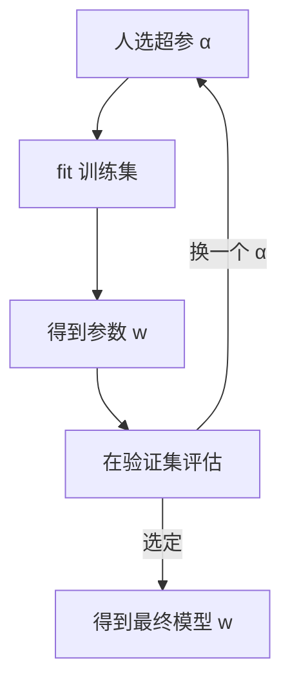

# ML-006 模型、参数与超参数

## 1. 本节学习目标

1. 能准确区分**模型参数**与**超参数**，并各举三例。
2. 知道在 sklearn 里怎么读参数（`coef_`/`intercept_`）、怎么设超参（构造参数）。
3. 理解"超参决定搜索空间，参数由数据决定"。
4. 能解释为什么调超参必须看验证集。

## 2. 为什么需要这个知识

因为混淆这两者会导致两类典型错误：

- **把参数当超参去"调"**：手动改 `coef_` 试图提升效果——参数本就该由 `fit` 算出来。
- **把超参当参数去"学"**：以为模型能自动找到最佳 `max_depth`——它不会，除非你显式搜索。

分清"谁来定"是理解训练的本质：**训练在超参给定的空间里找最优参数**。

## 3. 直观解释

| 概念 | 谁决定 | 何时确定 | 例子 |
|---|---|---|---|
| 参数 | **数据**（`fit` 算出来） | 训练后 | 线性回归的权重、截距 |
| 超参数 | **人**（构造模型时给） | 训练前 | 岭回归的 `alpha`、KNN 的 `k`、树的 `max_depth` |

类比：**超参是"学什么专业"，参数是"学到的知识"**。你选专业（超参），然后上课考试（fit），最后获得知识（参数）。

## 4. 正式定义

**参数** $\theta$：模型内部待估的量，由训练数据决定

$$
\hat\theta = \arg\min_\theta L(\theta; \mathcal{D}_{train})
$$

**超参数** $\lambda$：不由训练数据估计、需外部指定的量。给定 $\lambda$ 后：

$$
\hat\theta(\lambda) = \arg\min_\theta L(\theta; \mathcal{D}_{train}, \lambda)
$$

**调参**：在验证集上找

$$
\hat\lambda = \arg\min_\lambda\ L\big(\hat\theta(\lambda); \mathcal{D}_{val}\big)
$$

**关键**：$\hat\lambda$ 不能在测试集上选，否则测试集被间接使用（见 [[ML-004 训练集、验证集与测试集]]）。

## 5. 核心原理

**为什么参数不能手调**：参数维度可能是百万级（第 $d$ 个特征一个权重），人手调不动；而且最优值由数据决定，换个数据集就变。

**为什么超参必须人给**：它定义的是"模型的复杂度/假设空间"，而"该多复杂"是**先验判断**，无法从训练集内部推出——训练集永远偏向"越复杂越拟合"。

**这条张力**就是偏差-方差权衡的来源（见 [[ML-007 经验风险与泛化能力]]）。

## 6. 数学表达式

线性模型：

$$
y = X\mathbf{w} + b, \qquad \mathbf{w} \text{ 是参数}
$$

岭回归（多了超参 $\alpha$）：

$$
\hat{\mathbf{w}} = \arg\min_{\mathbf{w}}\ \|X\mathbf{w}-y\|^2 + \alpha\|\mathbf{w}\|^2
$$

$\alpha$ **不在优化变量里**——它是你给的常数。$\alpha$ 越大，$\|\mathbf{w}\|$ 被压得越小。

## 7. 数学库链接

| 用到的数学 | 对应篇目 | 用在哪 |
|---|---|---|
| 正则化与收缩 | [[MATH-708 L1 与 L2 正则化]] | $\alpha$ 如何影响权重 |
| 最小二乘闭式解 | [[MATH-801 线性回归的数学]] | 无正则时 $\mathbf{w}$ 的解析形式 |

## 8. 算法执行流程



## 9. 可视化解释

```text
超参（外层循环）        参数（内层求解）
α = 0.1   ──fit──►  w ≈ [...]
α = 1.0   ──fit──►  w ≈ [...]
α = 100   ──fit──►  w ≈ [...]（被压小）
       ↑
   你用验证集挑一个
```

## 10. Python 实现

```powershell
python ml006_params.py
```

```python
from sklearn.datasets import load_diabetes
from sklearn.linear_model import Ridge

X, y = load_diabetes(return_X_y=True)
print("特征数:", X.shape[1], "（参数个数 = 特征数 + 1 个截距）")

for alpha in (0.1, 1.0, 100.0):
    model = Ridge(alpha=alpha)          # alpha 是超参
    model.fit(X, y)                      # 训练得到参数
    print(f"alpha={alpha}: coef[0]={model.coef_[0]:.2f}  intercept={model.intercept_:.2f}")
```

**实际运行结果**

```
特征数: 10 （参数个数 = 特征数 + 1 个截距）
alpha=0.1: coef[0]=1.31  intercept=152.13
alpha=1.0: coef[0]=29.47  intercept=152.13
alpha=100.0: coef[0]=2.90  intercept=152.13
```

## 11. 代码逐行解释

| 代码 | 作用 |
|---|---|
| `Ridge(alpha=alpha)` | **超参**在构造时给定 |
| `model.fit(X, y)` | 训练，解出 10 个 `coef_` + 1 个 `intercept_` |
| `model.coef_[0]` | 第 1 个特征对应的**参数** |
| `model.intercept_` | 截距，也是参数 |

**一个反直觉现象（必须解释）**：`coef[0]` 随 $\alpha$ 从 0.1→1→100 的变化是 `1.31 → 29.47 → 2.90`，**不是单调下降**。

原因：糖尿病数据集的特征之间**高度相关**，正则化会把权重在相关特征之间"重新分配"。单个系数不单调，但整体 $\|\mathbf{w}\|$ 是随 $\alpha$ 单调减小的。**看单个系数会误判，要看范数**。

## 12. 实际运行结果

见第 10 节。要点：

- 10 个特征 ⇒ 11 个参数（10 权重 + 1 截距）。
- `intercept` 几乎不变（152.13），因为它不被 L2 惩罚（sklearn 默认 `fit_intercept=True` 时截距不正则化）。
- 单系数非单调 ⇒ 说明"正则化强度"不能靠看某一个系数判断。

## 13. 适用场景

| 场景 | 参数 | 超参 |
|---|---|---|
| 线性/逻辑回归 | 权重、截距 | 正则强度 `alpha`/`C` |
| KNN | **无参数**（记住训练集） | `k`、距离度量 |
| 决策树 | 分裂阈值、叶值 | `max_depth`、`min_samples_leaf` |
| 随机森林 | 每棵树的结构 | `n_estimators`、`max_features` |
| 神经网络 | 所有权重与偏置 | 层数、学习率、batch size |

> KNN 是"非参数模型"的典型：它没有需要学习的参数，但仍有超参。

## 14. 优点与缺点

| 做法 | 优点 | 缺点 |
|---|---|---|
| 手工设超参 | 快、可控 | 依赖经验，容易次优 |
| 网格搜索 | 简单、可复现 | 维度灾难 |
| 随机搜索 | 高维更高效 | 结果有随机性 |
| 贝叶斯优化 | 样本效率高 | 实现复杂 |

## 15. 常见错误

| 错误 | 表现 | 纠正 |
|---|---|---|
| 手动改 `coef_` | 训练后覆盖参数 | 参数由 `fit` 决定 |
| 拿训练集选 `alpha` | 永远选最复杂/最拟合的 | 用验证集 |
| 以为 KNN 有参数 | 找不到 `coef_` | KNN 是非参数模型 |
| 看单个系数判断正则强度 | 得到反直觉结论 | 看 $\|\mathbf{w}\|$ |
| 超参搜索不做 CV | 结果不稳 | `GridSearchCV(cv=5)` |
| 把 `random_state` 当超参调 | 无意义 | 它只控制随机性 |

## 16. 本节总结

- **参数由数据定，超参由人定**。
- sklearn 约定：`fit` 后带下划线的属性（`coef_`、`intercept_`）是参数；构造参数是超参。
- 调超参只能用验证集；测试集留一次。
- 单个系数不单调是正常现象，判断正则强度看范数。

## 17. 前置与后续

- 前置：[[ML-005 特征、标签、样本与数据集]]
- 后续：[[ML-007 经验风险与泛化能力]]、`ML-048 超参数搜索 GridSearchCV`（待建）、`ML-046 过拟合与欠拟合`（待建）
- 相关数学：[[MATH-708 L1 与 L2 正则化]]、[[MATH-801 线性回归的数学]]

## 18. 练习与参考答案

**基础 1**：下列哪些是参数、哪些是超参？① 逻辑回归的 `coef_` ② KNN 的 `n_neighbors` ③ 决策树的 `max_depth` ④ 线性回归的 `intercept_` ⑤ 学习率

**基础 2**：打印 `Ridge(alpha=10)` 在糖尿病数据上 `coef_` 的形状与绝对值均值。

**进阶 1**：为什么 $\alpha$ 增大时 `coef[0]` 不单调下降？

**综合 1**：用 `GridSearchCV` 在 `alpha ∈ {0.1, 1, 10, 100}` 上搜索最优值，报告最佳参数与分数。

> [!success]- 参考答案

> **基础 1**
> 参数：① `coef_`、④ `intercept_`
> 超参：② `n_neighbors`、③ `max_depth`、⑤ 学习率

> **基础 2**
> ```python
> from sklearn.datasets import load_diabetes
> from sklearn.linear_model import Ridge
> import numpy as np
>
> X, y = load_diabetes(return_X_y=True)
> m = Ridge(alpha=10).fit(X, y)
> print("coef 形状:", m.coef_.shape, " 绝对值均值:", round(float(np.abs(m.coef_).mean()), 2))
> ```
> 实跑输出：
> ```
> coef 形状: (10,)  绝对值均值: 39.52
> ```

> **进阶 1**
> 因为特征高度相关（多重共线性）。L2 正则把权重整体往 0 拉，但"哪个特征承担多少"在相关特征间可以互换，于是单个系数会上下浮动。
> 数学上：$\hat{\mathbf{w}}=(\mathbf{X}^\top\mathbf{X}+\alpha\mathbf{I})^{-1}\mathbf{X}^\top\mathbf{y}$，$\alpha$ 改变的是整个矩阵的逆，不是逐个坐标独立收缩。
> **验证方法**：看 $\|\mathbf{w}\|_2$ 是否随 $\alpha$ 单调减——它是。

> **综合 1**
> ```python
> from sklearn.datasets import load_diabetes
> from sklearn.linear_model import Ridge
> from sklearn.model_selection import GridSearchCV
>
> X, y = load_diabetes(return_X_y=True)
> gs = GridSearchCV(Ridge(), {"alpha": [0.1, 1, 10, 100]},
>                   cv=5, scoring="neg_mean_squared_error")
> gs.fit(X, y)
> print("最佳超参:", gs.best_params_)
> print("最佳分数(MSE):", round(-gs.best_score_, 1))
> ```
> 实跑输出：
> ```
> 最佳超参: {'alpha': 0.1}
> 最佳分数(MSE): 3006.7
> ```
> **解读**：5 折 CV 下 `alpha=0.1` 的负 MSE 最好（−3006.7 ⇒ MSE 约 3006.7）。
> **易错点**：`scoring="neg_mean_squared_error"` 是**负**的（sklearn 约定"越大越好"），所以报 MSE 要取负号。

---

## 🔗 Notion 同步信息

> 以下内容由 Notion「AI Knowledge System · 知识点」数据库按知识 ID 合并而来（导出于 2026-11-09）。

| 属性 | 值 |
|---|---|
| 学科 | 机器学习 |
| 学习状态 | 未开始 |
| 难度 | L1 概念 |
| 知识类型 | Concept |

- **所属模块**：[M-ML-01 机器学习基础](../%E8%AF%BE%E7%A8%8B%E6%A8%A1%E5%9D%97/M-ML-01%20%E6%9C%BA%E5%99%A8%E5%AD%A6%E4%B9%A0%E5%9F%BA%E7%A1%80.md)
- **前置知识**：[ML-005 特征、标签、样本与数据集](ML-005%20%E7%89%B9%E5%BE%81%E3%80%81%E6%A0%87%E7%AD%BE%E3%80%81%E6%A0%B7%E6%9C%AC%E4%B8%8E%E6%95%B0%E6%8D%AE%E9%9B%86.md)
- **后继知识**：[ML-007 经验风险与泛化能力](ML-007%20%E7%BB%8F%E9%AA%8C%E9%A3%8E%E9%99%A9%E4%B8%8E%E6%B3%9B%E5%8C%96%E8%83%BD%E5%8A%9B.md) · [ML-008 Scikit-learn 入门与开发环境](ML-008%20Scikit-learn%20%E5%85%A5%E9%97%A8%E4%B8%8E%E5%BC%80%E5%8F%91%E7%8E%AF%E5%A2%83.md)
