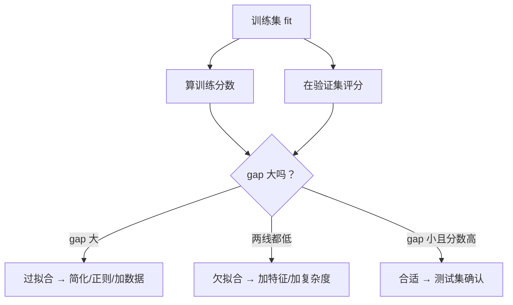

# ML-007 经验风险与泛化能力

## 1. 本节学习目标

1. 说清经验风险与真实风险的区别，知道前者只是后者的一次抽样估计。
2. 能用"训练/验证差距"与"学习曲线"诊断模型状态。
3. 理解"训练误差降到 0"为什么常常是坏消息。
4. 知道增加数据与增加模型容量分别解决什么问题。

## 2. 为什么需要这个知识

因为**你唯一能优化的，是经验风险；你唯一在乎的，是真实风险**。

两者之间的差距，就是"过拟合"的全部定义。不理解这个差距，就会把"训练集上 100% 准确"当成成功，把模型推向越学越记的方向。

## 3. 直观解释

| 术语 | 是什么 | 能否直接算 |
|---|---|---|
| 经验风险 | 在**训练集**上的平均损失 | ✅ 能 |
| 真实风险（泛化误差） | 在整个**数据分布**上的期望损失 | ❌ 不能，只能估 |
| 两者差距 | 过拟合程度 | 用验证/测试集近似 |

类比：**刷题正确率**（经验风险）与**高考成绩**（真实风险）。刷遍所有题型能到 100%，但换个新题就露馅——差距就是"你记住了题还是学会了方法"。

## 4. 正式定义

**经验风险**

$$
\hat R_n(f) = \frac{1}{n}\sum_{i=1}^{n} L\big(f(\mathbf{x}_i), y_i\big)
$$

**真实风险**

$$
R(f) = \mathbb{E}_{(\mathbf{x},y)\sim\mathcal{D}}\big[L(f(\mathbf{x}), y)\big]
$$

**泛化差距**

$$
\text{gap} = R(f) - \hat R_n(f)
$$

**泛化误差上界**（VC/Hoeffding 型，简化形式）：以概率 $1-\delta$

$$
R(f) \le \hat R_n(f) + O\!\left(\sqrt{\frac{\text{复杂度}}{n}}\right)
$$

**结论**：泛化误差 = 经验风险 + **复杂度项**，而复杂度项随 $n$ 增大而减小，随模型复杂度增大而增大。

## 5. 核心原理

**两种缩小 gap 的方式**

| 手段 | 作用 | 代价 |
|---|---|---|
| 增大 $n$（更多数据） | 降低复杂度项 | 数据贵 |
| 降低模型复杂度 | 降低复杂度项 | 可能欠拟合（经验风险升高） |

**"训练误差 0"为什么危险**：它意味着模型完全拟合了训练集，包括噪声。此时 gap 只由复杂度决定，通常很大。

**学习曲线**是这件事的可视化：横轴训练样本数，纵轴分数，两条线（train/val）。

- 两线都低且靠近：欠拟合。
- 两线差距大：过拟合。
- 两线收敛且较高：合适。

## 6. 数学表达式

**期望泛化误差分解**（偏差-方差分解）

$$
\mathbb{E}\big[(y-\hat f(\mathbf{x}))^2\big] = \underbrace{\text{Bias}^2}_{\text{系统性偏离}} + \underbrace{\text{Var}}_{\text{对样本的敏感}} + \underbrace{\sigma^2}_{\text{噪声}}
$$

**误差的标准误**（判断 gap 是否显著）

$$
\operatorname{SE}(\hat R_{val}) \approx \sqrt{\frac{\hat R_{val}(1-\hat R_{val})}{n_{val}}}
$$

**例**：$n_{val}=30$、$\hat R=0.93$ ⇒ $\operatorname{SE}\approx0.047$。所以 "train 1.00 vs val 0.93" 的差距可能只是波动，不能一口咬定过拟合。

## 7. 数学库链接

| 用到的数学 | 对应篇目 | 用在哪 |
|---|---|---|
| 期望、方差、偏差-方差 | [[MATH-306 期望、方差与协方差]] | gap 的分解与波动 |
| 大数定律与 CLT | [[MATH-401 大数定律与中心极限定理]] | 为什么 $n$ 大时经验风险趋近真实风险 |

## 8. 算法执行流程



## 9. 可视化解释

```text
分数
1.0 ┤●━━━━●━━━━●   train（几乎不动）
    │
0.9 ┤        ●━━━━●  val（随数据增多上升并靠近 train）
    │      ╱
0.7 ┤   ●╱
    └──┬──────┬──────┬──► 训练样本数
      20     50     90
```

## 10. Python 实现

固定模型（决策树 `max_depth=3`），只增加训练样本，看 train/val 两条线怎么变。

```powershell
python ml007_generalization.py
```

```python
from sklearn.datasets import load_iris
from sklearn.model_selection import train_test_split
from sklearn.tree import DecisionTreeClassifier

X, y = load_iris(return_X_y=True)
X_train, X_test, y_train, y_test = train_test_split(
    X, y, test_size=0.3, random_state=42, stratify=y
)

for n in (20, 50, 90):
    tree = DecisionTreeClassifier(max_depth=3, random_state=42)
    tree.fit(X_train[:n], y_train[:n])
    print(f"训练样本 {n:>2}: 训练分数={tree.score(X_train[:n], y_train[:n]):.4f}  "
          f"测试分数={tree.score(X_test, y_test):.4f}")
```

**实际运行结果**

```
训练样本 20: 训练分数=1.0000  测试分数=0.7778
训练样本 50: 训练分数=0.9800  测试分数=0.9111
训练样本 90: 训练分数=0.9778  测试分数=0.9333
```

## 11. 代码逐行解释

| 代码 | 作用 |
|---|---|
| `max_depth=3` 固定 | 固定**模型复杂度**，只变样本量（控制变量） |
| `X_train[:n]` | 取前 $n$ 条作为训练集（模拟"数据少"） |
| `tree.score` 算训练集 | 经验风险（准确率形式） |
| `tree.score(X_test, ...)` | 真实风险的估计 |

**读法**：

- $n=20$：训练 1.0、测试 0.7778 ⇒ gap 0.222，**过拟合**（样本太少，模型足以记住）。
- $n=90$：训练 0.9778、测试 0.9333 ⇒ gap 0.0445，**gap 缩小**。
- 测试分数从 0.7778 → 0.9333：**加数据直接提升了泛化**。

## 12. 实际运行结果

见第 10 节。三点结论：

1. 训练分数几乎不动（0.98–1.0），**它不是模型好坏的有效指标**。
2. 测试分数随样本量上升，说明 gap 的"复杂度项"确实随 $n$ 下降。
3. $n=20$ 时 gap 最大，正好对应"小数据 + 足够复杂的模型"这一危险组合。

## 13. 适用场景

| 现象 | 诊断 | 处方 |
|---|---|---|
| train 高、val 低、gap 大 | 过拟合 | 加数据、降复杂度、正则、早停 |
| train 低、val 低、gap 小 | 欠拟合 | 加特征、加复杂度、检查标签 |
| 两者都高且接近 | 合适 | 测试集确认后上线 |
| val 波动大 | 验证集太小 | 交叉验证 |

## 14. 优点与缺点

| 概念 | 优点 | 局限 |
|---|---|---|
| 经验风险 | 可算、可优化 | 只是真实风险的抽样 |
| 泛化上界 | 提供理论保证 | 常数巨大，实践中少用 |
| 学习曲线 | 直观、可操作 | 要重复训练多次 |
| 偏差-方差分解 | 解释力强 | 需要知道真值，实际算不出 |

## 15. 常见错误

| 错误 | 表现 | 纠正 |
|---|---|---|
| 用训练分数选模型 | 越复杂越好，越选越差 | 用验证分数 |
| 认为训练误差 0 是好事 | 上线崩 | 训练 0 往往意味着记住噪声 |
| 忽视 gap 的显著性 | 把 0.02 差距当过拟合 | 用标准误判断 |
| 只加复杂度不加数据 | 过拟合加剧 | 两者要匹配 |
| 用测试集画学习曲线 | 泄漏 | 用训练/验证集 |

## 16. 本节总结

- **经验风险可算，真实风险只能估**；两者的差就是过拟合。
- 泛化误差 = 经验风险 + 复杂度项；加数据或降复杂度都能缩小后者。
- 训练分数几乎不随数据量变化，**它不是好指标**；要看 val 与 gap。

## 17. 前置与后续

- 前置：[[ML-004 训练集、验证集与测试集]]、[[ML-006 模型、参数与超参数]]
- 后续：`ML-046 过拟合与欠拟合`（待建）、`ML-047 偏差-方差权衡与学习曲线`（待建）、`ML-040 Hold-out 验证`（待建）
- 相关数学：[[MATH-306 期望、方差与协方差]]、[[MATH-401 大数定律与中心极限定理]]

## 18. 练习与参考答案

**基础 1**：训练分数 1.000、测试 0.778，说明什么？下一步做什么？

**基础 2**：用 `learning_curve` 取 `train_sizes=[0.2,0.5,1.0]`，打印每个点的 train/val 均值。

**进阶 1**：为什么"训练误差降到 0"常常是坏消息？

**综合 1**：同一份数据上，比较 `max_depth=3` 与 `max_depth=None` 的 train/test 分数，说明哪个过拟合更严重。

> [!success]- 参考答案

> **基础 1**
> 典型过拟合：模型足以记住 20 条样本，但规律没学到。
> 下一步：加数据（首选）、降低复杂度（`max_depth`）、加正则（`min_samples_leaf`），并用验证集判断改善。

> **基础 2**
> ```python
> from sklearn.datasets import load_iris
> from sklearn.model_selection import train_test_split, learning_curve
> from sklearn.tree import DecisionTreeClassifier
>
> X, y = load_iris(return_X_y=True)
> Xtr, Xte, ytr, yte = train_test_split(X, y, test_size=0.3, random_state=42, stratify=y)
> sizes, tr, va = learning_curve(DecisionTreeClassifier(max_depth=3, random_state=42),
>                                Xtr, ytr, train_sizes=[0.2, 0.5, 1.0], cv=5)
> print("样本量:", sizes.tolist())
> print("train 均值:", tr.mean(axis=1).round(3).tolist())
> print("val   均值:", va.mean(axis=1).round(3).tolist())
> ```
> 实跑输出：
> ```
> 样本量: [16, 42, 84]
> train 均值: [1.0, 0.995, 0.981]
> val   均值: [0.752, 0.962, 0.952]
> ```
> **解读**：16 条时 gap 高达 0.248；42 条后 gap 收到 0.033。val 在 42 条时最高（0.962），再增样本略降（0.952）——这是 5 折 CV 的波动，不是"数据越多越差"。

> **进阶 1**
> 因为训练误差里包含**噪声**。把噪声也拟合进去，意味着模型学到了"这次采样特有的随机性"，而它在新数据上不复现。
> 结果：经验风险↓、真实风险↑，gap 被拉大。

> **综合 1**
> ```python
> from sklearn.datasets import load_iris
> from sklearn.model_selection import train_test_split
> from sklearn.tree import DecisionTreeClassifier
>
> X, y = load_iris(return_X_y=True)
> Xtr, Xte, ytr, yte = train_test_split(X, y, test_size=0.3, random_state=42, stratify=y)
> for d in (3, None):
>     m = DecisionTreeClassifier(max_depth=d, random_state=42).fit(Xtr, ytr)
>     tr_s, te_s = m.score(Xtr, ytr), m.score(Xte, yte)
>     print(f"depth={d}: train={tr_s:.3f} test={te_s:.3f} gap={tr_s-te_s:.3f}")
> ```
> 实跑输出：
> ```
> depth=3: train=0.981 test=0.978 gap=0.003
> depth=None: train=1.000 test=0.933 gap=0.067
> ```
> **结论**：`max_depth=None` 的 gap（0.067）是 `depth=3`（0.003）的 20 倍，过拟合更严重；同时它的 test 也更低（0.933 < 0.978）。
> **易错点**：只看 train=1.000 会误以为 `None` 更好——恰好相反。

---

## 🔗 Notion 同步信息

> 以下内容由 Notion「AI Knowledge System · 知识点」数据库按知识 ID 合并而来（导出于 2026-11-09）。

| 属性 | 值 |
|---|---|
| 学科 | 机器学习 |
| 学习状态 | 未开始 |
| 难度 | L2 应用 |
| 知识类型 | Concept |

- **所属模块**：[M-ML-01 机器学习基础](../%E8%AF%BE%E7%A8%8B%E6%A8%A1%E5%9D%97/M-ML-01%20%E6%9C%BA%E5%99%A8%E5%AD%A6%E4%B9%A0%E5%9F%BA%E7%A1%80.md)
- **前置知识**：[ML-006 模型、参数与超参数](ML-006%20%E6%A8%A1%E5%9E%8B%E3%80%81%E5%8F%82%E6%95%B0%E4%B8%8E%E8%B6%85%E5%8F%82%E6%95%B0.md)
- **关联数学**：[MATH-306 期望、方差与协方差](../../06_%E6%95%B0%E5%AD%A6%E5%9F%BA%E7%A1%80/03%20%E6%A6%82%E7%8E%87%E8%AE%BA/MATH-306%20%E6%9C%9F%E6%9C%9B%E3%80%81%E6%96%B9%E5%B7%AE%E4%B8%8E%E5%8D%8F%E6%96%B9%E5%B7%AE.md) · [MATH-401 大数定律与中心极限定理](../../06_%E6%95%B0%E5%AD%A6%E5%9F%BA%E7%A1%80/04%20%E6%95%B0%E7%90%86%E7%BB%9F%E8%AE%A1/MATH-401%20%E5%A4%A7%E6%95%B0%E5%AE%9A%E5%BE%8B%E4%B8%8E%E4%B8%AD%E5%BF%83%E6%9E%81%E9%99%90%E5%AE%9A%E7%90%86.md)
