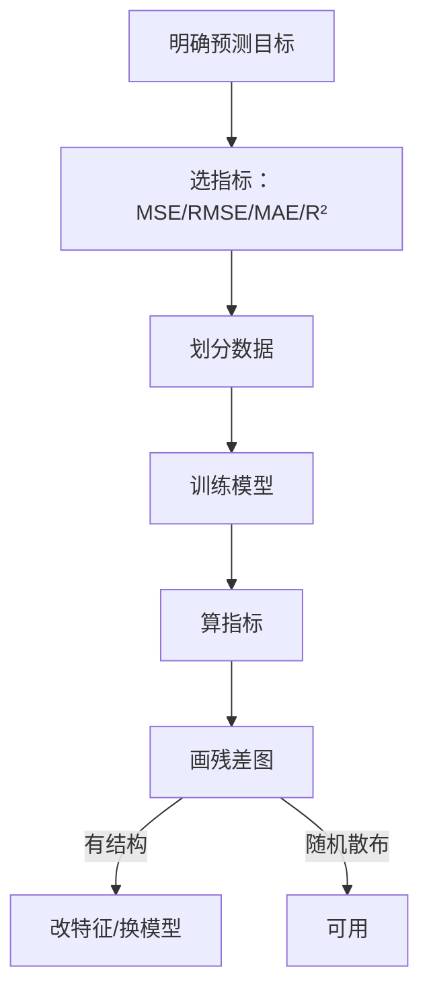

# ML-017 回归任务基本概念

## 1. 本节学习目标

1. 能判断一个任务是回归还是分类（看标签类型）。
2. 会用 MSE / MAE / $R^2$ 三个指标，并说清各自惩罚什么。
3. 理解"残差"与"拟合"的关系，能看残差图判断模型问题。
4. 知道回归的三种典型失败：欠拟合、过拟合、异方差。

## 2. 为什么需要这个知识

因为回归是最基础、也最容易"看起来对"的任务：

- $R^2=0.95$ 听起来很好，但可能是**用未来数据预测过去**。
- MSE 很小，但**误差全集中在高价值样本上**，业务上不可接受。
- 残差有明显的碗形，说明模型**漏了非线性项**，而指标看不出来。

选错指标、不看残差，就会得出"模型很好"的错误结论。

## 3. 直观解释

回归 = **预测一个连续数**。

| 任务 | 标签 | 类型 |
|---|---|---|
| 房价预测 | 320 万 | 回归 |
| 销量预测 | 1,240 件 | 回归 |
| 是否流失 | 是/否 | **分类** |
| 评分预测 | 4.3 分 | 回归（有序但常按连续算） |
| 分档预测 | 高/中/低 | 分类（有序分类） |

**一句话**：标签是"能算平均值"的数 ⇒ 回归。

## 4. 正式定义

**模型**：$f:\mathbb{R}^d\to\mathbb{R}$，$\hat y=f(\mathbf{x})$。

**残差**

$$
e_i = y_i - \hat y_i
$$

**三个核心指标**

| 指标 | 公式 | 单位 | 惩罚特点 |
|---|---|---|---|
| MSE | $\frac1n\sum e_i^2$ | $y^2$ | 重罚大误差 |
| RMSE | $\sqrt{\text{MSE}}$ | $y$ | 与 $y$ 同单位 |
| MAE | $\frac1n\sum \lvert e_i\rvert$ | $y$ | 线性，抗异常值 |
| $R^2$ | $1-\frac{\sum e_i^2}{\sum (y_i-\bar y)^2}$ | 无量纲 | 相对"只会猜均值"的提升 |

**$R^2$ 的含义**：以"永远预测训练集均值"为基线，你的模型减少了多少误差。$R^2=1$ 完美，$R^2=0$ 等于只猜均值，$R^2<0$ 比猜均值还差。

## 5. 核心原理

**MSE 与 MAE 的取舍**：MSE 对大误差平方放大，会**被少量极端误差主导**；MAE 每个误差等权，对异常值稳健但不可导（在 0 处尖）。

**为什么必须看残差**：指标是**一个数**，残差是**一个分布**。同一 MSE 下可能是：

- 随机散布（好）
- 碗形（漏了二次项）
- 喇叭形（异方差，误差随 $y$ 增大）
- 趋势（漏了重要特征）

**$R^2$ 的陷阱**：它随特征数增加**只升不降**（即使加噪声特征），所以比较不同特征数的模型要用调整 $R^2$。

## 6. 数学表达式

**本课实例**：$y = 2.5x+3+\varepsilon$，$\varepsilon\sim N(0,2^2)$，50 个点。

拟合结果：

$$
\hat y = 2.732\,x + 2.098
$$

指标：

$$
\text{MSE}=2.854,\qquad \text{MAE}=1.395,\qquad R^2=0.958
$$

**检查**：真斜率 2.5，估计 2.732；真截距 3，估计 2.098。差异来自噪声（$\sigma=2$），属正常抽样误差。

## 7. 数学库链接

| 用到的数学 | 对应篇目 | 用在哪 |
|---|---|---|
| 最小二乘 | [[MATH-451 最小二乘与回归统计]] | 回归的求解目标 |
| 均值/方差 | [[MATH-306 期望、方差与协方差]] | $R^2$ 的分母（总平方和） |
| 正态分布 | [[MATH-305 常见连续分布与正态分布]] | 噪声假设 |

## 8. 算法执行流程



## 9. 可视化解释

```text
残差图（好）            残差图（漏非线性）
  e                     e
  │ ·  ·   ·            │ ·      ·
  │   ·  ·  ·           │   ·  ·
──┼──────────► x      ──┼──────────► x
  │  ·   ·              │      ·  · ·
                        │          ·  ·
  随机散布              明显的弧形结构
```

## 10. Python 实现

```powershell
python ml017_regression_intro.py
```

```python
import numpy as np
from sklearn.linear_model import LinearRegression
from sklearn.metrics import mean_absolute_error, mean_squared_error, r2_score

rng = np.random.default_rng(0)
x = np.linspace(0, 10, 50)
y = 2.5 * x + 3 + rng.normal(0, 2, 50)

model = LinearRegression().fit(x.reshape(-1, 1), y)
y_pred = model.predict(x.reshape(-1, 1))

print("斜率:", round(float(model.coef_[0]), 3), " 截距:", round(float(model.intercept_), 3))
print("MSE:", round(mean_squared_error(y, y_pred), 3))
print("MAE:", round(mean_absolute_error(y, y_pred), 3))
print("R2 :", round(r2_score(y, y_pred), 3))

residual = y - y_pred
print("残差均值:", round(float(residual.mean()), 4), " 标准差:", round(float(residual.std()), 3))
print("残差前 5:", residual[:5].round(2).tolist())
```

**实际运行结果**

```
斜率: 2.732  截距: 2.098
MSE: 2.854
MAE: 1.395
R2 : 0.958
残差均值: 0.0  标准差: 1.672
残差前 5: [-1.5, 0.45, 0.87, -1.16, 0.16]
```

## 11. 代码逐行解释

| 代码 | 作用 |
|---|---|
| `LinearRegression().fit(x.reshape(-1,1), y)` | 特征必须二维 |
| `mean_squared_error(y, y_pred)` | 注意参数顺序：真实在前 |
| `r2_score(y, y_pred)` | $R^2$，越接近 1 越好 |
| `residual = y - y_pred` | 残差 = 真实 − 预测 |
| `residual.mean()` | 带截距的最小二乘残差均值**必然为 0** |

**残差均值 = 0 是数学必然**：最小二乘的正规方程强制 $\sum e_i=0$（只要模型含截距）。所以"残差均值"不是质量指标，**要看残差的分布形态**。

## 12. 实际运行结果

见第 10 节。三点：

1. 斜率 2.732 vs 真值 2.5，截距 2.098 vs 真值 3 —— 抽样误差。
2. $R^2=0.958$ ⇒ 模型解释了 95.8% 的方差。
3. 残差标准差 1.672 ≈ 噪声 $\sigma=2$ 量级，说明模型没漏掉主要结构。

## 13. 适用场景

| 指标 | 什么时候用 |
|---|---|
| MSE/RMSE | 大误差代价高（如预测库存） |
| MAE | 有异常值、想要"平均误差多少元" |
| $R^2$ | 比较同目标的不同模型 |
| 调整 $R^2$ | 特征数不同时比较 |
| 残差图 | **每次都要看** |

## 14. 优点与缺点

| 指标 | 优点 | 缺点 |
|---|---|---|
| MSE | 可导、优化友好 | 被极值主导、单位不直观 |
| RMSE | 与 $y$ 同单位 | 同样被极值主导 |
| MAE | 直观、稳健 | 不可导、对大误差不敏感 |
| $R^2$ | 无量纲、可比 | 随特征数单调增、对异常值敏感 |

## 15. 常见错误

| 错误 | 表现 | 纠正 |
|---|---|---|
| 用准确率评回归 | 无法定义 | 用 MSE/MAE/$R^2$ |
| 只报 $R^2$ 不看残差 | 漏掉非线性 | 画残差图 |
| 用训练集算指标 | 虚高 | 用测试集 |
| $R^2$ 比较不同特征数模型 | 偏向特征多的 | 用调整 $R^2$ |
| 忽略异方差 | 置信区间失真 | 看残差是否呈喇叭形 |
| 把回归预测值当概率 | 越界（<0 或 >1） | 需要概率用分类模型 |

## 16. 本节总结

- 回归 = 预测连续值；指标看 MSE/MAE/$R^2$，各有偏好。
- **$R^2$ 是相对"猜均值"的提升**，不是"正确率"。
- 残差均值必为 0，真正要看的是**残差的形状**。

## 17. 前置与后续

- 前置：[[ML-016 预处理 Pipeline 与 ColumnTransformer]]
- 后续：[[ML-018 线性回归（手写实现）]]、[[ML-019 多元线性回归与正规方程]]、`ML-023 回归评价指标与残差诊断`（待建）（待建）
- 相关数学：[[MATH-451 最小二乘与回归统计]]

## 18. 练习与参考答案

**基础 1**：下列哪些是回归任务？① 预测房价 ② 判断邮件是否垃圾 ③ 预测明日气温 ④ 预测用户属于哪个年龄段

**基础 2**：$R^2=0$ 意味着什么？$R^2<0$ 可能吗？

**进阶 1**：MSE 与 MAE 何时给出相反的模型排序？

**综合 1**：本课拟合的斜率/截距与真值（2.5 / 3）有偏差，这是模型错了还是正常？怎么验证？

> [!success]- 参考答案

> **基础 1**
> 回归：① 房价、③ 气温（连续值）。
> 分类：② 垃圾邮件（二分类）、④ 年龄段（有序分类，通常按分类处理）。

> **基础 2**
> $R^2=0$ 表示模型效果**等同"永远预测均值"**（$\text{SSE}=\text{SST}$）。
> $R^2<0$ 可能：$R^2=1-\text{SSE}/\text{SST}$，若 $\text{SSE}>\text{SST}$ 则为负——说明模型**比猜均值还差**，常见于在测试集上评估一个严重过拟合或方向错误的模型。

> **进阶 1**
> 当误差分布**有少数极端值**时：MSE 被极值主导，会选"在极值上不太差"的模型；MAE 等权，会选"在多数点上更准"的模型。
> 例：模型 A 在 99 个点上误差 1、1 个点误差 100；模型 B 在所有点误差 2。
> - MSE：A ≈ 100，B = 4 ⇒ 选 B。
> - MAE：A ≈ 1.99，B = 2 ⇒ 选 A。
> **结论**：指标选择本身就是业务判断（要不要为极端样本牺牲平均水平）。

> **综合 1**
> 正常，是**抽样噪声**导致的估计偏差，不是模型错。
> 验证方法：
> 1. 增大样本量（$n$ 越大估计越稳）；
> 2. 换不同随机种子重复拟合，看估计值是否围绕真值波动；
> 3. 看标准误：斜率的标准误 $\approx \sigma/\sqrt{\sum(x_i-\bar x)^2}$。
> 本课 $n=50$、$\sigma=2$，斜率估计 2.732 与真值 2.5 差 0.23，在 1 个标准误量级内。

---

## 🔗 Notion 同步信息

> 以下内容由 Notion「AI Knowledge System · 知识点」数据库按知识 ID 合并而来（导出于 2026-11-09）。

| 属性 | 值 |
|---|---|
| 学科 | 机器学习 |
| 学习状态 | 未开始 |
| 难度 | L1 概念 |
| 知识类型 | Concept |

- **所属模块**：[M-ML-03 监督学习——回归](../%E8%AF%BE%E7%A8%8B%E6%A8%A1%E5%9D%97/M-ML-03%20%E7%9B%91%E7%9D%A3%E5%AD%A6%E4%B9%A0%E2%80%94%E2%80%94%E5%9B%9E%E5%BD%92.md)
- **前置知识**：[ML-016 预处理 Pipeline 与 ColumnTransformer](../05%20%E7%89%B9%E5%BE%81%E5%B7%A5%E7%A8%8B/ML-016%20%E9%A2%84%E5%A4%84%E7%90%86%20Pipeline%20%E4%B8%8E%20ColumnTransformer.md)
- **后继知识**：[ML-018 线性回归（手写实现）](ML-018%20%E7%BA%BF%E6%80%A7%E5%9B%9E%E5%BD%92%EF%BC%88%E6%89%8B%E5%86%99%E5%AE%9E%E7%8E%B0%EF%BC%89.md)
- **关联数学**：[MATH-451 最小二乘与回归统计](../../06_%E6%95%B0%E5%AD%A6%E5%9F%BA%E7%A1%80/04%20%E6%95%B0%E7%90%86%E7%BB%9F%E8%AE%A1/MATH-451%20%E6%9C%80%E5%B0%8F%E4%BA%8C%E4%B9%98%E4%B8%8E%E5%9B%9E%E5%BD%92%E7%BB%9F%E8%AE%A1.md)
