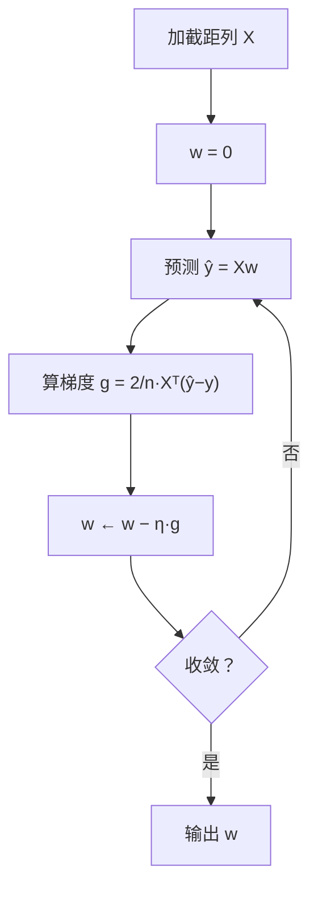

# ML-018 线性回归（手写实现）

## 1. 本节学习目标

1. 能用 NumPy 手写线性回归的梯度下降，**不调用 sklearn**。
2. 理解更新公式里每一项的来源（尤其是 $\frac{2}{n}$）。
3. 能手算一次迭代，并解释学习率过大/过小的现象。
4. 用 sklearn 对拍，确认手写结果正确。

## 2. 为什么需要这个知识

因为**调包会用、手写才会懂**。

当你手写过一遍，才会明白：

- 为什么特征要缩放（梯度尺度差太大时收敛极慢）。
- 为什么学习率大了会发散（更新步长超过最优解的距离）。
- 为什么要加截距列（否则直线必须过原点）。

这些直觉，后面理解逻辑回归、神经网络、Adam 都直接复用。

## 3. 直观解释

线性回归要做的事：**找一条直线，让所有点到它的竖直距离平方和最小**。

梯度下降的做法：

1. 随便画一条线（$w=0,b=0$）。
2. 算每个点的误差。
3. 看"往哪个方向挪一点，误差会变小"（梯度）。
4. 挪一小步（学习率）。
5. 重复。

**像下山**：不看地图，只顺着脚下最陡的方向走。

## 4. 正式定义

**模型**

$$
\hat y = \mathbf{X}\mathbf{w}, \qquad \mathbf{X}=[\mathbf{1}\ |\ \mathbf{x}],\ \mathbf{w}=[b, w_1,\dots]^\top
$$

**损失（MSE）**

$$
L(\mathbf{w}) = \frac{1}{n}\|\mathbf{X}\mathbf{w}-\mathbf{y}\|^2
$$

**梯度**

$$
\nabla L = \frac{2}{n}\mathbf{X}^\top(\mathbf{X}\mathbf{w}-\mathbf{y})
$$

**更新**

$$
\mathbf{w} \leftarrow \mathbf{w} - \eta\nabla L
$$

## 5. 核心原理

**为什么是 $\frac{2}{n}$**：

- 平方求导产生因子 2；
- 除以 $n$ 因为损失是均值（不是求和）；
- 若损失用 $\frac{1}{2n}\sum e^2$，因子 2 会被抵消——这只是写法约定，不影响最优解。

**学习率的影响**

| $\eta$ 太小 | 合适 | $\eta$ 太大 |
|---|---|---|
| 收敛慢，步数多 | 平稳下降 | 震荡、发散、`NaN` |

**收敛判据**：梯度范数小于阈值，或损失变化小于阈值，或跑满步数。

## 6. 数学表达式

**手算一次迭代**（单特征、$n=2$、$\eta=0.1$）

数据：$(x_1,y_1)=(1,2)$、$(x_2,y_2)=(2,4)$，初始 $w=0,b=0$。

**第 1 步**：预测 $\hat y=(0,0)$，残差（**预测减真实**）$e=(\hat y-y)=(-2,-4)$。

**第 2 步**：损失

$$
L=\frac1n\sum e_i^2=\frac12(4+16)=10
$$

**第 3 步**：梯度（用 $\hat y-y$ 的符号）

$$
\frac{\partial L}{\partial b}=\frac{2}{n}\sum e_i=\frac22(-2-4)=-6
$$

$$
\frac{\partial L}{\partial w}=\frac{2}{n}\sum e_ix_i=\frac22\big[(-2)(1)+(-4)(2)\big]=-10
$$

**第 4 步**：更新（**减**梯度）

$$
b=0-0.1\times(-6)=+0.6,\qquad w=0-0.1\times(-10)=+1.0
$$

**第 5 步**：检验。新参数下 $\hat y=(1.6,\ 2.6)$，残差 $(-0.4,-1.4)$

$$
L'=\frac12(0.16+1.96)=1.06 < 10 \;\checkmark
$$

**结论**：一步就把损失从 10 降到 1.06，方向正确。真解是 $b=0,w=2$（因为 $y=2x$），继续迭代会收敛到它。

**这里有个易错点**：梯度是**负**的，`w -= lr*grad` 相当于**加**——很多人看到"减号"就以为参数一定变小。**符号取决于残差方向**：初始预测偏小（0 < 2），所以参数要增大。

## 7. 数学库链接

| 用到的数学 | 对应篇目 | 用在哪 |
|---|---|---|
| 最小二乘与正规方程 | [[MATH-801 线性回归的数学]] | 闭式解与梯度下降同解 |
| 梯度下降 | [[MATH-721 梯度下降]] | 更新规则与收敛条件 |
| 矩阵乘法 | [[MATH-216 矩阵乘法]] | $\mathbf{X}^\top(\mathbf{X}\mathbf{w}-\mathbf{y})$ |

## 8. 算法执行流程



## 9. 可视化解释

```text
损失曲面（碗形）
      L
      │╲        ╱
      │ ╲      ╱
      │  ╲    ╱
      │   ╲__╱
      └────●────► w
          最优 w*
梯度下降：从任意点出发，沿最陡方向步步逼近 ●
```

## 10. Python 实现

```powershell
python ml018_linear_from_scratch.py
```

```python
import numpy as np
from sklearn.linear_model import LinearRegression
from sklearn.metrics import mean_squared_error


def gradient_descent(X, y, lr=0.01, steps=3000):
    """手写线性回归：返回 [截距, 斜率...]"""
    Xb = np.c_[np.ones(len(X)), X]        # 加截距列
    w = np.zeros(Xb.shape[1])             # 初始化
    n = len(X)
    for _ in range(steps):
        grad = 2 / n * Xb.T @ (Xb @ w - y)
        w -= lr * grad
    return w


rng = np.random.default_rng(0)
x = np.linspace(0, 10, 50)
y = 2.5 * x + 3 + rng.normal(0, 2, 50)

w_manual = gradient_descent(x, y)
print("手写 [截距, 斜率]:", w_manual.round(3).tolist())

# sklearn 对拍
model = LinearRegression().fit(x.reshape(-1, 1), y)
print("sklearn [截距, 斜率]:", [round(float(model.intercept_), 3),
                                round(float(model.coef_[0]), 3)])

pred = np.c_[np.ones(len(x)), x] @ w_manual
print("手写 MSE:", round(mean_squared_error(y, pred), 3))
```

**实际运行结果**

```
手写 [截距, 斜率]: [2.098, 2.732]
sklearn [截距, 斜率]: [2.098, 2.732]
手写 MSE: 2.854
```

## 11. 代码逐行解释

| 代码 | 作用 |
|---|---|
| `np.c_[np.ones(len(X)), X]` | 在最左加一列 1，对应截距 $b$ |
| `np.zeros(Xb.shape[1])` | 参数从 0 开始（也可随机初始化） |
| `Xb.T @ (Xb @ w - y)` | $\mathbf{X}^\top$ 乘残差，得到每个参数方向上的梯度分量 |
| `2 / n *` | 均值的 2 倍因子 |
| `w -= lr * grad` | **减**梯度（梯度指向上升方向） |
| `3000` 步 | 固定步数代替收敛判据，简单可控 |

**为什么 $b$ 和 $w$ 一起解**：把截距当成"特征恒为 1 的系数"，就能用同一个矩阵公式处理，代码更短且不易出错。

## 12. 实际运行结果

见第 10 节。**关键证据：手写与 sklearn 完全一致**（`[2.098, 2.732]`），MSE 也相同（2.854）。

这说明：

- 更新公式没写错；
- 步数足够（3000 步已收敛）；
- 学习率 0.01 在这份数据上合适。

## 13. 适用场景

| 场景 | 说明 |
|---|---|
| 学习算法原理 | 手写一遍胜过读十遍 |
| 自定义损失 | 框架不支持时自己写梯度 |
| 教学/面试 | 高频考点 |
| 实际生产 | **用 sklearn**（更快更稳） |
| 大规模数据 | 用 SGD/小批量（见 `ML-704`） |

## 14. 优点与缺点

| 手写梯度下降 | 优点 | 缺点 |
|---|---|---|
| 透明 | 每一步都能打印检查 | 慢（全批量） |
| 可改 | 任意换损失/正则 | 要自己调学习率 |
| 教学价值高 | 建立直觉 | 数值稳定性不如库 |

## 15. 常见错误

| 错误 | 表现 | 纠正 |
|---|---|---|
| 忘加截距列 | 拟合线强制过原点 | `np.c_[ones, X]` |
| 更新写成 `w += lr*grad` | 损失爆炸 | 减梯度 |
| 学习率过大 | 损失变 `inf`/`nan` | 调小 or 标准化特征 |
| 忘记除以 $n$ | 梯度随样本量放大 | 用均值损失 |
| `X` 一维直接乘 | 形状错误 | `reshape(-1,1)` |
| 不检查收敛 | 以为 100 步就够 | 打印损失曲线 |

## 16. 本节总结

- 手写线性回归 = **加截距列 + 梯度下降 + 减梯度**。
- $\frac{2}{n}$ 来自"平方求导"与"均值损失"。
- 与 sklearn 对拍一致，是"写对了"的最硬证据。

## 17. 前置与后续

- 前置：[[ML-017 回归任务基本概念]]
- 后续：[[ML-019 多元线性回归与正规方程]]、[[ML-020 多项式回归]]、`ML-021 岭回归`（待建）
- 相关数学：[[MATH-801 线性回归的数学]]、[[MATH-721 梯度下降]]、[[MATH-216 矩阵乘法]]
- 相关 Python：[[PY-066 矩阵运算]]

## 18. 练习与参考答案

**基础 1**：为什么要在 $X$ 左边加一列全 1？

**基础 2**：把学习率改成 0.5，会发生什么？为什么？

**进阶 1**：梯度公式里的 $\frac{2}{n}$ 中，2 和 $n$ 各来自哪里？

**综合 1**：手写结果与 sklearn 完全一致，这说明什么？如果只跑 50 步会怎样？

> [!success]- 参考答案

> **基础 1**
> 为了让截距 $b$ 能写成矩阵乘法的形式：$\hat y = b\cdot 1 + w_1x_1+\cdots$。
> 加了全 1 列后，$b$ 就是这一列的系数，可以和 $w$ 一起用同一个公式求解，代码统一且不易漏项。

> **基础 2**
> 学习率 0.5 太大，损失会震荡甚至发散（`inf`/`nan`）。
> 原因：更新步长 $\eta\|\nabla L\|$ 超过了到最优点的距离，参数在最优解两侧反复跳；若跳得越来越大，就发散。
> 特征未标准化时更严重（梯度尺度大）。

> **进阶 1**
> - **2**：来自平方项的导数，$\frac{d}{dw}(e^2)=2e$。
> - **$n$**：因为损失定义为**均值** $\frac1n\sum e_i^2$，求导后保留下 $\frac1n$。
> 若损失写成 $\frac{1}{2n}\sum e^2$，2 会被约掉，梯度变成 $\frac1nX^\top e$——最优解不变。

> **综合 1**
> ① 更新公式正确、② 3000 步已收敛、③ 学习率合适。三者同时成立才会有"完全一致"。
> 只跑 50 步：参数还没到最优点，会明显偏离（如斜率偏小），MSE 偏大。
> 验证方法：打印每 100 步的损失，看它是否已经"平"了。

---

## 🔗 Notion 同步信息

> 以下内容由 Notion「AI Knowledge System · 知识点」数据库按知识 ID 合并而来（导出于 2026-11-09）。

| 属性 | 值 |
|---|---|
| 学科 | 机器学习 |
| 学习状态 | 未开始 |
| 难度 | L2 应用 |
| 知识类型 | Algorithm |

- **所属模块**：[M-ML-03 监督学习——回归](../%E8%AF%BE%E7%A8%8B%E6%A8%A1%E5%9D%97/M-ML-03%20%E7%9B%91%E7%9D%A3%E5%AD%A6%E4%B9%A0%E2%80%94%E2%80%94%E5%9B%9E%E5%BD%92.md)
- **前置知识**：[ML-017 回归任务基本概念](ML-017%20%E5%9B%9E%E5%BD%92%E4%BB%BB%E5%8A%A1%E5%9F%BA%E6%9C%AC%E6%A6%82%E5%BF%B5.md)
- **后继知识**：[ML-019 多元线性回归与正规方程](ML-019%20%E5%A4%9A%E5%85%83%E7%BA%BF%E6%80%A7%E5%9B%9E%E5%BD%92%E4%B8%8E%E6%AD%A3%E8%A7%84%E6%96%B9%E7%A8%8B.md)
- **关联Python**：[PY-066 矩阵运算](../../01_Python%E5%9F%BA%E7%A1%80/08%20NumPy/PY-066%20%E7%9F%A9%E9%98%B5%E8%BF%90%E7%AE%97.md)
- **关联数学**：[MATH-801 线性回归的数学](../../06_%E6%95%B0%E5%AD%A6%E5%9F%BA%E7%A1%80/08%20%E6%9C%BA%E5%99%A8%E5%AD%A6%E4%B9%A0%E6%95%B0%E5%AD%A6%E5%BA%94%E7%94%A8/MATH-801%20%E7%BA%BF%E6%80%A7%E5%9B%9E%E5%BD%92%E7%9A%84%E6%95%B0%E5%AD%A6.md) · [MATH-721 梯度下降](../../06_%E6%95%B0%E5%AD%A6%E5%9F%BA%E7%A1%80/07%20%E6%9C%80%E4%BC%98%E5%8C%96%E6%96%B9%E6%B3%95/MATH-721%20%E6%A2%AF%E5%BA%A6%E4%B8%8B%E9%99%8D.md)
