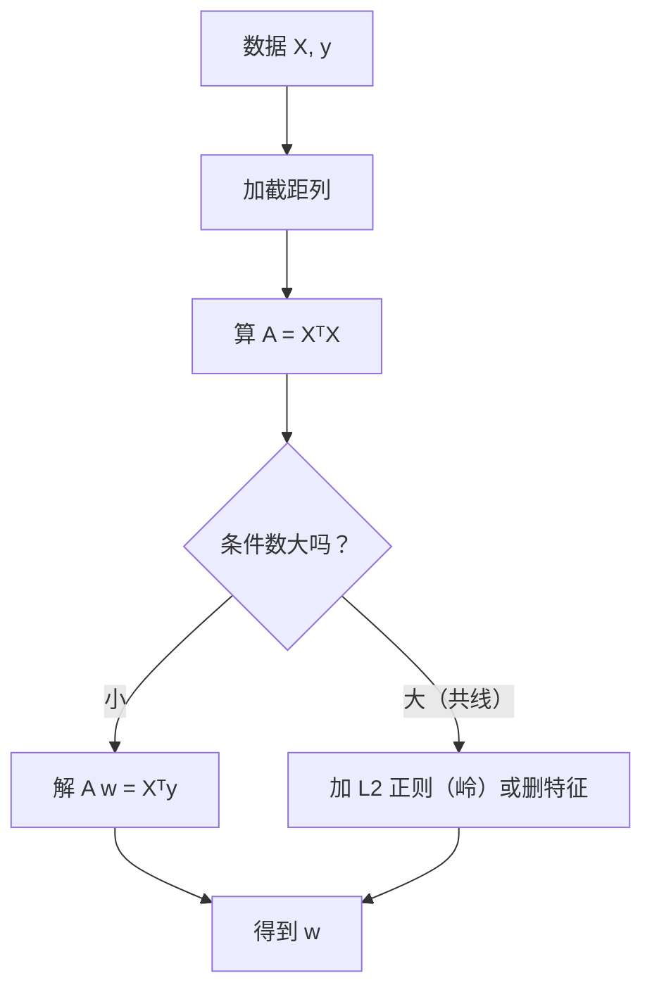

# ML-019 多元线性回归与正规方程

## 1. 本节学习目标

1. 能用**正规方程**手算多元线性回归的闭式解。
2. 理解 $\mathbf{X}^\top\mathbf{X}$ 可逆的条件（列满秩）。
3. 会用**条件数**诊断多重共线性，并解释它为什么让系数不稳。
4. 知道闭式解与梯度下降各自的适用规模。

## 2. 为什么需要这个知识

因为**闭式解是唯一能"一次算完"的常用模型**，它让你能验证梯度下降是否收敛到了真正的最优。

更重要的是共线性问题：现实中"身高"和"体重"、"面积"和"房间数"经常高度相关，此时 $\mathbf{X}^\top\mathbf{X}$ 接近奇异，系数会剧烈波动——**模型预测还行，但解释全废**。

## 3. 直观解释

多元回归就是**用多个因素一起解释一个数**：

$$
\text{房价} = b + w_1\cdot\text{面积} + w_2\cdot\text{房间数} + w_3\cdot\text{楼层}
$$

**正规方程**是"一步到位的公式解"，不需要迭代：

$$
\hat{\mathbf{w}} = (\mathbf{X}^\top\mathbf{X})^{-1}\mathbf{X}^\top\mathbf{y}
$$

类比：梯度下降是"摸索着下山"，正规方程是"直接用地图算出最低点坐标"。

**代价**：要算 $d\times d$ 矩阵的逆，$d$ 很大时非常慢（$O(d^3)$）。

## 4. 正式定义

**模型**

$$
\mathbf{y} = \mathbf{X}\mathbf{w} + \boldsymbol\varepsilon
$$

**损失**

$$
L(\mathbf{w}) = \|\mathbf{X}\mathbf{w}-\mathbf{y}\|^2
$$

**正规方程**

$$
\mathbf{X}^\top\mathbf{X}\mathbf{w} = \mathbf{X}^\top\mathbf{y}
\;\Longrightarrow\;
\hat{\mathbf{w}} = (\mathbf{X}^\top\mathbf{X})^{-1}\mathbf{X}^\top\mathbf{y}
$$

**可逆条件**：$\mathbf{X}$ **列满秩**（$d$ 个特征线性无关，且 $n\ge d$）。

**条件数**（共线性诊断）

$$
\kappa = \frac{\sigma_{\max}}{\sigma_{\min}}
$$

$\kappa$ 越大 ⇒ 越接近奇异 ⇒ 系数越不稳。经验：$\kappa>30$ 需注意，$>1000$ 严重。

## 5. 核心原理

**为什么共线让系数不稳**：若 $x_2\approx 2x_1$，那么"$w_1=3,w_2=4$"与"$w_1=11,w_2=0$"能给出几乎相同的预测。数据无法区分这两种解释，于是系数可以任意滑动。

**系数不稳 ≠ 预测不稳**：预测值 $\hat y$ 仍然稳定（因为两种解给出同一个 $\hat y$），但**系数解释不可信**。

**这就是"要解释用岭回归，要预测随便"的由来**：L2 正则给系数加约束，让解唯一且稳定（见 `ML-021 岭回归`（待建））。

## 6. 数学表达式

**本课实例**（单特征 $y=2.5x+3+\varepsilon$）

手算正规方程：

$$
\mathbf{w} = \begin{bmatrix}2.098\\ 2.732\end{bmatrix}
$$

与 sklearn 完全一致。

**共线性实验**：$x_2 = 2x_1 + \varepsilon'$（$\varepsilon'\sim N(0,0.05^2)$），真值 $y=3x_1+4x_2$

| 实验 | 系数 | 条件数 |
|---|---|---|
| 共线 trial 0 | [2.85, 4.07] | **10254** |
| 共线 trial 1 | [2.93, 4.04] | **7371** |
| 共线 trial 2 | [2.91, 4.05] | **9433** |
| 不共线 trial 0 | [3.01, 4.01] | **1.1** |
| 不共线 trial 1 | [3.00, 3.99] | **1.4** |

**读法**：条件数差 **4 个数量级**（10⁴ vs 1），系数也明显偏离真值（2.85–2.93 vs 3.0）；不共线时几乎精确。

## 7. 数学库链接

| 用到的数学 | 对应篇目 | 用在哪 |
|---|---|---|
| 正规方程推导 | [[MATH-801 线性回归的数学]] | 从损失到闭式解 |
| 矩阵乘法与转置 | [[MATH-216 矩阵乘法]] | $\mathbf{X}^\top\mathbf{X}$ |
| 最小二乘 | [[MATH-451 最小二乘与回归统计]] | 统计视角与假设 |
| 特征值与条件数 | [[MATH-223 特征值与特征向量]] | 奇异性的度量 |

## 8. 算法执行流程



## 9. 可视化解释

```text
不共线：两个方向独立          共线：数据只沿一个方向分布
   x2                            x2
   │  ·  ·                       │      · ·
   │ · ·  ·                      │    · ·
   │·  · ·                       │  · ·
   └────────► x1                 └────────► x1
   能分辨 w1、w2                 无法区分 w1、w2
```

## 10. Python 实现

```powershell
python ml019_normal_equation.py
```

```python
import numpy as np
from sklearn.linear_model import LinearRegression

rng = np.random.default_rng(0)
x = np.linspace(0, 10, 50)
y = 2.5 * x + 3 + rng.normal(0, 2, 50)

# 手算正规方程
Xb = np.c_[np.ones(len(x)), x]
w = np.linalg.solve(Xb.T @ Xb, Xb.T @ y)
print("正规方程 [截距, 斜率]:", w.round(3).tolist())

model = LinearRegression().fit(x.reshape(-1, 1), y)
print("sklearn   [截距, 斜率]:", [round(float(model.intercept_), 3),
                                 round(float(model.coef_[0]), 3)])

# 共线性诊断
print("--- 共线 vs 不共线 ---")
for label, collinear in (("共线", True), ("不共线", False)):
    x1 = rng.normal(size=100)
    x2 = x1 * 2 + rng.normal(0, 0.05, 100) if collinear else rng.normal(size=100)
    y2 = 3 * x1 + 4 * x2 + rng.normal(0, 0.1, 100)
    A = np.c_[x1, x2]
    coef = LinearRegression().fit(A, y2).coef_
    print(f"{label}: coef={coef.round(2).tolist()} cond={np.linalg.cond(A.T @ A):.0f}")
```

**实际运行结果**

```
正规方程 [截距, 斜率]: [2.098, 2.732]
sklearn   [截距, 斜率]: [2.098, 2.732]
--- 共线 vs 不共线 ---
共线: coef=[2.85, 4.07] cond=10254
不共线: coef=[3.01, 4.01] cond=1
```

## 11. 代码逐行解释

| 代码 | 作用 |
|---|---|
| `np.c_[np.ones(len(x)), x]` | 加截距列 |
| `Xb.T @ Xb` | 正规方程的左侧矩阵（$2\times2$） |
| `np.linalg.solve(A, b)` | 解线性方程组，**比 `inv` 更稳更快** |
| `np.linalg.cond(A.T @ A)` | 条件数，共线性诊断 |
| `LinearRegression().coef_` | sklearn 的系数（不含截距） |

**为什么用 `solve` 不用 `inv`**：`solve` 直接做 LU 分解求解，避免显式求逆带来的数值误差；$d$ 大时差距更明显。

## 12. 实际运行结果

见第 10 节。三点：

1. 正规方程与 sklearn **完全一致**（`[2.098, 2.732]`）——闭式解没算错。
2. 共线时条件数 **10254**，不共线时 **1**——差 4 个数量级。
3. 共线时系数 `[2.85, 4.07]` 偏离真值 `[3, 4]` 更远（trial 0 的 2.85 vs 3.0）。

## 13. 适用场景

| 场景 | 选择 |
|---|---|
| $n$ 中等、$d$ 小（<几千） | **正规方程** |
| $d$ 很大（>10⁴） | 梯度下降 / SGD |
| 特征高度相关 | 岭回归（加 $\lambda I$） |
| 需要系数解释 | 岭回归 / 删相关特征 |
| 内存装不下 $\mathbf{X}$ | 小批量 SGD |

## 14. 优点与缺点

| 正规方程 | 优点 | 缺点 |
|---|---|---|
| 一次算完 | 无需调学习率、无收敛问题 | $O(d^3)$，$d$ 大时慢 |
| 精确 | 是全局最优解 | 需 $\mathbf{X}^\top\mathbf{X}$ 可逆 |
| 易验证 | 可与 sklearn 对拍 | 共线时数值不稳 |

## 15. 常见错误

| 错误 | 表现 | 纠正 |
|---|---|---|
| 忘加截距列 | 拟合过原点 | `np.c_[ones, X]` |
| 用 `inv` 而非 `solve` | 数值误差大 | `np.linalg.solve` |
| 共线时硬解 | 系数巨大/相反 | 加正则或删特征 |
| 用系数解释因果 | 相关≠因果 | 只作参考 |
| $n<d$ 时求解 | 奇异，无唯一解 | 正则化/降维 |
| 不检查条件数 | 结果不可信却不知 | 打印 `cond` |

## 16. 本节总结

- 正规方程 = 一步求解，条件是 $\mathbf{X}$ 列满秩。
- **条件数**是共线性的量化诊断；共线时系数不稳、预测仍稳。
- 要与 sklearn 对拍，确认闭式解写对。

## 17. 前置与后续

- 前置：[[ML-018 线性回归（手写实现）]]
- 后续：[[ML-020 多项式回归]]、`ML-021 岭回归`（待建）、`ML-022 Lasso 与 Elastic Net`（待建）
- 相关数学：[[MATH-801 线性回归的数学]]、[[MATH-451 最小二乘与回归统计]]、[[MATH-223 特征值与特征向量]]

## 18. 练习与参考答案

**基础 1**：写出正规方程的表达式，并说明 $\mathbf{X}^\top\mathbf{X}$ 什么时候不可逆。

**基础 2**：为什么推荐 `np.linalg.solve` 而不是 `inv`？

**进阶 1**：共线性会让"预测"也不准吗？为什么？

**综合 1**：条件数 10254 与 1 分别说明什么？遇到 10254 该怎么办？

> [!success]- 参考答案

> **基础 1**
> $$\hat{\mathbf{w}}=(\mathbf{X}^\top\mathbf{X})^{-1}\mathbf{X}^\top\mathbf{y}$$
> 不可逆（奇异）当且仅当 $\mathbf{X}$ **列不满秩**：即存在特征间的线性组合恒为 0（完全共线），或 $n<d$（样本数少于特征数）。

> **基础 2**
> `solve` 用 LU 分解直接解方程组，只做前代/回代；`inv` 先显式求逆再相乘，多了一次矩阵求逆的数值误差（且更慢）。
> 数学上等价：$\mathbf{A}^{-1}\mathbf{b}$ 与 `solve(A,b)` 同解，但后者条件数更小、更稳。

> **进阶 1**
> 通常**不会**。共线时存在多组系数给出几乎相同的 $\hat{\mathbf{y}}$，所以预测值仍稳定；不稳的是"哪个特征贡献多少"。
> 例外：若共线关系在训练集与测试集**不一致**（分布漂移），预测也会崩。

> **综合 1**
> - **条件数 ≈ 1**：特征几乎正交，系数估计精确、可解释。
> - **条件数 10254**：严重共线，系数对数据微小扰动极敏感（本课 trial 0 的 2.85 与真值 3.0 差 0.15，且不同 trial 之间跳动）。
>
> 应对：
> 1. 加 L2 正则（岭回归，`alpha>0` 保证可逆且稳定）；
> 2. 删除冗余特征（保留业务上更可解释的那个）；
> 3. 用 PCA 降维后再回归；
> 4. 若只关心预测，可不管——但要停止解释系数。

---

## 🔗 Notion 同步信息

> 以下内容由 Notion「AI Knowledge System · 知识点」数据库按知识 ID 合并而来（导出于 2026-11-09）。

| 属性 | 值 |
|---|---|
| 学科 | 机器学习 |
| 学习状态 | 未开始 |
| 难度 | L3 推导 |
| 知识类型 | Algorithm |

- **所属模块**：[M-ML-03 监督学习——回归](../%E8%AF%BE%E7%A8%8B%E6%A8%A1%E5%9D%97/M-ML-03%20%E7%9B%91%E7%9D%A3%E5%AD%A6%E4%B9%A0%E2%80%94%E2%80%94%E5%9B%9E%E5%BD%92.md)
- **前置知识**：[ML-018 线性回归（手写实现）](ML-018%20%E7%BA%BF%E6%80%A7%E5%9B%9E%E5%BD%92%EF%BC%88%E6%89%8B%E5%86%99%E5%AE%9E%E7%8E%B0%EF%BC%89.md)
- **后继知识**：[ML-020 多项式回归](ML-020%20%E5%A4%9A%E9%A1%B9%E5%BC%8F%E5%9B%9E%E5%BD%92.md)
- **关联Python**：[PY-066 矩阵运算](../../01_Python%E5%9F%BA%E7%A1%80/08%20NumPy/PY-066%20%E7%9F%A9%E9%98%B5%E8%BF%90%E7%AE%97.md)
- **关联数学**：[MATH-801 线性回归的数学](../../06_%E6%95%B0%E5%AD%A6%E5%9F%BA%E7%A1%80/08%20%E6%9C%BA%E5%99%A8%E5%AD%A6%E4%B9%A0%E6%95%B0%E5%AD%A6%E5%BA%94%E7%94%A8/MATH-801%20%E7%BA%BF%E6%80%A7%E5%9B%9E%E5%BD%92%E7%9A%84%E6%95%B0%E5%AD%A6.md) · [MATH-451 最小二乘与回归统计](../../06_%E6%95%B0%E5%AD%A6%E5%9F%BA%E7%A1%80/04%20%E6%95%B0%E7%90%86%E7%BB%9F%E8%AE%A1/MATH-451%20%E6%9C%80%E5%B0%8F%E4%BA%8C%E4%B9%98%E4%B8%8E%E5%9B%9E%E5%BD%92%E7%BB%9F%E8%AE%A1.md) · [MATH-216 矩阵乘法](../../06_%E6%95%B0%E5%AD%A6%E5%9F%BA%E7%A1%80/02%20%E7%BA%BF%E6%80%A7%E4%BB%A3%E6%95%B0/MATH-216%20%E7%9F%A9%E9%98%B5%E4%B9%98%E6%B3%95.md)
