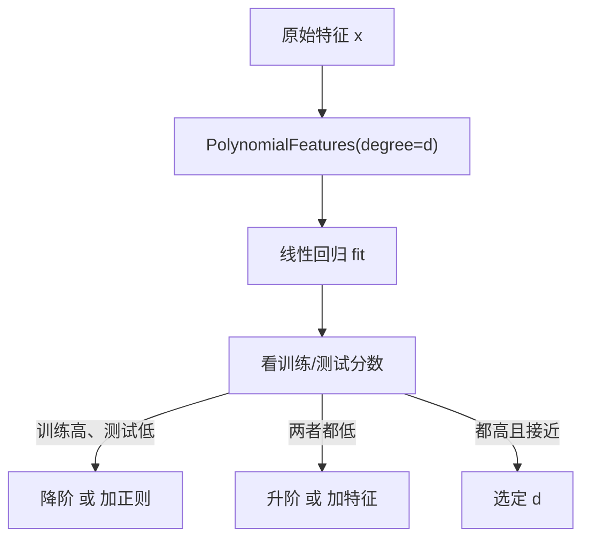

# ML-020 多项式回归

## 1. 本节学习目标

1. 会用 `PolynomialFeatures` 把线性模型变成能拟合曲线的模型。
2. 能算多项式展开后的特征数（维度公式）。
3. 能用"训练/测试分数差"选出合适阶数，并识别过拟合。
4. 理解"多项式回归仍是线性模型"这句话的含义。

## 2. 为什么需要这个知识

因为**很多真实关系不是直线**：房价随面积增长会加速、温度对产量的影响是倒 U 型。

线性模型学不了曲线，但**把特征做非线性变换后，模型在原参数上仍是线性的**——这就是多项式回归的全部技巧。它让你用最简单的求解器（最小二乘）拟合任意光滑曲线。

同时它也是**过拟合的最佳教学案例**：阶数越高，训练分数越漂亮，测试分数先升后崩。

## 3. 直观解释

**核心技巧**：把 $x$ 变成 $(x, x^2, x^3)$，然后**照常做线性回归**。

$$
\hat y = b + w_1x + w_2x^2 + w_3x^3
$$

对参数 $(b,w_1,w_2,w_3)$ 来说，这仍是**线性组合**，所以最小二乘公式原样可用。

**阶数的作用**：

| 阶数 | 能力 | 风险 |
|---|---|---|
| 1 | 直线 | 欠拟合（弯曲数据） |
| 2–3 | 一条弯 | 通常够用 |
| 10+ | 极弯曲 | **过拟合**（在数据点间剧烈震荡） |

## 4. 正式定义

**特征映射**

$$
\phi(x) = (x, x^2, \dots, x^d)
$$

**模型**

$$
\hat y = w_0 + \sum_{k=1}^{d} w_k x^k
$$

**仍是线性模型**：因为对 $w_k$ 是线性的，正规方程照用。

**多特征时的展开维度**（$d$ 阶、$m$ 个原始特征、含偏置）

$$
\#\text{terms} = \binom{m+d}{d}
$$

不含偏置时减 1。

**本课实例**：1 个特征、$d$ 阶 ⇒ $d$ 列（不含偏置）。

## 5. 核心原理

**为什么高阶会过拟合**：$d$ 阶多项式有 $d+1$ 个自由度，能精确穿过 $d+1$ 个点。数据点一密集，曲线就在点之间剧烈摆动（Runge 现象）。

**为什么必须看测试分数**：训练分数随阶数**单调不降**（更多自由度总能拟合更好），所以它不能用来选阶数。

**为什么不直接上高阶**：阶数每加 1，特征数加 1，但方差急速上升；实践中 2–3 阶通常足够，再高就配正则化（岭回归 + 多项式）。

## 6. 数学表达式

**本课数据**：$y = 0.5x^2 - x + 2 + \mathcal{N}(0,1)$，$x\in[-3,3]$，60 个点。

**各阶结果**

| 阶数 | 特征数 | 训练 $R^2$ | 测试 $R^2$ | 诊断 |
|---|---|---|---|---|
| 1 | 1 | 0.435 | 0.515 | **欠拟合** |
| 2 | 2 | 0.823 | **0.873** | 合适（真模型是二次） |
| 5 | 5 | 0.853 | 0.881 | 略好，仍稳 |
| 15 | 15 | 0.790 | **0.569** | **过拟合** |

**读法**：2 阶已经抓到真实结构（真模型就是二次）；15 阶训练分数反而下降（因为样本少、自由度太多导致拟合不稳），测试分数崩到 0.569。

## 7. 数学库链接

| 用到的数学 | 对应篇目 | 用在哪 |
|---|---|---|
| 多项式函数 | [[MATH-005 基本初等函数]] | 幂函数形状 |
| 过拟合与正则 | [[MATH-708 L1 与 L2 正则化]] | 高阶配正则 |
| 最小二乘 | [[MATH-451 最小二乘与回归统计]] | 求解方式不变 |

## 8. 算法执行流程



## 9. 可视化解释

```text
阶数 2（合适）            阶数 15（过拟合）
   ╱‾‾╲                    ╱╲    ╱╲
  ╱    ╲                  ╱  ╲  ╱  ╲
 ╱      ╲                ╱    ╲╱    ╲
●  ●  ●  ●              ● ● ● ● ● ● ●
平滑地跟随趋势           在点之间剧烈震荡
```

## 10. Python 实现

```powershell
python ml020_polynomial.py
```

```python
import numpy as np
from sklearn.linear_model import LinearRegression
from sklearn.model_selection import train_test_split
from sklearn.preprocessing import PolynomialFeatures

rng = np.random.default_rng(0)
x = np.linspace(-3, 3, 60)
y = 0.5 * x**2 - x + 2 + rng.normal(0, 1.0, 60)

X_train, X_test, y_train, y_test = train_test_split(
    x.reshape(-1, 1), y, test_size=0.3, random_state=42
)

print(f"{'degree':>6} {'特征数':>6} {'train R²':>10} {'test R²':>10}")
for d in (1, 2, 5, 15):
    poly = PolynomialFeatures(degree=d, include_bias=False)
    A = poly.fit_transform(X_train)
    B = poly.transform(X_test)
    model = LinearRegression().fit(A, y_train)
    print(f"{d:>6} {A.shape[1]:>6} {model.score(A, y_train):>10.3f} {model.score(B, y_test):>10.3f}")
```

**实际运行结果**

```
degree 特征数   train R²    test R²
     1      1      0.435      0.515
     2      2      0.823      0.873
     5      5      0.853      0.881
    15     15      0.790      0.569
```

## 11. 代码逐行解释

| 代码 | 作用 |
|---|---|
| `PolynomialFeatures(degree=d, include_bias=False)` | 生成 $x,x^2,\dots,x^d$ |
| `fit_transform(X_train)` | **训练集**上拟合并展开 |
| `transform(X_test)` | 测试集只用 `transform`（不重新拟合） |
| `LinearRegression().fit(A, y_train)` | 在展开后的特征上做普通线性回归 |
| `model.score` | 默认返回 $R^2$ |

**为什么 `include_bias=False`**：`LinearRegression` 自带截距，再生成一列全 1 会造成共线（两列完全相同），导致系数不可识别。

## 12. 实际运行结果

见第 10 节。三点：

1. 阶数 1 明显欠拟合（训练 0.435）。
2. 阶数 2 已接近上限（测试 0.873），因为**真模型就是二次**。
3. 阶数 15 测试崩到 **0.569**，训练也降到 0.790——过拟合 + 数值不稳。

## 13. 适用场景

| 场景 | 建议阶数 |
|---|---|
| 明显弯曲、单峰 | 2 |
| S 形/多峰 | 3–4 |
| 物理/经济模型 | 按理论定 |
| 高维特征 | 先选特征再展开（否则爆炸） |
| 需要外推 | **不要用高阶**（边界处爆炸） |

## 14. 优点与缺点

| 优点 | 缺点 |
|---|---|
| 实现极简（复用线性回归） | 高阶易过拟合 |
| 可拟合任意光滑曲线 | 对异常值极敏感（高次幂放大） |
| 可解释（系数即多项式系数） | 外推极差（边界爆炸） |
| 与正则化天然兼容 | 多特征时维度爆炸 |

## 15. 常见错误

| 错误 | 表现 | 纠正 |
|---|---|---|
| `include_bias=True` + 线性回归截距 | 共线、系数异常 | 设 `False` |
| 在测试集上 `fit_transform` | 泄漏 | 只 `transform` |
| 只训练分数选阶数 | 越选越高 | 看测试/CV |
| 未缩放就上高阶 | 数值不稳 | 先标准化 |
| 高阶用于外推 | 预测值爆炸 | 限制在训练范围内 |
| 多特征直接 3 阶 | 维度爆炸 | 先选特征 |

## 16. 本节总结

- 多项式回归 = **特征变换 + 线性回归**，对参数仍线性。
- 阶数选择看**测试/CV 分数**，不是训练分数。
- 高阶配正则、配缩放；外推要谨慎。

## 17. 前置与后续

- 前置：[[ML-019 多元线性回归与正规方程]]
- 后续：`ML-021 岭回归`（待建）、`ML-022 Lasso 与 Elastic Net`（待建）、`ML-023 回归评价指标与残差诊断`（待建）
- 相关数学：[[MATH-005 基本初等函数]]、[[MATH-708 L1 与 L2 正则化]]

## 18. 练习与参考答案

**基础 1**：1 个特征做 5 阶多项式展开（不含偏置）有多少列？3 个特征做 2 阶呢？

**基础 2**：为什么 `include_bias=False`？

**进阶 1**：为什么阶数 15 时**训练** $R^2$ 反而下降到 0.790？

**综合 1**：根据本课表格，你会选哪个阶数？理由是什么？

> [!success]- 参考答案

> **基础 1**
> - 1 特征 5 阶：$x,x^2,x^3,x^4,x^5$ ⇒ **5 列**。
> - 3 特征 2 阶（不含偏置）：
> $$\binom{3+2}{2}-1 = 10-1 = 9 \text{ 列}$$
> （含 $x_1,x_2,x_3$ 三个一次项，$x_1^2,x_2^2,x_3^2$ 三个平方项，$x_1x_2,x_1x_3,x_2x_3$ 三个交叉项）

> **基础 2**
> `LinearRegression` 默认 `fit_intercept=True`，会自动加截距列。若 `PolynomialFeatures` 再生成一列全 1（bias），两列完全相同 ⇒ $\mathbf{X}^\top\mathbf{X}$ 奇异，系数不可唯一确定。

> **进阶 1**
> 两个原因叠加：
> 1. **自由度过多**：15 列特征、训练集仅 42 个样本，模型在数值上接近"插值"，$\mathbf{X}^\top\mathbf{X}$ 条件数极大，解的方差很高，训练集上的拟合反而不稳。
> 2. **高次幂数值问题**：$x^{15}$ 在 $|x|<1$ 时极小、在 $|x|>1$ 时极大，未标准化时矩阵严重病态。
> 所以"自由度越多训练分数越高"只在数值稳定时成立；病态时连训练集都拟合不好。

> **综合 1**
> 选 **2 阶**（或 5 阶，二者接近）。理由：
> - 测试 $R^2$ 0.873 / 0.881 最高，且与训练分数接近（0.823 / 0.853）⇒ 泛化好；
> - 2 阶对应真实生成过程（$0.5x^2$），可解释性最好；
> - 15 阶测试崩到 0.569，明显过拟合。
> 若担心 5 阶略优是噪声，应用交叉验证确认（见 `ML-041`，待建）。

---

## 🔗 Notion 同步信息

> 以下内容由 Notion「AI Knowledge System · 知识点」数据库按知识 ID 合并而来（导出于 2026-11-09）。

| 属性 | 值 |
|---|---|
| 学科 | 机器学习 |
| 学习状态 | 未开始 |
| 难度 | L2 应用 |
| 知识类型 | Algorithm |

- **所属模块**：[M-ML-03 监督学习——回归](../%E8%AF%BE%E7%A8%8B%E6%A8%A1%E5%9D%97/M-ML-03%20%E7%9B%91%E7%9D%A3%E5%AD%A6%E4%B9%A0%E2%80%94%E2%80%94%E5%9B%9E%E5%BD%92.md)
- **前置知识**：[ML-019 多元线性回归与正规方程](ML-019%20%E5%A4%9A%E5%85%83%E7%BA%BF%E6%80%A7%E5%9B%9E%E5%BD%92%E4%B8%8E%E6%AD%A3%E8%A7%84%E6%96%B9%E7%A8%8B.md)
- **后继知识**：[ML-021 岭回归](ML-021%20%E5%B2%AD%E5%9B%9E%E5%BD%92.md)
- **关联Python**：[PY-066 矩阵运算](../../01_Python%E5%9F%BA%E7%A1%80/08%20NumPy/PY-066%20%E7%9F%A9%E9%98%B5%E8%BF%90%E7%AE%97.md)
- **关联数学**：[MATH-005 基本初等函数](../../06_%E6%95%B0%E5%AD%A6%E5%9F%BA%E7%A1%80/01%20%E9%AB%98%E7%AD%89%E6%95%B0%E5%AD%A6/MATH-005%20%E5%9F%BA%E6%9C%AC%E5%88%9D%E7%AD%89%E5%87%BD%E6%95%B0.md) · [MATH-708 L1 与 L2 正则化](../../06_%E6%95%B0%E5%AD%A6%E5%9F%BA%E7%A1%80/07%20%E6%9C%80%E4%BC%98%E5%8C%96%E6%96%B9%E6%B3%95/MATH-708%20L1%20%E4%B8%8E%20L2%20%E6%AD%A3%E5%88%99%E5%8C%96.md)
