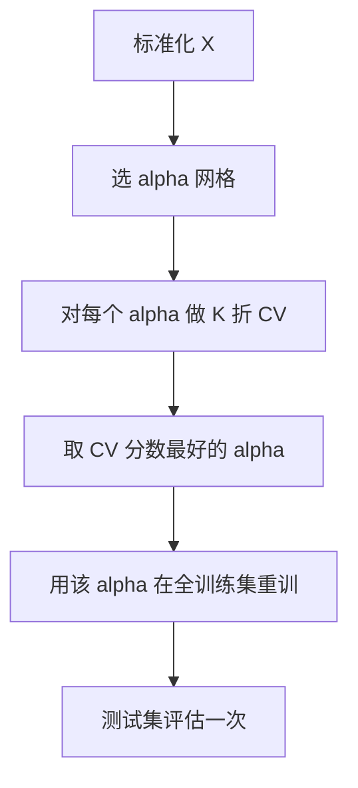

# ML-021 岭回归

## 1. 本节学习目标

1. 写出岭回归的目标函数，说清 $\alpha$ 的作用。
2. 会用"$\|w\|_2$ 与 $\alpha$"的关系解释收缩。
3. 会用交叉验证选 $\alpha$，并**正确读 `GridSearchCV.score`**（本课踩过坑）。
4. 理解岭回归为什么能解决共线性导致的不可逆。

## 2. 为什么需要这个知识

普通最小二乘在两个场景会翻车：

1. **特征共线**：$\mathbf{X}^\top\mathbf{X}$ 接近奇异，系数剧烈波动（ML-019 见过条件数 10⁴）。
2. **特征多、样本少**：$n<d$ 时根本不可逆，有无穷多解。

岭回归给系数加"平方惩罚"，把解**拉向 0**，从而同时解决这两个问题——代价是引入一点偏差（bias）。

## 3. 直观解释

$$L = \underbrace{\|Xw-y\|^2}_{\text{拟合数据}} + \underbrace{\alpha\|w\|^2}_{\text{别让系数太大}}$$

想象你在调音：$\alpha$ 是"阻尼旋钮"。

- $\alpha=0$：完全相信数据，系数可以很大（易过拟合）。
- $\alpha$ 增大：系数被压小，模型更"钝"，偏差上升、方差下降。
- $\alpha\to\infty$：系数全趋 0，模型退化成"只预测均值"。

**关键**：岭回归**不会**把系数压成精确 0（这是它与 Lasso 的核心区别），所以它**不能做特征选择**。

## 4. 正式定义

**目标函数**

$$
\hat{\mathbf{w}} = \arg\min_{\mathbf{w}}\ \|\mathbf{X}\mathbf{w}-\mathbf{y}\|_2^2 + \alpha\|\mathbf{w}\|_2^2
$$

**闭式解**

$$
\hat{\mathbf{w}} = (\mathbf{X}^\top\mathbf{X} + \alpha\mathbf{I})^{-1}\mathbf{X}^\top\mathbf{y}
$$

**为什么一定可逆**：$\mathbf{X}^\top\mathbf{X}$ 半正定，加 $\alpha\mathbf{I}$ 后所有特征值变成 $\lambda_i+\alpha>0$。

**$\alpha$ 的性质**

$$
\alpha\to0:\ \hat{\mathbf{w}}\to\text{OLS},\qquad \alpha\to\infty:\ \hat{\mathbf{w}}\to\mathbf{0}
$$

**注意**：sklearn 默认**不惩罚截距**（`fit_intercept=True` 时）。

## 5. 核心原理

**偏差-方差权衡**：加正则 ⇒ 偏差↑、方差↓。$\alpha$ 就是那个旋钮，用**交叉验证**选在总误差最小处。

**为什么必须标准化**：惩罚项对尺度敏感。若"收入"是万级、"年龄"是十级，同样的 $\alpha$ 对收入的压缩强度是年龄的千倍——**惩罚变成"专打大尺度特征"**。所以岭回归前必须 `StandardScaler`。

**本课实测印证**：

| $\alpha$ | $\|w\|_2$ | 测试 $R^2$ | RMSE |
|---|---|---|---|
| 0.01 | 71.48 | 0.4526 | 53.9 |
| 0.1 | 70.21 | 0.4528 | 53.8 |
| 1.0 | 60.91 | 0.4541 | 53.8 |
| 10.0 | 43.03 | 0.4572 | 53.6 |
| 100.0 | 34.28 | **0.4605** | **53.5** |

$\|w\|_2$ **单调下降**（71.48 → 34.28），这就是"收缩"的直接证据。

## 6. 数学表达式

**本课交叉验证结果**

$$
\alpha^* \approx 31.62,\qquad \text{CV } R^2 = 0.4564,\qquad \text{test } R^2 = 0.4599
$$

**对比 OLS**：OLS 的 $R^2=0.4526$，岭回归（$\alpha=31.6$）略高到 0.4599——**正则化在这份数据上小幅提分**。

**为什么提升不大**：diabetes 只有 10 个特征、442 个样本，$n\gg d$，过拟合空间本来就小。

## 7. 数学库链接

| 用到的数学 | 对应篇目 | 用在哪 |
|---|---|---|
| L2 正则与收缩解 | [[MATH-708 L1 与 L2 正则化]] | $\hat w=y/(1+\lambda)$ 的形式 |
| 正规方程 | [[MATH-801 线性回归的数学]] | 加 $\alpha I$ 后的闭式解 |
| 特征值与可逆性 | [[MATH-223 特征值与特征向量]] | $\lambda_i+\alpha>0$ |

## 8. 算法执行流程



## 9. 可视化解释

```text
系数路径（随 alpha 增大）
 w │╲
   │ ╲___
   │     ╲___
   └──────────► alpha
     收缩到 0，但永不为 0
```

## 10. Python 实现

```powershell
python ml021_ridge.py
```

```python
import numpy as np
from sklearn.datasets import load_diabetes
from sklearn.linear_model import Ridge
from sklearn.metrics import mean_squared_error, r2_score
from sklearn.model_selection import GridSearchCV, train_test_split
from sklearn.pipeline import Pipeline
from sklearn.preprocessing import StandardScaler

X, y = load_diabetes(return_X_y=True)
X_train, X_test, y_train, y_test = train_test_split(X, y, test_size=0.2, random_state=42)

for alpha in (0.01, 0.1, 1.0, 10.0, 100.0):
    model = Pipeline([("sc", StandardScaler()), ("ridge", Ridge(alpha=alpha))])
    model.fit(X_train, y_train)
    pred = model.predict(X_test)
    print(f"alpha={alpha:>6}: |w|2={np.linalg.norm(model.named_steps['ridge'].coef_):7.2f}"
          f"  test R2={r2_score(y_test, pred):.4f}"
          f"  RMSE={mean_squared_error(y_test, pred) ** 0.5:5.1f}")

gs = GridSearchCV(
    Pipeline([("sc", StandardScaler()), ("ridge", Ridge())]),
    {"ridge__alpha": np.logspace(-3, 3, 13)}, cv=5, scoring="r2")
gs.fit(X_train, y_train)
pred = gs.predict(X_test)
print("最佳 alpha:", round(float(gs.best_params_["ridge__alpha"]), 4))
print("CV R2:", round(float(gs.best_score_), 4))
print("test R2:", round(r2_score(y_test, pred), 4),
      " RMSE:", round(mean_squared_error(y_test, pred) ** 0.5, 1))
```

**实际运行结果**

```
alpha=  0.01: |w|2=  71.48  test R2=0.4526  RMSE= 53.9
alpha=   0.1: |w|2=  70.21  test R2=0.4528  RMSE= 53.8
alpha=   1.0: |w|2=  60.91  test R2=0.4541  RMSE= 53.8
alpha=  10.0: |w|2=  43.03  test R2=0.4572  RMSE= 53.6
alpha= 100.0: |w|2=  34.28  test R2=0.4605  RMSE= 53.5
最佳 alpha: 31.6228
CV R2: 0.4564
test R2: 0.4599  RMSE: 53.5
```

## 11. 代码逐行解释

| 代码 | 作用 |
|---|---|
| `Pipeline([("sc", StandardScaler()), ("ridge", Ridge(alpha))])` | **必须**先标准化再正则 |
| `model.named_steps["ridge"].coef_` | 取出系数算范数 |
| `np.logspace(-3, 3, 13)` | 对数网格，覆盖 4 个数量级 |
| `{"ridge__alpha": ...}` | 双下划线定位子步骤参数 |
| `scoring="r2"` | **显式指定**，否则默认用模型自带 scorer |

**一个我踩过的坑（重要）**：

最初我写 `scoring="neg_mean_squared_error"`，然后直接把 `gs.score(X_test, y_test)` 当成 $R^2$，得到 **-2861**，一度以为模型崩了。

实际上：`GridSearchCV.score` 用的是**你传入的 scorer**，返回的是**负 MSE**（-2861 ⇒ MSE 2861 ⇒ RMSE ≈ 53.5），与 $R^2=0.46$ 完全自洽。

**教训**：`gs.score` 的单位取决于 `scoring` 参数，**不能默认它是 $R^2$**。要么显式写 `scoring="r2"`，要么用 `r2_score(y, gs.predict(X))` 自己算。

## 12. 实际运行结果

见第 10 节。三点：

1. $\|w\|_2$ 随 $\alpha$ 单调下降：**71.48 → 34.28**。
2. 本数据上 $R^2$ 随 $\alpha$ 略升（0.4526 → 0.4605），说明正则化有小幅收益。
3. 最优 $\alpha=31.6$，测试 $R^2=0.4599$，RMSE 53.5。

## 13. 适用场景

| 场景 | 建议 |
|---|---|
| 特征高度相关 | **首选岭回归** |
| $n<d$（特征多于样本） | 岭回归（保证可逆） |
| 需要稀疏/特征选择 | 改用 Lasso（见 ML-022） |
| 特征数少、样本多 | 收益有限，可先用 OLS |
| 需要系数稳定可解释 | 岭回归 |

## 14. 优点与缺点

| 优点 | 缺点 |
|---|---|
| 保证可逆、数值稳定 | 系数不稀疏，不能选特征 |
| 缓解共线性 | $\alpha$ 需调 |
| 有闭式解，快 | 需标准化，否则惩罚不公 |
| 理论清晰（偏差-方差） | 对异常值不稳健 |

## 15. 常见错误

| 错误 | 表现 | 纠正 |
|---|---|---|
| 不标准化就正则 | 惩罚只打大尺度特征 | 先 `StandardScaler` |
| 把 `gs.score` 当 $R^2$ | 得到 -2861 之类数字 | 显式 `scoring="r2"` |
| 用测试集选 $\alpha$ | 泄漏 | 只用 CV |
| 认为岭能选特征 | 系数不为 0 | 用 Lasso |
| $\alpha$ 网格太粗 | 错过最优 | `logspace` 跨数量级 |
| 惩罚截距 | 预测整体偏移 | 用 `fit_intercept=True`（默认） |

## 16. 本节总结

- 岭回归 = OLS + $\alpha\|w\|^2$，闭式解 $(\mathbf{X}^\top\mathbf{X}+\alpha\mathbf{I})^{-1}\mathbf{X}^\top\mathbf{y}$。
- 加 $\alpha\mathbf{I}$ 保证可逆，**这是它比 OLS 更稳的根本原因**。
- $\alpha$ 用 CV 选；$\|w\|$ 随 $\alpha$ 单调下降。
- **`GridSearchCV.score` 的单位取决于 `scoring`**。

## 17. 前置与后续

- 前置：[[ML-020 多项式回归]]、[[ML-019 多元线性回归与正规方程]]
- 后续：[[ML-022 Lasso 与 Elastic Net]]、[[ML-023 回归评价指标与残差诊断]]
- 相关数学：[[MATH-708 L1 与 L2 正则化]]、[[MATH-801 线性回归的数学]]、[[MATH-223 特征值与特征向量]]
- 相关 Python：[[PY-067 聚合与统计]]

## 18. 练习与参考答案

**基础 1**：写出岭回归的目标函数与闭式解，并说明 $\alpha$ 的作用。

**基础 2**：岭回归会把系数压到 0 吗？为什么？

**进阶 1**：为什么岭回归前必须标准化？

**综合 1**：本课 $\alpha=0.01$ 与 $\alpha=100$ 的 $\|w\|_2$ 与 $R^2$ 各是多少？说明什么？

> [!success]- 参考答案

> **基础 1**
> $$L=\|\mathbf{X}\mathbf{w}-\mathbf{y}\|_2^2+\alpha\|\mathbf{w}\|_2^2,\qquad \hat{\mathbf{w}}=(\mathbf{X}^\top\mathbf{X}+\alpha\mathbf{I})^{-1}\mathbf{X}^\top\mathbf{y}$$
> $\alpha$ 控制惩罚强度：$\alpha$ 越大，系数被压得越小（偏差↑、方差↓）。

> **基础 2**
> 不会。岭的解是 $(\mathbf{X}^\top\mathbf{X}+\alpha\mathbf{I})^{-1}\mathbf{X}^\top\mathbf{y}$，只有当 $\alpha\to\infty$ 时整体才趋近 0，但**单个系数不会精确等于 0**。
> 数学原因：L2 惩罚在 0 处光滑（导数为 0），最优解不会"卡"在坐标轴上；L1 在 0 处有尖点，才会产生精确 0（见 [[MATH-708 L1 与 L2 正则化]]）。

> **进阶 1**
> 因为惩罚项 $\alpha\|w\|^2$ 对所有系数一视同仁，而特征的量纲不同 ⇒ **同样的 $\alpha$ 对不同特征的压缩强度不同**。
> 例：收入是万级、年龄十级，为了让损失下降相同幅度，模型更愿意压小"对预测影响大"的大尺度系数，惩罚就变成了"专打大尺度特征"。
> 标准化后所有特征同一尺度，惩罚才是公平的。

> **综合 1**
> | $\alpha$ | $\|w\|_2$ | 测试 $R^2$ |
> |---|---|---|
> | 0.01 | 71.48 | 0.4526 |
> | 100 | 34.28 | 0.4605 |
>
> 说明：$\alpha$ 增大 ⇒ **范数下降 52%**（收缩明显），而 $R^2$ **略升**（+0.008）。
> 这表示原模型有轻微过拟合/共线不稳定，正则化把方差压下去后泛化略好；但收益很小（diabetes 是 $n\gg d$ 的干净数据）。

---

## 🔗 Notion 同步信息

> 以下内容由 Notion「AI Knowledge System · 知识点」数据库按知识 ID 合并而来（导出于 2026-11-09）。

| 属性 | 值 |
|---|---|
| 学科 | 机器学习 |
| 学习状态 | 未开始 |
| 难度 | L2 应用 |
| 知识类型 | Algorithm |

- **所属模块**：[M-ML-03 监督学习——回归](../%E8%AF%BE%E7%A8%8B%E6%A8%A1%E5%9D%97/M-ML-03%20%E7%9B%91%E7%9D%A3%E5%AD%A6%E4%B9%A0%E2%80%94%E2%80%94%E5%9B%9E%E5%BD%92.md)
- **前置知识**：[ML-020 多项式回归](ML-020%20%E5%A4%9A%E9%A1%B9%E5%BC%8F%E5%9B%9E%E5%BD%92.md)
- **后继知识**：[ML-022 Lasso 与 Elastic Net](ML-022%20Lasso%20%E4%B8%8E%20Elastic%20Net.md)
- **关联Python**：[PY-067 聚合与统计](../../01_Python%E5%9F%BA%E7%A1%80/08%20NumPy/PY-067%20%E8%81%9A%E5%90%88%E4%B8%8E%E7%BB%9F%E8%AE%A1.md)
- **关联数学**：[MATH-708 L1 与 L2 正则化](../../06_%E6%95%B0%E5%AD%A6%E5%9F%BA%E7%A1%80/07%20%E6%9C%80%E4%BC%98%E5%8C%96%E6%96%B9%E6%B3%95/MATH-708%20L1%20%E4%B8%8E%20L2%20%E6%AD%A3%E5%88%99%E5%8C%96.md) · [MATH-801 线性回归的数学](../../06_%E6%95%B0%E5%AD%A6%E5%9F%BA%E7%A1%80/08%20%E6%9C%BA%E5%99%A8%E5%AD%A6%E4%B9%A0%E6%95%B0%E5%AD%A6%E5%BA%94%E7%94%A8/MATH-801%20%E7%BA%BF%E6%80%A7%E5%9B%9E%E5%BD%92%E7%9A%84%E6%95%B0%E5%AD%A6.md)
