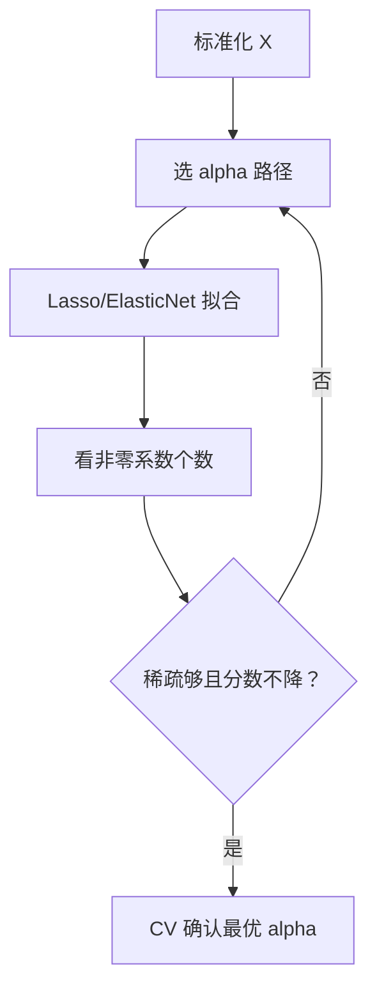

# ML-022 Lasso 与 Elastic Net

## 1. 本节学习目标

1. 写出 Lasso 与 Elastic Net 的目标函数，说清 $L_1$ 与 $L_2$ 的分工。
2. 能读出"$\alpha$ 增大 ⇒ 非零系数减少"的稀疏路径。
3. 理解 Lasso 为什么能把系数压成**精确 0**（几何 + 次梯度）。
4. 知道 Elastic Net 存在的理由：Lasso 在相关特征上"随机挑一个"。

## 2. 为什么需要这个知识

因为很多时候你不只想要预测，还想要**知道哪些特征重要**。

岭回归会把 10 个特征的系数都压小，但一个都不归零——你没法说"这三个特征就够了"。Lasso 直接给你一个**稀疏解**：用 $\alpha$ 控制保留几个特征，模型自己选。

这在特征有几百上千个时是刚需：省内存、可解释、抗过拟合。

## 3. 直观理解

| 模型 | 惩罚 | 系数形态 |
|---|---|---|
| 岭回归 | $\alpha\|w\|_2^2$ | 都变小，**都不为 0** |
| **Lasso** | $\alpha\|w\|_1$ | 一部分**精确为 0** |
| **Elastic Net** | $\alpha[\rho\|w\|_1+(1-\rho)\|w\|_2^2]$ | 稀疏 + 稳定 |

类比：岭回归是"把所有人的音量都调小"，Lasso 是"**直接把不重要的麦克风关掉**"。

## 4. 正式定义

**Lasso**

$$
\hat{\mathbf{w}} = \arg\min_{\mathbf{w}}\ \|\mathbf{X}\mathbf{w}-\mathbf{y}\|_2^2 + \alpha\|\mathbf{w}\|_1
$$

无闭式解（$L_1$ 不可导），用坐标下降求解。

**Elastic Net**

$$
\hat{\mathbf{w}} = \arg\min_{\mathbf{w}}\ \|\mathbf{X}\mathbf{w}-\mathbf{y}\|_2^2 + \alpha\left[\rho\|\mathbf{w}\|_1 + \frac{1-\rho}{2}\|\mathbf{w}\|_2^2\right]
$$

| 参数 | 含义 | 典型 |
|---|---|---|
| `alpha` | 总惩罚强度 | 0.001–10 |
| `l1_ratio` ($\rho$) | L1 占比 | 0.5（默认） |

$\rho=1$ ⇒ Lasso；$\rho=0$ ⇒ 岭回归。

**软阈值（单变量情形）**

$$
\hat w = \operatorname{sign}(y)\max(|y|-\alpha/2,\ 0)
$$

$|y|\le\alpha/2$ 时**精确为 0**——这就是稀疏的来源。

## 5. 核心原理

**几何解释**：L1 约束区域是**菱形**（有尖角在坐标轴上），L2 是**圆**。损失等高线与约束区域相切时，菱形更容易切在**顶点**——顶点意味着某些坐标为 0。

**次梯度解释**：$|w|$ 在 0 处次梯度是 $[-1,1]$ 这个区间，所以"最优性条件允许解停在 0"。

**Elastic Net 为什么存在**：

1. $p\gg n$ 时，Lasso 最多选出 $n$ 个特征，且相关特征里**随机挑一个**；
2. 加 L2 项（严格凸）让解唯一、且把相关特征"一起拉进来"（grouping effect）。

## 6. 数学表达式

**本课实测**（diabetes，10 特征，标准化后）

| 模型 | 参数 | 非零系数 | 测试 $R^2$ |
|---|---|---|---|
| OLS | — | 10/10 | 0.4526 |
| Lasso | $\alpha=0.01$ | 10/10 | 0.4529 |
| Lasso | $\alpha=0.1$ | 10/10 | 0.4555 |
| Lasso | $\alpha=1.0$ | **9/10** | **0.4669** |
| Lasso | $\alpha=5.0$ | **5/10** | 0.4645 |
| Lasso | $\alpha=20.0$ | **3/10** | 0.3669 |
| ElasticNet | $\alpha=1,\rho=0.2$ | 10/10 | 0.4410 |
| ElasticNet | $\alpha=1,\rho=0.5$ | 10/10 | 0.4548 |
| ElasticNet | $\alpha=1,\rho=0.9$ | 10/10 | 0.4673 |

**读法**：

- $\alpha$ 从 1 增到 20，非零系数 **9 → 5 → 3**，稀疏性递增。
- **$\alpha$ 太大反而掉分**（20 时 0.3669 < OLS 0.4526）——删过头就是欠拟合。
- 同一 $\alpha=1$ 下，Elastic Net 的 $\rho$ 越大越接近 Lasso，但**都没归零**——因为 $\alpha=1$ 时 L1 分量还不足以把系数压到 0。

## 7. 数学库链接

| 用到的数学 | 对应篇目 | 用在哪 |
|---|---|---|
| L1 稀疏性推导 | [[MATH-708 L1 与 L2 正则化]] | 软阈值与次梯度 |
| 凸优化与坐标下降 | [[MATH-701 优化问题与凸性]] | Lasso 的求解 |
| 特征矩阵 | [[MATH-217 矩阵运算与维度]] | $\mathbf{X}$ 的形状 |

## 8. 算法执行流程



## 9. 可视化解释

```text
Lasso 系数路径（alpha 增大）
 w │╲╲╲
   │  ╲╲╲___  ← 逐条归零
   │      ╲╲╲___
   └──────────────► alpha
      0.01   1    5   20
      10    9    5    3  个非零
```

## 10. Python 实现

```powershell
python ml022_lasso.py
```

```python
import numpy as np
from sklearn.datasets import load_diabetes
from sklearn.linear_model import ElasticNet, Lasso, LinearRegression
from sklearn.metrics import r2_score
from sklearn.model_selection import train_test_split
from sklearn.pipeline import Pipeline
from sklearn.preprocessing import StandardScaler

X, y = load_diabetes(return_X_y=True)
X_train, X_test, y_train, y_test = train_test_split(X, y, test_size=0.2, random_state=42)

print("OLS 非零:", 10, " R2:", round(
    Pipeline([("sc", StandardScaler()), ("m", LinearRegression())])
    .fit(X_train, y_train).score(X_test, y_test), 4))

for alpha in (0.01, 0.1, 1.0, 5.0, 20.0):
    model = Pipeline([("sc", StandardScaler()),
                      ("m", Lasso(alpha=alpha, max_iter=50000))]).fit(X_train, y_train)
    coef = model.named_steps["m"].coef_
    print(f"Lasso a={alpha:>5}: 非零={int((coef != 0).sum())}/10 "
          f" R2={r2_score(y_test, model.predict(X_test)):.4f}")

for ratio in (0.2, 0.5, 0.9):
    model = Pipeline([("sc", StandardScaler()),
                      ("m", ElasticNet(alpha=1.0, l1_ratio=ratio, max_iter=50000))]).fit(X_train, y_train)
    coef = model.named_steps["m"].coef_
    print(f"ElasticNet a=1 l1_ratio={ratio}: 非零={int((coef != 0).sum())}/10 "
          f" R2={r2_score(y_test, model.predict(X_test)):.4f}")
```

**实际运行结果**

```
OLS 非零: 10  R2: 0.4526
Lasso a= 0.01: 非零=10/10  R2=0.4529
Lasso a=  0.1: 非零=10/10  R2=0.4555
Lasso a=  1.0: 非零=9/10  R2=0.4669
Lasso a=  5.0: 非零=5/10  R2=0.4645
Lasso a= 20.0: 非零=3/10  R2=0.3669
ElasticNet a=1 l1_ratio=0.2: 非零=10/10  R2=0.4410
ElasticNet a=1 l1_ratio=0.5: 非零=10/10  R2=0.4548
ElasticNet a=1 l1_ratio=0.9: 非零=10/10  R2=0.4673
```

## 11. 代码逐行解释

| 代码 | 作用 |
|---|---|
| `Lasso(alpha=..., max_iter=50000)` | $\alpha$ 越大越稀疏；`max_iter` 调大防不收敛警告 |
| `(coef != 0).sum()` | 统计非零系数 ⇒ 稀疏度 |
| `ElasticNet(alpha=1.0, l1_ratio=ratio)` | `l1_ratio` = $\rho$，1 即 Lasso |
| 全部套 `StandardScaler` | 惩罚对尺度敏感，必须标准化 |
| `r2_score(y_test, model.predict(...))` | 显式算 $R^2$（不用 `gs.score`） |

**为什么 `max_iter` 要调大**：Lasso 用坐标下降，特征尺度差异大或 $\alpha$ 小的时候收敛慢，默认 1000 次常不够，会报 `ConvergenceWarning`。

## 12. 实际运行结果

见第 10 节。三点：

1. 稀疏路径清晰：$\alpha=1$ 时首次归零（9 个），$\alpha=20$ 时只剩 3 个。
2. **最优点在中间**：$\alpha=1$ 的 $R^2=0.4669$ 最高，$\alpha=20$ 掉到 0.3669。
3. Elastic Net 在 $\alpha=1$ 时**一个都没归零**（10 个），因为 L1 分量被 `l1_ratio` 稀释了。

## 13. 适用场景

| 场景 | 选择 |
|---|---|
| 特征多、想筛特征 | **Lasso** |
| 特征高度相关、想稳定 | **Elastic Net** |
| $p\gg n$ | Elastic Net（Lasso 最多选 $n$ 个） |
| 只要预测、不需稀疏 | 岭回归 |
| 需要分组效应（相关特征一起进） | Elastic Net |

## 14. 优点与缺点

| 模型 | 优点 | 缺点 |
|---|---|---|
| Lasso | 稀疏、可解释、自动选特征 | 相关特征随机挑一个；$p>n$ 时最多选 $n$ 个 |
| Elastic Net | 兼具稀疏与稳定、有分组效应 | 多一个超参 |
| 岭回归 | 稳定、有闭式解 | 不稀疏 |

## 15. 常见错误

| 错误 | 表现 | 纠正 |
|---|---|---|
| 不标准化 | 稀疏结果被尺度主导 | 先 `StandardScaler` |
| $\alpha$ 过大 | 系数全 0、$R^2$ 暴跌 | 用 CV 选 |
| 用 Lasso 处理强相关特征 | 随机保留一个、结果不稳 | 用 Elastic Net |
| 不看 `ConvergenceWarning` | 解不是最优 | 加 `max_iter` |
| 把系数为 0 当"该特征无用" | 可能只是被相关特征替代 | 结合业务判断 |
| 用 Lasso 系数做因果解释 | 相关≠因果 | 只作参考 |

## 16. 本节总结

- Lasso = $L_1$ 惩罚，产生**精确 0**，能选特征；无闭式解。
- Elastic Net = $L_1+L_2$，$\rho$ 控制稀疏程度，解决相关特征问题。
- $\alpha$ 有最优区间：太小不稀疏，太大欠拟合（本课 $\alpha=20$ 掉到 0.3669）。

## 17. 前置与后续

- 前置：[[ML-021 岭回归]]
- 后续：[[ML-023 回归评价指标与残差诊断]]、`ML-015 特征选择与特征构造`（已建，回看）
- 相关数学：[[MATH-708 L1 与 L2 正则化]]、[[MATH-701 优化问题与凸性]]

## 18. 练习与参考答案

**基础 1**：写出 Lasso 与 Elastic Net 的目标函数，说明 $L_1$ 与 $L_2$ 各自负责什么。

**基础 2**：Elastic Net 中 `l1_ratio=1` 和 `l1_ratio=0` 分别等价于什么模型？

**进阶 1**：为什么 Lasso 能把系数压成精确 0，而岭回归不能？

**综合 1**：本课中 $\alpha=1$ 与 $\alpha=20$ 的稀疏度与 $R^2$ 各是多少？说明该怎么选 $\alpha$。

> [!success]- 参考答案

> **基础 1**
> - Lasso：$\|\mathbf{X}\mathbf{w}-\mathbf{y}\|^2+\alpha\|\mathbf{w}\|_1$，$L_1$ 负责**稀疏/选特征**。
> - Elastic Net：$\|\mathbf{X}\mathbf{w}-\mathbf{y}\|^2+\alpha[\rho\|\mathbf{w}\|_1+\frac{1-\rho}{2}\|\mathbf{w}\|_2^2]$，$L_1$ 负责稀疏，$L_2$ 负责**稳定与分组**。

> **基础 2**
> - `l1_ratio=1` ⇒ 纯 Lasso。
> - `l1_ratio=0` ⇒ 纯岭回归（$L_2$）。

> **进阶 1**
> 因为 $|w|$ 在 $w=0$ 处**不可导**，次梯度是区间 $[-1,1]$。最优性条件 $0\in\partial L$ 允许解**停在 0**（只要梯度落在这个区间内）。
> 而 $w^2$ 在 0 处导数为 0，最优解只会被"拉小"，不会被"压到 0"——除非 $\alpha\to\infty$。
> 几何上：L1 约束是菱形，顶点在坐标轴上，等高线更容易切在顶点。

> **综合 1**
> | $\alpha$ | 非零系数 | $R^2$ |
> |---|---|---|
> | 1 | 9/10 | **0.4669** |
> | 20 | 3/10 | 0.3669 |
>
> $\alpha=20$ 虽然只剩 3 个特征（很稀疏），但 $R^2$ 从 0.4669 掉到 0.3669（低于 OLS 的 0.4526）⇒ **欠拟合**。
> 选 $\alpha$ 的方法：在 $\alpha$ 的对数网格上做 5 折 CV，取 CV 分数最高者；不能只看稀疏度，也不能只看训练误差。

---

## 🔗 Notion 同步信息

> 以下内容由 Notion「AI Knowledge System · 知识点」数据库按知识 ID 合并而来（导出于 2026-11-09）。

| 属性 | 值 |
|---|---|
| 学科 | 机器学习 |
| 学习状态 | 未开始 |
| 难度 | L3 推导 |
| 知识类型 | Algorithm |

- **所属模块**：[M-ML-03 监督学习——回归](../%E8%AF%BE%E7%A8%8B%E6%A8%A1%E5%9D%97/M-ML-03%20%E7%9B%91%E7%9D%A3%E5%AD%A6%E4%B9%A0%E2%80%94%E2%80%94%E5%9B%9E%E5%BD%92.md)
- **前置知识**：[ML-021 岭回归](ML-021%20%E5%B2%AD%E5%9B%9E%E5%BD%92.md)
- **后继知识**：[ML-023 回归评价指标与残差诊断](ML-023%20%E5%9B%9E%E5%BD%92%E8%AF%84%E4%BB%B7%E6%8C%87%E6%A0%87%E4%B8%8E%E6%AE%8B%E5%B7%AE%E8%AF%8A%E6%96%AD.md)
- **关联Python**：[PY-067 聚合与统计](../../01_Python%E5%9F%BA%E7%A1%80/08%20NumPy/PY-067%20%E8%81%9A%E5%90%88%E4%B8%8E%E7%BB%9F%E8%AE%A1.md)
- **关联数学**：[MATH-708 L1 与 L2 正则化](../../06_%E6%95%B0%E5%AD%A6%E5%9F%BA%E7%A1%80/07%20%E6%9C%80%E4%BC%98%E5%8C%96%E6%96%B9%E6%B3%95/MATH-708%20L1%20%E4%B8%8E%20L2%20%E6%AD%A3%E5%88%99%E5%8C%96.md)
