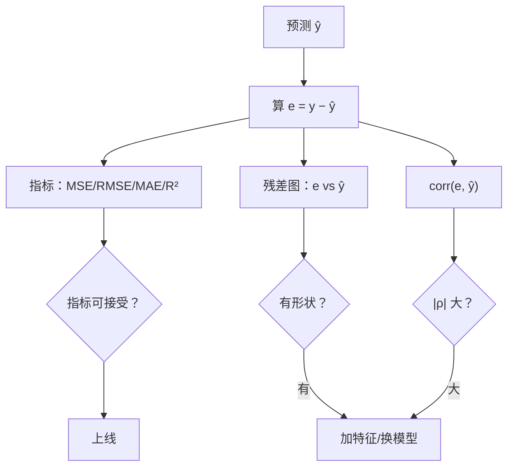

# ML-023 回归评价指标与残差诊断

## 1. 本节学习目标

1. 会用 MSE / RMSE / MAE / $R^2$ / MAPE，并说清各自的单位与偏好。
2. 能用**残差图**（残差 vs 预测值）判断模型是否漏掉结构。
3. 会算残差与预测值的相关系数，作为"有没有系统偏差"的量化信号。
4. 知道"残差均值≈0"是带截距模型的必然，不是质量指标。

## 2. 为什么需要这个知识

因为**指标是一个数，模型的问题是一个形状**。

同一份数据、同一个 MSE，可能是：

- 误差均匀散布（模型OK）
- 误差随预测值增大（异方差，置信区间不可信）
- 误差呈弧形（漏了二次项）
- 误差有系统性偏移（漏了关键特征）

只看 $R^2=0.46$ 你无法区分这些。残差诊断就是"把数字变成图形"的那一步。

## 3. 直观解释

残差 = **真实 − 预测**。

$$e_i = y_i - \hat y_i$$

理想的残差图：**围绕 0 随机散布，没有形状**。

| 形状 | 含义 | 处方 |
|---|---|---|
| 随机云 | 好 | — |
| 弧形/碗形 | 漏了非线性项 | 加多项式特征 |
| 喇叭形 | 异方差 | 变换目标/加权 |
| 斜率 | 系统性偏差 | 检查截距/特征 |
| 少量远点 | 异常值 | 见 ML-012 |

## 4. 正式定义

| 指标 | 公式 | 单位 | 偏好 |
|---|---|---|---|
| MSE | $\frac1n\sum e_i^2$ | $y^2$ | 重罚大误差 |
| RMSE | $\sqrt{\text{MSE}}$ | $y$ | 与 $y$ 同单位 |
| MAE | $\frac1n\sum\lvert e_i\rvert$ | $y$ | 抗异常值 |
| $R^2$ | $1-\frac{\sum e_i^2}{\sum(y_i-\bar y)^2}$ | 无量纲 | 相对"猜均值"的提升 |
| MAPE | $\frac{100\%}{n}\sum\left\lvert\frac{e_i}{y_i}\right\rvert$ | % | 相对误差，$y$ 接近 0 时爆炸 |

**残差相关系数**（本课用它做量化诊断）

$$
\rho_{e,\hat y} = \operatorname{corr}(e,\ \hat y)
$$

$|\rho|$ 明显大于 0 ⇒ 残差里还有结构 ⇒ 模型没吃干净信息。

## 5. 核心原理

**RMSE ≥ MAE 恒成立**，比值反映误差集中度：

$$
\text{RMSE} \ge \text{MAE},\qquad \frac{\text{RMSE}}{\text{MAE}} \approx 1 \Rightarrow \text{误差均匀}
$$

比值远大于 1（如 >1.5）⇒ 少数大误差主导。

**本课实测**：RMSE 55.5、MAE 46.1 ⇒ 比值 **1.20**，误差分布尚可但存在少量较大误差。

**为什么残差均值≈0**：只要模型含截距，最小二乘的正规方程强制 $\sum e_i=0$。所以"残差均值 -0.54"只是数值误差，**不是模型好的证据**。

## 6. 数学表达式

**本课结果**（Ridge $\alpha=1$，未标准化，diabetes 测试集）

$$
\text{MSE}=3077.4,\quad \text{RMSE}=55.5,\quad \text{MAE}=46.1,\quad R^2=0.4192
$$

**残差统计**

$$
\bar e = -0.54,\qquad s_e = 55.47,\qquad \rho_{e,\hat y}=0.238
$$

**解读**：$\rho=0.238$ 说明残差与预测值**弱正相关**——存在轻微的系统偏差（预测值越大，残差略偏正），提示模型在高值区略微低估。

## 7. 数学库链接

| 用到的数学 | 对应篇目 | 用在哪 |
|---|---|---|
| 均值/方差/相关系数 | [[MATH-306 期望、方差与协方差]] | 残差统计与 $\rho$ |
| 最小二乘性质 | [[MATH-451 最小二乘与回归统计]] | 残差均值为 0、正交性 |

## 8. 算法执行流程



## 9. 可视化解释

```text
好：随机云              坏：弧形（漏二次项）
 e                      e
 │ ·  ·   ·             │ ·      ·
 │   ·  ·  ·            │   ·  ·
─┼──────────► ŷ        ─┼──────────► ŷ
 │  ·   ·               │      ·  · ·
```

## 10. Python 实现

```powershell
python ml023_metrics.py
```

```python
import numpy as np
from sklearn.datasets import load_diabetes
from sklearn.linear_model import Ridge
from sklearn.metrics import mean_absolute_error, mean_squared_error, r2_score
from sklearn.model_selection import train_test_split

X, y = load_diabetes(return_X_y=True)
X_train, X_test, y_train, y_test = train_test_split(X, y, test_size=0.2, random_state=42)

model = Ridge(alpha=1.0).fit(X_train, y_train)
pred = model.predict(X_test)
resid = y_test - pred

print("MSE :", round(mean_squared_error(y_test, pred), 1))
print("RMSE:", round(mean_squared_error(y_test, pred) ** 0.5, 1))
print("MAE :", round(mean_absolute_error(y_test, pred), 1))
print("R2  :", round(r2_score(y_test, pred), 4))
print("RMSE/MAE:", round((mean_squared_error(y_test, pred) ** 0.5)
                         / mean_absolute_error(y_test, pred), 2))
print("残差均值:", round(float(resid.mean()), 2), " 标准差:", round(float(resid.std()), 2))
print("残差与预测值相关:", round(float(np.corrcoef(resid, pred)[0, 1]), 3))
print("残差最大绝对值:", round(float(np.abs(resid).max()), 1))
```

**实际运行结果**

```
MSE : 3077.4
RMSE: 55.5
MAE : 46.1
R2  : 0.4192
RMSE/MAE: 1.2
残差均值: -0.54  标准差: 55.47
残差与预测值相关: 0.238
残差最大绝对值: 143.9
```

## 11. 代码逐行解释

| 代码 | 作用 |
|---|---|
| `mean_squared_error(y, pred)` | 真实在前、预测在后 |
| `** 0.5` | RMSE = MSE 开方，回到原单位 |
| `r2_score` | 相对"猜均值"的提升 |
| `resid = y_test - pred` | 残差定义（**真实减预测**） |
| `np.corrcoef(resid, pred)[0,1]` | 取相关系数矩阵的上三角 |
| `np.abs(resid).max()` | 最大单点误差，看极端情况 |

**读法**：RMSE 55.5 意味着"平均偏离约 55（mg/dL 量级）"，而目标 $y$ 的均值约 152——**相对误差约 36%**，模型只能算"粗筛"。

## 12. 实际运行结果

见第 10 节。三点：

1. **RMSE/MAE = 1.2**：误差分布较均匀，没有极端值主导（>1.5 才需警惕）。
2. **$\rho_{e,\hat y}=0.238$**：弱正相关 ⇒ 轻微系统性偏差，值得在残差图上确认。
3. **最大残差 143.9**：存在个别大偏差样本，应检查是否为异常值或"特殊病人"。

## 13. 适用场景

| 目标 | 指标 |
|---|---|
| 报告"平均误差多少钱" | MAE |
| 惩罚大误差 | RMSE |
| 跨目标比较 | $R^2$ |
| 相对误差（销量预测） | MAPE（$y$ 不接近 0） |
| 诊断模型问题 | **残差图 + $\rho_{e,\hat y}$** |

## 14. 优点与缺点

| 指标 | 优点 | 缺点 |
|---|---|---|
| MSE | 可导、优化友好 | 单位是平方，不好解释 |
| RMSE | 同单位、惩罚大误差 | 被极值主导 |
| MAE | 直观、稳健 | 不可导 |
| $R^2$ | 无量纲、可比 | 随特征数单调增 |
| MAPE | 相对误差直观 | $y\to0$ 爆炸 |

## 15. 常见错误

| 错误 | 表现 | 纠正 |
|---|---|---|
| 参数顺序反了 | `mean_squared_error(pred, y)` 结果看似正常但含义错 | 用 `(y_true, y_pred)` |
| 只看 $R^2$ | 漏掉异方差/非线性 | 必看残差图 |
| 认为残差均值为 0 = 好 | 数学必然 | 看形状与 $\rho$ |
| 在训练集上报指标 | 虚高 | 用测试集 |
| 用 MAPE 且 $y$ 有 0 | `inf` | 换 MAE/RMSE |
| $R^2$ 比不同特征数模型 | 偏向特征多的 | 用调整 $R^2$ |

## 16. 本节总结

- 指标回答"差多少"，残差图回答"**为什么差**"。
- RMSE/MAE 比值判断误差集中度（1.2 = 均匀）。
- $\rho_{e,\hat y}$ 是"残差里还有没有结构"的量化信号。

## 17. 前置与后续

- 前置：[[ML-022 Lasso 与 Elastic Net]]、[[ML-017 回归任务基本概念]]
- 后续：`ML-024 分类任务基本概念`、`ML-043 混淆矩阵与分类指标`（待建）、`ML-044 ROC 曲线与 AUC`（待建）
- 相关数学：[[MATH-451 最小二乘与回归统计]]、[[MATH-306 期望、方差与协方差]]

## 18. 练习与参考答案

**基础 1**：RMSE 与 MAE 的区别是什么？RMSE/MAE = 1.2 说明什么？

**基础 2**：为什么带截距的线性回归，残差均值必然为 0？

**进阶 1**：残差与预测值相关系数 0.238，意味着什么？该怎么处理？

**综合 1**：本课 $R^2=0.4192$，$y$ 均值约 152，请估算 RMSE 相对误差并说明业务含义。

> [!success]- 参考答案

> **基础 1**
> MAE 是误差绝对值的平均（对每个误差等权）；RMSE 是平方平均再开方（**放大**大误差）。
> RMSE/MAE = 1.2 接近 1，说明误差分布较均匀、没有少数极端误差主导（若比值 >1.5 则说明有显著离群误差）。

> **基础 2**
> 含截距时，最小二乘的正规方程 $\mathbf{X}^\top(\mathbf{X}\mathbf{w}-\mathbf{y})=0$ 的第一行对应截距列（全 1），即 $\sum(\hat y_i-y_i)=0$ ⇒ $\sum e_i=0$ ⇒ $\bar e=0$。
> 所以"残差均值≈0"是**结构必然**，不是模型质量证据。

> **进阶 1**
> 说明残差与预测值有**弱正相关**：预测值偏大时残差也偏正（即模型在高值区略微**低估**）。
> 这提示存在未建模的非线性或遗漏特征。
> 处理：①画残差图确认形状；②加多项式/交互特征；③若呈喇叭形，对目标做对数变换或加权最小二乘。

> **综合 1**
> 目标均值约 152，RMSE 55.5 ⇒ 相对误差
> $$\frac{55.5}{152} \approx 36.5\%$$
> 业务含义：预测"血糖进展指标"时平均偏 55 个单位，约为均值的 1/3——**只适合粗筛或趋势判断**，不能作为单点决策依据（如个体用药剂量）。

---

## 🔗 Notion 同步信息

> 以下内容由 Notion「AI Knowledge System · 知识点」数据库按知识 ID 合并而来（导出于 2026-11-09）。

| 属性 | 值 |
|---|---|
| 学科 | 机器学习 |
| 学习状态 | 未开始 |
| 难度 | L2 应用 |
| 知识类型 | Technique |

- **所属模块**：[M-ML-03 监督学习——回归](../%E8%AF%BE%E7%A8%8B%E6%A8%A1%E5%9D%97/M-ML-03%20%E7%9B%91%E7%9D%A3%E5%AD%A6%E4%B9%A0%E2%80%94%E2%80%94%E5%9B%9E%E5%BD%92.md)
- **前置知识**：[ML-022 Lasso 与 Elastic Net](ML-022%20Lasso%20%E4%B8%8E%20Elastic%20Net.md)
- **后继知识**：[ML-024 分类任务基本概念](ML-024%20%E5%88%86%E7%B1%BB%E4%BB%BB%E5%8A%A1%E5%9F%BA%E6%9C%AC%E6%A6%82%E5%BF%B5.md)
- **关联Python**：[PY-067 聚合与统计](../../01_Python%E5%9F%BA%E7%A1%80/08%20NumPy/PY-067%20%E8%81%9A%E5%90%88%E4%B8%8E%E7%BB%9F%E8%AE%A1.md)
- **关联数学**：[MATH-451 最小二乘与回归统计](../../06_%E6%95%B0%E5%AD%A6%E5%9F%BA%E7%A1%80/04%20%E6%95%B0%E7%90%86%E7%BB%9F%E8%AE%A1/MATH-451%20%E6%9C%80%E5%B0%8F%E4%BA%8C%E4%B9%98%E4%B8%8E%E5%9B%9E%E5%BD%92%E7%BB%9F%E8%AE%A1.md) · [MATH-306 期望、方差与协方差](../../06_%E6%95%B0%E5%AD%A6%E5%9F%BA%E7%A1%80/03%20%E6%A6%82%E7%8E%87%E8%AE%BA/MATH-306%20%E6%9C%9F%E6%9C%9B%E3%80%81%E6%96%B9%E5%B7%AE%E4%B8%8E%E5%8D%8F%E6%96%B9%E5%B7%AE.md)
