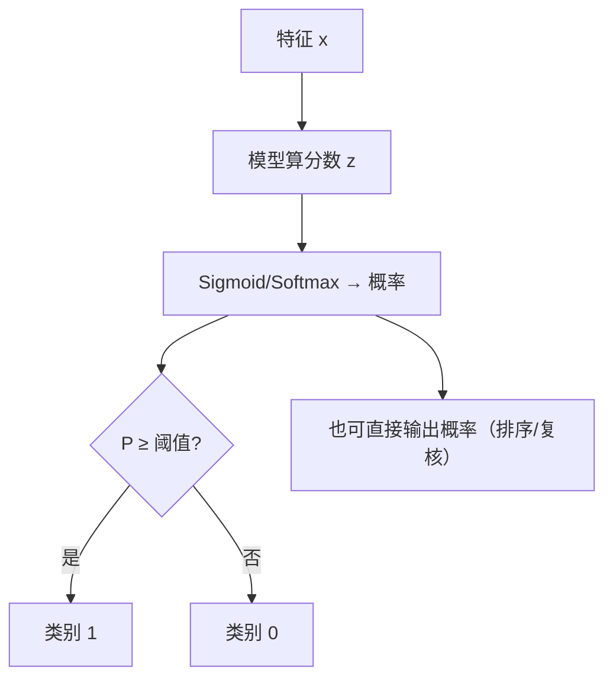

# ML-024 分类任务基本概念

## 1. 本节学习目标

1. 说清分类与回归的分界，识别二分类/多分类/多标签。
2. 理解"模型输出概率，阈值决定类别"这两步。
3. 会用 `predict` 与 `predict_proba`，并验证二者关系。
4. 知道准确率为什么会骗人（类别不平衡）。

## 2. 为什么需要这个知识

因为分类任务里**最危险的一步是"把概率当答案"**。

模型输出的是 $P(y=1\mid x)=0.87$，而业务要的是"是/否"。中间那个 **0.5 阈值是人为选的**，不是模型给的。改阈值就能改混淆矩阵、改精确率/召回率——很多"模型效果不好"其实是阈值选错了。

## 3. 直观解释

分类两步走：

1. 模型算一个**分数/概率**（连续）。
2. 用**阈值**把它切成类别（离散）。

```
概率 0.87 ──阈值0.5──► 类别 1
概率 0.45 ──阈值0.5──► 类别 0
概率 0.45 ──阈值0.3──► 类别 1   ← 同一个模型，不同阈值
```

| 类型 | 例子 | 输出 |
|---|---|---|
| 二分类 | 是否违约 | 1 个概率 |
| 多分类 | 数字 0–9 | $K$ 个概率（和为 1） |
| 多标签 | 一张图有猫又有狗 | $K$ 个独立概率（不必和为 1） |

## 4. 正式定义

**模型**

$$
P(y=k\mid\mathbf{x}) = f_k(\mathbf{x}), \qquad \hat y = \arg\max_k f_k(\mathbf{x})
$$

**二分类阈值**

$$
\hat y = \mathbb{1}\big[P(y=1\mid\mathbf{x}) \ge \tau\big], \qquad \tau \text{ 默认 } 0.5
$$

**准确率**

$$
\text{Acc} = \frac{\text{预测正确的样本数}}{n}
$$

**不平衡下的陷阱**：若正类占 1%，一个"永远预测负类"的模型准确率 **99%**，但毫无价值。

## 5. 核心原理

**为什么 0.5 不是金标准**：

- 漏判代价高（癌症筛查）⇒ 降低阈值，宁可误报。
- 误报代价高（自动扣款）⇒ 提高阈值，宁可漏判。

**阈值与指标的关系**：降低阈值 ⇒ 召回率↑、精确率↓（见 ML-043/044）。

**为什么输出概率而不只输出类别**：概率携带"置信度"，可排序（风控按分数排队人工复核），也可换阈值复用同一个模型。

## 6. 数学表达式

**本课数据**：breast cancer，569 条，类别分布 $[212, 357]$（负类 212、正类 357）。

**模型输出**（前 3 条的预测概率）

$$
\begin{bmatrix}0.031 & 0.969\\ 1.0 & 0.0\\ 0.441 & 0.559\end{bmatrix}
$$

**准确率与混淆矩阵**

$$
\text{Acc} = \frac{52+89}{52+1+1+89} = \frac{141}{143} \approx 0.9860
$$

$$
\text{CM} = \begin{bmatrix}52 & 1\\ 1 & 89\end{bmatrix}
$$

**关系验证**：`predict` 与"$P\ge0.5$ 取 1"**完全一致**（实跑 `True`）。

## 7. 数学库链接

| 用到的数学 | 对应篇目 | 用在哪 |
|---|---|---|
| 条件概率 | [[MATH-301 概率基础与条件概率]] | $P(y\mid x)$ 的含义 |
| Sigmoid 与阈值 | [[MATH-802 逻辑回归与 Sigmoid]] | 概率如何被切成类别 |
| 集合划分 | [[MATH-501 集合与集合运算]] | 混淆矩阵的四格划分 |

## 8. 算法执行流程



## 9. 可视化解释

```text
概率分布（两类样本）
负类 │▮▮▮▮╲
正类 │      ╲▮▮▮▮
     └──┬───┬───┬──► P(y=1)
      0.2  0.5  0.8
           ↑阈值
      往左移 ⇒ 更多判正 ⇒ 召回↑ 精确↓
```

## 10. Python 实现

```powershell
python ml024_classification_intro.py
```

```python
import numpy as np
from sklearn.datasets import load_breast_cancer
from sklearn.linear_model import LogisticRegression
from sklearn.metrics import accuracy_score, confusion_matrix
from sklearn.model_selection import train_test_split
from sklearn.pipeline import Pipeline
from sklearn.preprocessing import StandardScaler

X, y = load_breast_cancer(return_X_y=True)
print("类别分布:", np.bincount(y).tolist(), " 类别名:", ["malignant", "benign"])

X_train, X_test, y_train, y_test = train_test_split(
    X, y, test_size=0.25, random_state=42, stratify=y)

clf = Pipeline([("sc", StandardScaler()),
                ("lr", LogisticRegression(max_iter=2000))]).fit(X_train, y_train)

pred = clf.predict(X_test)
proba = clf.predict_proba(X_test)

print("准确率:", round(accuracy_score(y_test, pred), 4))
print("混淆矩阵:\n", confusion_matrix(y_test, pred))
print("前 3 条概率:", proba[:3].round(3).tolist())
print("predict == (P>=0.5):", bool((pred == (proba[:, 1] >= 0.5).astype(int)).all()))

# 换阈值看看
for tau in (0.3, 0.5, 0.8):
    pred_tau = (proba[:, 1] >= tau).astype(int)
    print(f"阈值 {tau}: 判正数 {int(pred_tau.sum())}  准确率 {accuracy_score(y_test, pred_tau):.4f}")
```

**实际运行结果**

```
类别分布: [212, 357]  类别名: ['malignant', 'benign']
准确率: 0.986
混淆矩阵:
 [[52  1]
 [ 1 89]]
前 3 条概率: [[0.031, 0.969], [1.0, 0.0], [0.441, 0.559]]
predict == (P>=0.5): True
阈值 0.3: 判正数 93  准确率 0.9790
阈值 0.5: 判正数 90  准确率 0.9860
阈值 0.8: 判正数 85  准确率 0.9510
```

## 11. 代码逐行解释

| 代码 | 作用 |
|---|---|
| `np.bincount(y)` | 统计每类样本数 ⇒ 检查是否平衡 |
| `stratify=y` | 分层划分，保持类别比例 |
| `predict_proba` | 返回 $(n,2)$ 概率矩阵，列对应类别顺序 |
| `proba[:, 1]` | 取"正类"概率 |
| `(proba[:,1] >= tau)` | 手动实现阈值切分 |
| `predict == (P>=0.5)` | 验证 sklearn 默认行为 |

**关键观察**（实跑）：阈值 0.5 → 0.3，判正数 90 → 93，准确率 0.9860 → **0.9790**（降低）；阈值 0.5 → 0.8，判正数 90 → 85，准确率 0.9860 → **0.9510**（明显降低）。这说明：

- 阈值改变的是**判正的数量**，准确率随之变化；在这份数据上 0.5 恰好落在最优区间；
- 但准确率**掩盖了"错在哪一类"**，真正该看的是精确率/召回率（见 ML-043）与 ROC/PR（ML-044/045）。

## 12. 实际运行结果

见第 10 节。三点：

1. 数据轻度不平衡（212 vs 357，约 6:4），准确率仍有参考价值。
2. 混淆矩阵 `[[52,1],[1,89]]`：只错 2 条（1 个假阳、1 个假阴）。
3. 阈值扫描显示：**准确率对阈值不敏感，但判正数变了**——这正是"要看 PR/ROC"的原因。

## 13. 适用场景

| 场景 | 关注点 |
|---|---|
| 癌症筛查 | 阈值调低，保召回 |
| 垃圾邮件 | 阈值可高，保精确（别误删正常邮件） |
| 风控 | 输出概率排序，人工复核 Top-N |
| 多分类 | 用 Softmax，取最大概率 |
| 多标签 | 每类独立 Sigmoid，阈值分别设 |

## 14. 优点与缺点

| 分类框架 | 优点 | 缺点 |
|---|---|---|
| 直接输出类别 | 简单 | 丢失置信度、无法调阈值 |
| 输出概率 | 可排序、可调阈值、可复用 | 概率可能过度自信（需校准） |
| 硬阈值 0.5 | 默认省事 | 常不是业务最优 |

## 15. 常见错误

| 错误 | 表现 | 纠正 |
|---|---|---|
| 只用准确率 | 不平衡时虚高 | 看精确率/召回率/F1 |
| 认为 0.5 最优 | 业务代价不对称 | 按代价调阈值 |
| 把 `predict_proba` 当 `predict` | 类型不符 | 用途不同 |
| 概率未校准就信"90% 把握" | 过度自信 | 用校准曲线/Platt scaling |
| 划分不分层 | 小类在某侧过少 | `stratify=y` |
| 多分类用 Sigmoid | 概率和不等于 1 | 用 Softmax |

## 16. 本节总结

- 分类 = **算概率 + 选阈值**，两步分开看。
- `predict` 就是 `P>=0.5`（实跑验证 True）。
- 阈值是业务参数，不是模型参数。
- 不平衡数据上，准确率会骗人。

## 17. 前置与后续

- 前置：[[ML-023 回归评价指标与残差诊断]]、[[ML-002 机器学习三大范式]]
- 后续：[[ML-025 逻辑回归]]、`ML-030 决策边界与分类阈值`（待建）、`ML-043 混淆矩阵与分类指标`（待建）
- 相关数学：[[MATH-301 概率基础与条件概率]]、[[MATH-802 逻辑回归与 Sigmoid]]

## 18. 练习与参考答案

**基础 1**：二分类、多分类、多标签三者的输出形式有什么不同？

**基础 2**：为什么说 0.5 阈值是"人为选择"而不是模型给的？

**进阶 1**：数据 99% 是负类，一个"全预测负类"的模型准确率多少？为什么不能用它？

**综合 1**：本课阈值从 0.5 调到 0.3，判正数与准确率各如何变化？说明该看什么指标。

> [!success]- 参考答案

> **基础 1**
> - 二分类：1 个概率（$P(y=1)$），另一类为 $1-P$。
> - 多分类：$K$ 个概率，**和为 1**（Softmax）。
> - 多标签：$K$ 个**独立**概率，各自可 $>0.5$，**不必和为 1**（每类一个 Sigmoid）。

> **基础 2**
> 模型只输出概率，"切在哪"是**决策规则**。同一模型配不同阈值就是不同业务策略：筛查要低阈值（保召回），自动扣款要高阈值（保精确）。
> sklearn 的 `predict` 默认用 0.5 只是约定，可以用 `predict_proba` 自己切。

> **进阶 1**
> 准确率 = **99%**（把所有样本都预测为负类，只错 1%）。
> 不能用：它对任何正类都判错，**召回率为 0**，业务上完全无效。这正说明"不平衡数据必须看精确率/召回率/AUC，而不是准确率"。

> **综合 1**
> | 阈值 | 判正数 | 准确率 |
> |---|---|---|
> | 0.3 | 93 | 0.9790 |
> | 0.5 | 90 | **0.9860** |
> | 0.8 | 85 | 0.9510 |
>
> 阈值降低 ⇒ 判正数增加（90 → 93），准确率**反而降**（0.9860 → 0.9790）；阈值升到 0.8 ⇒ 判正 85、准确率 0.9510（降更多）。
> 说明：**准确率掩盖了"错在哪一类"**；且"准确率最高的阈值"未必是业务最优（筛查宁可降准确率换召回）。应该看混淆矩阵、精确率、召回率（ML-043）与 ROC/PR（ML-044/045）。

---

## 🔗 Notion 同步信息

> 以下内容由 Notion「AI Knowledge System · 知识点」数据库按知识 ID 合并而来（导出于 2026-11-09）。

| 属性 | 值 |
|---|---|
| 学科 | 机器学习 |
| 学习状态 | 未开始 |
| 难度 | L1 概念 |
| 知识类型 | Concept |

- **所属模块**：[M-ML-04 监督学习——分类](../%E8%AF%BE%E7%A8%8B%E6%A8%A1%E5%9D%97/M-ML-04%20%E7%9B%91%E7%9D%A3%E5%AD%A6%E4%B9%A0%E2%80%94%E2%80%94%E5%88%86%E7%B1%BB.md)
- **前置知识**：[ML-023 回归评价指标与残差诊断](ML-023%20%E5%9B%9E%E5%BD%92%E8%AF%84%E4%BB%B7%E6%8C%87%E6%A0%87%E4%B8%8E%E6%AE%8B%E5%B7%AE%E8%AF%8A%E6%96%AD.md)
- **后继知识**：[ML-025 逻辑回归](ML-025%20%E9%80%BB%E8%BE%91%E5%9B%9E%E5%BD%92.md)
- **关联数学**：[MATH-501 集合与集合运算](../../06_%E6%95%B0%E5%AD%A6%E5%9F%BA%E7%A1%80/05%20%E7%A6%BB%E6%95%A3%E6%95%B0%E5%AD%A6/MATH-501%20%E9%9B%86%E5%90%88%E4%B8%8E%E9%9B%86%E5%90%88%E8%BF%90%E7%AE%97.md) · [MATH-802 逻辑回归与 Sigmoid](../../06_%E6%95%B0%E5%AD%A6%E5%9F%BA%E7%A1%80/08%20%E6%9C%BA%E5%99%A8%E5%AD%A6%E4%B9%A0%E6%95%B0%E5%AD%A6%E5%BA%94%E7%94%A8/MATH-802%20%E9%80%BB%E8%BE%91%E5%9B%9E%E5%BD%92%E4%B8%8E%20Sigmoid.md)
