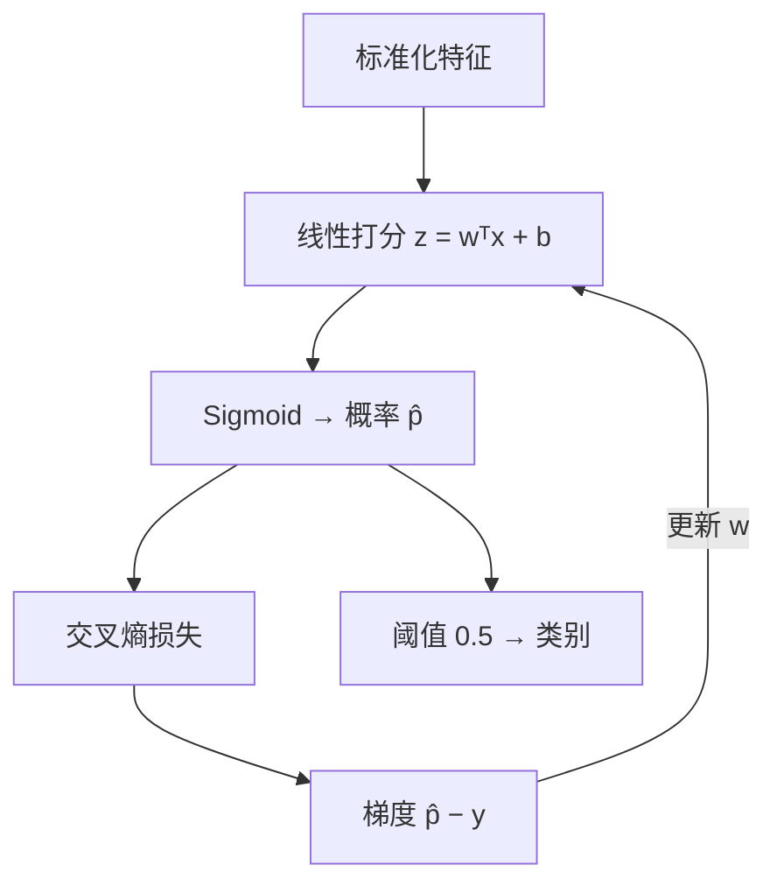

# ML-025 逻辑回归

## 1. 本节学习目标

1. 写出逻辑回归的模型与损失，说清它"为什么叫回归却是分类器"。
2. 会用 `C`（正则强度倒数）调节过拟合，并观察准确率变化。
3. 能读系数：**系数是 log-odds**，可解释为"每单位特征的胜算倍数"。
4. 知道逻辑回归的决策边界是**线性**的。

## 2. 为什么需要这个知识

因为逻辑回归是**工业界最常用的基线分类器**：训练快、可解释、输出概率、几乎不需要调参。

它也是理解神经网络的台阶：单个神经元 + Sigmoid = 逻辑回归；理解它的梯度 $p-y$，才能理解深层网络的反向传播。

## 3. 直观解释

**三步**：

1. 线性打分：$z = w^\top x + b$
2. 压成概率：$\hat p = \sigma(z) = \dfrac{1}{1+e^{-z}}$
3. 阈值分类：$\hat y = \mathbb{1}[\hat p\ge0.5]$

**名字的由来**：它用线性回归的方式算 $z$，再用 logistic 函数变成概率，所以叫"逻辑（logistic）回归"，但输出是**类别**。

**系数怎么读**：$w_j$ 是"$x_j$ 每增加 1 单位，**对数胜算**（log-odds）增加 $w_j$"。取指数 $e^{w_j}$ 就是"胜算倍数"（odds ratio）。

## 4. 正式定义

**模型**

$$
\hat p = \sigma(\mathbf{w}^\top\mathbf{x}+b),\qquad \sigma(z)=\frac{1}{1+e^{-z}}
$$

**损失（对数损失/交叉熵）**

$$
L = -\frac1n\sum_{i=1}^{n}\Big[y_i\ln\hat p_i + (1-y_i)\ln(1-\hat p_i)\Big]
$$

**梯度**

$$
\frac{\partial L}{\partial \mathbf{w}} = \frac1n\sum_i (\hat p_i-y_i)\mathbf{x}_i
$$

**正则化（sklearn 默认 L2）**

$$
L + \frac{1}{2C}\|\mathbf{w}\|_2^2
$$

**注意**：sklearn 用 $C$（**正则强度的倒数**）：$C$ 越小 ⇒ 正则越强。

**决策边界**：$\mathbf{w}^\top\mathbf{x}+b=0$，是一个**超平面**。

## 5. 核心原理

**为什么不用 MSE**：MSE + Sigmoid 的梯度含 $\sigma'(z)=\hat p(1-\hat p)$，在预测严重错误（$\hat p\approx0$ 而 $y=1$）时 $\sigma'\approx0$ ⇒ **梯度消失，学不动**。

交叉熵的梯度是 $\hat p-y$，此时 $\approx-1$，梯度很大，能快速纠正（推导见 [[MATH-802 逻辑回归与 Sigmoid]]）。

**为什么必须标准化**：L2 正则对系数尺度敏感；且不同特征量纲差异会让收敛变慢。

**$C$ 的影响**（本课实测，breast cancer）

| $C$ | 测试准确率 | 说明 |
|---|---|---|
| 0.01 | 0.9371 | 正则过强，欠拟合 |
| 1.0 | **0.9860** | 默认值，最好 |
| 100.0 | 0.9441 | 正则过弱，过拟合 |

## 6. 数学表达式

**本课模型**（标准化 + 逻辑回归，默认参数）

$$
\text{test acc}=0.9860,\qquad b=0.281
$$

**系数范围**

$$
w \in [-1.250,\ 0.694]
$$

**绝对值最大的 3 个特征索引**：$[28,\ 10,\ 21]$（对应 breast cancer 的 worst concave points / radius error / worst texture 等）。

**胜算倍数解读**：$w=0.694$ ⇒ $e^{0.694}\approx2.00$，即该特征每增 1 个标准差，**正类胜算翻倍**。

## 7. 数学库链接

| 用到的数学 | 对应篇目 | 用在哪 |
|---|---|---|
| Sigmoid 与梯度 $p-y$ | [[MATH-802 逻辑回归与 Sigmoid]] | 模型的完整推导 |
| 交叉熵与 KL | [[MATH-507 交叉熵与 KL 散度]] | 损失的来历 |
| 最大似然 | [[MATH-404 最大似然估计]] | 交叉熵=负对数似然 |

## 8. 算法执行流程



## 9. 可视化解释

```text
Sigmoid
 1 ┤        ╭──────
   │     ╱
0.5┤───╱
   │ ╱
 0 ┴────────────► z
   -4   0   +4
   决策边界在 z=0（即 wᵀx+b=0）
```

## 10. Python 实现

```powershell
python ml025_logistic.py
```

```python
import numpy as np
from sklearn.datasets import load_breast_cancer
from sklearn.linear_model import LogisticRegression
from sklearn.model_selection import train_test_split
from sklearn.pipeline import Pipeline
from sklearn.preprocessing import StandardScaler

X, y = load_breast_cancer(return_X_y=True)
X_train, X_test, y_train, y_test = train_test_split(
    X, y, test_size=0.25, random_state=42, stratify=y)

for C in (0.01, 1.0, 100.0):
    model = Pipeline([("sc", StandardScaler()),
                      ("lr", LogisticRegression(C=C, max_iter=2000))]).fit(X_train, y_train)
    print(f"C={C:>6}: test acc={model.score(X_test, y_test):.4f}")

model = Pipeline([("sc", StandardScaler()),
                  ("lr", LogisticRegression(max_iter=2000))]).fit(X_train, y_train)
coef = model.named_steps["lr"].coef_[0]
print("系数范围:", round(float(coef.min()), 3), "~", round(float(coef.max()), 3))
print("|系数| 最大的 3 个特征索引:", np.argsort(np.abs(coef))[-3:].tolist())
print("截距:", round(float(model.named_steps["lr"].intercept_[0]), 3))
print("胜算倍数(最大系数):", round(float(np.exp(coef.max())), 2))
```

**实际运行结果**

```
C=  0.01: test acc=0.9371
C=   1.0: test acc=0.9860
C= 100.0: test acc=0.9441
系数范围: -1.25 ~ 0.694
|系数| 最大的 3 个特征索引: [28, 10, 21]
截距: 0.281
胜算倍数(最大系数): 2.0
```

## 11. 代码逐行解释

| 代码 | 作用 |
|---|---|
| `LogisticRegression(C=C)` | $C$ 是正则强度**倒数**：越小越强 |
| `max_iter=2000` | 防不收敛警告（标准化后通常 1000 够） |
| `model.score` | 分类器默认返回**准确率** |
| `np.argsort(np.abs(coef))[-3:]` | 取绝对值最大的 3 个索引 |
| `np.exp(coef.max())` | 系数 → 胜算倍数 |

**$C$ 的读法容易反**：$C=0.01$ 表示"正则很强"（等价 $\lambda=100$），$C=100$ 表示"几乎不正则"。本课 $C=1$ 最好，两端都掉分——典型的"过强欠拟合 / 过弱过拟合"。

## 12. 实际运行结果

见第 10 节。三点：

1. $C=1$ 准确率 **0.9860**，$C=0.01$ 掉到 0.9371，$C=100$ 掉到 0.9441。
2. 系数范围 $[-1.25, 0.694]$，标准化后可比大小。
3. 最大正系数对应**胜算 2.0 倍**。

## 13. 适用场景

| 场景 | 说明 |
|---|---|
| 二分类基线 | **首选**，几行代码就有强基线 |
| 需要概率输出 | 原生支持 |
| 需要可解释 | 系数=log-odds，业务能懂 |
| 线性可分或近似线性 | 效果好 |
| 高度非线性 | 需特征工程或换模型 |
| 多分类 | `multi_class="multinomial"` 或 Softmax |

## 14. 优点与缺点

| 优点 | 缺点 |
|---|---|
| 训练快、可解释、输出概率 | 只能学线性边界 |
| 不易过拟合（有正则） | 对异常值和共线敏感 |
| 系数可转胜算倍数 | 需标准化 |
| 是神经网络的基本单元 | 特征交互需手工构造 |

## 15. 常见错误

| 错误 | 表现 | 纠正 |
|---|---|---|
| 认为 $C$ 越大正则越强 | 方向反了 | $C$ 是倒数 |
| 不标准化 | 收敛慢、系数不可比 | 先 `StandardScaler` |
| 用 MSE 训练 | 梯度消失 | 用交叉熵 |
| 用系数直接说"因果" | 相关≠因果 | 只作相对重要性 |
| 概率当置信度 | 可能过度自信 | 需校准 |
| 不平衡数据用默认阈值 | 全判多数类 | 调 `class_weight`/阈值 |

## 16. 本节总结

- 逻辑回归 = **线性打分 + Sigmoid + 交叉熵**，输出概率、线性边界。
- 系数是 log-odds，$e^{w}$ 是胜算倍数。
- `C` 是正则强度倒数；本课 $C=1$ 最优（0.9860）。

## 17. 前置与后续

- 前置：[[ML-024 分类任务基本概念]]
- 后续：`ML-026 K 近邻`（待建）、`ML-030 决策边界与分类阈值`（待建）、`ML-031 多分类策略`（待建）
- 相关数学：[[MATH-802 逻辑回归与 Sigmoid]]、[[MATH-507 交叉熵与 KL 散度]]、[[MATH-404 最大似然估计]]

## 18. 练习与参考答案

**基础 1**：写出逻辑回归的模型与损失函数，并说明为什么它是分类器。

**基础 2**：`C=0.01` 与 `C=100` 哪个正则更强？本课两者准确率各是多少？

**进阶 1**：某特征系数 $w=0.694$，如何用业务语言解释？

**综合 1**：为什么逻辑回归不用 MSE 而用交叉熵？从梯度角度说明。

> [!success]- 参考答案

> **基础 1**
> $$\hat p=\sigma(\mathbf{w}^\top\mathbf{x}+b),\qquad L=-\frac1n\sum[y\ln\hat p+(1-y)\ln(1-\hat p)]$$
> 输出是**类别概率**，经阈值 $\hat y=\mathbb{1}[\hat p\ge0.5]$ 得到离散类别，所以是分类器。名字里的"回归"来自它内部用了线性打分。

> **基础 2**
> `C=0.01` 正则**更强**（$C$ 是正则强度倒数，等价 $\lambda=100$）。
> 本课：$C=0.01$ → 0.9371（正则过强，欠拟合）；$C=100$ → 0.9441（几乎不正则，过拟合）；$C=1$ → 0.9860 最好。

> **进阶 1**
> 标准化后，$x_j$ 每增加 1 个标准差，**正类的胜算（odds）变为原来的 $e^{0.694}\approx2$ 倍**。
> 等价说法：对数胜算增加 0.694。注意这是"在其它特征不变时"的边际效应，且**不代表因果**。

> **综合 1**
> MSE + Sigmoid 的梯度是 $(\hat p-y)\cdot\sigma'(z)$，其中 $\sigma'=\hat p(1-\hat p)$。
> 当预测严重错误（$\hat p\approx0$，$y=1$）时，$\sigma'\approx0$ ⇒ 梯度≈0 ⇒ **学不动**（错得越离谱，修正越慢）。
> 交叉熵的梯度是 $\hat p-y$，同样情形下 $\approx-1$，梯度大 ⇒ 快速纠正。

---

## 🔗 Notion 同步信息

> 以下内容由 Notion「AI Knowledge System · 知识点」数据库按知识 ID 合并而来（导出于 2026-11-09）。

| 属性 | 值 |
|---|---|
| 学科 | 机器学习 |
| 学习状态 | 未开始 |
| 难度 | L2 应用 |
| 知识类型 | Algorithm |

- **所属模块**：[M-ML-04 监督学习——分类](../%E8%AF%BE%E7%A8%8B%E6%A8%A1%E5%9D%97/M-ML-04%20%E7%9B%91%E7%9D%A3%E5%AD%A6%E4%B9%A0%E2%80%94%E2%80%94%E5%88%86%E7%B1%BB.md)
- **前置知识**：[ML-024 分类任务基本概念](ML-024%20%E5%88%86%E7%B1%BB%E4%BB%BB%E5%8A%A1%E5%9F%BA%E6%9C%AC%E6%A6%82%E5%BF%B5.md)
- **后继知识**：[ML-026 K 近邻](ML-026%20K%20%E8%BF%91%E9%82%BB.md)
- **关联Python**：[PY-067 聚合与统计](../../01_Python%E5%9F%BA%E7%A1%80/08%20NumPy/PY-067%20%E8%81%9A%E5%90%88%E4%B8%8E%E7%BB%9F%E8%AE%A1.md)
- **关联数学**：[MATH-802 逻辑回归与 Sigmoid](../../06_%E6%95%B0%E5%AD%A6%E5%9F%BA%E7%A1%80/08%20%E6%9C%BA%E5%99%A8%E5%AD%A6%E4%B9%A0%E6%95%B0%E5%AD%A6%E5%BA%94%E7%94%A8/MATH-802%20%E9%80%BB%E8%BE%91%E5%9B%9E%E5%BD%92%E4%B8%8E%20Sigmoid.md) · [MATH-507 交叉熵与 KL 散度](../../06_%E6%95%B0%E5%AD%A6%E5%9F%BA%E7%A1%80/05%20%E7%A6%BB%E6%95%A3%E6%95%B0%E5%AD%A6/MATH-507%20%E4%BA%A4%E5%8F%89%E7%86%B5%E4%B8%8E%20KL%20%E6%95%A3%E5%BA%A6.md)
