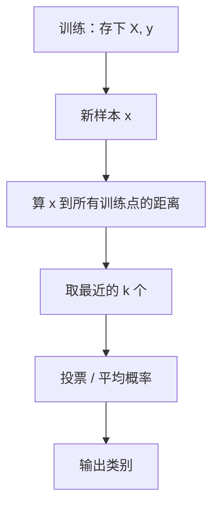

# ML-026 K 近邻

## 1. 本节学习目标

1. 说清 KNN 的"训练 = 记住数据、预测 = 投票"这一本质。
2. 会用 $k$ 扫描找拐点，理解 $k$ 小/大的偏差-方差后果。
3. 知道 KNN 必须标准化（距离对量纲敏感）。
4. 能读出 `predict_proba` 的"邻居投票比例"含义。

## 2. 为什么需要这个知识

因为 KNN 是**最直观的"非参数"模型**：没有需要学习的参数，只有超参 $k$。

它也是理解"距离度量"的最好入口——标准化、距离选择、维度灾难，都在它身上体现得最清楚。而且它有一个反直觉性质：**训练几乎零成本，预测很贵**。

## 3. 直观解释

KNN 的逻辑一句话：**看离它最近的 $k$ 个邻居是谁，多数说了算**。

| 步骤 | 做什么 | 成本 |
|---|---|---|
| 训练 | 把训练集存起来 | **O(1)**（几乎为零） |
| 预测 | 算到所有训练点的距离、取前 $k$、投票 | O(n·d) **很贵** |

**$k$ 的作用**：

- $k=1$：完全相信最近的那个点 ⇒ 方差大、易受噪声影响。
- $k$ 很大：看"整体多数" ⇒ 偏差大，可能把局部结构抹平。
- $k=n$：永远预测多数类。

## 4. 正式定义

**决策规则**

$$
\hat y = \operatorname{mode}\Big(\{y_i : \mathbf{x}_i \in N_k(\mathbf{x})\}\Big)
$$

**概率输出**

$$
\hat P(y=c\mid\mathbf{x}) = \frac{1}{k}\sum_{\mathbf{x}_i\in N_k(\mathbf{x})}\mathbb{1}[y_i=c]
$$

**距离**（默认欧氏）

$$
d(\mathbf{x},\mathbf{x}') = \sqrt{\sum_{j=1}^{d}(x_j-x'_j)^2}
$$

**曼哈顿距离**

$$
d_1 = \sum_j |x_j-x'_j|
$$

**复杂度**：训练 $O(1)$（只存储），预测 $O(nd + k\log k)$。

**非参数**：参数个数随数据增长，不是固定维向量。

## 5. 核心原理

**为什么必须标准化**：距离是各维差值的平方和。若"收入"是万级、"年龄"是十级，收入的差异会**完全主导**距离，年龄等于没参与。

本课实测印证（iris 未标准化）：

| 设定 | 测试准确率 |
|---|---|
| $k=5$，未标准化 | **0.9778** |
| $k=5$，标准化后 | 0.9111 |

**注意方向**：这次标准化**反而降分**——因为 iris 四个特征本就同为厘米级，标准化只带来扰动。这与 ML-014 的结论一致：**缩放修正量纲误导，不是无条件加分**。

**$k$ 的偏差-方差**：$k$ 小 ⇒ 方差大（对噪声敏感）；$k$ 大 ⇒ 偏差大（决策边界变平滑）。

## 6. 数学表达式

**本课 $k$ 扫描**（iris，未标准化，70/30 划分）

| $k$ | 1 | 3 | 5 | 15 | 45 |
|---|---|---|---|---|---|
| 准确率 | 0.9333 | 0.9556 | **0.9778** | 0.9556 | 0.8889 |

**交叉验证选 $k$**：`GridSearchCV` 选出 $k=3$，CV 准确率 0.9619。

**为什么 CV 选 3 而单次划分选 5**：单次划分的 45 条测试集波动大，$k=5$ 的 0.9778 有运气成分；CV 用 5 折平均，更可靠。

## 7. 数学库链接

| 用到的数学 | 对应篇目 | 用在哪 |
|---|---|---|
| 向量与距离 | [[MATH-201 向量与空间基础]] | 欧氏/曼哈顿距离 |
| 矩阵运算 | [[MATH-216 矩阵乘法]] | 批量计算距离矩阵 |

## 8. 算法执行流程



## 9. 可视化解释

```text
k=3 投票
      ● 类0
   ○  ●   ← 查询点 x
      ○ 类1

最近的 3 个：● ● ○ ⇒ 判为类 0（2:1）
```

## 10. Python 实现

```powershell
python ml026_knn.py
```

```python
import numpy as np
from sklearn.datasets import load_iris
from sklearn.model_selection import GridSearchCV, train_test_split
from sklearn.neighbors import KNeighborsClassifier
from sklearn.pipeline import Pipeline
from sklearn.preprocessing import StandardScaler

X, y = load_iris(return_X_y=True)
X_train, X_test, y_train, y_test = train_test_split(
    X, y, test_size=0.3, random_state=42, stratify=y)

for k in (1, 3, 5, 15, 45):
    model = KNeighborsClassifier(n_neighbors=k).fit(X_train, y_train)
    print(f"k={k:>2}: acc={model.score(X_test, y_test):.4f}")

best = KNeighborsClassifier(n_neighbors=5).fit(X_train, y_train)
print("5-NN 概率前 2:", best.predict_proba(X_test[:2]).round(3).tolist())

gs = GridSearchCV(Pipeline([("sc", StandardScaler()), ("knn", KNeighborsClassifier())]),
                  {"knn__n_neighbors": [1, 3, 5, 7, 9, 11]}, cv=5).fit(X_train, y_train)
print("最佳 k:", gs.best_params_, " CV acc:", round(float(gs.best_score_), 4))

for metric in ("euclidean", "manhattan"):
    model = Pipeline([("sc", StandardScaler()),
                      ("knn", KNeighborsClassifier(5, metric=metric))]).fit(X_train, y_train)
    print(f"metric={metric}: acc={model.score(X_test, y_test):.4f}")
```

**实际运行结果**

```
k= 1: acc=0.9333
k= 3: acc=0.9556
k= 5: acc=0.9778
k=15: acc=0.9556
k=45: acc=0.8889
5-NN 概率前 2: [[0.0, 0.0, 1.0], [0.0, 0.8, 0.2]]
最佳 k: {'knn__n_neighbors': 3}  CV acc: 0.9619
metric=euclidean: acc=0.9111
metric=manhattan: acc=0.9111
```

## 11. 代码逐行解释

| 代码 | 作用 |
|---|---|
| `KNeighborsClassifier(n_neighbors=k)` | $k$ 是唯一核心超参 |
| `model.score` | 分类器默认返回准确率 |
| `predict_proba` | 返回 $k$ 个邻居中各类的**占比** |
| `GridSearchCV(..., cv=5)` | 用 CV 选 $k$，比单次划分稳 |
| `metric="manhattan"` | 换距离度量 |

**概率读法**：`[0.0, 0.8, 0.2]` 表示 5 个邻居里 4 个是类 1、1 个是类 2 ⇒ 概率 0.8/0.2。**KNN 的概率是离散的 $i/k$**，不是连续置信度。

## 12. 实际运行结果

见第 10 节。三点：

1. $k$ 从 1 到 5 准确率上升（0.9333→0.9778），到 45 崩到 0.8889（过度平滑）。
2. 概率是 $i/5$ 的离散值（0.8、0.2）。
3. 欧氏与曼哈顿在本数据上**完全相同**（0.9111）——标准化后两种距离对 iris 的排序差别很小。

## 13. 适用场景

| 场景 | 说明 |
|---|---|
| 小数据、低维 | KNN 简单有效 |
| 需要非线性边界 | 天然非线性 |
| 推荐系统（协同过滤） | 用户/物品相似度 |
| 高维数据 | **不适用**（维度灾难） |
| 预测延迟敏感 | 不适用（预测慢） |

## 14. 优点与缺点

| 优点 | 缺点 |
|---|---|
| 无训练成本、实现极简 | 预测慢（要算全部距离） |
| 天然多分类 | 内存要存全量数据 |
| 无参数假设 | 高维表现差 |
| 可解释（看邻居） | 对量纲与无关特征敏感 |

## 15. 常见错误

| 错误 | 表现 | 纠正 |
|---|---|---|
| 不标准化 | 大尺度特征主导距离 | 标准化 |
| $k$ 取偶数（二分类） | 平票 | 取奇数 |
| 用训练集评估 | 1-NN 训练准确率恒为 1.0 | 用测试集 |
| 高维硬用 KNN | 效果差且慢 | 降维或换模型 |
| 把概率当连续置信度 | 只有 $i/k$ 几档 | 知道它的离散性 |
| 数据量大时上线 | 延迟爆炸 | 用近似最近邻/换模型 |

## 16. 本节总结

- KNN = **记忆 + 投票**，训练免费、预测贵。
- $k$ 控制平滑度：小则方差大，大则偏差大。
- 距离对量纲敏感 —— 但标准化**不一定提分**（本课 0.9778 → 0.9111）。

## 17. 前置与后续

- 前置：[[ML-025 逻辑回归]]、[[ML-024 分类任务基本概念]]
- 后续：[[ML-027 朴素贝叶斯]]、`ML-037 距离度量与聚类评价`（待建）
- 相关数学：[[MATH-201 向量与空间基础]]、[[MATH-216 矩阵乘法]]

## 18. 练习与参考答案

**基础 1**：KNN 的训练与预测成本各是多少？为什么？

**基础 2**：本课 $k=1$、$k=5$、$k=45$ 的准确率各是多少？

**进阶 1**：为什么 $k$ 取偶数在二分类里不推荐？

**综合 1**：单次划分选出 $k=5$（0.9778），CV 选出 $k=3$（0.9619）。该信哪个？

> [!success]- 参考答案

> **基础 1**
> - 训练：$O(1)$，只把训练集存起来（没有参数要学）。
> - 预测：$O(nd)$ 算到所有训练点的距离，再加排序/投票。$n$ 越大越慢。
> 所以 KNN 是"懒惰学习"（lazy learning）：把计算推迟到预测时。

> **基础 2**
> $k=1$ → **0.9333**；$k=5$ → **0.9778**；$k=45$ → **0.8889**。
> 呈"先升后降"，$k=5$ 是单次划分下的最优点；$k=45$ 已接近"永远预测多数类"。

> **进阶 1**
> 二分类中 $k$ 为偶数时可能出现**平票**（如 $k=4$：2 票对 2 票）。sklearn 会按"距离更近者优先"打破平局，但这个规则是隐式的，不如直接取奇数可控。

> **综合 1**
> 信 **CV 的 $k=3$**。
> 理由：单次划分只有 45 条测试集，1 条样本 = 2.2 个百分点，0.9778 与 0.9556 的差距（1 条）在噪声范围内；CV 用 5 折平均（每折都在不同数据上验证），估计更稳。
> 这也解释了为什么"调参必须用 CV"（见 `ML-041`，待建）。

---

## 🔗 Notion 同步信息

> 以下内容由 Notion「AI Knowledge System · 知识点」数据库按知识 ID 合并而来（导出于 2026-11-09）。

| 属性 | 值 |
|---|---|
| 学科 | 机器学习 |
| 学习状态 | 未开始 |
| 难度 | L1 概念 |
| 知识类型 | Algorithm |

- **所属模块**：[M-ML-04 监督学习——分类](../%E8%AF%BE%E7%A8%8B%E6%A8%A1%E5%9D%97/M-ML-04%20%E7%9B%91%E7%9D%A3%E5%AD%A6%E4%B9%A0%E2%80%94%E2%80%94%E5%88%86%E7%B1%BB.md)
- **前置知识**：[ML-025 逻辑回归](ML-025%20%E9%80%BB%E8%BE%91%E5%9B%9E%E5%BD%92.md)
- **后继知识**：[ML-027 朴素贝叶斯](ML-027%20%E6%9C%B4%E7%B4%A0%E8%B4%9D%E5%8F%B6%E6%96%AF.md)
- **关联Python**：[PY-066 矩阵运算](../../01_Python%E5%9F%BA%E7%A1%80/08%20NumPy/PY-066%20%E7%9F%A9%E9%98%B5%E8%BF%90%E7%AE%97.md)
- **关联数学**：[MATH-201 向量与空间基础](../../06_%E6%95%B0%E5%AD%A6%E5%9F%BA%E7%A1%80/02%20%E7%BA%BF%E6%80%A7%E4%BB%A3%E6%95%B0/MATH-201%20%E5%90%91%E9%87%8F%E4%B8%8E%E7%A9%BA%E9%97%B4%E5%9F%BA%E7%A1%80.md)
