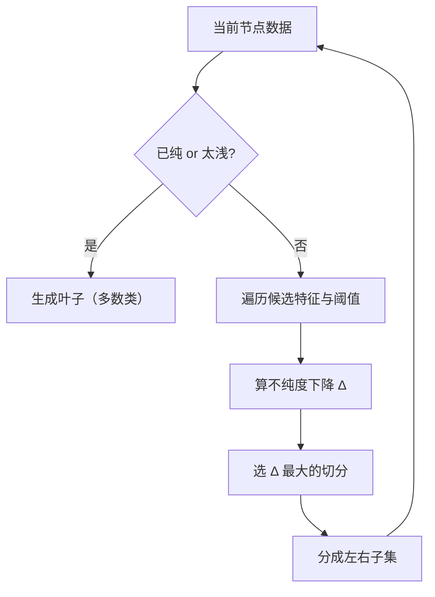

# ML-028 决策树

## 1. 本节学习目标

1. 说清决策树"递归切分、每次选最优切分点"的建树过程。
2. 写出 Gini 与信息熵，并解释它们衡量"不纯度"的方式。
3. 会读 `export_text` 的树结构，理解一条决策路径。
4. 会用 `max_depth` 控制过拟合，并读出 `feature_importances_`。

## 2. 为什么需要这个知识

因为决策树是**唯一"可白盒阅读"的主流模型**：你能把它打印成 if-else 规则给业务看。

它也是集成学习的基石：随机森林、GBDT、XGBoost 全是"很多棵树"。不理解单棵树，就无法理解它们的偏差-方差来源。

## 3. 直观解释

决策树就是**一串"是/否"问题**：

```text
f9 <= 3.82 ?
├── 是 → f2 <= 3.00 ?
│         ├── 是 → f11 <= 3.73 ? → 类1 / 类0
│         └── 否 → 类0
└── 否 → ...
```

**建树逻辑**：每次找一个"切一刀最能分清类别"的特征和阈值，把数据分成两份，然后对每份递归重复。

**什么时候停**：深度到限制、样本太少、或已经纯了（全是同一类）。

## 4. 正式定义

**不纯度：Gini**

$$
\text{Gini}(t) = 1-\sum_{k=1}^{K}p_k^2
$$

两类各 50% 时 $\text{Gini}=0.5$；全同类时 $\text{Gini}=0$。

**不纯度：信息熵**

$$
H(t) = -\sum_{k=1}^{K}p_k\log_2 p_k
$$

**切分增益（以 Gini 为例）**

$$
\Delta = \text{Gini}(t) - \frac{n_L}{n}\text{Gini}(t_L) - \frac{n_R}{n}\text{Gini}(t_R)
$$

选 $\Delta$ 最大的切分。

**叶子预测**：多数类（分类）或均值（回归）。

**重要超参**

| 参数 | 作用 |
|---|---|
| `max_depth` | 最大深度（防过拟合首选） |
| `min_samples_leaf` | 叶子最少样本 |
| `min_samples_split` | 内部节点最少样本 |
| `criterion` | `gini` / `entropy` |

## 5. 核心原理

**为什么树容易过拟合**：完全生长的树能让每个叶子只剩一个样本 ⇒ 训练误差 0，但把噪声也学进去了。

**为什么不需要标准化**：树只看"$x_j\le t$"这种阈值比较，与尺度无关（单调变换不改变切分顺序）。这是树相对 KNN/SVM 的巨大优势。

**特征重要性怎么算**：`feature_importances_` 是"该特征带来的不纯度下降的加权和"，归一化到和为 1。**注意**：它反映"模型用了多少"，不是因果。

## 6. 数学表达式

**本课实验**（wine 数据，178×13，75/25 划分）

| `max_depth` | 训练准确率 | 测试准确率 | 叶子数 |
|---|---|---|---|
| 1 | 0.6617 | 0.6000 | 2 |
| 2 | 0.9398 | 0.8667 | 4 |
| 3 | 0.9925 | **0.9556** | 7 |
| `None` | **1.0000** | 0.9556 | 8 |

**读法**：深度 3 与不限制的测试准确率相同（0.9556），但训练准确率从 0.9925 涨到 1.0000 ⇒ **多出来的那一层只是在背训练集**。

**Gini vs 熵**：深度 3 时 gini **0.9556**，entropy **0.9111**。

**特征重要性前 3**：索引 `[12, 9, 6]`，对应重要性 0.102 / 0.411 / 0.419。

## 7. 数学库链接

| 用到的数学 | 对应篇目 | 用在哪 |
|---|---|---|
| 信息熵与信息增益 | [[MATH-506 信息量与熵]] | `criterion="entropy"` |
| 对数 | [[MATH-003 指数、根式与对数]] | 熵的计算 |
| 条件概率 | [[MATH-301 概率基础与条件概率]] | 节点内的类分布 |

## 8. 算法执行流程



## 9. 可视化解释

```text
        f9 <= 3.82
        /        \
   f2<=3.00      f6<=1.58
    /    \        /     \
  ...   类0    类1     ...
   
每个内部节点 = 一条规则；每个叶子 = 一个预测
```

## 10. Python 实现

```powershell
python ml028_decision_tree.py
```

```python
import numpy as np
from sklearn.datasets import load_wine
from sklearn.model_selection import train_test_split
from sklearn.tree import DecisionTreeClassifier, export_text

X, y = load_wine(return_X_y=True)
X_train, X_test, y_train, y_test = train_test_split(
    X, y, test_size=0.25, random_state=42, stratify=y)

for depth in (1, 2, 3, None):
    model = DecisionTreeClassifier(max_depth=depth, random_state=42).fit(X_train, y_train)
    print(f"depth={depth}: train={model.score(X_train, y_train):.4f}"
          f" test={model.score(X_test, y_test):.4f} leaves={model.get_n_leaves()}")

model = DecisionTreeClassifier(max_depth=3, random_state=42).fit(X_train, y_train)
print("重要性前 3 的索引:", np.argsort(model.feature_importances_)[-3:].tolist())
print("重要性:", model.feature_importances_.round(3).tolist())

for crit in ("gini", "entropy"):
    m = DecisionTreeClassifier(max_depth=3, criterion=crit, random_state=42).fit(X_train, y_train)
    print(f"{crit}: test={m.score(X_test, y_test):.4f}")

rules = export_text(model, max_depth=2, feature_names=[f"f{i}" for i in range(X.shape[1])])
print(rules[:300])
```

**实际运行结果**

```
depth=1: train=0.6617 test=0.6000 leaves=2
depth=2: train=0.9398 test=0.8667 leaves=4
depth=3: train=0.9925 test=0.9556 leaves=7
depth=None: train=1.0000 test=0.9556 leaves=8
重要性前 3 的索引: [12, 9, 6]
重要性: [0.0, 0.0, 0.022, 0.023, 0.0, 0.0, 0.419, 0.0, 0.0, 0.411, 0.0, 0.023, 0.102]
gini: test=0.9556
entropy: test=0.9111
```

树结构（前 2 层）：

```
|--- f9 <= 3.82
|   |--- f2 <= 3.00
|   |   |--- f11 <= 3.73
|   |   |   |--- class: 1
|   |   |--- f11 >  3.73
|   |   |   |--- class: 0
|   |--- f2 >  3.00
|   |   |--- class: 0
|--- f9 >  3.82
|   |--- f6 <= 1.58
...
```

## 11. 代码逐行解释

| 代码 | 作用 |
|---|---|
| `DecisionTreeClassifier(max_depth=d)` | 限制深度的最直接手段 |
| `get_n_leaves()` | 叶子数，反映模型复杂度 |
| `feature_importances_` | 不纯度下降的归一化贡献，和为 1 |
| `criterion="entropy"` | 用信息熵代替 Gini |
| `export_text(..., max_depth=2)` | 打印规则，只显示前 2 层 |

**重要性读法**：13 个特征里有 8 个重要性为 **0**——树完全没用它们。真正起作用的是 `f6`(0.419) 与 `f9`(0.411)，两者合计 83%。

## 12. 实际运行结果

见第 10 节。三点：

1. 深度 3 与不限深度测试成绩**相同**（0.9556），但不限深度的训练准确率是 1.0000 ⇒ **纯过拟合**。
2. Gini 比 entropy 在本数据上更好（0.9556 vs 0.9111），差距来自切分选择的细节，不是"熵更差"。
3. 13 个特征里 8 个零贡献 ⇒ **树自动做了特征选择**。

## 13. 适用场景

| 场景 | 说明 |
|---|---|
| 需要可解释规则 | **首选**（能打印成 if-else） |
| 混合类型特征（数值+类别） | 树天然支持 |
| 特征尺度差异大 | 不需要标准化 |
| 需要稳定预测 | 单树方差大 ⇒ 用随机森林 |
| 数据有噪声 | 需剪枝/限制深度 |

## 14. 优点与缺点

| 优点 | 缺点 |
|---|---|
| 可解释、可可视化 | 极易过拟合 |
| 不需标准化 | 对数据微小变化敏感（不稳定） |
| 自动特征选择 | 单树精度通常不如集成 |
| 支持非线性与交互 | 不能外推（叶子是常数） |

## 15. 常见错误

| 错误 | 表现 | 纠正 |
|---|---|---|
| 不限制深度 | 训练 1.0、测试低 | `max_depth`/`min_samples_leaf` |
| 用测试集选深度 | 泄漏 | 用 CV |
| 认为重要性=因果 | 相关≠因果 | 只作参考 |
| 对树做标准化 | 无必要（不改结果） | 可跳过 |
| 单树直接上线 | 方差大、抖动明显 | 用随机森林 |
| 用 `entropy` 却期望更好 | 不一定 | 用 CV 比较 |

## 16. 本节总结

- 决策树 = **递归找最优切分**，用 Gini/熵衡量不纯度。
- 不需要标准化；能打印成规则；会自动忽略无用特征。
- **必须限制深度**：本课深度 3 与不限制同分，但不限制的训练准确率是 1.0（过拟合）。

## 17. 前置与后续

- 前置：[[ML-027 朴素贝叶斯]]
- 后续：[[ML-029 支持向量机]]、`ML-051 Bagging 与随机森林`（待建）、`ML-057 特征重要性与模型解释`（待建）
- 相关数学：[[MATH-506 信息量与熵]]
- 相关 Python：[[PY-017 树的基本概念]]

## 18. 练习与参考答案

**基础 1**：Gini 与信息熵各衡量什么？两者有什么区别？

**基础 2**：本课 `max_depth=1/3/None` 的训练与测试准确率各是多少？

**进阶 1**：为什么决策树不需要标准化？

**综合 1**：深度 3 与不限制深度测试成绩相同（0.9556），该选哪个？为什么？

> [!success]- 参考答案

> **基础 1**
> 两者都衡量节点"不纯度"：值越大，节点内类别越混杂。
> - Gini：$1-\sum p_k^2$，计算快（无对数），对类别分布敏感。
> - 熵：$-\sum p_k\log_2 p_k$，信息论含义明确，计算稍慢。
> 实践差别通常很小，Gini 是默认；本课 Gini 0.9556 略优于 entropy 0.9111，但这依赖数据，不能推广。

> **基础 2**
> | 深度 | 训练 | 测试 |
> |---|---|---|
> | 1 | 0.6617 | 0.6000 |
> | 3 | 0.9925 | **0.9556** |
> | None | **1.0000** | 0.9556 |

> **进阶 1**
> 因为树只做"$x_j \le t$"的比较，任何单调变换（如标准化 $x\mapsto(x-\mu)/\sigma$）都不改变样本在阈值上的相对顺序 ⇒ **切分点等价，树结构完全相同**。
> 这与 KNN/SVM/线性模型（依赖距离或内积）形成对比。

> **综合 1**
> 选 **深度 3**。
> 理由：测试成绩相同（0.9556），但深度 3 的训练准确率 0.9925 < 1.0000，说明它没把训练集背下来；模型更简单（7 个叶子 vs 8 个）、方差更小、更可能在新数据上稳定。
> 原则：**同分选简单**（奥卡姆剃刀），并用 CV 复核。

---

## 🔗 Notion 同步信息

> 以下内容由 Notion「AI Knowledge System · 知识点」数据库按知识 ID 合并而来（导出于 2026-11-09）。

| 属性 | 值 |
|---|---|
| 学科 | 机器学习 |
| 学习状态 | 未开始 |
| 难度 | L3 推导 |
| 知识类型 | Algorithm |

- **所属模块**：[M-ML-04 监督学习——分类](../%E8%AF%BE%E7%A8%8B%E6%A8%A1%E5%9D%97/M-ML-04%20%E7%9B%91%E7%9D%A3%E5%AD%A6%E4%B9%A0%E2%80%94%E2%80%94%E5%88%86%E7%B1%BB.md)
- **前置知识**：[ML-027 朴素贝叶斯](ML-027%20%E6%9C%B4%E7%B4%A0%E8%B4%9D%E5%8F%B6%E6%96%AF.md)
- **后继知识**：[ML-029 支持向量机](ML-029%20%E6%94%AF%E6%8C%81%E5%90%91%E9%87%8F%E6%9C%BA.md)
- **关联Python**：[PY-017 树的基本概念](../../01_Python%E5%9F%BA%E7%A1%80/03%20%E6%95%B0%E6%8D%AE%E7%BB%93%E6%9E%84/PY-017%20%E6%A0%91%E7%9A%84%E5%9F%BA%E6%9C%AC%E6%A6%82%E5%BF%B5.md)
- **关联数学**：[MATH-506 信息量与熵](../../06_%E6%95%B0%E5%AD%A6%E5%9F%BA%E7%A1%80/05%20%E7%A6%BB%E6%95%A3%E6%95%B0%E5%AD%A6/MATH-506%20%E4%BF%A1%E6%81%AF%E9%87%8F%E4%B8%8E%E7%86%B5.md)
