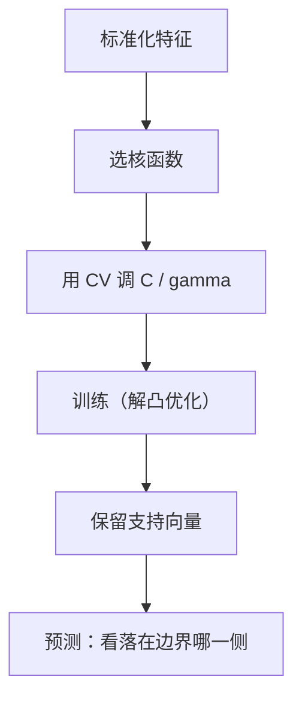

# ML-029 支持向量机

## 1. 本节学习目标

1. 说清 SVM 的目标：**最大化间隔**，而不是"分对就行"。
2. 理解支持向量是"决定边界的那几个点"。
3. 会用核函数（`linear`/`rbf`）处理非线性，并调 `C`、`gamma`。
4. 知道 SVM **必须标准化**，且大数据上训练慢。

## 2. 为什么需要这个知识

因为"能分开"和"分得好"是两件事：间隔越大，模型对噪声越不敏感。

SVM 把这件事做成了**凸优化问题**（有全局最优），并靠"核技巧"把线性方法扩展到非线性——这套思想（间隔、对偶、核）在机器学习里影响极深。

## 3. 直观解释

两类点之间能画很多条分界线，SVM 选**离两边都最远**的那条。

**支持向量**：离分界线最近的那几个点。**只有它们决定边界**——移走其他点，边界不变。

**核技巧**：数据线性不可分时，把它映射到高维空间，在那里就能用平面切开。核函数让你**不用真的算高维坐标**，只算点积。

## 4. 正式定义

**硬间隔 SVM（线性可分）**

$$
\min_{\mathbf{w},b}\ \frac12\|\mathbf{w}\|^2 \quad \text{s.t.}\ y_i(\mathbf{w}^\top\mathbf{x}_i+b)\ge1
$$

**软间隔（允许违反，带松弛变量）**

$$
\min_{\mathbf{w},b,\xi}\ \frac12\|\mathbf{w}\|^2 + C\sum_i\xi_i
\quad \text{s.t.}\ y_i(\mathbf{w}^\top\mathbf{x}_i+b)\ge1-\xi_i,\ \xi_i\ge0
$$

**间隔宽度**

$$
\text{margin} = \frac{2}{\|\mathbf{w}\|}
$$

⇒ 最小化 $\|\mathbf{w}\|$ 就是最大化间隔。

**核函数**

| 核 | 形式 |
|---|---|
| 线性 | $\mathbf{x}^\top\mathbf{x}'$ |
| RBF | $\exp(-\gamma\|\mathbf{x}-\mathbf{x}'\|^2)$ |
| 多项式 | $(\gamma\mathbf{x}^\top\mathbf{x}'+r)^d$ |

## 5. 核心原理

**$C$ 的作用**：惩罚违反间隔的程度。

- $C$ 小 ⇒ 容忍更多违反 ⇒ 边界更平滑、更宽（偏差↑）。
- $C$ 大 ⇒ 几乎不容忍 ⇒ 边界贴合数据（方差↑，易过拟合）。

**$\gamma$ 的作用**（RBF）：单个样本的影响半径。

- $\gamma$ 小 ⇒ 影响范围大 ⇒ 边界平滑（近似线性）。
- $\gamma$ 大 ⇒ 影响范围小 ⇒ 边界弯曲、易过拟合。

**为什么必须标准化**：间隔与核都基于**距离/内积**，量纲大的特征会主导。

## 6. 数学表达式

**本课实验**（`make_moons`，300 样本，噪声 0.25，70/30 划分，标准化后）

| 配置 | 测试准确率 |
|---|---|
| `kernel=linear` | 0.8444 |
| `kernel=rbf`（默认） | 0.8667 |
| rbf, $C=0.1$ | 0.8667 |
| rbf, $C=1$ | 0.8667 |
| rbf, $C=100$ | **0.9111** |
| rbf, $\gamma=0.01$ | 0.8222 |
| rbf, $\gamma=0.1$ | 0.8444 |
| rbf, $\gamma=1$ | 0.9000 |
| rbf, $\gamma=10$ | **0.9222** |

**线性核的支持向量数**：66 个（约占训练集 210 的 31%）。

## 7. 数学库链接

| 用到的数学 | 对应篇目 | 用在哪 |
|---|---|---|
| 超平面与内积 | [[MATH-222 基、维度与子空间]] | 决策边界的几何 |
| 凸优化与约束 | [[MATH-701 优化问题与凸性]] | SVM 的优化形式 |
| 向量范数 | [[MATH-201 向量与空间基础]] | $\|\mathbf{w}\|$ 与间隔 |

## 8. 算法执行流程



## 9. 可视化解释

```text
     ○ ○ ○
   ○ ○ ○        ← 支持向量（贴边界的点）
  ───────────   ← 最大间隔边界
     ● ● ●
   ● ● ●

移走远处的点：边界不变；
移走支持向量：边界改变。
```

## 10. Python 实现

```powershell
python ml029_svm.py
```

```python
from sklearn.datasets import make_moons
from sklearn.model_selection import train_test_split
from sklearn.pipeline import Pipeline
from sklearn.preprocessing import StandardScaler
from sklearn.svm import SVC

X, y = make_moons(n_samples=300, noise=0.25, random_state=42)
X_train, X_test, y_train, y_test = train_test_split(
    X, y, test_size=0.3, random_state=42, stratify=y)

for kernel in ("linear", "rbf"):
    model = Pipeline([("sc", StandardScaler()), ("svm", SVC(kernel=kernel))]).fit(X_train, y_train)
    print(f"kernel={kernel}: acc={model.score(X_test, y_test):.4f}")

for C in (0.1, 1.0, 100.0):
    model = Pipeline([("sc", StandardScaler()),
                      ("svm", SVC(kernel="rbf", C=C))]).fit(X_train, y_train)
    print(f"rbf C={C}: acc={model.score(X_test, y_test):.4f}")

for gamma in (0.01, 0.1, 1.0, 10.0):
    model = Pipeline([("sc", StandardScaler()),
                      ("svm", SVC(kernel="rbf", gamma=gamma))]).fit(X_train, y_train)
    print(f"rbf gamma={gamma}: acc={model.score(X_test, y_test):.4f}")

linear = Pipeline([("sc", StandardScaler()),
                   ("svm", SVC(kernel="linear", C=1.0))]).fit(X_train, y_train)
print("线性核支持向量数:", int(linear.named_steps["svm"].n_support_.sum()))
```

**实际运行结果**

```
kernel=linear: acc=0.8444
kernel=rbf: acc=0.8667
rbf C=0.1: acc=0.8667
rbf C=1.0: acc=0.8667
rbf C=100.0: acc=0.9111
rbf gamma=0.01: acc=0.8222
rbf gamma=0.1: acc=0.8444
rbf gamma=1.0: acc=0.9000
rbf gamma=10.0: acc=0.9222
线性核支持向量数: 66
```

## 11. 代码逐行解释

| 代码 | 作用 |
|---|---|
| `SVC(kernel="linear")` | 线性核，只能画直线边界 |
| `SVC(kernel="rbf")` | 默认核，能画弯曲边界 |
| `C=...` | 惩罚系数：大则贴合数据 |
| `gamma=...` | RBF 的影响半径倒数：大则边界更弯 |
| `n_support_` | 各类支持向量数量（数组） |
| `Pipeline([...])` | 标准化必须放在 SVM 之前 |

**读数提示**：$C$ 从 1 增到 100，准确率从 0.8667 升到 0.9111；$\gamma$ 从 0.01 增到 10，从 0.8222 升到 0.9222。**两者都是"越大越贴合数据"**，但过大会过拟合——本课还没到那个点，因为数据本身是弯曲的。

## 12. 实际运行结果

见第 10 节。三点：

1. RBF 略优于线性（0.8667 vs 0.8444）——因为 moons 是**非线性**数据。
2. 调大 $C$ 或 $\gamma$ 都能提分（到 0.91/0.92），说明默认参数偏保守。
3. 线性核用了 66 个支持向量（约占 31%）——间隔附近点很多，说明两类有重叠（噪声 0.25 造成）。

## 13. 适用场景

| 场景 | 说明 |
|---|---|
| 中小样本、高维（文本） | SVM 表现好 |
| 需要明确间隔 | SVM 的强项 |
| 数据量大（>10 万） | 训练慢 ⇒ 用线性 SVM 或换模型 |
| 需要概率输出 | 需 `probability=True`（更慢） |
| 多分类 | 内部用 one-vs-one |

## 14. 优点与缺点

| 优点 | 缺点 |
|---|---|
| 有全局最优（凸问题） | 大数据训练慢（$O(n^2)$~$O(n^3)$） |
| 核技巧处理非线性 | 核与参数难调 |
| 高维表现好 | 需标准化 |
| 只依赖支持向量（内存省） | 概率输出需额外校准 |

## 15. 常见错误

| 错误 | 表现 | 纠正 |
|---|---|---|
| 不标准化 | 效果差、收敛慢 | 先 `StandardScaler` |
| 大数据硬用 RBF | 训练几小时 | 换线性核/SGDClassifier |
| 只调 $C$ 不调 $\gamma$ | 效果受限 | 两者一起网格搜索 |
| 认为支持向量越多越好 | 说明重叠严重 | 看数据质量 |
| 直接读 `predict_proba` | 默认不支持 | 设 `probability=True` |
| 用 SVM 做可解释规则 | 无法打印规则 | 用决策树 |

## 16. 本节总结

- SVM = **最大化间隔** + 软间隔（$C$）+ 核技巧。
- 只有支持向量决定边界；$C$ 与 $\gamma$ 都控制"贴合程度"。
- 必须标准化；大数据上要慎用 RBF。

## 17. 前置与后续

- 前置：[[ML-028 决策树]]
- 后续：[[ML-030 决策边界与分类阈值]]、`ML-031 多分类策略`（待建）
- 相关数学：[[MATH-222 基、维度与子空间]]、[[MATH-701 优化问题与凸性]]、[[MATH-201 向量与空间基础]]

## 18. 练习与参考答案

**基础 1**：SVM 与"只要能分开就行"的线性分类器有什么区别？

**基础 2**：本课线性核与 RBF 核的准确率各是多少？

**进阶 1**：$C$ 和 $\gamma$ 增大分别会发生什么？为什么方向相同？

**综合 1**：线性核用了 66 个支持向量，这说明了什么？

> [!success]- 参考答案

> **基础 1**
> 普通线性分类器只要求分对（间隔任意）；SVM 要求**间隔最大**，即决策边界离两类最近的样本都尽量远。
> 好处：间隔越大，对噪声和小扰动越鲁棒，泛化通常更好。数学上等价于最小化 $\|\mathbf{w}\|$。

> **基础 2**
> 线性核 **0.8444**，RBF 核 **0.8667**（默认参数）。
> RBF 略好，因为 moons 数据是**线性不可分**的，需要弯曲边界。

> **进阶 1**
> - $C$ 增大：惩罚违反间隔更重 ⇒ 边界更贴合训练点 ⇒ 方差↑、偏差↓。
> - $\gamma$ 增大：每个样本影响半径变小 ⇒ 边界更弯 ⇒ 同样方差↑、偏差↓。
> 方向相同（都更"贴合数据"），所以两者都调大容易一起过拟合，需要一起网格搜索（见 `ML-048`，待建）。

> **综合 1**
> 66/210 ≈ 31% 的训练点成了支持向量，比例偏高，说明**两类在间隔附近大量重叠**（本课 `noise=0.25` 人为加了噪声）。
> 对比：若数据干净可分，支持向量通常只占几个百分点。支持向量比例是"数据可分性"的一个粗略指标。

---

## 🔗 Notion 同步信息

> 以下内容由 Notion「AI Knowledge System · 知识点」数据库按知识 ID 合并而来（导出于 2026-11-09）。

| 属性 | 值 |
|---|---|
| 学科 | 机器学习 |
| 学习状态 | 未开始 |
| 难度 | L3 推导 |
| 知识类型 | Algorithm |

- **所属模块**：[M-ML-04 监督学习——分类](../%E8%AF%BE%E7%A8%8B%E6%A8%A1%E5%9D%97/M-ML-04%20%E7%9B%91%E7%9D%A3%E5%AD%A6%E4%B9%A0%E2%80%94%E2%80%94%E5%88%86%E7%B1%BB.md)
- **前置知识**：[ML-028 决策树](ML-028%20%E5%86%B3%E7%AD%96%E6%A0%91.md)
- **后继知识**：[ML-030 决策边界与分类阈值](ML-030%20%E5%86%B3%E7%AD%96%E8%BE%B9%E7%95%8C%E4%B8%8E%E5%88%86%E7%B1%BB%E9%98%88%E5%80%BC.md)
- **关联Python**：[PY-066 矩阵运算](../../01_Python%E5%9F%BA%E7%A1%80/08%20NumPy/PY-066%20%E7%9F%A9%E9%98%B5%E8%BF%90%E7%AE%97.md)
- **关联数学**：[MATH-222 基、维度与子空间](../../06_%E6%95%B0%E5%AD%A6%E5%9F%BA%E7%A1%80/02%20%E7%BA%BF%E6%80%A7%E4%BB%A3%E6%95%B0/MATH-222%20%E5%9F%BA%E3%80%81%E7%BB%B4%E5%BA%A6%E4%B8%8E%E5%AD%90%E7%A9%BA%E9%97%B4.md) · [MATH-701 优化问题与凸性](../../06_%E6%95%B0%E5%AD%A6%E5%9F%BA%E7%A1%80/07%20%E6%9C%80%E4%BC%98%E5%8C%96%E6%96%B9%E6%B3%95/MATH-701%20%E4%BC%98%E5%8C%96%E9%97%AE%E9%A2%98%E4%B8%8E%E5%87%B8%E6%80%A7.md)
