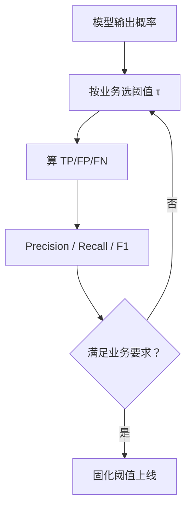

# ML-030 决策边界与分类阈值

## 1. 本节学习目标

1. 区分**决策边界**（模型结构决定）与**阈值**（人为选择）。
2. 能解释为什么"不平衡数据里默认阈值 0.5 很糟"。
3. 会用阈值扫描画出精确率/召回率/F1 的权衡曲线。
4. 知道线性/非线性边界的模型来源（谁只能画直线）。

## 2. 为什么需要这个知识

因为**模型输出的概率不是决策**。

一个正类只占 10% 的数据集上，逻辑回归的默认阈值 0.5 会让模型几乎不判正——即使它排出的概率顺序是对的。改阈值就能把召回率从 0.56 拉到 0.84，代价是精确率下降。

**阈值是业务参数**。不会调阈值，等于把模型的一半能力扔了。

## 3. 直观解释

两个不同的东西：

| 概念 | 由谁决定 | 改变它会怎样 |
|---|---|---|
| **决策边界** | 模型类型 + 训练数据 | 决定"形状"（直线/曲线） |
| **阈值** | 你 | 在同一个概率排序上"切在哪" |

类比：边界是"把人群按身高体重分成两堆的形状"，阈值是"你在概率轴上划的那条线"。

**关键**：阈值变化**不改变**排序（A 比 B 更可能是正类这件事不变），只改变"多严格"。

## 4. 正式定义

**决策边界**（二分类，概率 0.5 处）

$$
\{\mathbf{x} : P(y=1\mid\mathbf{x}) = 0.5\}
$$

逻辑回归：$\mathbf{w}^\top\mathbf{x}+b=0$ ⇒ **超平面**。
决策树：分段常数的锯齿边界。
RBF-SVM：由核决定的弯曲边界。

**阈值规则**

$$
\hat y = \mathbb{1}[P(y=1\mid\mathbf{x})\ge\tau]
$$

**精确率 / 召回率 / F1**

$$
\text{Precision}=\frac{TP}{TP+FP},\qquad \text{Recall}=\frac{TP}{TP+FN}
$$

$$
F_1 = \frac{2PR}{P+R}
$$

**阈值与两者的关系**：$\tau$ 降低 ⇒ 判正变多 ⇒ 召回↑、精确↓（一般趋势）。

## 5. 核心原理

**为什么不平衡时 0.5 失效**：若正类只占 10%，模型给大多数样本的概率在 0.1 附近。阈值 0.5 会把这些全判负 ⇒ 召回极低。

**"全判负"的准确率基线**：本课数据 894:106（正类 10.6%），全判负的准确率是 **0.8933**。模型 0.9367 只比它高 4 个百分点——**准确率在这里几乎没有区分力**。

**该看什么**：精确率/召回率/F1、PR 曲线、ROC-AUC（见 ML-043/044/045）。

## 6. 数学表达式

**本课实验**（`make_classification`，1000 样本，weights=[0.9, 0.1]，2 维）

类别分布 $[894,\ 106]$

| 阈值 $\tau$ | Precision | Recall | F1 |
|---|---|---|---|
| 0.1 | 0.435 | **0.844** | 0.574 |
| 0.3 | 0.686 | 0.750 | **0.716** |
| 0.5 | 0.783 | 0.562 | 0.655 |
| 0.7 | **0.818** | 0.281 | 0.419 |

**读法**：

- $\tau=0.1$：召回 0.844（抓到 84% 的正类），但精确率只有 0.435（一半以上是误报）。
- $\tau=0.7$：精确率 0.818，但只能抓到 28% 的正类。
- **F1 最优在 $\tau=0.3$（0.716）**，不是默认的 0.5（0.655）。

## 7. 数学库链接

| 用到的数学 | 对应篇目 | 用在哪 |
|---|---|---|
| 条件概率与阈值 | [[MATH-802 逻辑回归与 Sigmoid]] | 概率如何被切开 |
| 混淆矩阵计数 | [[MATH-501 集合与集合运算]] | TP/FP/FN 的集合定义 |

## 8. 算法执行流程



## 9. 可视化解释

```text
概率排序（正类样本标 ▲）
负 0.02 … 0.11 ▲ 0.13 ▲ 0.31 ▲ 0.55 ▲ 0.88 正

      τ=0.5 ────────┤         ⇒ 召回低（只抓到右边两个）
   τ=0.3 ──────┤              ⇒ 召回↑ 精确↓
τ=0.1 ──┤                     ⇒ 召回更高 精确更低
```

## 10. Python 实现

```powershell
python ml030_threshold.py
```

```python
import numpy as np
from sklearn.datasets import make_classification
from sklearn.linear_model import LogisticRegression
from sklearn.metrics import f1_score, precision_score, recall_score
from sklearn.model_selection import train_test_split
from sklearn.pipeline import Pipeline
from sklearn.preprocessing import StandardScaler

X, y = make_classification(n_samples=1000, weights=[0.9, 0.1], n_features=2,
                           n_redundant=0, n_informative=2, random_state=42)
print("类别分布:", np.bincount(y).tolist())

X_train, X_test, y_train, y_test = train_test_split(
    X, y, test_size=0.3, random_state=42, stratify=y)

clf = Pipeline([("sc", StandardScaler()),
                ("lr", LogisticRegression(max_iter=1000))]).fit(X_train, y_train)
print("默认阈值 acc:", round(clf.score(X_test, y_test), 4))
print("全判负的 acc:", round(float((y_test == 0).mean()), 4))

proba = clf.predict_proba(X_test)[:, 1]
for tau in (0.1, 0.3, 0.5, 0.7):
    pred = (proba >= tau).astype(int)
    print(f"tau={tau}: P={precision_score(y_test, pred, zero_division=0):.3f}"
          f" R={recall_score(y_test, pred, zero_division=0):.3f}"
          f" F1={f1_score(y_test, pred, zero_division=0):.3f}")
```

**实际运行结果**

```
类别分布: [894, 106]
默认阈值 acc: 0.9367
全判负的 acc: 0.8933
tau=0.1: P=0.435 R=0.844 F1=0.574
tau=0.3: P=0.686 R=0.750 F1=0.716
tau=0.5: P=0.783 R=0.562 F1=0.655
tau=0.7: P=0.818 R=0.281 F1=0.419
```

## 11. 代码逐行解释

| 代码 | 作用 |
|---|---|
| `weights=[0.9, 0.1]` | 人为制造 9:1 不平衡 |
| `predict_proba(...)[:, 1]` | 取正类概率 |
| `(proba >= tau).astype(int)` | 手动实现阈值切分 |
| `zero_division=0` | 避免分母为 0 报错 |
| `全判负 acc` | 关键基线：不做任何事能拿多少分 |

**最重要的两个数**：模型 0.9367 vs 全判负 0.8933。**只差 4.3 个百分点**——如果只看准确率，你会以为"模型还不错"，但它实际上把一半正类漏了（$\tau=0.5$ 时召回仅 0.562）。

## 12. 实际运行结果

见第 10 节。三点：

1. 全判负基线 0.8933 ⇒ 准确率在不平衡数据上**几乎没有信息量**。
2. F1 在 $\tau=0.3$ 达到最优 **0.716**，明显优于默认 0.5 的 0.655。
3. 精确率与召回率**此消彼长**，阈值就是那个旋钮。

## 13. 适用场景

| 业务代价 | 阈值策略 |
|---|---|
| 漏判代价高（癌症筛查） | 阈值**调低**，保召回 |
| 误报代价高（自动扣款） | 阈值**调高**，保精确 |
| 需要平衡 | 选 F1 最大 |
| 人工复核排队（风控） | 按概率排序取 Top-N，不设固定阈值 |
| 概率已校准 | 可用期望损失最小化选阈值 |

## 14. 优点与缺点

| 做法 | 优点 | 缺点 |
|---|---|---|
| 默认 0.5 | 省事 | 不平衡时常灾难 |
| 按业务调阈值 | 直接对齐代价 | 需业务参与 |
| 按 F1 选 | 自动化、平衡 | F1 隐含"P、R 同等重要" |
| 按代价期望最小化 | 理论最优 | 需明确代价矩阵 |

## 15. 常见错误

| 错误 | 表现 | 纠正 |
|---|---|---|
| 不看"全判多数类"基线 | 高估模型 | 先算基线 |
| 不平衡时用准确率 | 虚高 | 用 P/R/F1/AUC |
| 在测试集上调阈值 | 泄漏 | 用验证集调，测试集确认 |
| 认为阈值改变排序 | 排序不变 | 只是切点变 |
| 阈值写死不做监控 | 分布漂移后失效 | 定期重估 |
| 把阈值当模型参数 | 它不参与训练 | 训练后单独选 |

## 16. 本节总结

- **决策边界由模型决定，阈值由你决定**，两者不同层。
- 不平衡数据上，准确率几乎没信息：全判负就有 0.8933。
- 阈值扫描是必做动作：本课 F1 从 0.655（0.5）升到 0.716（0.3）。

## 17. 前置与后续

- 前置：[[ML-029 支持向量机]]、[[ML-024 分类任务基本概念]]
- 后续：`ML-043 混淆矩阵与分类指标`（待建）、`ML-044 ROC 曲线与 AUC`（待建）、`ML-045 PR 曲线与阈值选择`（待建）
- 相关数学：[[MATH-802 逻辑回归与 Sigmoid]]、[[MATH-501 集合与集合运算]]

## 18. 练习与参考答案

**基础 1**：决策边界与分类阈值有什么区别？

**基础 2**：本课"全判负"的准确率是多少？模型默认阈值下是多少？说明什么？

**进阶 1**：为什么降低阈值会提高召回率、降低精确率？

**综合 1**：本课 $\tau=0.3$ 与 $\tau=0.7$ 的 P/R/F1 各是多少？如果是癌症筛查该选哪个？

> [!success]- 参考答案

> **基础 1**
> - **决策边界**：由模型结构与训练数据决定，是输入空间里的"分界形状"（直线、曲线、锯齿）。改模型类型才会变。
> - **分类阈值**：在概率轴上人为选的一个切点 $\tau$。改它不改变概率排序，只改变"多容易被判为正类"。
> 逻辑回归的边界是 $\mathbf{w}^\top\mathbf{x}+b=0$，而阈值可以在 $(0,1)$ 上任取。

> **基础 2**
> 全判负 **0.8933**，模型默认阈值 **0.9367**。只差 4.3 个百分点。
> 说明：在不平衡数据上准确率没有区分力——一个什么都不做的模型就能拿 89 分。必须看精确率/召回率/F1 或 AUC。

> **进阶 1**
> 阈值降低 ⇒ 更多样本被判定为正类（$TP+FP$ 都增加）。
> - 召回 $TP/(TP+FN)$：分母固定，$TP$ 增加 ⇒ **召回上升**。
> - 精确 $TP/(TP+FP)$：分子分母同时增加，但新纳入的多是低概率（更可能是真负类）的样本 ⇒ 精确率通常**下降**。

> **综合 1**
> | $\tau$ | P | R | F1 |
> |---|---|---|---|
> | 0.3 | 0.686 | 0.750 | 0.716 |
> | 0.7 | 0.818 | 0.281 | 0.419 |
>
> 癌症筛查应选 **$\tau=0.3$ 或更低**：漏判（把病人判健康）代价远高于误报（让健康人多做一次复查）。
> 选 0.7 会漏掉 72% 的病人，即使精确率更高也不可接受。

---

## 🔗 Notion 同步信息

> 以下内容由 Notion「AI Knowledge System · 知识点」数据库按知识 ID 合并而来（导出于 2026-11-09）。

| 属性 | 值 |
|---|---|
| 学科 | 机器学习 |
| 学习状态 | 未开始 |
| 难度 | L2 应用 |
| 知识类型 | Concept |

- **所属模块**：[M-ML-04 监督学习——分类](../%E8%AF%BE%E7%A8%8B%E6%A8%A1%E5%9D%97/M-ML-04%20%E7%9B%91%E7%9D%A3%E5%AD%A6%E4%B9%A0%E2%80%94%E2%80%94%E5%88%86%E7%B1%BB.md)
- **前置知识**：[ML-029 支持向量机](ML-029%20%E6%94%AF%E6%8C%81%E5%90%91%E9%87%8F%E6%9C%BA.md)
- **后继知识**：[ML-031 多分类策略](ML-031%20%E5%A4%9A%E5%88%86%E7%B1%BB%E7%AD%96%E7%95%A5.md)
- **关联Python**：[PY-067 聚合与统计](../../01_Python%E5%9F%BA%E7%A1%80/08%20NumPy/PY-067%20%E8%81%9A%E5%90%88%E4%B8%8E%E7%BB%9F%E8%AE%A1.md)
- **关联数学**：[MATH-802 逻辑回归与 Sigmoid](../../06_%E6%95%B0%E5%AD%A6%E5%9F%BA%E7%A1%80/08%20%E6%9C%BA%E5%99%A8%E5%AD%A6%E4%B9%A0%E6%95%B0%E5%AD%A6%E5%BA%94%E7%94%A8/MATH-802%20%E9%80%BB%E8%BE%91%E5%9B%9E%E5%BD%92%E4%B8%8E%20Sigmoid.md)
