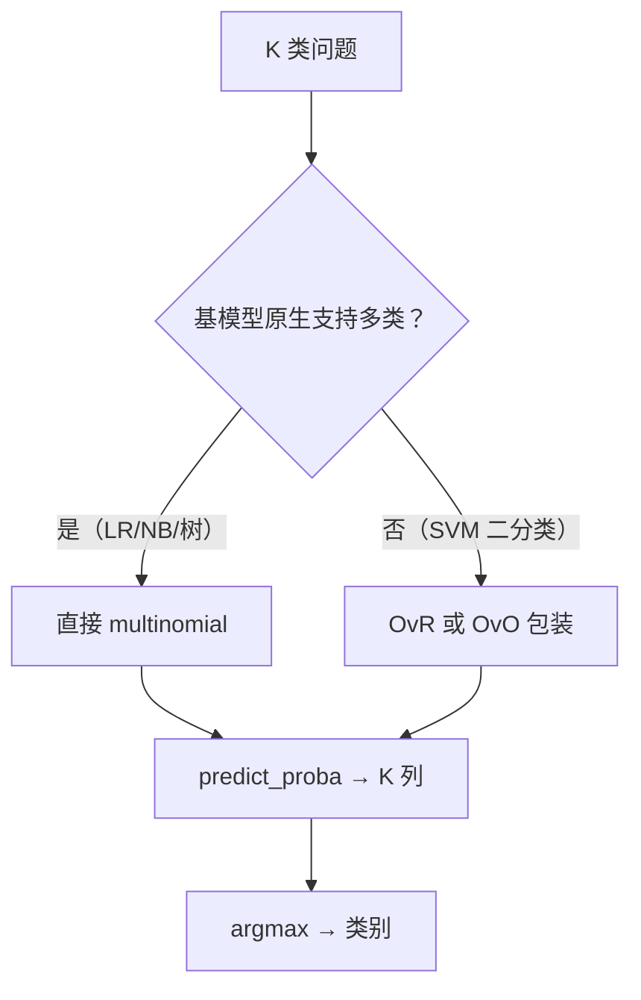

# ML-031 多分类策略

## 1. 本节学习目标

1. 区分 **OvR（一对多）** 与 **多项（multinomial/Softmax）** 两种策略。
2. 说清为什么 sklearn 1.9 已移除 `multi_class` 参数、现在怎么表达两种策略。
3. 会读多分类的 `predict_proba`（$K$ 列、行和为 1）。
4. 会用混淆矩阵定位"哪两类最容易混"。

## 2. 为什么需要这个知识

因为大多数"分类器"原生只会二分类，$K$ 类问题需要**策略**来拼装。

而且策略选择会影响结果：本课实测 OvR 0.8889、multinomial 0.9333（差 4.4 个百分点）。原因不是"哪个更先进"，而是**两者的概率模型不同**：OvR 假设各类独立，multinomial 强制各类概率和为 1。

## 3. 直观解释

**OvR（One-vs-Rest）**：训练 $K$ 个二分类器，"是不是第 1 类？""是不是第 2 类？"……取分数最高的。

**OvO（One-vs-One）**：每两类训练一个分类器，共 $K(K-1)/2$ 个，投票。

**Multinomial（Softmax）**：一个模型直接输出 $K$ 个概率，**和为 1**。

| 策略 | 分类器数 | 概率和 | 适合 |
|---|---|---|---|
| OvR | $K$ | 不保证 1 | 基模型支持二分类 |
| OvO | $K(K-1)/2$ | 不保证 | 类别多、单模型快 |
| Multinomial | 1 | **1** | 逻辑回归、神经网络 |

## 4. 正式定义

**OvR 决策**

$$
\hat y = \arg\max_{k}\ f_k(\mathbf{x})
$$

$f_k$ 是"第 $k$ 类 vs 其余"的二分类器输出。

**Multinomial（Softmax）**

$$
P(y=k\mid\mathbf{x}) = \frac{e^{z_k}}{\sum_{j=1}^{K}e^{z_j}},\qquad \sum_k P(y=k\mid\mathbf{x})=1
$$

**OvO 投票**

$$
\hat y = \operatorname{mode}\big(\{f_{ij}(\mathbf{x})\}_{i<j}\big)
$$

**本课 sklearn 1.9 的写法**

| 策略 | 代码 |
|---|---|
| Multinomial | `LogisticRegression()`（默认） |
| OvR | `OneVsRestClassifier(LogisticRegression())` |
| OvO | `OneVsOneClassifier(...)` |

> **重要**：`multi_class` 参数在 sklearn 1.5 起弃用、1.7+ 已移除。旧教程里的 `multi_class="ovr"` 会直接报 `TypeError`（本课踩过）。

## 5. 核心原理

**为什么 multinomial 通常更好（逻辑回归）**：它把 $K$ 类放在**同一个概率模型**里联合优化，参数共享（同一组 $\mathbf{w}$ 的 softmax），因此在小样本上更稳。

**为什么 OvR 有时反而好**：类别之间不互斥（多标签）时必须用 OvR；或者各类样本量极不均衡时，独立二分类器更鲁棒。

**概率和为什么重要**：如果下游要做"取最大概率 vs 阈值"或"概率加权"，行和不为 1 会让阈值失去意义。

## 6. 数学表达式

**本课实验 1**（iris，3 类，45 条测试）

| 策略 | 准确率 | `predict_proba` 形状 | 行和均值 |
|---|---|---|---|
| OvR | 0.8889 | (45, 3) | 1.0 |
| Multinomial | **0.9333** | (45, 3) | 1.0 |

**本课实验 2**（digits，10 类，标准化 + 逻辑回归）

$$
\text{acc} = 0.9815
$$

混淆矩阵前 3 行：

$$
\begin{bmatrix}
54 & 0 & 0 & \cdots\\
0 & 52 & 0 & 1 & \cdots & 2\\
0 & 0 & 53 & \cdots
\end{bmatrix}
$$

读法：第 2 行（真实类 1）里错分到类 4 有 1 个、类 8 有 2 个；类 0 与类 2 全对。

## 7. 数学库链接

| 用到的数学 | 对应篇目 | 用在哪 |
|---|---|---|
| Softmax 与交叉熵 | [[MATH-805 Softmax 与交叉熵]] | multinomial 的概率模型 |
| 条件概率 | [[MATH-301 概率基础与条件概率]] | OvR 的"各类概率" |

## 8. 算法执行流程



## 9. 可视化解释

```text
OvR：三个二分类器     Multinomial：一个模型
  类1 vs 其余            ┌──────────┐
  类2 vs 其余   ───►     │  Softmax │ ───► 概率和为1
  类3 vs 其余            └──────────┘
  取分数最大
```

## 10. Python 实现

```powershell
python ml031_multiclass.py
```

```python
import numpy as np
from sklearn.datasets import load_digits, load_iris
from sklearn.linear_model import LogisticRegression
from sklearn.metrics import confusion_matrix
from sklearn.model_selection import train_test_split
from sklearn.multiclass import OneVsRestClassifier
from sklearn.pipeline import Pipeline
from sklearn.preprocessing import StandardScaler

# 3 类：OvR vs multinomial
X, y = load_iris(return_X_y=True)
X_train, X_test, y_train, y_test = train_test_split(
    X, y, test_size=0.3, random_state=42, stratify=y)

ovr = OneVsRestClassifier(LogisticRegression(max_iter=2000)).fit(X_train, y_train)
mul = LogisticRegression(max_iter=2000).fit(X_train, y_train)
print("OvR acc:", round(ovr.score(X_test, y_test), 4))
print("multinomial acc:", round(mul.score(X_test, y_test), 4))
print("proba 形状:", mul.predict_proba(X_test).shape,
      " 行和均值:", round(float(mul.predict_proba(X_test).sum(axis=1).mean()), 6))

# 10 类：digits
X_d, y_d = load_digits(return_X_y=True)
Xd_train, Xd_test, yd_train, yd_test = train_test_split(
    X_d, y_d, test_size=0.3, random_state=42, stratify=y_d)
model = Pipeline([("sc", StandardScaler()),
                  ("lr", LogisticRegression(max_iter=300))]).fit(Xd_train, yd_train)
print("digits acc:", round(model.score(Xd_test, yd_test), 4),
      " 类别数:", len(np.unique(y_d)))
print(confusion_matrix(yd_test, model.predict(Xd_test))[:3])
```

**实际运行结果**

```
OvR acc: 0.8889
multinomial acc: 0.9333
proba 形状: (45, 3)  行和均值: 1.0
digits acc: 0.9815  类别数: 10
[[54  0  0  0  0  0  0  0  0  0]
 [ 0 52  0  0  1  0  0  0  2  0]
 [ 0  0 53  0  0  0  0  0  0  0]]
```

## 11. 代码逐行解释

| 代码 | 作用 |
|---|---|
| `OneVsRestClassifier(LogisticRegression())` | 显式 OvR（1.9 推荐写法） |
| `LogisticRegression()` | 1.9 中多类**默认就是 multinomial** |
| `predict_proba(X).shape` | 多分类恒为 $(n,K)$ |
| `.sum(axis=1).mean()` | 验证每行概率和为 1 |
| `confusion_matrix(...)[:3]` | 只打印前 3 行（10×10 全打太长） |

**API 变更提醒**：老代码 `LogisticRegression(multi_class="ovr")` 在 1.9 会抛

```
TypeError: LogisticRegression.__init__() got an unexpected keyword argument 'multi_class'
```

——这正是本课第一次探测时报的错。**照抄旧教程前先看版本**。

## 12. 实际运行结果

见第 10 节。三点：

1. multinomial 比 OvR 高 4.4 个百分点（0.9333 vs 0.8889）。
2. 两种策略的 `predict_proba` 形状相同，行和都是 1.0（sklearn 会为 OvR 做归一化）。
3. digits 10 类准确率 0.9815，混淆矩阵显示少数错分集中在 1↔4、1↔8 这类形近数字。

## 13. 适用场景

| 场景 | 策略 |
|---|---|
| 逻辑回归多分类 | multinomial（默认） |
| SVM 多分类 | OvR/OvO（sklearn 内部自动） |
| 多标签（可同时属于多类） | **必须 OvR** |
| 类别极多（>100） | OvO 或层级分类 |
| 需要概率和为 1 | multinomial / Softmax |

## 14. 优点与缺点

| 策略 | 优点 | 缺点 |
|---|---|---|
| Multinomial | 概率归一、小样本稳、一个模型 | 需要支持 Softmax 的基模型 |
| OvR | 通用（任意二分类器）、可并行 | $K$ 个模型、概率不天然归一 |
| OvO | 单模型训练快、适合类别多 | 模型数 $O(K^2)$、投票可能平票 |

## 15. 常见错误

| 错误 | 表现 | 纠正 |
|---|---|---|
| 抄旧版 `multi_class=` | `TypeError` | 1.9 用 `OneVsRestClassifier` |
| 多标签用 multinomial | 只能选一个类 | 用 OvR |
| 假设 OvR 概率和为 1 | 不保证 | 需自己归一化或看分数 |
| 类别不平衡时用 micro 平均 | 掩盖小类 | 看 macro/weighted |
| 只看总体准确率 | 大类掩盖小类 | 看每类 P/R 与混淆矩阵 |

## 16. 本节总结

- 多分类 = **策略 + 基模型**：multinomial（一个模型）或 OvR/OvO（多个二分类器）。
- sklearn 1.9 已移除 `multi_class` 参数；OvR 用 `OneVsRestClassifier` 显式表达。
- 本课 multinomial 更好（0.9333 vs 0.8889），但**多标签场景只能用 OvR**。

## 17. 前置与后续

- 前置：[[ML-030 决策边界与分类阈值]]
- 后续：[[ML-032 类别不平衡处理]]、`ML-043 混淆矩阵与分类指标`（待建）
- 相关数学：[[MATH-805 Softmax 与交叉熵]]

## 18. 练习与参考答案

**基础 1**：OvR、OvO、multinomial 各需要训练几个模型？

**基础 2**：本课 OvR 与 multinomial 的准确率各是多少？

**进阶 1**：为什么多标签任务不能用 multinomial？

**综合 1**：`predict_proba` 行和恒为 1 这件事，对"用阈值做决策"有什么意义？

> [!success]- 参考答案

> **基础 1**
> - OvR：$K$ 个二分类器。
> - OvO：$K(K-1)/2$ 个。
> - Multinomial：**1 个**（直接输出 $K$ 类概率）。
> 例：10 类时 OvR 10 个、OvO 45 个、multinomial 1 个。

> **基础 2**
> OvR **0.8889**，multinomial **0.9333**（差 4.4 个百分点）。

> **进阶 1**
> 多标签允许一个样本**同时属于多个类**（如一张图既有猫又有狗），概率不应被强制加和为 1。
> multinomial 的 Softmax 结构强制"只选一个"，会压制其他正类；多标签必须对每类独立做二分类（OvR + Sigmoid）。

> **综合 1**
> 行和为 1 意味着概率是**合法分布**，阈值才有可比性：同一样本在 $\tau=0.3$ 下判正、$\tau=0.5$ 下判负，含义是明确的"更严格/更宽松"。
> 若行和不为 1（如未归一化的 OvR 分数），阈值就失去绝对意义，只能比较相对大小。

---

## 🔗 Notion 同步信息

> 以下内容由 Notion「AI Knowledge System · 知识点」数据库按知识 ID 合并而来（导出于 2026-11-09）。

| 属性 | 值 |
|---|---|
| 学科 | 机器学习 |
| 学习状态 | 未开始 |
| 难度 | L2 应用 |
| 知识类型 | Technique |

- **所属模块**：[M-ML-04 监督学习——分类](../%E8%AF%BE%E7%A8%8B%E6%A8%A1%E5%9D%97/M-ML-04%20%E7%9B%91%E7%9D%A3%E5%AD%A6%E4%B9%A0%E2%80%94%E2%80%94%E5%88%86%E7%B1%BB.md)
- **前置知识**：[ML-030 决策边界与分类阈值](ML-030%20%E5%86%B3%E7%AD%96%E8%BE%B9%E7%95%8C%E4%B8%8E%E5%88%86%E7%B1%BB%E9%98%88%E5%80%BC.md)
- **后继知识**：[ML-032 类别不平衡处理](ML-032%20%E7%B1%BB%E5%88%AB%E4%B8%8D%E5%B9%B3%E8%A1%A1%E5%A4%84%E7%90%86.md)
- **关联Python**：[PY-067 聚合与统计](../../01_Python%E5%9F%BA%E7%A1%80/08%20NumPy/PY-067%20%E8%81%9A%E5%90%88%E4%B8%8E%E7%BB%9F%E8%AE%A1.md)
- **关联数学**：[MATH-805 Softmax 与交叉熵](../../06_%E6%95%B0%E5%AD%A6%E5%9F%BA%E7%A1%80/08%20%E6%9C%BA%E5%99%A8%E5%AD%A6%E4%B9%A0%E6%95%B0%E5%AD%A6%E5%BA%94%E7%94%A8/MATH-805%20Softmax%20%E4%B8%8E%E4%BA%A4%E5%8F%89%E7%86%B5.md)
