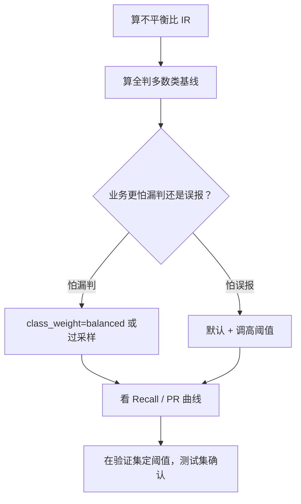

# ML-032 类别不平衡处理

## 1. 本节学习目标

1. 能识别不平衡的严重程度，并知道"全判多数类"基线怎么算。
2. 会用 `class_weight="balanced"` 与手工过采样。
3. **理解"提升召回可能拉低 F1"**（本课实测：F1 从 0.545 掉到 0.435）。
4. 知道重采样必须在训练折内做，测试集绝不能动。

## 2. 为什么需要这个知识

因为现实数据几乎都是不平衡的：欺诈 0.1%、疾病 2%、流失 5%。

在小类上，模型的最优策略是"永远预测多数类"——准确率极高、毫无用处。要让它"看见"小类，必须改变**代价结构**（加权）或**样本分布**（重采样）。

但这两件事都有代价：本课实测 `class_weight="balanced"` 把召回从 0.469 拉到 0.844，却把精确率从 0.652 压到 0.293，**F1 反而下降**。这个反直觉结果是本节的核心。

## 3. 直观解释

不平衡的三种应对：

| 思路 | 做法 | 改动什么 |
|---|---|---|
| **算法层** | `class_weight="balanced"` | 改损失权重 |
| **数据层** | 过采样小类 / 欠采样大类 | 改样本分布 |
| **决策层** | 调阈值（见 ML-030） | 改判定规则 |

**为什么加权能提升召回**：给小类更高的误分代价，模型为了少犯"漏判"，会把更多样本判为小类。

**代价**：误报变多 ⇒ 精确率下降。

## 4. 正式定义

**不平衡比**

$$
\text{IR} = \frac{N_{\text{majority}}}{N_{\text{minority}}}
$$

本课：训练集 1326 : 74 ⇒ **IR ≈ 17.9**

**类别权重（balanced）**

$$
w_c = \frac{n}{K\cdot n_c}
$$

小类 $n_c$ 小 ⇒ $w_c$ 大 ⇒ 损失里小类的样本被放大。

**重采样**

- 过采样（oversampling）：复制/生成小类样本。
- 欠采样（undersampling）：丢弃多数类样本。

**评价指标（不平衡下必看）**

$$
\text{Precision}=\frac{TP}{TP+FP},\quad \text{Recall}=\frac{TP}{TP+FN},\quad F_1=\frac{2PR}{P+R}
$$

## 5. 核心原理

**为什么准确率在这里失效**：本课"全判多数类"的准确率 **0.9467**，而默认模型 0.9583——只高 1.2 个百分点，但 F1 是 0 vs 0.545。

**为什么 F1 可能下降**：F1 是 $P$ 与 $R$ 的调和平均。当精确率从 0.652 掉到 0.293（−55%），召回从 0.469 升到 0.844（+80%），因为**基数太小**（正类只有 32 个），精确率的绝对下降更"伤" F1。

**结论**：**"平衡"不等于"F1 更高"**。选哪个取决于业务代价：

- 宁可错杀（筛查）⇒ 用 balanced，看召回。
- 不能误报（自动扣款）⇒ 用默认，看精确率。
- 要综合 ⇒ 用 PR 曲线选阈值（见 ML-045）。

## 6. 数学表达式

**本课实验**（`make_classification`，2000 样本，weights=[0.95,0.05]）

训练分布 $[1326,\ 74]$，测试分布 $[568,\ 32]$。

| 方法 | 准确率 | Precision | Recall | F1 |
|---|---|---|---|---|
| 默认 | **0.9583** | **0.652** | 0.469 | **0.545** |
| `class_weight="balanced"` | 0.8833 | 0.293 | **0.844** | 0.435 |
| 全判多数类 | 0.9467 | 0.000 | 0.000 | 0.000 |
| 手工过采样（2652 条） | 0.8850 | 0.292 | 0.812 | 0.430 |

**读法**：

- 默认模型 F1 最高（0.545），但召回只有 0.469——漏掉一半以上正类。
- balanced 把召回拉到 0.844，但精确率崩到 0.293。
- 过采样与 balanced 效果几乎一样（F1 0.430 vs 0.435），说明**两种思路在这里等价**。

## 7. 数学库链接

| 用到的数学 | 对应篇目 | 用在哪 |
|---|---|---|
| 期望与加权 | [[MATH-306 期望、方差与协方差]] | 类别权重是加权损失 |
| 条件概率 | [[MATH-301 概率基础与条件概率]] | P/R 的条件概率含义 |

## 8. 算法执行流程



## 9. 可视化解释

```text
默认：只抓一半正类         balanced：抓八成，但误报多
正类 ●●●●●●             正类 ●●●●●●●●
抓到  ●●●                抓到  ●●●●●●●●
漏掉    ●●●              漏掉        ●●
误报   ●                 误报  ●●●●●●●
```

## 10. Python 实现

```powershell
python ml032_imbalance.py
```

```python
import numpy as np
from sklearn.datasets import make_classification
from sklearn.dummy import DummyClassifier
from sklearn.linear_model import LogisticRegression
from sklearn.metrics import accuracy_score, f1_score, precision_score, recall_score
from sklearn.model_selection import train_test_split
from sklearn.pipeline import Pipeline
from sklearn.preprocessing import StandardScaler

X, y = make_classification(n_samples=2000, weights=[0.95, 0.05],
                           n_features=10, random_state=42)
X_train, X_test, y_train, y_test = train_test_split(
    X, y, test_size=0.3, random_state=42, stratify=y)
print("训练分布:", np.bincount(y_train).tolist())
print("测试分布:", np.bincount(y_test).tolist())

base = Pipeline([("sc", StandardScaler()),
                 ("lr", LogisticRegression(max_iter=1000))]).fit(X_train, y_train)
balanced = Pipeline([("sc", StandardScaler()),
                     ("lr", LogisticRegression(max_iter=1000, class_weight="balanced"))]).fit(X_train, y_train)
dummy = DummyClassifier(strategy="most_frequent").fit(X_train, y_train)

for name, model in (("默认", base), ("class_weight=balanced", balanced),
                    ("全判多数类", dummy)):
    pred = model.predict(X_test)
    print(f"{name:<22} acc={accuracy_score(y_test, pred):.4f} "
          f"P={precision_score(y_test, pred, zero_division=0):.3f} "
          f"R={recall_score(y_test, pred, zero_division=0):.3f} "
          f"F1={f1_score(y_test, pred, zero_division=0):.3f}")

# 手工过采样（仅训练集）
rng = np.random.default_rng(42)
pos = X_train[y_train == 1]
neg = X_train[y_train == 0]
pos_up = pos[rng.integers(0, len(pos), len(neg) - len(pos))]
X_up = np.vstack([X_train, pos_up])
y_up = np.concatenate([y_train, np.ones(len(pos_up))])

over = Pipeline([("sc", StandardScaler()),
                 ("lr", LogisticRegression(max_iter=1000))]).fit(X_up, y_up)
pred = over.predict(X_test)
print(f"过采样({len(y_up)}条) acc={accuracy_score(y_test, pred):.4f} "
      f"P={precision_score(y_test, pred, zero_division=0):.3f} "
      f"R={recall_score(y_test, pred, zero_division=0):.3f} "
      f"F1={f1_score(y_test, pred, zero_division=0):.3f}")
```

**实际运行结果**

```
训练分布: [1326, 74]
测试分布: [568, 32]
默认                     acc=0.9583 P=0.652 R=0.469 F1=0.545
class_weight=balanced    acc=0.8833 P=0.293 R=0.844 F1=0.435
全判多数类                  acc=0.9467 P=0.000 R=0.000 F1=0.000
过采样(2652条)            acc=0.8850 P=0.292 R=0.812 F1=0.430
```

## 11. 代码逐行解释

| 代码 | 作用 |
|---|---|
| `weights=[0.95, 0.05]` | 制造 19:1 不平衡 |
| `class_weight="balanced"` | 按类频率自动加权 |
| `DummyClassifier(strategy="most_frequent")` | **基线**，永远预测多数类 |
| `pos[rng.integers(...)]` | 有放回抽样实现过采样 |
| `np.vstack([X_train, pos_up])` | 只对**训练集**扩充 |

**最关键的一行是 `DummyClassifier`**：它给 0.9467 的"准确率"，却 F1=0。**任何模型都必须先打赢这个基线**，否则等于没学到东西。

## 12. 实际运行结果

见第 10 节。三点：

1. 默认模型准确率最高（0.9583），但召回仅 0.469——**漏掉一半以上正类**。
2. balanced 把召回提到 0.844，精确率掉到 0.293 ⇒ **F1 反而降到 0.435**。
3. 过采样与 balanced 效果几乎相同（F1 0.430 vs 0.435），说明"加权"与"复制样本"在逻辑回归上等效。

## 13. 适用场景

| 业务 | 选择 |
|---|---|
| 疾病筛查（怕漏诊） | balanced / 过采样，看召回 |
| 欺诈拦截（怕误伤） | 默认 + 高阈值，看精确率 |
| 需要综合 | PR 曲线选阈值，看 F1 或 $F_\beta$ |
| 数据量足够 | 过采样/欠采样 |
| 数据量小 | 用 `class_weight`（不复制样本） |

## 14. 优点与缺点

| 方法 | 优点 | 缺点 |
|---|---|---|
| `class_weight` | 不改数据、快 | 只影响损失，不改变分布 |
| 过采样 | 直接改变分布 | 复制样本易过拟合 |
| 欠采样 | 训练快 | 丢信息 |
| 调阈值 | 不重训、最灵活 | 需业务定代价 |
| SMOTE（未装） | 生成新样本 | 可能生成噪声点 |

## 15. 常见错误

| 错误 | 表现 | 纠正 |
|---|---|---|
| 在划分前重采样 | **严重泄漏**（同一样本进训练和测试） | 只在训练折内做 |
| 对测试集过采样 | 指标虚高 | 测试集保持原分布 |
| 用准确率评价 | 全判多数类也有 0.9467 | 看 P/R/F1/AUC |
| 认为平衡一定更好 | 本课 F1 从 0.545 掉到 0.435 | 按业务选指标 |
| 忘了基线 | 不知道模型有没有用 | 先跑 Dummy |
| 过采样后不调阈值 | 概率整体偏移 | 重新校准/调阈值 |

## 16. 本节总结

- 不平衡下**先算基线**（全判多数类），再谈模型好坏。
- 两条路：改损失权重（`class_weight`）或改分布（重采样）；本课两者效果相当。
- **"平衡"不等于"F1 更高"**——代价是精确率下降，选哪个看业务。

## 17. 前置与后续

- 前置：[[ML-031 多分类策略]]、[[ML-030 决策边界与分类阈值]]
- 后续：`ML-043 混淆矩阵与分类指标`（待建）、`ML-045 PR 曲线与阈值选择`（待建）
- 相关数学：[[MATH-306 期望、方差与协方差]]、[[MATH-301 概率基础与条件概率]]

## 18. 练习与参考答案

**基础 1**：不平衡数据上，为什么不能只看准确率？

**基础 2**：本课"全判多数类"的准确率与 F1 各是多少？

**进阶 1**：为什么 `class_weight="balanced"` 会让 F1 下降？

**综合 1**：若业务是"信用卡欺诈拦截，人工复核成本低"，你选哪个配置？

> [!success]- 参考答案

> **基础 1**
> 因为多数类占比极高时，"永远预测多数类"就能拿到很高的准确率。本课全判多数类准确率 **0.9467**，但它 F1=0、召回=0，完全没用。
> 准确率把"两类错误"混在一起平均，掩盖了小类的失败。

> **基础 2**
> 准确率 **0.9467**（568/600），F1 **0.000**（一个正类都没抓到）。

> **进阶 1**
> `balanced` 把决策推向"多判正类"：召回从 0.469 升到 0.844，但精确率从 0.652 崩到 0.293。
> F1 是调和平均，对小数值更敏感：精确率相对下降 55%，大于召回相对上升 80% 在调和平均里的贡献（且分母只有 32 个正类，波动大）。
> 所以"提高召回"不一定提高 F1——**F1 隐含了"P 与 R 同等重要"的假设**，而业务未必如此。

> **综合 1**
> 选 **`class_weight="balanced"`**（或过采样）。
> 理由：人工复核成本低 ⇒ 误报（假阳）代价小；漏判（假阴，真欺诈放过）代价高。
> 此时应看**召回 0.844**（抓到 84% 欺诈），接受精确率 0.293（复核量大但可控）。
> 进一步：用 PR 曲线选阈值，在召回 0.8 附近找精确率的拐点，把复核量压到可承受范围。

---

## 🔗 Notion 同步信息

> 以下内容由 Notion「AI Knowledge System · 知识点」数据库按知识 ID 合并而来（导出于 2026-11-09）。

| 属性 | 值 |
|---|---|
| 学科 | 机器学习 |
| 学习状态 | 未开始 |
| 难度 | L3 推导 |
| 知识类型 | Technique |

- **所属模块**：[M-ML-04 监督学习——分类](../%E8%AF%BE%E7%A8%8B%E6%A8%A1%E5%9D%97/M-ML-04%20%E7%9B%91%E7%9D%A3%E5%AD%A6%E4%B9%A0%E2%80%94%E2%80%94%E5%88%86%E7%B1%BB.md)
- **前置知识**：[ML-031 多分类策略](ML-031%20%E5%A4%9A%E5%88%86%E7%B1%BB%E7%AD%96%E7%95%A5.md)
- **后继知识**：[ML-033 无监督学习基本概念](../03%20%E6%97%A0%E7%9B%91%E7%9D%A3%E5%AD%A6%E4%B9%A0/ML-033%20%E6%97%A0%E7%9B%91%E7%9D%A3%E5%AD%A6%E4%B9%A0%E5%9F%BA%E6%9C%AC%E6%A6%82%E5%BF%B5.md)
- **关联Python**：[PY-067 聚合与统计](../../01_Python%E5%9F%BA%E7%A1%80/08%20NumPy/PY-067%20%E8%81%9A%E5%90%88%E4%B8%8E%E7%BB%9F%E8%AE%A1.md)
- **关联数学**：[MATH-306 期望、方差与协方差](../../06_%E6%95%B0%E5%AD%A6%E5%9F%BA%E7%A1%80/03%20%E6%A6%82%E7%8E%87%E8%AE%BA/MATH-306%20%E6%9C%9F%E6%9C%9B%E3%80%81%E6%96%B9%E5%B7%AE%E4%B8%8E%E5%8D%8F%E6%96%B9%E5%B7%AE.md)
