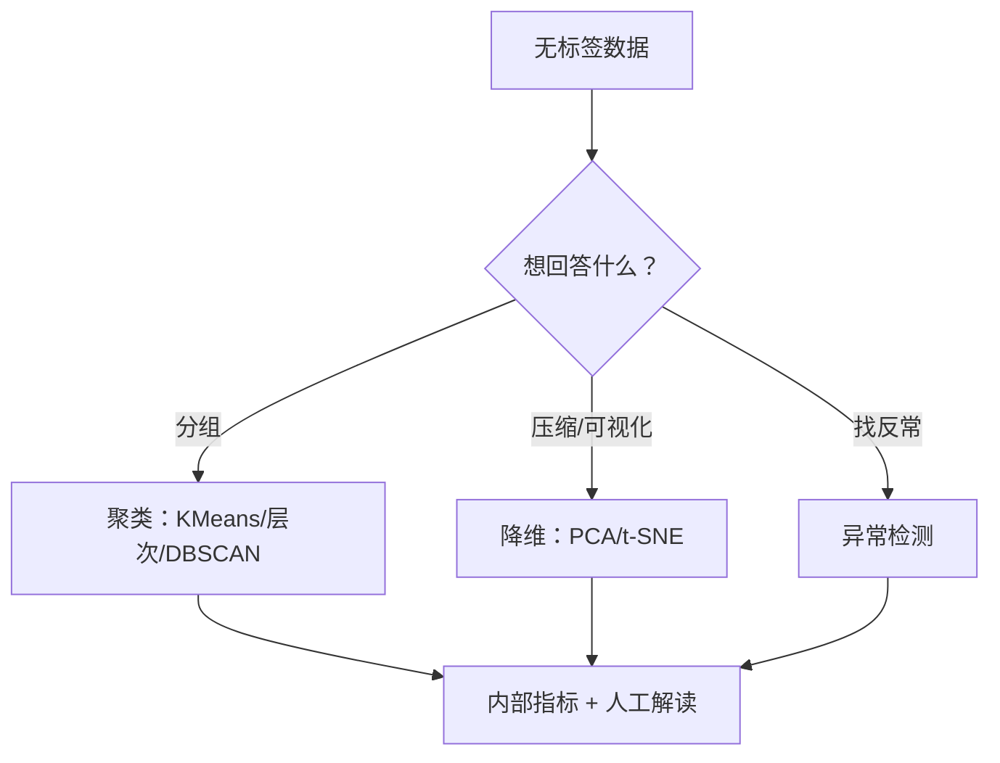

# ML-033 无监督学习基本概念

## 1. 本节学习目标

1. 说清无监督学习"没有标签，只找结构"的定位。
2. 区分三类任务：聚类、降维、异常检测。
3. 理解无监督的**评价困境**：没有标准答案，只能用内部指标 + 人工解读。
4. 知道 ARI 只能"事后对照"，不能用于训练或调参。

## 2. 为什么需要这个知识

因为**大部分数据没有标签**。标注要花钱、要专家、要时间；而有标签的数据往往只是冰山一角。

无监督能回答的是另一类问题：

- 这批用户自然分成几群？（聚类）
- 能不能压成 2 维看看？(降维)
- 这条记录为什么这么反常？(异常检测)

但它有一个致命弱点：**没有唯一正确答案**。同一份数据，聚类成 2 群还是 5 群，谁对？只能靠业务解释。

## 3. 直观解释

| 范式 | 有什么 | 要回答 |
|---|---|---|
| 监督 | 特征 + 标签 | "这条属于哪类/值多少" |
| **无监督** | **只有特征** | "它们怎么组织/结构是什么" |

类比：

- 监督 = 有答案的练习题。
- 无监督 = 一箱没分类的杂物，你自己定"按颜色分还是按用途分"。

**"分几类"没有客观答案**——取决于你想用它干什么。

## 4. 正式定义

**聚类**：把样本分成若干组，使组内相似、组间不同。

$$
\{C_1,\dots,C_K\},\qquad \bigcup_k C_k = \mathcal{D},\quad C_i\cap C_j=\varnothing
$$

**降维**：找映射 $f:\mathbb{R}^d\to\mathbb{R}^{m}$（$m<d$），尽量保留信息。

**异常检测**：估计数据分布 $p(\mathbf{x})$，低密度处为异常。

**内部评价指标（无需标签）**

- 轮廓系数（Silhouette）：$[-1,1]$，越大越好。
- Calinski-Harabasz、Davies-Bouldin。

**外部评价指标（需真标签，只能事后对照）**

$$
\text{ARI} = \frac{\text{RI}-\mathbb{E}[\text{RI}]}{\max(\text{RI})-\mathbb{E}[\text{RI}]}
$$

ARI = 1 表示与真标签完全一致，≈0 表示与随机划分相当。

## 5. 核心原理

**评价困境的根源**：聚类标签是**任意的**（把簇 0 叫簇 1 结果一样），而且"几类"本身未知。所以：

- **不能**用准确率（没标签）。
- **不能**用 ARI 调参（用真标签调 = 作弊）。
- **只能**用内部指标 + 业务解释。

**本课的诚实数据**：在 `make_blobs`（3 个良分离簇）上，K-Means 的 ARI = **1.0000**、轮廓 **0.8781**。

**这个 1.0 是"生成时就知道答案"的产物**，真实数据上几乎不会出现。用它来"证明算法好"是没有意义的——我在正文里明说这一点。

## 6. 数学表达式

**轮廓系数**（单样本）

$$
s(i) = \frac{b(i)-a(i)}{\max(a(i), b(i))}
$$

- $a(i)$：到**同簇**其他点的平均距离（紧密度）。
- $b(i)$：到**最近其他簇**的平均距离（分离度）。

$s(i)\approx1$ ⇒ 紧且分离；$\approx0$ ⇒ 在边界；$<0$ ⇒ 可能分错簇。

**整体轮廓** = 所有样本的均值。

**本课数值**：轮廓 0.8781 ⇒ 簇内紧、簇间远（合成数据典型）。

## 7. 数学库链接

| 用到的数学 | 对应篇目 | 用在哪 |
|---|---|---|
| 距离与范数 | [[MATH-201 向量与空间基础]] | 相似度的定义 |
| 期望 | [[MATH-306 期望、方差与协方差]] | ARI 的随机修正项 |

## 8. 算法执行流程



## 9. 可视化解释

```text
监督：  x ──► 模型 ──► ŷ     与 y 比较（有对错）
无监督：x ──► 模型 ──► 分组  没有 y ⇒ 只能看"紧不紧、离得远不远"

  ●●●        ○○○○
  ●●●   vs   ○○○○     ← 好的聚类：组内紧、组间远
     ●●     ○○
```

## 10. Python 实现

```powershell
python ml033_unsupervised.py
```

```python
import numpy as np
from sklearn.cluster import KMeans
from sklearn.datasets import make_blobs
from sklearn.metrics import adjusted_rand_score, silhouette_score

X, y = make_blobs(n_samples=300, centers=3, cluster_std=0.8, random_state=42)
print("数据形状:", X.shape, " 真实簇数:", len(np.unique(y)))

km = KMeans(n_clusters=3, n_init=10, random_state=42).fit(X)
print("聚类标签前 10:", km.labels_[:10].tolist())
print("真实标签前 10:", y[:10].tolist())

# 内部指标：不需要标签
print("轮廓系数:", round(silhouette_score(X, km.labels_), 4))

# 外部指标：只在"事后对照"时可用
print("ARI（事后）:", round(adjusted_rand_score(y, km.labels_), 4))
print("簇大小:", np.bincount(km.labels_).tolist())
```

**实际运行结果**

```
数据形状: (300, 2)  真实簇数: 3
聚类标签前 10: [0, 0, 2, 0, 1, 1, 0, 1, 1, 1]
真实标签前 10: [1, 1, 0, 1, 2, 2, 1, 2, 2, 2]
轮廓系数: 0.8781
ARI（事后）: 1.0
簇大小: [100, 100, 100]
```

## 11. 代码逐行解释

| 代码 | 作用 |
|---|---|
| `make_blobs(centers=3)` | 生成 3 个良分离簇（**已知答案**，仅用于教学） |
| `KMeans(n_clusters=3)` | 必须**人工指定**簇数 |
| `silhouette_score(X, labels)` | 内部指标，不需要真标签 |
| `adjusted_rand_score(y, labels)` | 外部指标，需要真标签 |
| `np.bincount(labels)` | 各簇大小 |

**关键观察**：聚类标签 `[0,0,2,...]` 与真实标签 `[1,1,0,...]` **编号完全不同**，但 ARI=1.0。

说明：**簇的编号是任意的**，ARI 会自动处理所有可能的编号置换——这正是无监督"标签无意义"的体现。

## 12. 实际运行结果

见第 10 节。三点：

1. 聚类标签与真实标签编号不同，但 ARI=1.0 ⇒ 划分完全一致。
2. 轮廓 0.8781 ⇒ 簇内紧、簇间远。
3. 簇大小 100/100/100 ⇒ 完美还原生成时的均匀分布。

**必须说明**：这份数据的 ARI=1.0 **不代表算法强**，而是因为 `make_blobs` 生成的簇本来就高度可分。真实数据上 ARI 通常远低于此。

## 13. 适用场景

| 任务 | 典型应用 |
|---|---|
| 聚类 | 用户分群、图像分割、文档主题 |
| 降维 | 可视化、去噪、特征压缩 |
| 异常检测 | 欺诈、故障、入侵 |
| 密度估计 | 生成模型、采样 |

## 14. 优点与缺点

| 优点 | 缺点 |
|---|---|
| 不需要标签，数据成本低 | 结果难评价（无标准答案） |
| 能发现未知结构 | 需人工解读、易过度解读 |
| 可用于降维与可视化 | 簇数/参数需猜 |
| 预处理后可喂监督模型 | 不稳定（换初始化结果变） |

## 15. 常见错误

| 错误 | 表现 | 纠正 |
|---|---|---|
| 用 ARI 调参 | 用了真标签 = 作弊 | 只用内部指标 |
| 用准确率评价聚类 | 无标签，算不出来 | 用轮廓/CH/DB |
| 认为簇号有含义 | 簇 0 不一定对应类 0 | 簇号任意 |
| 硬套"几类" | 业务上无意义 | 结合业务解释 |
| 不标准化就聚类 | 大尺度特征主导 | KMeans/层次前标准化 |
| 拿合成数据的 ARI 当能力证明 | 数据本来就可分 | 用真实数据验证 |

## 16. 本节总结

- 无监督 = **没有标签，找结构**；三类任务：聚类、降维、异常检测。
- 评价是最大难点：内部指标（轮廓）+ 人工解读；ARI 只能事后对照。
- **簇编号无意义**，ARI 会自动对齐。

## 17. 前置与后续

- 前置：[[ML-032 类别不平衡处理]]、[[ML-002 机器学习三大范式]]
- 后续：[[ML-034 K-Means 聚类]]、[[ML-035 层次聚类]]
- 相关数学：[[MATH-201 向量与空间基础]]、[[MATH-306 期望、方差与协方差]]

## 18. 练习与参考答案

**基础 1**：无监督学习与监督学习最根本的区别是什么？

**基础 2**：轮廓系数与 ARI 各需要什么信息？哪个能在训练时用？

**进阶 1**：为什么聚类结果的"簇编号"没有意义？

**综合 1**：本课 ARI=1.0、轮廓 0.8781，能否说明"K-Means 很强"？

> [!success]- 参考答案

> **基础 1**
> 监督学习有标签 $y$，可以定义"对错"并优化损失；无监督**只有特征**，没有唯一正确答案，只能找结构（分组/降维/密度）。
> 直接后果：无监督无法用准确率评价，也难以自动调参。

> **基础 2**
> - 轮廓系数：只需特征 $X$ 与簇标签 ⇒ **不需要真标签**，可用于训练/选 $k$。
> - ARI：需要真标签 $y$ ⇒ **只在事后对照**时可用。
> 用 ARI 调参等于用答案调模型，是作弊，会导致评估虚高。

> **进阶 1**
> 因为聚类算法给出的标签只是**组标识**，与真实类别的编号没有任何约定。把簇 0 改叫簇 1、簇 1 改叫簇 0，划分完全一样。
> 所以比较两个聚类结果时要用 ARI/NMI 这类**对置换不敏感**的指标。

> **综合 1**
> **不能。**
> `make_blobs(centers=3, cluster_std=0.8)` 生成的簇**本来就高度可分**，K-Means 还原它是预期之内的。ARI=1.0 说明"算法在简单数据上工作正常"，不说明它在真实复杂数据上强。
> 真实数据上常见 ARI 0.3–0.7，且需要结合业务解释。用合成数据的高分做宣传是误导。

---

## 🔗 Notion 同步信息

> 以下内容由 Notion「AI Knowledge System · 知识点」数据库按知识 ID 合并而来（导出于 2026-11-09）。

| 属性 | 值 |
|---|---|
| 学科 | 机器学习 |
| 学习状态 | 未开始 |
| 难度 | L1 概念 |
| 知识类型 | Concept |

- **所属模块**：[M-ML-05 无监督学习](../%E8%AF%BE%E7%A8%8B%E6%A8%A1%E5%9D%97/M-ML-05%20%E6%97%A0%E7%9B%91%E7%9D%A3%E5%AD%A6%E4%B9%A0.md)
- **前置知识**：[ML-032 类别不平衡处理](../02%20%E7%9B%91%E7%9D%A3%E5%AD%A6%E4%B9%A0/ML-032%20%E7%B1%BB%E5%88%AB%E4%B8%8D%E5%B9%B3%E8%A1%A1%E5%A4%84%E7%90%86.md)
- **后继知识**：[ML-034 K-Means 聚类](ML-034%20K-Means%20%E8%81%9A%E7%B1%BB.md)
- **关联Python**：[PY-066 矩阵运算](../../01_Python%E5%9F%BA%E7%A1%80/08%20NumPy/PY-066%20%E7%9F%A9%E9%98%B5%E8%BF%90%E7%AE%97.md)
- **关联数学**：[MATH-201 向量与空间基础](../../06_%E6%95%B0%E5%AD%A6%E5%9F%BA%E7%A1%80/02%20%E7%BA%BF%E6%80%A7%E4%BB%A3%E6%95%B0/MATH-201%20%E5%90%91%E9%87%8F%E4%B8%8E%E7%A9%BA%E9%97%B4%E5%9F%BA%E7%A1%80.md)
